# Kush 1.1 — last-kushos

Kush 1.1 is ReactOS (master, commit `344ebfe5`) with a Sudanese identity and the
fixes needed to boot on UEFI-only hardware (Acer). **المستودع الموحد: المصدر في main ونسخ ISO التجريبية في Releases.**

## What's in this repo

**This repo is the complete Kush 1.1 source tree**: ReactOS master commit `344ebfe5`
plus every Kush 1.1 modification, so it builds on its own (no separate ReactOS clone).
(The upstream ReactOS CI workflows are not included. Kush has its own manually triggered workflow.)

**المستودع ده فيه النظام كامل:** كود ReactOS (commit `344ebfe5`) ومعاه كل تعديلات Kush 1.1. بتعمل clone
للمستودع ده بس وبتبني على طول.

Build (Linux, mingw-w64 **posix** toolchain, cmake, ninja, bison, flex, libgmp-dev):

1. `git clone https://github.com/eltaieb-eltalib/insticnt-kush-os.git last-kushos && mkdir build && cd build`
2. `cmake -G Ninja -DARCH=amd64 -DCMAKE_BUILD_TYPE=Release -DCMAKE_TOOLCHAIN_FILE=../last-kushos/toolchain-gcc.cmake -DENABLE_CCACHE=0 -DDLL_EXPORT_VERSION=0x600 ../last-kushos`
3. `ninja bootcd` → `bootcd.iso` (or use RosBE x86_64: `configure.sh` then `ninja bootcd`).
4. Make a GPT USB image (1.5 GB, one EFI System partition, FAT32) and copy
   `uefildr.efi` to `EFI/BOOT/BOOTX64.EFI`, `freeldr.ini` to the root, and the
   `reactos` tree. Write it with Rufus in DD mode, UEFI only, Secure Boot off.

## WoW64: برامج 32-bit بقت شغالة على Kush (24 نوفمبر 2026)

دمجنا شغل WoW64 من فرع [`TheNNX/reactos` wow64sync](https://github.com/TheNNX/reactos/tree/wow64sync) وصلّحنا 28 مشكلة من جذورها
(من ntdll والكيرنل لحد user32 وwin32k). النتيجة على QEMU:
- `SysWOW64\cmd.exe` (نسخة x86) شغال ✅
- `wow64test.exe`: نجح **12/12** ✅ (ملفات، ذاكرة، خيوط، SEH، CreateProcess، ريجستري)
- نافذة 32-bit بزرار وcombobox وMessageBox ✅

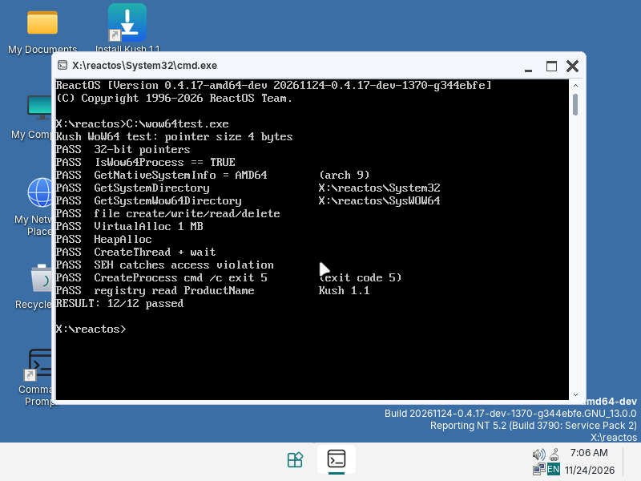

**وكمان: برنامج التثبيت الرسمي `Firefox Setup.exe` (‏32-bit) اتثبّت بالضغط على Next لحد الآخر، وFirefox اشتغل:**

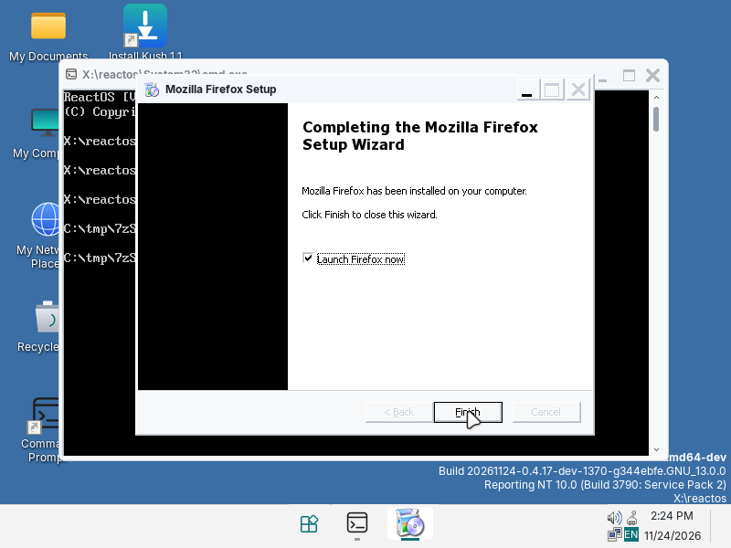 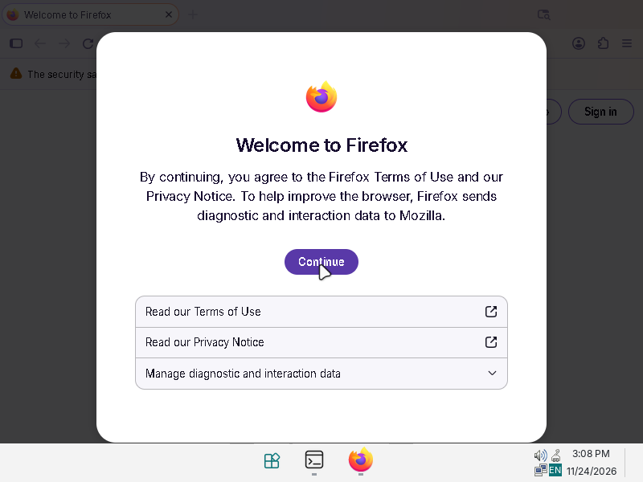

**وبعد كده:** الدبل كليك على `Firefox Setup.exe` بقى بيشغّل المعالج لوحده، وزرار **"Launch Firefox now"** في الآخر بيفتح Firefox
(إصلاح محاذاة الـ stack للبرامج الـ 64-bit اللي بيشغّلها برنامج 32-bit، وتمرير `GetLastError` بين الـ TEB الاتنين):

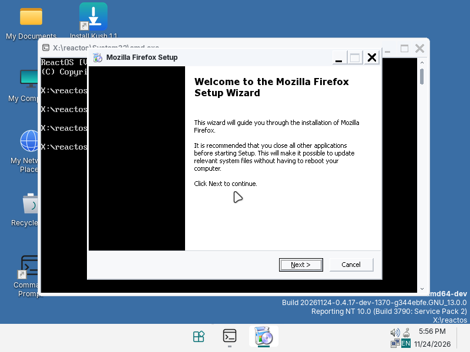 

**والاختبار الحقيقي:** Firefox المتثبّت بحث في Google عن "ok" وظهرت النتايج:

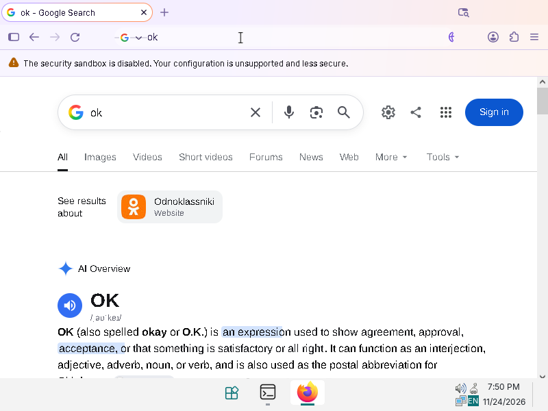

عشان نوصل للنقطة دي اتصلحت 30 مشكلة من جذورها. من أهمها خطأ في الكيرنل نفسه كان بيعمل شاشة زرقا لأي خطأ يتمسك بـ SEH جوه الكيرنل،
حتى في برامج 64-bit (‏`.pushframe` كان بيشيل الـ error code). وKush بقى يعلن نفسه Windows 10 (‏10.0.19045) للبرامج اللي بتطلبه.

التفاصيل كلها (المشاكل وأسبابها وحلولها، **والمشاكل اللي لسه ما اتحلّتش**) في [`docs/wow64/README.md`](docs/wow64/README.md).
**مهم:** الـ ISO اللي بيطلع من الـ CI لسه **من غير** WoW64، لأن الـ CI ما فيهوش مترجم i386. عشان تبنيه بـ WoW64:
`-DBUILD_WOW64_ENABLED=1 -DWOW64_MINGW_TOOLCHAIN_SUFFIX=-win32`. لإيقاف WoW64 على جهاز:
`HKLM\SYSTEM\CurrentControlSet\Control\Kush\Wow64` و`Enabled=0`.

## Firefox فتح Google وبحث عن "ok" على Kush (23 نوفمبر 2026)

**النتيجة:** على آخر نسخة من النظام (بناء 20261123 من `main`)، Firefox 160 فتح `google.com`، واتكتب "ok" في البحث، وظهرت النتائج
(`docs/firefox/21-google-home-on-kush.png`، `docs/firefox/22-google-typing-ok.png`، `docs/firefox/23-google-results-ok.png`).
دي أول مرة صفحة ويب حقيقية تترسم في Firefox على Kush (عملية المحتوى بقت شغالة بعد إصلاحات الدمج).

**3 تابات في نفس الوقت:** Google، وويكيبيديا العربية، و BBC عربي، كلها اتفتحت واترسمت، والعربي ظاهر صح من اليمين لليسار
(`docs/firefox/24-three-tabs-google.png`، `docs/firefox/25-three-tabs-ar-wikipedia.png`، `docs/firefox/26-three-tabs-bbc-arabic.png`).

**طريقة وجود Firefox على Kush (ما اتثبت ببرنامج التثبيت):** ملف `Firefox Setup 160.0.1.exe` نفسه 32-bit (غلاف NSIS) وKush 64-bit
من غير WoW64، فبيطلع "Machine Type Mismatch". عشان كده اتفك بـ `7z`، واتنسخ مجلد `core` (فيه `firefox.exe` 64-bit) لـ
`C:\Firefox`، وبيشتغل من هناك مباشرة زي النسخة المحمولة.

| # | المشكلة | السبب | الحل |
|---|---|---|---|
| 1 | تحذير `SEC_ERROR_UNKNOWN_ISSUER` في google.com | **من بيئة الاختبار، مش من Kush:** الـ proxy بتاع بيئتي بيعيد إصدار الشهادات بـ CA خاص بيه ("CCR agent-proxy interception CA"). في جهاز حقيقي شهادة Google بتوصل زي ما هي | إعداد اختبار بس جوه الـ VM (ما اترفع للمستودع): `policies.json` بيثبّت شهادة الـ CA دي في نسخة Firefox الاختبارية |
| 2 | **شاشة زرقاء `0x1E`** في `win32k.sys` (`MsqDestroyMessage`) لما ضغطت Alt+Tab وFirefox شغال | use-after-free: أثناء معالجة رسالة كيبورد/ماوس (`co_MsqPeekHardwareMessage`) الـ hooks بتشتغل والقفل مفكوك، ومسار تاني (rawinput، focus، تنظيف نافذة أو thread) ممكن **يمسح نفس الرسالة**. الذاكرة بترجع للـ lookaside وبتتاخد لرسالة جديدة ما اتضافت لقائمة، فالحلقة بتمسح الرسالة الجديدة دي (`Flink = NULL`) | `win32ss/user/ntuser/msgqueue.[ch]`: علامة `InPlay` على الرسالة أثناء المعالجة؛ `MsqDestroyMessage` بيفكها من القائمة بس ويأجل التحرير، والحلقة بتحررها بعد ما تخلص، وبتقرأ الرسالة الجاية من جديد بعد الـ callbacks. **بعد الإصلاح:** Alt+Tab 6 مرات مع Firefox من غير شاشة زرقاء |
| 3 | Firefox بيقفل بعد شوية (`c0000005` في `xul.dll +0x2d9e749`) | الـ stack وداني لـ `nsStandardURL::IsValid` جوه `std::find`، **وكان تخميني الأول "بيانات IPC تالفة" غلط**: اختبار جديد (`tools/ipc_pipe_test/pipetest.c`) بيقلّد قناة Firefox بالظبط (pipe بايتات overlapped، قراية 4KB، IOCP، اتجاهين، بين عمليتين) ونجح في **64MB لكل اتجاه برسائل لحد 1MB من غير ولا بايت غلط**. التعليمة اللي قفلت هي **`vpmaskmovd`** (AVX2): الـ STL بتاع Microsoft بيستعملها لآخر الـ buffer، والمعالج الحقيقي **ما بيعمل fault** على الأجزاء المقنّعة حتى لو في صفحة مش موجودة، لكن **محاكي QEMU (TCG 8.2) بيعمل fault** عليها. يعني **العطل من المحاكي، مش من Kush** | `tools/qemu/run_vm.sh`: المحاكي بيشتغل بـ `-cpu max,-avx2` عشان الـ STL ياخد طريق SSE. **بعد التغيير:** حوالي 17 دقيقة استعمال (بحث، 6 مرات Alt+Tab، تنقل بين 3 تابات، إعادة تحميل) **من غير ولا قفلة** (`docs/firefox/27-no-avx2-stable-three-tabs.png`، `docs/firefox/28-no-avx2-google-ok.png`). على جهازك الحقيقي المشكلة دي ما بتحصل أصلًا |
| 4 | (أداة) ما كان في طريقة نعرف بيها مين نادى الدالة اللي قفلت | | `ntoskrnl/ke/amd64/except.c`: `KUSH-EXC` بقى بيطبع **stack تقريبي** (كل قيمة في الـ stack بتشاور على موديول، كـ module+RVA) عشان يتحول لأسماء دوال بـ `tools/breakpad_sym.py` |

## تنزيل الـ ISO الجديد وحرقه على فلاش (23 نوفمبر 2026)

- **الـ ISO:** بناء GitHub Actions نجح (run 45250069151، commit `d01eefd`): فيه كل إصلاحات UEFI تحت، وإصلاح الشاشة
  الزرقاء مع Alt+Tab (`win32k`)، وطباعة الـ stack في `KUSH-EXC`.
  صفحة البناء: https://github.com/eltaieb-eltalib/last-kushos/actions/runs/45250069151
  تنزيل مباشر (لازم تكون مسجّل دخول في GitHub): https://github.com/eltaieb-eltalib/last-kushos/actions/runs/45250069151/artifacts/14855702776
  (ملف zip حوالي 150MB فيه `bootcd.iso` و`build-sha256.txt`). الرابط صالح لحد **26 نوفمبر 2026، 19:37 UTC**.
- **Rufus:** Device = الفلاش، Boot selection = `bootcd.iso`، **Partition scheme = GPT**، **Target system = UEFI (non CSM)**،
  File system = FAT32. لو سأل ISO أو DD اختار **ISO mode**. وفي الـ BIOS: اقفل **Secure Boot**.
- **التثبيت:** من قائمة الإقلاع اختار **"Kush 1.1 Setup (Text Mode)"** (بقى بيشتغل تحت UEFI) أو **"Kush 1.1 Live Environment"**
  ← "Install Kush 1.1". بعد النسخ لو الجهاز ما عمل إعادة تشغيل لوحده، اقفله وشيل الفلاش وشغّله.
- **مهم:** النسخة القديمة اللي اتجربت على Acer وLenovo (ختم `6b031252`) فيها الأخطاء دي؛ لازم تحرق النسخة الجديدة دي.

## إصلاح الإقلاع على Acer وLenovo من فلاش USB (UEFI)، 23 نوفمبر 2026

**البلاغ:** الفلاش ما بيقلع على Acer ولا Lenovo، وكل الخيارات (التثبيت وLive) بتطلّع
`STOP 0x7E (C0000006) bootvid.dll Address FFFFF8000007B7A1, DateStamp 6b031252`.

| # | المشكلة | السبب | الحل والاختبار |
|---|---|---|---|
| 1 | `0x7E/C0000006` في `bootvid.dll +0x27A1` | الـ ISO المحروق **قديم**: ختمه `6b031252` = 22 نوفمبر 16:03، قبل الإصلاح. `BitBlt` كان بياخد انتقال الصف كرقم موجب (`ULONG`)، فالصور bottom-up بتقفز ~4GB على amd64 | الإصلاح (`Stride` → `LONG` في `drivers/base/bootvid/common.c`) موجود في النسخة المدمجة. اختبار الدالة المباشر (`tools/qemu/test_bootvid_stride.py`) نجح، ومن فلاش USB تحت UEFI **شعار الإقلاع اترسم كامل** في نفس المرحلة اللي كان بيقع فيها (`docs/fixes/2026-11-23-usb-uefi-bootlogo-bootvid-ok.png`) |
| 2 | بعد إصلاح 1: الإقلاع من USB تحت UEFI **بيعلّق** بعد تحميل الـ drivers (`docs/fixes/2026-11-23-usb-uefi-hang-before-fix.png`) | **bug في driver الـ SATA `storahci`:** لما الجهاز يرجع خطأ (`PxIS.TFES` = `0x40000000`)، الـ driver كان بيطبع "Fatal Error" بس، **ما بيمسح الـ bit ولا بيعمل recovery**، فالـ interrupt بيرجع للأبد (**358,048 رسالة** في إقلاع واحد، والسجل وصل 72MB)، والأمر الفاشل ما بيكتمل أبدًا. أي خطأ ATAPI (زي DVD أو card reader فاضي) بيعمل كده | `drivers/storage/port/storahci/storahci.c`: recovery حسب **AHCI 1.3 القسم 6.2.2.1**: مسح bits الخطأ، وإيقاف المنفذ (`ST=0`، والانتظار لحد `CR=0`)، ومسح `SERR`، وإعادة تشغيله، وإنهاء الأوامر الفاشلة بـ `SRB_STATUS_ERROR` عشان الـ class driver يعيد المحاولة، وبعدها تشغيل الأوامر المنتظرة. **بعد الإصلاح:** 24 رسالة بس (كل خطأ اتعالج مرة)، و**Kush قلع من فلاش USB (xHCI) تحت UEFI لحد شاشة الترحيب** (`docs/fixes/2026-11-23-usb-uefi-after-storahci-fix.png`) |

| 3 | خيار التثبيت النصي **"Kush 1.1 Setup (Text Mode)"** من فلاش USB تحت UEFI: شاشة زرقاء `0x7B (C0000010)` | **السبب الجذري:** الـ kernel بيجرب أنظمة الملفات بالترتيب (Ntfs ← btrfs ← fastfat). `ntfs` في فحص التركيب (`NtfsHasFileSystem`) كان بيستعمل `IOCTL_DISK_GET_PARTITION_INFO` القديم، اللي **بيشتغل على MBR بس**، وفي قسم **GPT** (فلاش Rufus لـ UEFI) بيرجع `STATUS_INVALID_DEVICE_REQUEST` = `C0000010`. `IopMountVolume` بيعتبر الخطأ ده عطل في الجهاز وبيوقف قبل ما يوصل `fastfat`، فبيحصل bugcheck. الـ Live كان شغال لأن ترتيب تحميل الـ drivers فيه مختلف | `drivers/filesystems/ntfs/fsctl.c`: استعمال `IOCTL_DISK_GET_PARTITION_INFO_EX` (بيشتغل مع MBR وGPT)، وفي GPT القرار لـ boot sector، وأي فشل بيرجع `STATUS_UNRECOGNIZED_VOLUME` عشان النظام يجرب النظام اللي بعده. **بعد الإصلاح:** التثبيت النصي قلع من فلاش GPT تحت UEFI من غير 0x7B |
| 4 | التثبيت الرسومي من Live تحت UEFI: **إعداد الشاشة الافتراضي "VGA Display (640x480x4)"**، يعني بعد التثبيت الشاشة بتبقى سودا على أجهزة UEFI (ما فيها VGA قديم) | تحت UEFI الـ firmware ما بيرجع اسم شاشة معروف في `[Map.Display]`، فالمصفوفة `DisplayKey` في `CreateDisplayDriverList` كانت **بتفضل من غير قيمة**، والاختيار بيقع على أول عنصر (VgaSave) | `base/setup/lib/settings.c`: القيمة الافتراضية بقت `vbe` (driver الـ VBE/GOP)، و`boot/bootdata/txtsetup.sif`: إضافة `vbe = "VGA Display"` في `[Map.Display]`. ✅ **اتأكد:** بالـ ISO الجديد التثبيت النصي تحت UEFI اختار **VESA Display (800x600x32)** لوحده (`docs/fixes/2026-11-23-uefi-textsetup-vesa-default.png`) |
| 5 | تحذير **"No supported system partition"**، والتثبيت ما بيكمل على قرص NVMe فاضي تحت UEFI | `partlist.c` بيدور على "القرص اللي الـ firmware بيقلع منه" عن طريق BIOS، وتحت UEFI مافي قرص زي ده، فكان بيرفض كل الأقراص | `base/setup/lib/utils/partlist.c`: لو مافي قرص بديل من الـ firmware، بيقبل القرص المختار كقرص النظام. فضل تحذير "may not be bootable" (تحذير بس، وبيكمل بـ OK) (`docs/fixes/2026-11-23-setup-no-system-partition-uefi.png`) |
| 6 | بعد التثبيت على UEFI مافي **loader يقلع منه الجهاز** | برنامج التثبيت بيكتب `freeldr` بس (طريقة BIOS) | `base/setup/lib/bootsup.c`: بعد rosload بيتنسخ `efi\boot\bootx64.efi` من وسيط التثبيت لـ `\EFI\BOOT\BOOTX64.EFI` في قرص النظام (المسار الافتراضي اللي أي UEFI بيقلع منه من غير ما يحتاج NVRAM) |
| 7 | التثبيت النصي تحت UEFI: **شاشة سودا** (بعد إصلاح 3 البرنامج كان شغال لكن ما بيظهر) | `blue.sys` (شاشة التثبيت النصي) بيكتب في ذاكرة VGA النصية (`0xB8000`) وبيبرمج سجلات VGA، والحاجات دي **ما موجودة في أجهزة UEFI** (الشاشة framebuffer بس) | `drivers/setup/blue/blue.c` و`fbfont.c`: لما النظام يقلع من UEFI (الـ HAL ما فيه BIOS، و BootVid شغال)، النص بيتخزن في الذاكرة وكل خانة اتغيرت بتترسم على الـ framebuffer بـ `VidBufferToScreenBlt` (و`lfbbvid` بيكبّرها لدقة الشاشة). نفس شبكة الـ VGA اللي البرنامج متوقعها (80×50)، وبيستعمل خط الـ code page اللي البرنامج بيحمّله، أو خط 8×16 من freeldr. في BIOS ما اتغير أي شي. **بعد الإصلاح:** كل صفحات التثبيت النصي ظاهرة تحت UEFI (`docs/fixes/2026-11-23-uefi-textsetup-gpt-usb-ok.png`، `docs/fixes/2026-11-23-uefi-textsetup-partitions.png`) |
| 8 | تحذير **"The disk ... is not visible by the firmware"** لأي قرص تحت UEFI، ومسار ARC للنظام المثبت بيبقى `scsi()` (freeldr ما بيعرفه) | freeldr تحت UEFI بيعدّ كل الأقراص (وبيحسب الـ signature والـ checksum) لكن **ما بينشرها في شجرة الهاردوير** (`DiskController\DiskPeripheral`) زي ما بيعمل في BIOS، فبرنامج التثبيت بيلقى قائمة أقراص الـ firmware فاضية | `boot/freeldr/freeldr/arch/uefi/uefidisk.c` (`UefiDetectDisks`) و`uefihw.c`: نشر الأقراص بنفس شكل BIOS. **بعد الإصلاح:** التحذير اختفى (`docs/fixes/2026-11-23-uefi-textsetup-no-warning.png`) |
| 9 | برنامج التثبيت ما بيعرف إن الجهاز UEFI (كان مكتوب `FIXME: This should be determined at runtime`)، وكان ممكن يختار **الفلاش نفسه** كقرص النظام ويكتب الـ loader عليه | ما كان في طريقة في النظام يعرف بيها أي برنامج نوع الـ firmware | `ntoskrnl/ex/sysinfo.c`: تنفيذ `SystemBootEnvironmentInformation` (class 90) من بيانات الـ loader، وده اللي بيستعمله `GetFirmwareType` كمان (فأي برنامج بيستفيد). `base/setup/lib/utils/partlist.c`: في UEFI مافي "أول قرص BIOS"، فقسم النظام بيتعمل في قرص التثبيت، ما في الفلاش |
| 10 | بعد إصلاح 2: لسه في 24 رسالة "Fatal Error" في كل إقلاع، وتأخير، من مشغل الـ CD الفاضي | الـ recovery كان بينهي الأمر بـ `SRB_STATUS_ERROR` بس، فـ `cdrom.sys` ما بيقدر يفرّق بين "مافي قرص" وعطل حقيقي، فبيعيد المحاولة | `storahci.c`: لأجهزة ATAPI، الـ sense key بيتاخد من سجل الخطأ (`TFD.ERR >> 4`) وبيرجع `CHECK CONDITION` مع sense data (و NOT READY = "medium not present"). **بعد الإصلاح:** 7 رسائل بدل 24، والـ Live قلع من فلاش USB تحت UEFI لحد شاشة الترحيب |

**النتيجة الكاملة تحت UEFI (في المحاكاة):** فلاش GPT ← التثبيت النصي ← نسخ الملفات للقرص الداخلي (NVMe) ← **القرص الداخلي قلع لوحده من غير الفلاش** عن طريق `\EFI\BOOT\BOOTX64.EFI`، ومسار النظام `multi(0)disk(0)rdisk(0)partition(1)\ReactOS` صح (`docs/fixes/2026-11-23-uefi-installed-disk-boots.png`) ← المرحلة التانية من التثبيت اشتغلت من `C:\ReactOS` بشاشة 800×600 (`docs/fixes/2026-11-23-uefi-installed-second-stage.png`). وبعد المرحلة التانية الجهاز **عمل إعادة تشغيل لوحده** (بإصلاح 11) وقلع لحد **سطح مكتب Kush 1.1 من القرص الداخلي تحت UEFI** (`docs/fixes/2026-11-23-uefi-installed-desktop.png`).

| # | المشكلة | السبب | الإصلاح |
|---|---|---|---|
| 11 | في آخر التثبيت النصي الشاشة وقفت على "Flushing cache" وما حصلت إعادة تشغيل (`docs/fixes/2026-11-23-uefi-textsetup-flush-no-reboot.png`) | الـ HAL كان بيعيد التشغيل بطريقة واحدة بس: أمر `0xFE` لمتحكم الكيبورد القديم (8042) في البورت `0x64`. أجهزة UEFI الحديثة كتير منها ما فيها 8042 حقيقي، فالأمر ما بيعمل حاجة | `hal/halx86/generic/reboot.c` و`acpi/halacpi.c`: الـ HAL بيقرأ **سجل إعادة التشغيل من ACPI** (FADT `RESET_REG`) وبيجربه أول، وبعده 8042، وبعده بورت PCI `0xCF9` (نفس ترتيب Windows وLinux). **بعد الإصلاح:** بعد المرحلة التانية الجهاز عمل إعادة تشغيل لوحده |
| 12 | بناء GitHub Actions بيفشل: `windres: can't open file shell32_shldisp.tlb` | `add_rc_deps` كانت **بتستبدل** قائمة الاعتماديات، وفي `shell32` (و20 ملف تاني) بتتنادى مرتين، فالمرة التانية (أيقونات Kush) مسحت الـ tlb المتولد. البناء المحلي كان شغال لأن الملف قديم موجود | `sdk/cmake/CMakeMacros.cmake`: `add_rc_deps` بقت **بتضيف** بدل ما تستبدل، و`shell32` ليه قائمة واحدة. اتأكد: مسحت الـ tlb وبنيت، اتولد قبل الـ RC |

**طريقة الاختبار:** صورة فلاش زي Rufus (GPT، قسم ESP واحد FAT32 فيه ملفات الـ ISO) متوصلة كـ USB على
متحكم xHCI، و OVMF (UEFI) على جهاز q35، وده أقرب وضع للأجهزة الحقيقية. **حدود:** اتجرب في المحاكاة بس، ولسه
محتاج تجربة على Acer وLenovo الحقيقيين بالـ ISO الجديد.

## دمج insticnt-kush-os في last-kushos، 23 نوفمبر 2026

اتدمج كل شغل المستودع الموحد `insticnt-kush-os` (commit `1cc53ae9`) هنا، بدمج تلاتي ملف بملف على أساس ReactOS `344ebfe5`:

| النوع | العدد | المعالجة |
|---|---|---|
| ملفات جديدة عندهم (ثيمات، أيقونات Fluent، أسهم الماوس، خطوط، أدوات اختبار، توثيق) | 1174 | اتضافت |
| ملفات اتعدلت عندهم بس (الحاسبة، Paint، Registry Editor، Character Map، OSK، مشغل الوسائط، Task Manager، explorer، أدوات التحكم، `obref.c`، `fastfat`، `bootvid`، `FindFirstFileEx`، `GetFileType`…) | 187 | نسختهم |
| ملفات اتعدلت في الاتنين | 15 | دمج سطر بسطر، و10 منها كان فيها تعارض |
| ملفات عندي بس (`tools/kstackdump`، صور فايرفوكس 15-18، صور التشخيص) | 13 | اتخلت |

**التعارضات وحلها:**
- 7 ملفات (`bootcd.ini`، `hivedef/hivesft/hivesys.inf`، `txtsetup.sif`، `font.inf`، `sysmain.xml`) كانت عندهم **CRLF** وعندي LF، فطلعت تعارض في كل سطر. بعد توحيد نهايات الأسطر (LF زي ReactOS) اتدمجت تلقائيًا من غير تعارض حقيقي.
- `kernel32/kush/kush_win8.c`: اتاخدت نسختهم من `WaitOnAddress`/`WakeByAddress*` (إيقاظ حقيقي بقائمة انتظار)، وبتحل محل نسختي (فحص القيمة بشكل متكرر).
- `hivedef.inf`: نسختهم (`REG_EXPAND_SZ` لمسار الخلفية).
- `tools/qemu/run_vm.sh`: نسختي (3072MB)، لأن 4096MB بيعدّي حاجز الـ 4GB وبيطلّع الشاشة الزرقاء 0x7B.
- `README.md` و`docs/design/kush-fluent-plan.md`: نسختهم كأساس، ومعاها أقسام فايرفوكس عندي (الدورتين 10 و11) اللي ما كانت عندهم.
- إصلاح win32k (`IntResyncQueueWakeBits`) وإصلاح `tlhelp32.h` بتوعي **كانوا موجودين عندهم أصلًا** بنفس الكود.

**بناء واختبار النسخة المدمجة:** `ninja bootcd` اتبنى بنجاح من الكود المدمج (Build 20261123). الـ LiveCD قلع
لحد شاشة Kush الجديدة وسطح المكتب بتصميم Fluent: أيقونات جديدة، شريط مهام بالأيقونات في النص، وساعة في سطرين
(`docs/firefox/19-merged-livecd-welcome.png`، `docs/firefox/20-merged-desktop-fluent.png`). ملاحظة: الـ CD بيطلب
ضغطة مفتاح عشان يقلع منه بدل القرص لما يكون في قرص قابل للإقلاع. ⏳ تجربة فايرفوكس على النسخة المدمجة شغالة.

## المستودع الموحد، 23 نوفمبر 2026

هذا هو المكان الموحد للمصدر المنشور وتاريخه ونسخ ISO التجريبية: `insticnt-kush-os`. بقي المستودع خاصا، ولم تُحذف المستودعات القديمة أو تُغيّر إتاحتها. المصدر المجمّع يعتمد شجرة `kush-os-fluent` المنشورة عند `c3ec5422f8d4326e84164bdc59e6ae5560cc9125`، مع حفظ تاريخ main السابق لهذا المستودع عند `d97b3fa8eec0565e6e24537f2420b94b4281d837`. التعديلات المتكافئة لم تُطبّق مرتين. لا توجد تغييرات جديدة في ملفات النظام التنفيذية في عملية التجميع، ولا ادعاء بإجراء بناء أو اختبار شامل جديد لها.

نسخ ISO القديمة في Releases محفوظة للاختبار والتتبع، وليست كلها مطابقة لآخر main. لا تعتبر أي نسخة دليلا على اكتمال دعم Firefox. المستودع السابق `kush-os-fluent` يبقى مرجعا محفوظا؛ متابعة المصدر الموحد هنا.

### اكتشافات ما زالت تحتاج إصلاحا أو تحققاً

- Firefox الرسمي160.0 Windows64 يفتح واجهته، لكن بحث Google عن `ok` لم ينجح. ملفات Firefox لم تتغير. غياب remoteTab وLoadContext وأخطاء IndexedDB أعراض مرصودة، وليست سببا جذريا محسوما.
- اختبار واجهة `TokenIntegrityLevel` في الضيف أعاد الخطأ87 عند القراءة والتعيين، بينما نجحت واجهات الرموز الأخرى التي شملها ذلك الاختبار المحدود. هذا يثبت فجوة في المسار المختبر، ولا يثبت وحده سبب تعطل المتصفح.
- تعديل أمان تجريبي غير منشور لم يُدمج هنا. التحقق غير مكتمل: آخر نتيجة مقروءة لاختبار الدلالات كانت11نجاحا و1فشلا مع فشل إعداد mutex لسياق منخفض وتخطي اختبارات الكائنات. لا ادعاء بإصلاح مكتمل أو تكافؤ أمني مع Windows.
- ضبط fastfat باستخدام volatile عالج نمط توليد كود محددا في اختبار مصغر، وليس علاجا عاما للانهيار. ظهرت انهيارات لاحقة؛ واختبار مستقل مرتبط بالقرص المرن أعاد انهيارا على النواة الأصلية. السبب الأساسي الدقيق ما زال غير محسوم. لا يثبت نجاح اختبار التخزين المتتابع سلامة كل التخزين أو IndexedDB.
- يلزم لاحقا فصل أسباب فشل إطار المحتوى عن أخطاء الملفات والرموز، واختبارات تراجع مستقلة وبناء واختبار النسخة النهائية. هذا التجميع يوثق الموجود فقط، ولا يحول الأعراض أو التجارب غير المكتملة إلى إصلاحات جاهزة.

## سجل المشاكل والإصلاحات الحالية، 23 نوفمبر 2026

هذا الملخص جزء من README على main، ولا يستبدله وجود تقارير منفصلة. كل إصلاح لاحق يسجل هنا مع السبب والتغيير ونتيجة الاختبار وحدوده. الأقسام الأقدم أدناه سجل تاريخي، وليست حالة التوافق الحالية.

| المشكلة | إصلاح النظام | الاختبار المثبت وحدوده |
|---|---|---|
| WakeByAddress لا يوقظ WaitOnAddress فعليا؛ الحجم غير المقبول يرجع مهلة | قائمة انتظار بأحداث مستقلة وقفل مشترك للمقارنة والتسجيل والإيقاظ؛ رفض الأحجام غير 1/2/4/8 بخطأ 87 | قبل/بعد: الإيقاظ دون تغيير القيمة نجح بعد الإصلاح؛ 240 انتظارا في 30 جولة دون فشل. ليس اختبار توافق Windows كاملا. [التفاصيل والصور](docs/fixes/2026-11-23-system-sync.md) |
| GetFileType يحجب خلف ReadFile معلقة على pipe متزامنة | نقل استعلام FileFsDeviceInformation السريع قبل قفل الملف | قبل: محجوب أكثر من 300ms؛ بعد: FILE_TYPE_PIPE فورا والقراءة ما زالت معلقة. لا يثبت وحده سبب تعليق Firefox. [التفاصيل](docs/fixes/2026-11-23-system-sync.md) |
| WriteFile على Event يفشل بالنوع الصحيح لكنه يترك قفل جدول المقبض محجوزا | ExUnlockHandleTableEntry في فرع خطأ النوع داخل obref.c | قبل: GetHandleInformation ينتظر أكثر من 750ms؛ بعد: يرجع بنجاح، وخطأ الكتابة 6 باق. بعده استجاب ترحيب Firefox، وليس التصفح. [الاختبار والصور](docs/fixes/2026-11-23-badwrite.md) |
| FindFirstFileEx يرفض تلميح LARGE_FETCH بخطأ 87 | قبول التلميح في A وW مع مسار التعداد الموجود ومخزنه 16KiB | اختبار W قبل/بعد: 0 نتائج وخطأ 87 أصبح 5 نتائج مطابقة للتعداد العادي، النهاية 18؛ النمط المفقود 2 والعلم المجهول 87. لا قياس أداء ولا اختبار مستقل لـA بعد. [الاختبار والصور](docs/fixes/2026-11-23-findfetch.md) |
| مرشح استثناء fastfat يولد تخزين سجل عبر RBP قبل ضبط إطار الدالة | IrpContext volatile في Query/SetInformation؛ فحص البناء أزال التخزين المبكر | اختبار مصغر: AV ثم1E قبل، ومع volatile المعالج يرجع42. بناء المشغل اجتاز فحص البرامج الأربعة، ولم يتكرر الانهيار في جولة Firefox، لكن الصفحة فارغة ولا حقن مضبوط داخل المشغل بعد. [الدليل والحدود](docs/fixes/2026-11-23-fastfat-volatile.md) |
| Toolhelp على Win64 يعطي تخطيط حقول مؤشرات وأحجام غير مطابق | تصحيح تخطيط حقول 64بت المنقول من المصدر | تعداد 17 عملية بأسماء كاملة بعد فشل الأساس، مع فحص ABI64 وترجمة32؛ ليس إثبات توافق SPSS أو Firefox. [التفاصيل](docs/fixes/2026-11-22-toolhelp.md) |
| إقلاع الرسم يمرر انتقال صف سالب كعدد غير موقع | تغيير وسيط BitBlt في bootvid إلى LONG | أعيد إنتاج 7E/C0000006 ثم إقلاع Live لسطح المكتب تحت BIOS وUEFI داخل QEMU؛ العتاد الحقيقي غير مختبر. [التفاصيل](docs/fixes/2026-11-22-bootvid-stride.md) |

### اختبار التخزين وتشخيص إطار المحتوى، 09:41

اختبار مستقل على نفس بناء fastfat الأخير نجح في إنشاء ملف اختبار وكتابته وقراءته ومزامنته، وتكبيره، وmemory mapping وحفظ تعديله، والقفل وفكه، والتقصير وإعادة التسمية والحذف. النتيجة صفر فشل في هذه الحالات المتتابعة المحددة فقط. هذا ليس اختبار SQLite أو IndexedDB أو الضغط المتزامن، ولا إصلاحا جديدا. [مصدر الاختبار](tools/compat-tests/storageprobe.c) و[صورته الفعلية](docs/fixes/images/storageprobe-0941.png).

على قرص اختبار جديد من الأساس الذي اجتاز فحص FAT للقراءة فقط، بقي Firefox بصفحة فارغة. Browser Console أظهر غياب `frameLoader.remoteTab` أثناء التنقل وخطأ `NS_ERROR_UNEXPECTED` عند طلب LoadContext، إضافة إلى أخطاء قراءة IndexedDB. [صورة الخطأ](docs/fixes/images/firefox-remote-frame-0933.png). هذه أعراض مثبتة وليست سببا جذريا مثبتا. قرص الاختبار القديم أظهر اختلافات بين أحجام ملفات وسلاسل FAT؛ لم يُصلح، ولم يثبت هل التلف سبب العطل أم نتيجته. وجود نفس مشكلة التصفح على القرص الجديد يمنع عزوها كلها للقرص القديم. بحث Google عن `ok` لم ينجح حتى هذه النقطة.

### ما زال غير محلول

- هدف Firefox الرسمي16064بت هو فتح Google والبحث عن `ok` فعليا. **لم ينجح بعد**. ظهور الترحيب أو الواجهة العادية ليس نجاح تصفح. ملفات المتصفح الرسمية لم تتغير ولم يعطل sandbox.
- ظهرت أخطاء تخزين وتعداد مجلدات في Browser Console. إصلاح LARGE_FETCH يثبت فجوة API محددة فقط، ولا يثبت زوال كل أخطاء التخزين. مجلدات AppData القابلة للكتابة في LiveCD ما زالت إعداد اختبار، وليست إصلاحا عاما منشورا للنظام.
- بعد LARGE_FETCH وصلت الواجهة العادية وأغلقت نافذة المتصفح الافتراضي، لكن محاولة إدخال العنوان انتهت بانهيار نواة 1E/C0000005. في اختبار 1GiB ظهر أول عطل مرصود داخل fastfat في مرشح استثناء FatFsdQueryInformation، ثم فشل RtlVirtualUnwind. هذه سلسلة عطل مرصودة وليست سببا نهائيا أو إصلاحا. بحث Google لم ينجح. حادثة قرص التشخيص الممتلئ السابقة منفصلة؛ لم تُحسب إصلاحا للنواة.
- تقارير التصميم والوظائف الأخرى أدناه تبين الاختبارات المحدودة لكل دفعة. لا ادعاء بتوافق التطبيقات الكامل أو إصلاح جهاز Acer/Lenovo دون تجربته. صورة ISO المجمدة للتسليم وحالة رفع Drive لم تتغيرا في هذه الدفعة.

## استيراد إصلاحات المصدر الأصلي، 22 نوفمبر

بدأ استيراد الإصلاحات الوظيفية بصورة مستقلة عن تصميم Fluent، مع مراجعة الفرق والبناء والصور، دون استبدال شجرة التصميم أو دمج تاريخ المستودع القديم. نُقل أولا تصحيح Toolhelp/Win64 من المصدر: حقول المؤشرات والأحجام أصبحت مطابقة لعقد Windows64. نفس برنامج الاختبار المستقل فشل في تعداد العمليات قبل التصحيح، ثم عدّد17عملية بأسماء كاملة بعده. نجح فحصABI على64بت وفحص ترجمة32بت، وفتحت البرامج الأربعة وTask Manager. لم يُختبر Firefox أوSPSS أو كل وظائفHeap على هذه الصورة، ولا تعني هذه الدفعة إصلاح عطل إقلاع على عتاد حقيقي. [التقرير والمصدر والاختبارات والحدود](docs/fixes/2026-11-22-toolhelp.md).

تصحيح طابور رسائل win32k الموجود في المصدر قيد فحص منفصل، وليس ضمن هذه الدفعة. بقية ملفات النواة والتعريفات وloader ودعمSPSS/APIs الموجودة في المصدر تطابق main نسختنا في مقارنة الشجرة، عدا مواضع الهوية والثيم والتصميم المعروفة؛ تطابق الكود لا يساوي اختبار كل برنامج.

## تصحيح إقلاع الصور على64بت، 22 نوفمبر

الفحص الموجّه لـlast-kushos وجد أن التفافLive Debug موجود بالفعل، لكن سبب توقف رسم الصورة بقي في الكود المشترك. حُدد انتقال صف سالب يُمرر كعدد غير موقّع فيbootvid، وصُحح نوع وسيطBitBlt إلىLONG. أُعيد إنتاج7E/C0000006 قبل التصحيح تحتBIOS وUEFI، بما في ذلك نفس ختمlfbbvid والإزاحة27A1 في بلاغ العطل. بعد التصحيح وصلLive العادي لسطح المكتب تحتالبيئتين، وفتحتالبرامجالأربعة. الاختبار المباشر للدالة يؤكد الصفوفالموجبةوالسالبة، ويعيد فشل النسخةالقديمة. هذا إثبات محدد داخلالمحاكاة، وليس تأكيدإصلاحAcer/Lenovo قبل تجربتهما. [السبب والصور والاختبارات وحدودها](docs/fixes/2026-11-22-bootvid-stride.md).

## تحرير قفل المقبض بعد فشل الكتابة، 23 نوفمبر

أُعيد إنتاج تسرب قفل جدول المقابض عند WriteFile على Event باختبار مستقل، وأُصلح فرع خطأ النوع في obref.c. قبل التصحيح يفشل الاستعلام اللاحق بالانتظار، وبعده يرجع بنجاح مع بقاء خطأ الكتابة الصحيح. استجابت واجهة ترحيب Firefox بعده، لكن بحث Google لم ينجح بعد. [السبب والاختبار وصور قبل وبعد والحدود](docs/fixes/2026-11-23-badwrite.md).

## تصحيحات انتظارالعناوين ونوعالجهاز، 23 نوفمبر

تصحيحان نظاميان محدودان: إيقاظWaitOnAddress الفعلي معفحصالحجم، وعدم حجبGetFileType خلفقراءةpipe معلقة. الاختبارات قبل/بعد أعادتالفشل ثم نجحت، بمافيها240خيطانتظار في30جولة، معفحصNotepad وControlPanel وExplorer وcmd. لاادعاءبإصلاحFirefox: مازالإطلاقالمحتوى معلقا وبحثGoogle غيرناجح؛ ملفاتالمتصفح الرسمية لمتتغير. [السبب والاختبارات والصور والحدود](docs/fixes/2026-11-23-system-sync.md).

## تصميم Fluent (شغل جاري — WIP)

### تحديث 22 نوفمبر: واجهة مشغل الوسائط

اتسعت النافذة العادية إلى560×160، بخلفية بيضاء ومسار تقدم أخف ومناطق أزرار36×36، مع إبقاء صور الأزرار الأصلية ومحركMCI والأوامر والقوائم. العرض المدمج للفيديو يعود للتخطيط الأصلي23×22، وظهر إطارMSVideo1 كاملا داخل نافذة328×324. `ClassicMediaPlayer=1` أعاد العرض الأصلي350×125، ثم0 أعاد الحديث في عملية جديدة. حواجزRTL والتباين العالي وDPI الأخرى تترك المسار الأصلي، ولم تُختبر فعليا هنا.

اختبارQEMU للبناء الرابع أثبت حالاتStopped وPlaying وPaused، وقياسي480 و680 برمجيا، وفتح البرامج الأربعة. سجل النهاية118308بايت بلاFirstChance أوKUSH-EXC أوFatal System Error. ظهرت رسالةMMSYS5، وبقي جزء من الفيديو يرسم خلف العناصر بعد الرجوع أثناء التشغيل؛ أُعيد إنتاج الحالتين علىISO السابق، ولا إصلاح لمحرك الوسائط هنا. لا إثبات للصوت أو توافق كلAVI. [التقرير والصور وحدود الاختبار](docs/design/kush-media-2026-11-22.md). بصمةISO المحفوظ احتياطيا والمطابق بعد إعادة التنزيل: `519fb5c271cdc90f6b05132b623131dfd0612ec2c78b90647a1c436c215fe7b9`.

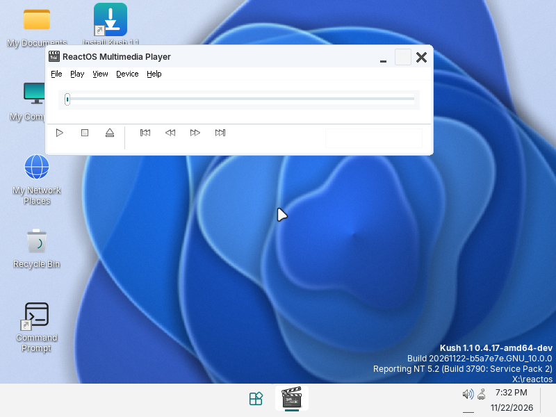

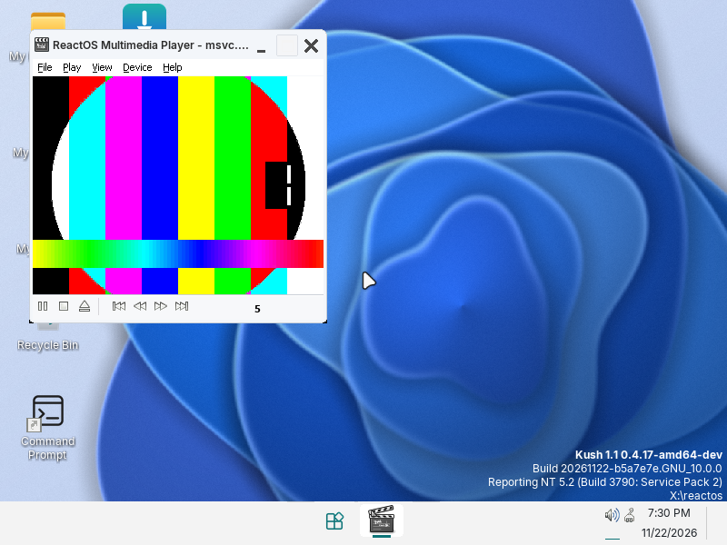

### تحديث 22 نوفمبر: مساحات Registry Editor

اتسعت شجرة المحرر الأصلي وصفوفها وأعمدة القيم، وصار صف العنوان أوضح وحدود الشجرة والقائمة مسطحة. الإعدادات المحفوظة ومسارات تعديل السجل والتصفح والحوارات الأصلية باقية. حدود النافذة العادية والتكبير تتبع مساحة العمل، ومفتاح `ClassicRegistryEditor` يعيد العرض الأصلي بشكل مستقل.

اختبار QEMU للبناء الثاني، English/US و800×600 و96DPI، أثبت الانتقال بالعنوان، فتح DWORD ثم إلغاءه، الفرز، تحريك الفاصل، إخفاء شريط الحالة وإعادته، والتكبير والاستعادة والرجوع1 ثم0 مع قراءة القيم. فتحت البرامج الأربعة على إقلاع نظيف، وسجله85043بايت بلاFirstChance أوKUSH-EXC أوFatal System Error قبل إغلاق المحرر. ظهر استثناء من الدرجة الأولى عند الإغلاق، وتكرر في المحرر الأصلي على ISO Paint السابق في الموضع نفسه؛ لم يُصلح ضمن هذه الدفعة ولم يُخف. [التقرير والصور والحدود](docs/design/kush-regedit-2026-11-22.md). بصمة ISO المحفوظ احتياطيا والمطابق بعد إعادة التنزيل: `a5bcc6cfe95ade5947d017717cba2feb4f9bcb52a0b226994fe2e515ccad651b`.

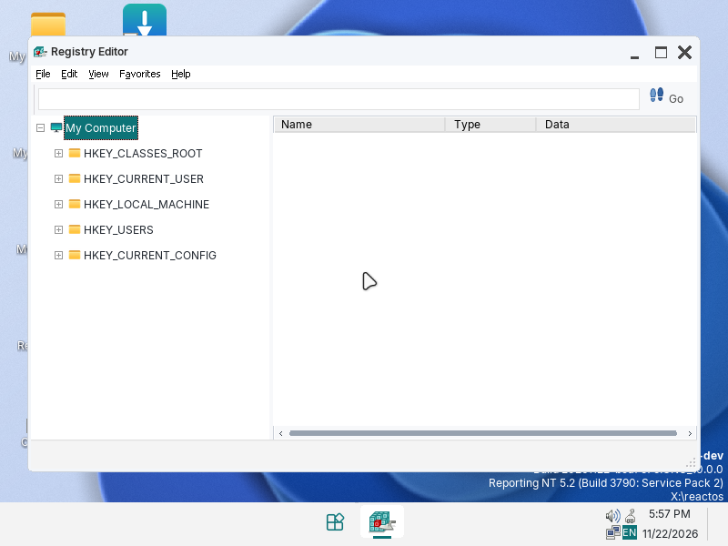

### تحديث 22 نوفمبر: مساحات وألوان Paint

اتوسعت أزرار أدوات Paint الأصلية من25 إلى32 بكسل مع إبقاء أيقوناتها16 بكسل، واتسعت لوحة الأدوات وإعداداتها. لوحة الألوان الأصلية28 لونا صارت بخلايا18 بكسل وحدود مسطحة وخلفية بيضاء؛ المنطقة خارج الصورة فاتحة. محرك الرسم والملفات والحافظة والطباعة لم تتغير في الكود. اتضبط موضع النافذة العادية وحدود التكبير حسب مساحة العمل حتى لا يختفي شريط الحالة خلف شريط المهام.

على البناء الثالث في QEMU، 800×600 و96DPI وEnglish/US، اختُبر التكبير والاستعادة، وإخفاء لوحتي الألوان والأدوات وإعادتهما من View، ونقاط Pencil وUndo/Redo، واختيار لون أمامي وخلفي، وعرض إعدادات Brush وRounded rectangle، وسؤال الحفظ الأصلي. `HKCU\Software\Kush\Shell\ClassicPaint=1` أعاد الشكل الأصلي ثم0 أعاد الحديث في عملية جديدة مع قراءة القيم وصورها. فتحت البرامج الأربعة، وسجل النهاية92363بايت بلا KUSH-EXC أو Fatal System Error، مع بقاء رسائل تشخيص أخرى.

سحب Line لم ينتج الخط المتوقع في البناء الأول الحديث والأصلي، وتكرر على ISO خريطة الرموز السابق. هذا يثبت أن السلوك المرصود يسبق دفعة Paint فقط؛ السبب غير معروف ولم يُصلح أو يُحسب نجاحا. لم تُختبر كل أدوات الرسم أو الملفات والطباعة. [التقرير والصور وحدود النتيجة](docs/design/kush-paint-2026-11-22.md). حُفظ ISO احتياطيا بشكل خاص وأعيد تنزيله وطابقت بصمته قبل التشغيل: `6f5928665000bd207e27e00c1d1abd7058ea0037f813257deb6414637a720edc`.

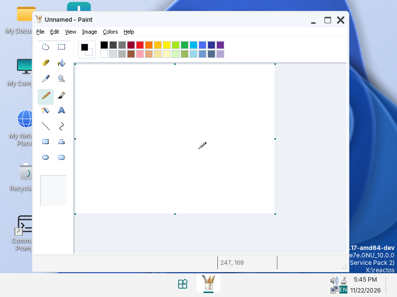

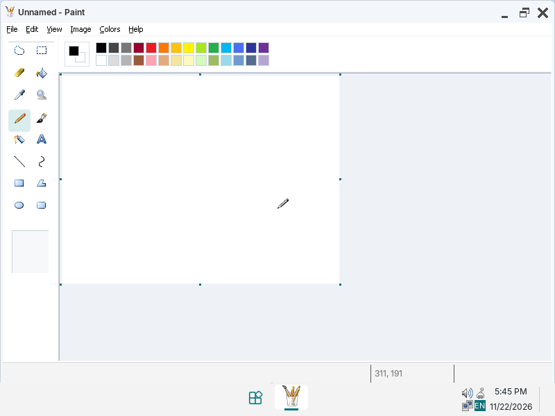

### تحديث 22 نوفمبر: واجهة خريطة الرموز

اترتبت Character Map بمساحة أوسع وخلفية بيضاء وشبكة فاتحة وتحديد تيل، مع إبقاء شبكة20×10 وعناصر الخطوط والرموز والنسخ والإعدادات الأصلية. هذه تعديلات عرض فقط، بلا إضافة خط أو أيقونة أو تغيير لمحرك الرموز. Help وGroup by وSearch تظل معطلة كما كانت.

على QEMU بدقة800×600 و96DPI وEnglish/US، نجح اختيارA ونسخه ولصقه في Notepad، وفتح Advanced، واختيارInter، وتغيير Charset إلى OEM United States437 ثم Unicode. `HKCU\Software\Kush\Shell\ClassicCharacterMap=1` أعاد الشكل الأصلي، ثم0 أعاد الحديث في عملية جديدة، مع قراءة القيم وصورها وبقاء الخط وحالةAdvanced المحفوظين. حواجز ClassicWindows وRTL والتباين العالي وDPI الآخر وقياس النصوص ومساحة العمل تحفظ المسار الأصلي، لكن لم تُختبر هنا.

فتحت البرامج الأربعة Explorer وcmd وNotepad وControl Panel، ونفذ cmd أمرecho. سجل نهاية الفحص90806بايت بلا KUSH-EXC أو Fatal System Error؛ ليس فحصا لكل البرامج أو حلا لعطلWordPad. [التقرير والصور وحدود النتيجة](docs/design/kush-charmap-2026-11-22.md). حُفظ ISO في نسخة خاصة جديدة وأعيد تنزيله وطابقت بصمته قبل الإقلاع: `70978fcdc3315d7c6b0bdab69a3060448bb6021697aff937b404adc779ca712a`.

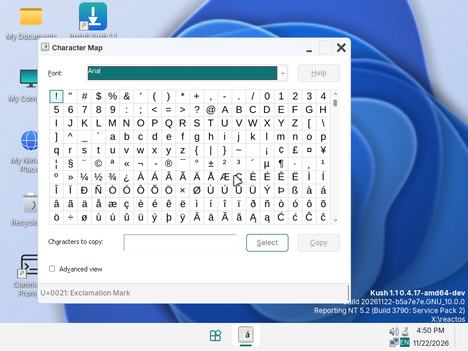

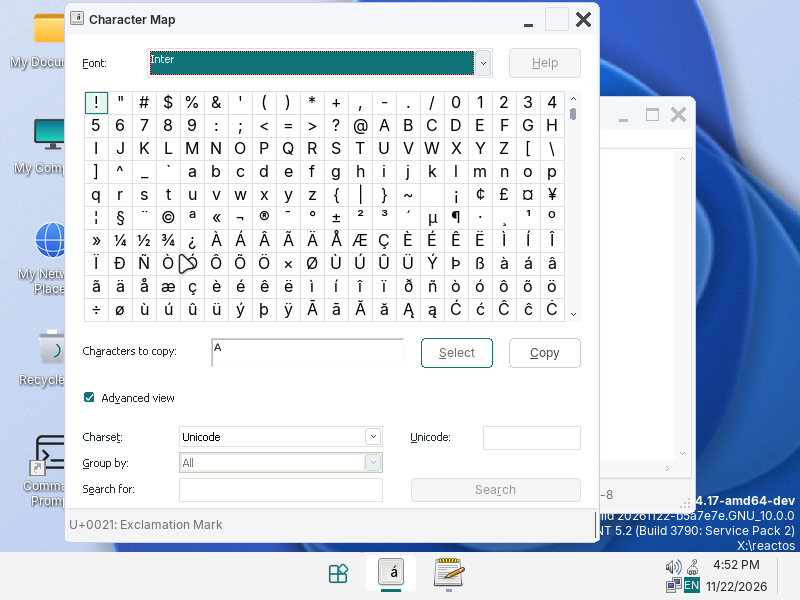

### تحديث 22 نوفمبر: موضع لوحة المفاتيح على الشاشة

اتصلح ارتفاع وموضع On-Screen Keyboard عشان الصف السفلي ما يدخل خلف شريط المهام. التصحيح يستعمل مساحة العمل والإطار الفعلي، مع إبقاء عرض Enhanced746 وStandard586 بكسل الأصليين. الأزرار وشكلها ومعرفاتها وscan codes وSendInput والمؤقت والخط والقوائم وآلية حفظ الإعدادات الأصلية لم تتغير؛ هذا إصلاح عرض محدود، وليس إعادة تصميم للوحة.

على البناء الثاني في QEMU، 800×600 و96DPI وEnglish/US، ظهر التخطيطان كاملين فوق الشريط بلا شريحة لوحة أرقام في Standard، ووصلت حروف ومسافة بالماوس إلى Notepad بعد تنشيطه. قائمة Settings احتفظت بحالة Always on Top المفعلة وUse Click Sound غير المفعلة، دون تغييرهما. `HKCU\Software\Kush\Shell\ClassicOnScreenKeyboard=1` أعاد الموضع الأصلي المحجوب، ثم0 أعاد التصحيح، مع ضبط WindowTop=360 وقراءة القيم قبل العمليتين. ClassicWindows والتباين العالي وRTL وDPI غير96 تترك المسار الأصلي، ولم تُختبر هنا.

Explorer وcmd وNotepad وControl Panel فتحت، ونفذ cmd أمر echo. سجل نهاية الفحص96881بايت بلا KUSH-EXC أو Fatal System Error، وهذا لا يشمل كل البرامج أو WordPad. حدث توقف نظام في تجربة سابقة على البناء الأول؛ السبب غير محدد، ولم يتكرر في الإقلاع النظيف والفحص المحدود للبناء الثاني، بلا ادعاء حل شامل. [التقرير والصور وحدود النتيجة](docs/design/kush-osk-2026-11-22.md). كل ISO جديد حُفظ احتياطيا وأعيد تنزيله وطابقت بصمته قبل الإقلاع؛ بصمة البناء الثاني `7afd8aedbe2559ebfc60a158c794a7ec60450a521c4da38e658b673660bfc166`.

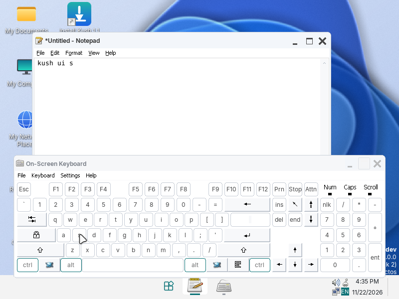

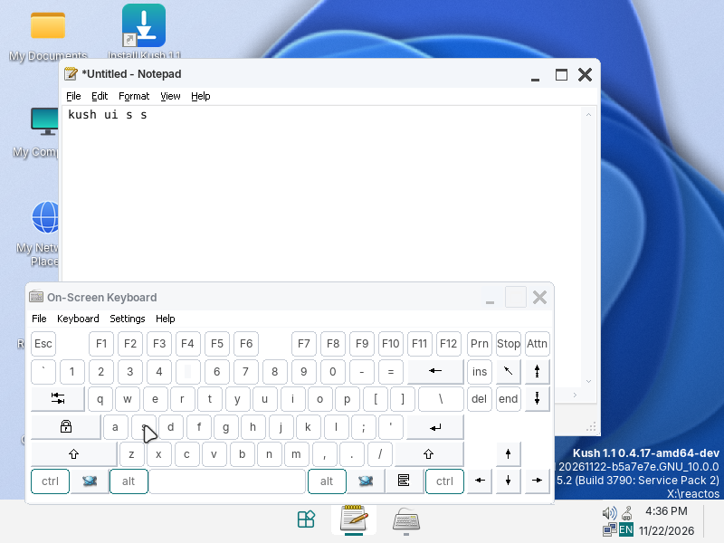

### تحديث 22 نوفمبر: واجهة الحاسبة القياسية

مراجعة البرامج أظهرت أن الحاسبة ترسم أزرارها بنفسها داخل قالب صغير، لذلك ثيم النظام وحده لا يكفي لترتيبها. اتحدث عرض الوضع القياسي إلى مساحة 420×430 عند96DPI، شاشة أرقام أكبر، صف ذاكرة مستقل، أزرار أوسع وألوان هادئة وزر نتيجة تيل. العناصر ومعرفاتها ونصوصها الأصلية باقية، ولم يُعدّل محرك الحساب أو الكيبورد أو القوائم أو النسخ واللصق. الرقم الطويل يختار خط عرض أصغر دون تغيير قيمته أو تنسيقه.

الاختبار الفعلي في QEMU أثبت 12+30=42 بالكيبورد، تخزين42 ومسحه واسترجاعه، جذر9=3 بالماوس، Error الأصلي للقسمة على صفر، و8×7=56 بزر النتيجة بالماوس. اتفتحت Scientific وConversion بواجهتيهما الأصليتين ثم رجع Standard الحديث؛ ليس اختبارا لكل وظائف الوضعين. نسخ42 إلى Notepad ولصقه في الحاسبة نجح، وظهر إدخال32رقما كاملا بخط أصغر. راجع [التقرير والصور وحدود الاختبار](docs/design/kush-calculator-2026-11-22.md).

`HKCU\Software\Kush\Shell\ClassicCalculator=1` أعاد الشكل القديم، ثم0 أعاد الحديث في عملية جديدة، مع reg query وصور للقيم. ClassicWindows والتباين العالي وRTL وDPI غير96 ومساحة العمل غير الكافية تترك المسار الأصلي، لكنها غير مختبرة هنا. Explorer وcmd وNotepad وControl Panel فتحت؛ سجل نهاية الفحص91305بايت وبلا KUSH-EXC. هذا لا يشمل WordPad أو كل البرامج. كل ISO جديد اتحفظ احتياطيا واتنزل تاني وطابقت بصمته قبل الإقلاع؛ بصمة هذه الدفعة `5bb19314eb38627768ce4429a6cd8be71d43b44a6e105d92a547d570a63ae3dc`.

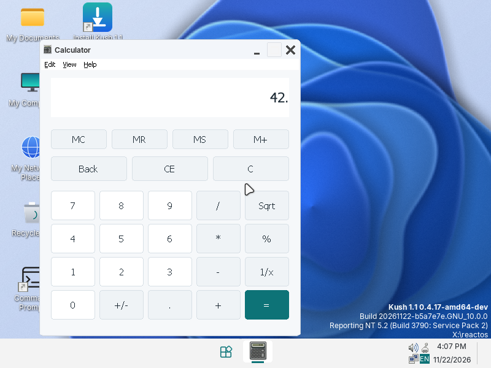

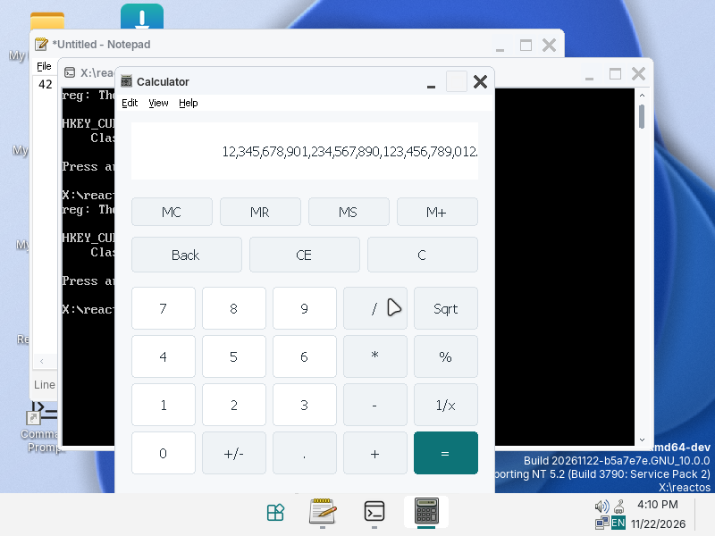

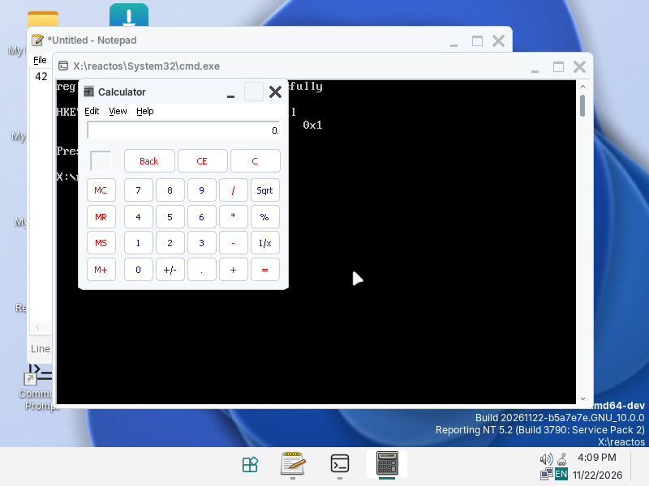

### تحديث 22 نوفمبر: مراجعة بقية البرامج

اتعمل جرد بصري لعشر نوافذ برامج وإعدادات، مع صور QEMU فعلية ومصدر بناء كل صورة وحدود الفحص في [تقرير مراجعة البرامج](docs/design/kush-app-audit-2026-11-22.md). الحاسبة والرسام وخريطة الرموز ومحرر السجل، ثم إعداد النظام وخصائص النظام والعرض والوقت ولوحة المفاتيح ومشغل الوسائط، ما زالت فيها مناطق قديمة. الفحص ليس اختبار وظائف كامل ولا يعني تحديثها. الصف السفلي من لوحة المفاتيح ظهر جزئيا خلف شريط المهام عند 800×600.

WordPad لم يفتح وسجّل استثناء. المقارنة ببناء حوار الملفات السابق أعادت الاستثناء نفسه، فتأكد أنه يسبق دفعة LiveCD، وليس أنه يسبق كل تعديلات الواجهة. السبب الجذري غير محدد، ولم يُغيّر محركه أو الطباعة. الخطوة التالية المختارة واجهة الحاسبة القياسية مع إبقاء وظائفها الأصلية؛ التنفيذ لم يبدأ في هذه الدفعة. هذه دفعة توثيق فقط، بلا ISO جديد.

### تحديث 22 نوفمبر: صفحتا بدء LiveCD الأصليتان

اتحدث عرض صفحتي اللغة وبدء التشغيل داخل userinit نفسه: مساحة 600×420 بكسل عند 96DPI، خلفية بيضاء، تذييل فاتح، نص أكبر ومسافات أوسع، وأزرار أصلية مرسومة بزوايا خفيفة وتيل. شعار Kush الموجود لم يتغير. قوائم اللغة ولوحة المفاتيح هي العناصر الأصلية ببياناتها، ومعرفات الأوامر ومسارات تغيير اللغة وRun وInstall والإعداد غير التفاعلي لم تتغير. لا تشغيل مبكر لخدمة الثيمات ولا تغيير للنواة أو المثبت.

الرسم في شريط العنوان فقط؛ مقاسات الإطار واختبار مواضع الماوس وقائمة النظام وأوامر الإغلاق تظل للنظام. أول تجربة كشفت أن رسالة تأكيد الخروج لا تحصل على التنشيط الصحيح. اتصلح إرجاع نتيجة رسائل الحوار عبر DWLP_MSGRESULT، وأعيد البناء والإقلاع والفحص قبل النشر.

التحقق الفعلي على البناء الثاني في QEMU، بدقة 800×600 و96DPI:
- القائمتان الأصليتان فتحتا، وNext وPrevious والتنقل الافتراضي بـ Enter عملت. الاختيارات المختبرة English (United States) وUS فقط، وليس تغيير لغة النظام إلى لغة أخرى.
- Alt+F4 وEscape فتحا رسالة تأكيد الخروج الأصلية النشطة؛ اختيار No أعاد صفحة البداية. Enter على Run فتح سطح المكتب الحقيقي، وليس صورة أو نموذج عرض.
- Explorer وcmd وNotepad وControl Panel فتحت بعد الوصول لسطح المكتب. سجل نهاية الفحص 93842 بايت وبلا KUSH-EXC. هذا فحص تشغيل محدود، وليس اختبار توافق كامل.
- `HKCU\Software\Kush\Shell\ClassicLiveCD` من نوع DWORD: القيمة 1 أعادت محتوى الصفحتين وترتيبهما الأصليين، ثم 0 أعادت العرض الحديث في عملية جديدة. القيم اتأكدت بأمر reg query والصور.
- اختبار مفتاح الرجوع تم بعد فتح سطح المكتب، بمساعد `livecdpreview` الذي يستعمل RunLiveCD والموارد نفسها. المساعد ينهي العملية بعد إغلاق الصفحات ولا يشغل shell أو المثبت أو إعادة التشغيل. هدف CMake اختياري EXCLUDE_FROM_ALL، ولا يُضاف لقرص النظام. لذلك صور الرجوع تثبت محتوى الصفحات، وليست إقلاعا ثانيا بلا ثيمات.

كل ISO جديد اتحفظ احتياطيا واتنزل تاني وطابق SHA256 قبل تشغيله. بصمة البناء الثاني: `b306282a4aa8497b9d57c6f18c7cf8cb1cc287e22e04ece5f1d9e1df981c91cb`.

ClassicWindows والتباين العالي وRTL والشاشات الأصغر من المساحة المطلوبة عند DPI الحالي تحتفظ بالمسار الأصلي، لكن هذه الحالات لم تُختبر فعليا هنا. لم يُضغط Install في بدء النظام، ولم يُختبر التثبيت أو إعادة التشغيل أو الإعداد غير التفاعلي. حواف القوائم ورسالة تأكيد الخروج والخلفية الزرقاء قبل سطح المكتب ما زالت أصلية. بقية البرامج وحوارات النظام ما زالت قيد المراجعة.

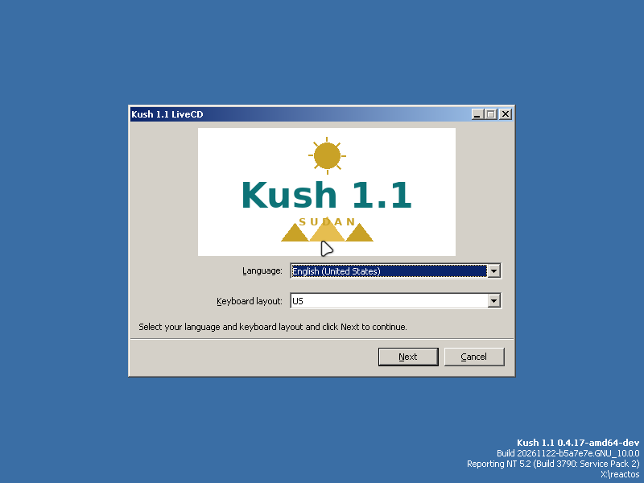

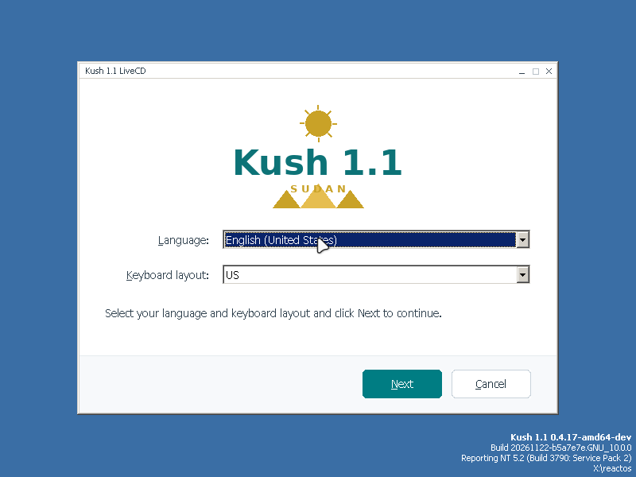

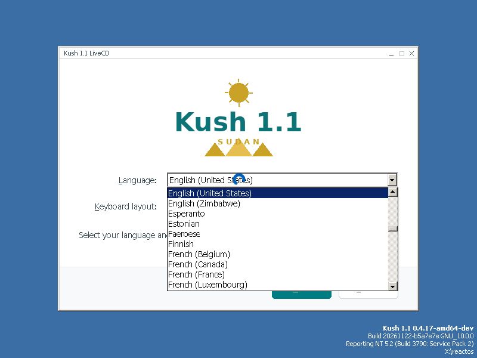

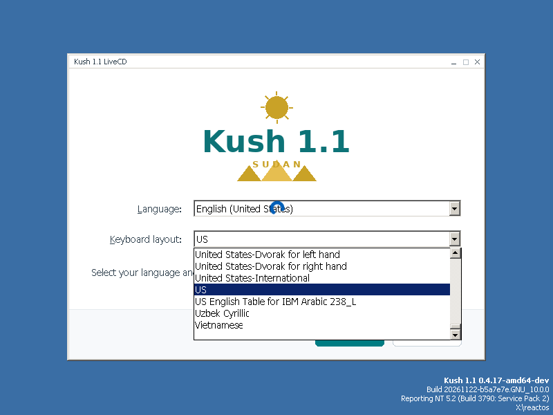

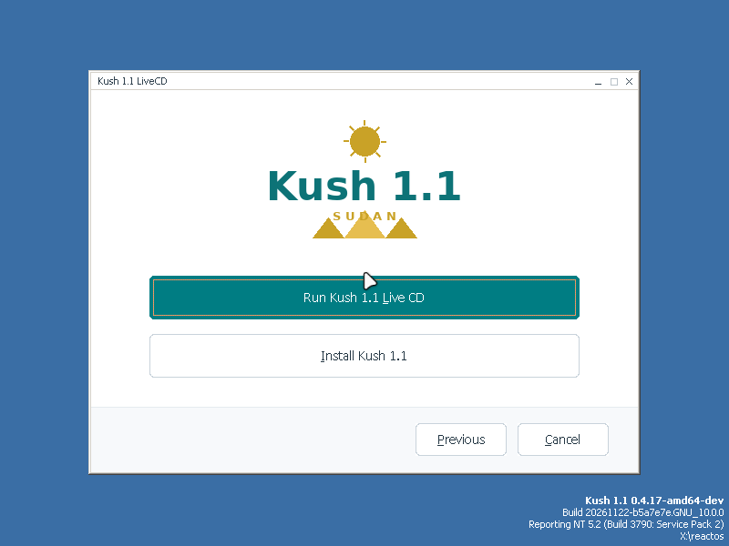

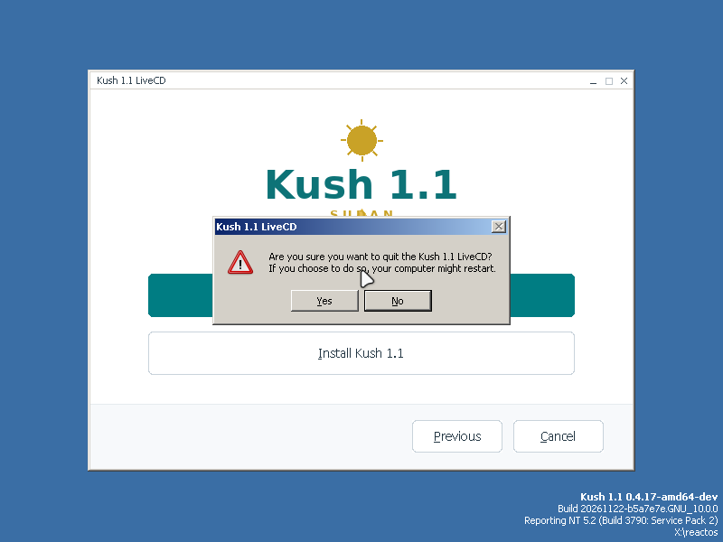

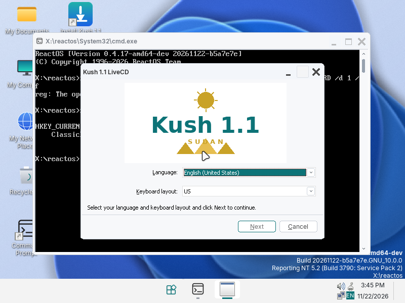

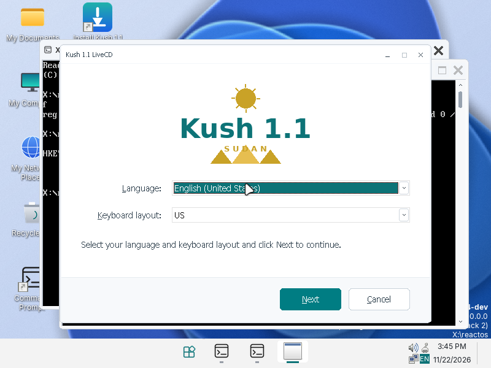

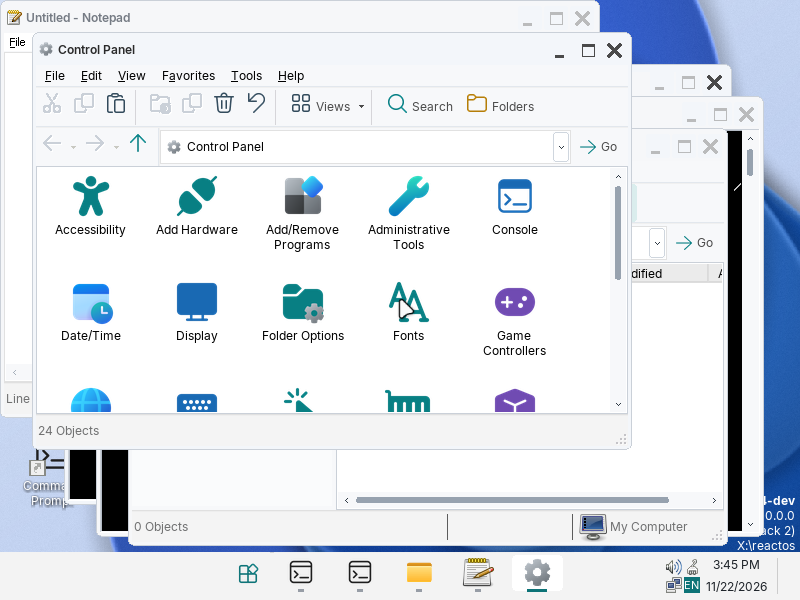

### تحديث 22 نوفمبر: حوار فتح الملفات الأصلي

اتحدث قالب Explorer القياسي ذي شريط الأماكن في comdlg32 نفسه، وليس واجهة بديلة داخل Notepad. شريطه بقى بأيقونات Fluent الرسمية MIT بحجم 24 بكسل وأزرار أوسع، مع نفس أوامر Up وDesktop وNew Folder وList وDetails الأصلية. الأماكن الجانبية بقت صفوفا أفقية أوضح، والعرض 180 بكسل أظهر My Network Places كاملا. اتزادت المسافة فوق قائمة الملفات واترتبت حقول الاسم والنوع مع الخلفية الفاتحة. الخط وبيانات الأماكن وPIDL ومتصفح الملفات ومعالجة المسارات والاختيار لم تتغير.

أول بناء كشف بالصور لون الشفافية الوردي وقص آخر زر. اتصلح تحميل الصورة بقناع شفافية صريح وحساب عرض الشريط من حجمه الحقيقي. البناء الثالث أضاف شرطا يحافظ على القالب الأصلي الأصغر عندما يطلب التطبيق حوارا بلا شريط أماكن. كل ISO اتحفظ في نسخة احتياطية خاصة واتنزل تاني وطابق SHA256 قبل إقلاعه.

التحقق الفعلي في QEMU:
- البناء النهائي فتح `X:\reactos\readme.txt` وظهر الملف ومحتواه فعليا في Notepad.
- Up انتقل من مجلد reactos إلى جذر X، وزر Desktop فتح سطح المكتب الحقيقي، وDetails أظهر أعمدة الملفات الأصلية. فحص التنقل ده تم على البناء الثاني قبل إضافة شرط القالب بلا أماكن.
- على البناء النهائي، `HKCU\Software\Kush\Shell\ClassicFileDialogs` من نوع DWORD: 1 أعادت الحوار الأصلي، ثم 0 أعادت الترتيب الحديث في حوار جديد. اتأكدت القيم بأمر `reg query` والصور.
- مساعد الاختبار `tools/qemu/filedlgprobe.c` طلب `OFN_EX_NOPLACESBAR` فعليا؛ ظهر الحوار الأصغر بأدواته الأصلية بدون قص، واتلغى بدون تغيير ملفات.
- Save As في Notepad احتفظ بحواره الأصلي المخصص وحقول Encoding وEndlines. تم فتحه وإلغاؤه فقط، وليس اختبار كتابة ملف أو إعادة فتحه.
- Explorer وcmd وNotepad وControl Panel فتحت بعد التغيير على البناء النهائي. سجل الفحص النهائي 115148 بايت وبلا `KUSH-EXC`، وهذا فحص تشغيل محدود وليس اختبار توافق شامل.

للحفاظ على توافق التطبيقات، القوالب والخطافات الخاصة بالتطبيقات لا يُعاد ترتيبها. RTL والتباين العالي وClassicWindows يحتفظون بالمسار الأصلي أيضا؛ ClassicIcons يترك أيقونات الشريط الأصلية مع الترتيب الحديث. هذه المسارات موجودة في الكود ولم تُختبر كلها هنا. الاختبار المرئي 800×600 و96DPI فقط، ولم تُختبر كل اللغات أو تغييرات الحجم أو تعدد الاختيار أو أمر New Folder. أيقونات الأماكن نفسها ما زالت من الـ shell الأصلي، ولم تُستبدل بقائمة أماكن ثابتة.

هذه دفعة الحوار القياسي فقط. تحديث صفحتي LiveCD موثق في القسم الأحدث أعلاه، وترتيب بقية حوارات النظام ما زال عملا جاريا.

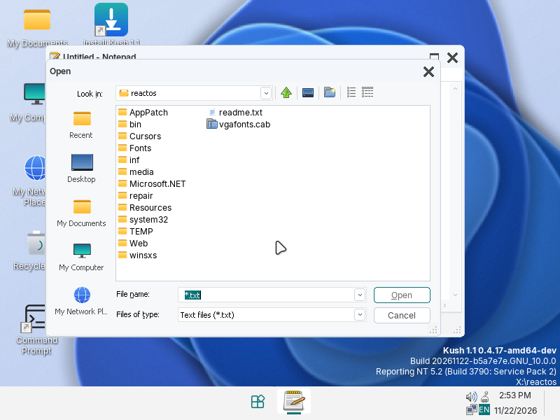

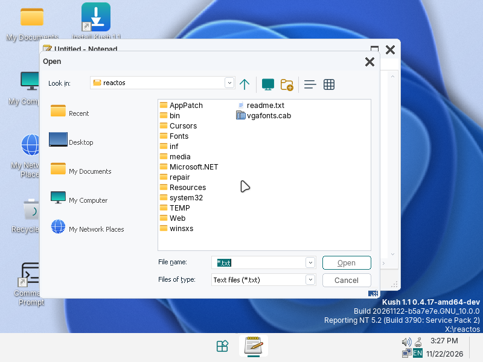

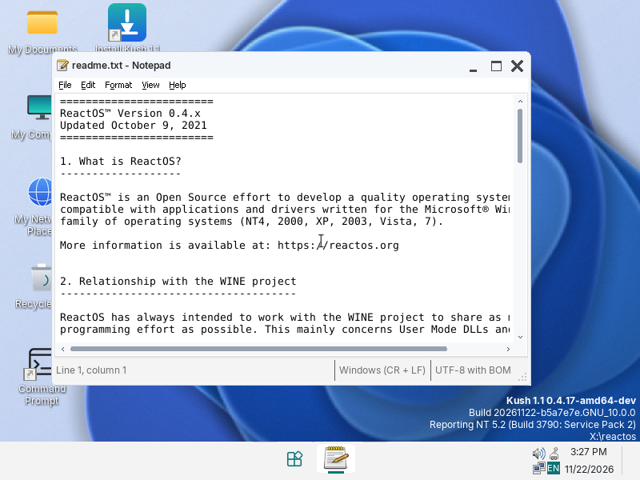

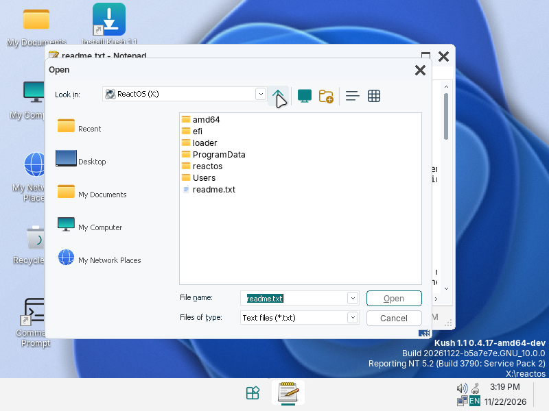

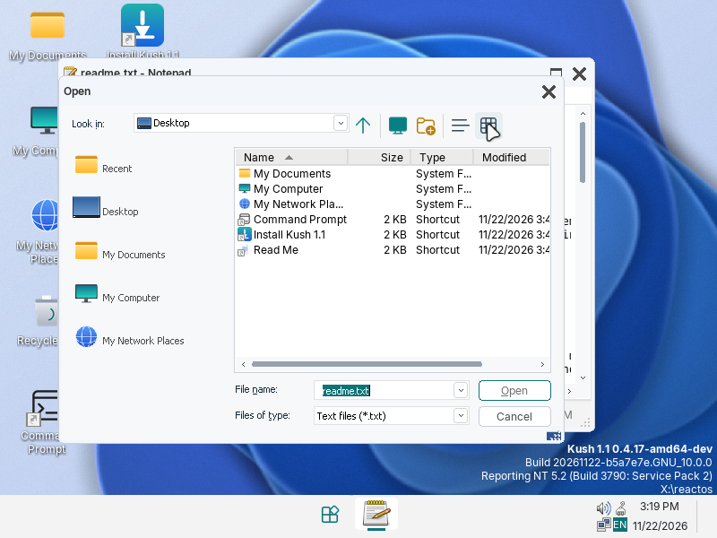

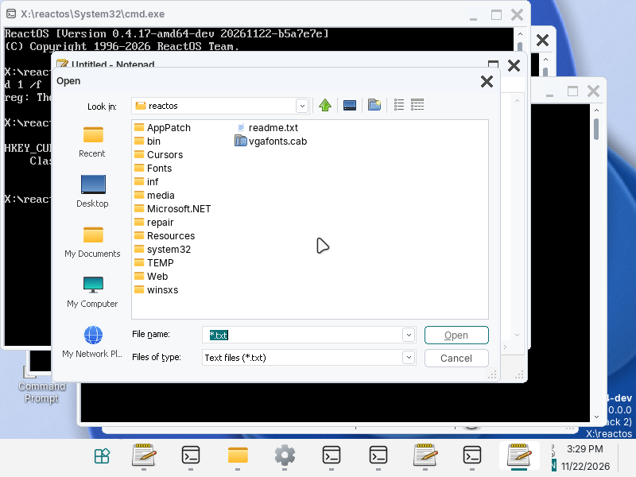

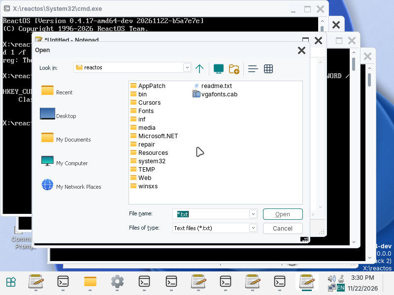

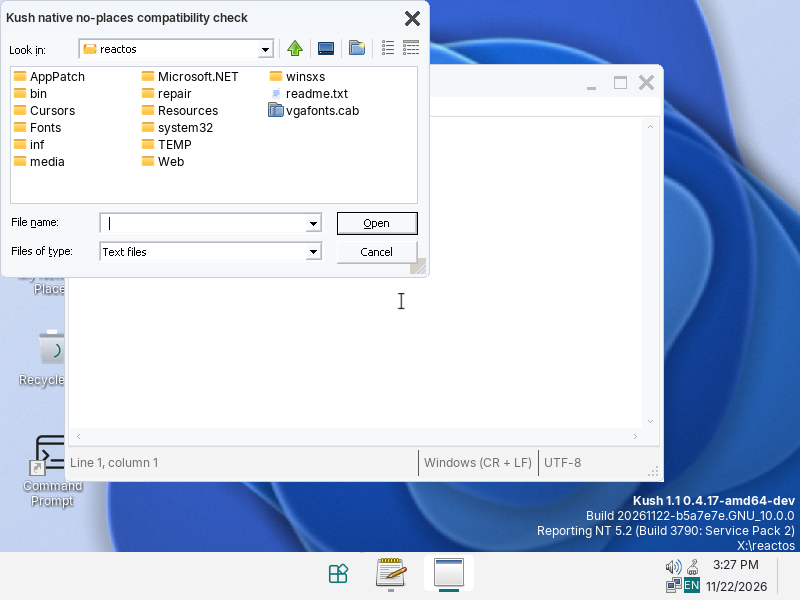

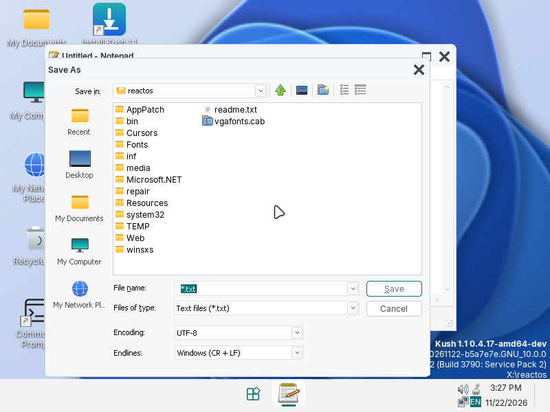

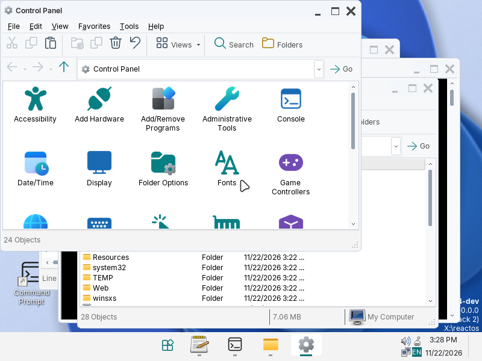

### تحديث 22 نوفمبر: رسوم ومقاييس Performance في مدير المهام

المشكلة كانت ظاهرة في الفحص الفعلي: داخل الإطار الحديث، رسوم سوداء بشبكة خضراء كثيفة وعدادات شرائط صغيرة. اتغير رسم هذه العناصر نفسها إلى خلفيات بيضاء، شبكة رمادية خفيفة كل 24 بكسل، وخطوط تيل للمعالج وأزرق للذاكرة. استخدام kernel له خط برتقالي عند تفعيل Show Kernel Times. عدادات CPU والذاكرة بقت أرقاما أوضح وأشرطة استخدام أفقية مسطحة. الخط موروث من الحوار الموجود، وليس خطا جديدا من موقع المرجع.

القرارات والتنفيذ:
- الرسم GDI بسيط، والخط يُنشأ مرة عند فتح صفحة Performance ويُحرر عند إغلاقها. لا مؤقت جديد أو blur أو تغيير لمحرك الرسم.
- مصادر بيانات CPU والذاكرة، العينات، سرعة التحديث، أوامر القوائم وإدارة العمليات لم تتغير. الألوان والعدادات وحدود عناصر الرسوم فقط هي التي تغيرت.
- `HKCU\Software\Kush\Shell\ClassicTaskManager` من نوع DWORD: القيمة 1 تعيد الرسم الأصلي، والقيمة 0 تعيد الرسم الحديث بعد إغلاق Task Manager وفتحه. الكود يحترم `ClassicWindows` والتباين العالي أيضا، لكن مساريهما لم يُختبرا في هذه الدفعة.

التحقق في QEMU على 800×600 و96DPI:
- بُني `taskmgr` و`bootcd`، وحُفظ ISO في النسخة الاحتياطية الخاصة ونُزل وطابق SHA256 قبل الإقلاع.
- اتأكدت قيم ClassicTaskManager بأمر `reg query`: 1 أعادت العداد الأسود/الأخضر فعليا، ثم 0 أعادت الشكل الحديث في عملية جديدة.
- تفعيل Show Kernel Times ظهر بعلامة اختيار في القائمة، ثم ظهر خطه البرتقالي أثناء النشاط. القيم والرسوم اتغيرت فعليا مع فتح التطبيقات، ووصل CPU في الصورة النهائية إلى 34% والذاكرة إلى 109 MB.
- التكبير إلى مساحة الشاشة ثم الاستعادة حافظا على وضوح المقاييس والرسوم. Explorer وNotepad وcmd وControl Panel فتحت، والسجل النهائي بلا `KUSH-EXC`.

دي دفعة الرسوم والمقاييس فقط. مجموعات الأرقام السفلية والقوائم وترتيب تبويبات Task Manager ما زالت قديمة، ولم تُختبر DPI أخرى أو العربية أو التباين العالي أو توافق البرامج الواسع. حوار فتح الملفات ومعالج لغة LiveCD هما التاليان حسب الطلب، ولم يتغيرا في هذه الدفعة.

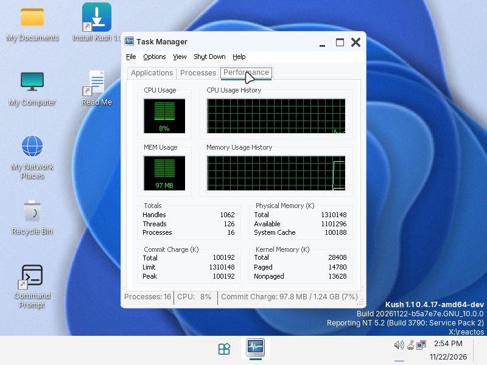

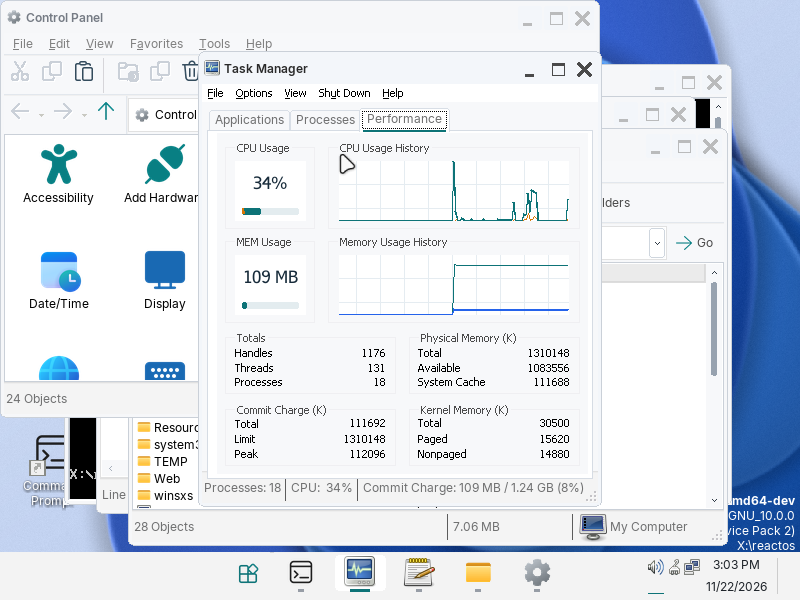

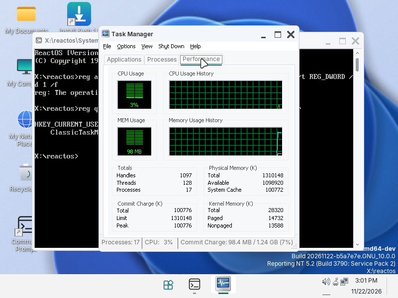

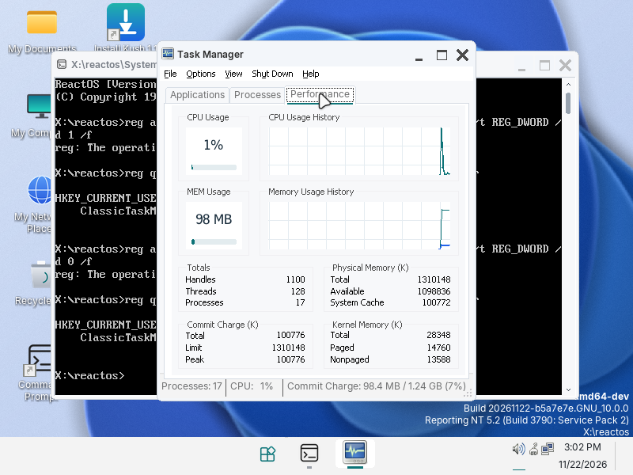

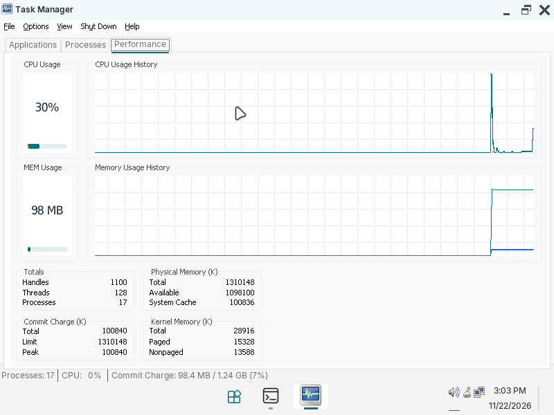

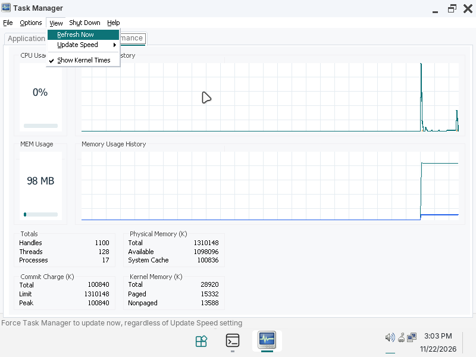

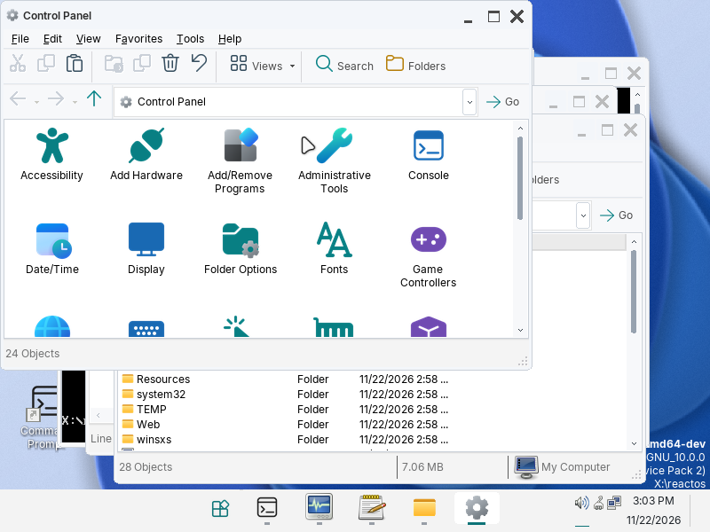

### تحديث 22 نوفمبر: فصل أوامر الملفات عن التنقل في Explorer الأصلي

أوامر الملفات بقت في الصف العلوي: قص ونسخ ولصق، ثم Move To وCopy To وحذف وتراجع، ثم Views والبحث وإظهار الشجرة. Back وForward وUp بقوا في صف مستقل بجانب حقل العنوان الحقيقي. دي عناصر Win32 الأصلية، بنفس معرّفات الأوامر والصور والنصوص ومسارات التنفيذ، وليست واجهة متصفح أو أزرارا مرسومة بلا عمل. القائمة القديمة باقية للوصول لكل الوظائف.

أول بناء وضع التنقل والعنوان في صفين منفصلين، والثاني ترك فراغا كبيرا بعد أزرار التنقل وضغط حقل العنوان. السبب كان طريقة توزيع rebar: ارتفاع الحاوية الكبير يشجع كسر الصفوف، والحد الأدنى الصغير للعنوان يعطي المساحة الزائدة لشريط التنقل. اتحدد الارتفاع الطبيعي للصفوف وحد أدنى 220 بكسل للعنوان، مع عرض ثابت لأزرار التنقل. الصورة النهائية اتفحصت في نافذة بعرض 600 بكسل، ومع التكبير إلى 800 بكسل على 96DPI.

التحقق الفعلي في QEMU:
- كتابة `X:\reactos` ثم Enter، وBack ثم Forward ثم Up، فتحت المسارات الحقيقية المتوقعة. قائمة تاريخ Back وقائمة Views فتحتا فعلا.
- اتنسخ ملف تجريبي من قرص التجربة إلى مجلد آخر بأزرار Copy وPaste الجديدة، ثم اتفتح الملف الناتج في Notepad وظهر محتواه الصحيح. Cut وCopy يتعطلان بلا اختيار ويتفعّلان مع اختيار الملف. لم تُختبر هنا عمليات الحذف أو النقل أو التراجع فعليا.
- زر Folders أخفى الشجرة وأعادها. View ثم Toolbars ثم Address Bar أخفى صف التنقل والعنوان معا وأعادهما.
- `HKCU\Software\Kush\Shell\ClassicExplorer=1` أعاد الشريط الأصلي في نافذة جديدة، ثم 0 أعاد الترتيب الحديث. مفتاح الرجوع الموجود يغطي الفصل الجديد أيضا.
- Explorer وNotepad وcmd وControl Panel فتحت بعد التغيير، والسجل النهائي بلا `KUSH-EXC`. هذا فحص تشغيل محدد، وليس اختبار توافق شامل لكل التطبيقات أو DPI أو التباين العالي.

الـ ISO النهائي اتخزن في النسخة الاحتياطية الخاصة قبل الإقلاع، ثم نُزل وطابق SHA256. لا أيقونات أو خطوط جديدة من موقع المرجع، ولا تغيير للنواة أو تفسير المسارات أو كود نسخ الملفات. الأيقونات الملونة الدقيقة ما زال مصدرها وحق إعادة توزيعها غير محسومين؛ breadcrumbs والبحث المستقل وبقية تفاصيل المرجع لم تكتمل.

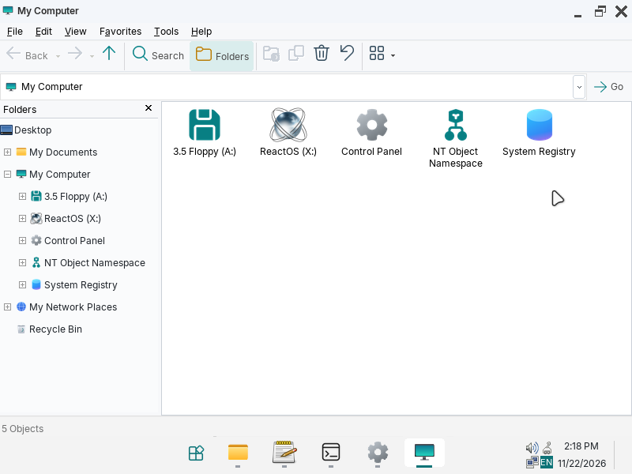

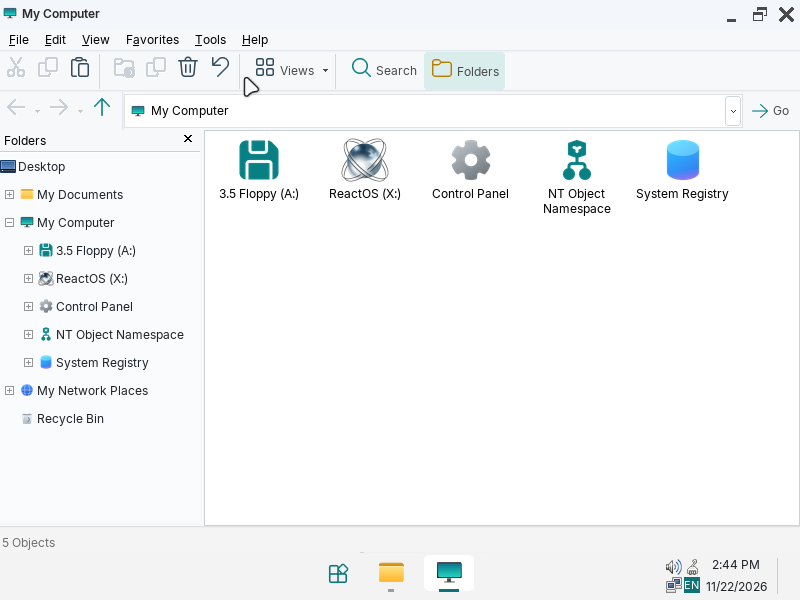

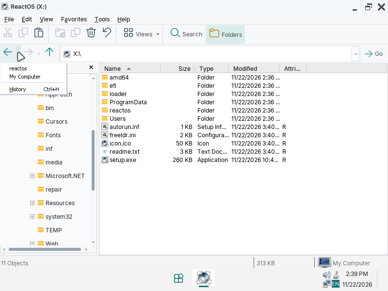

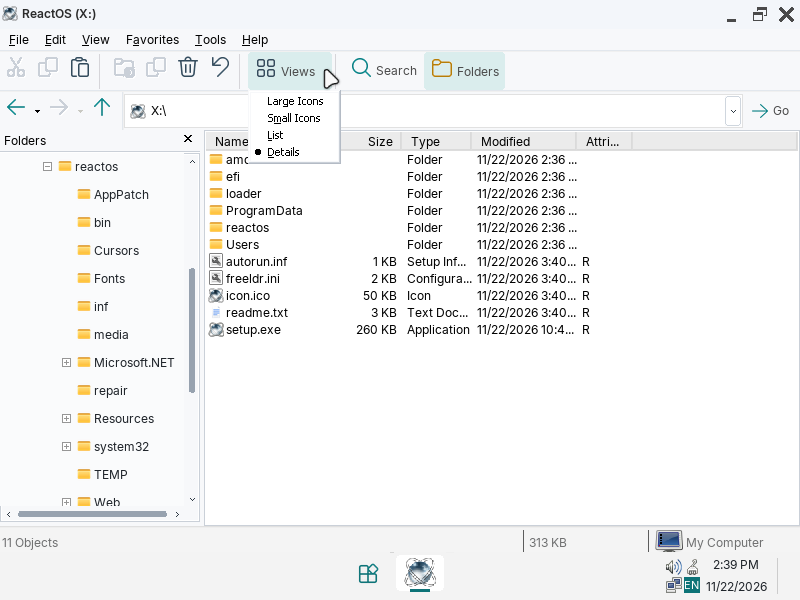

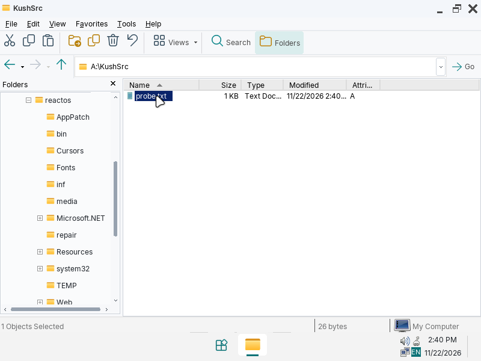

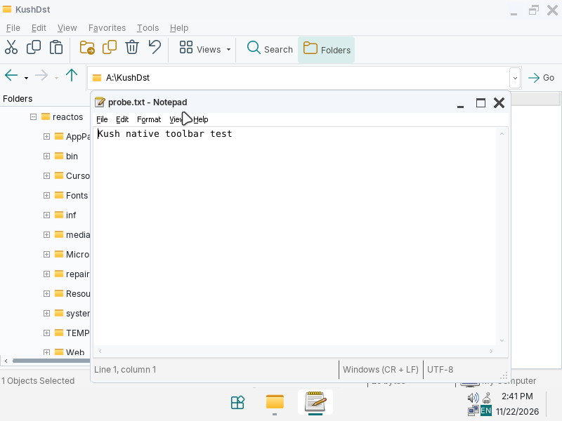

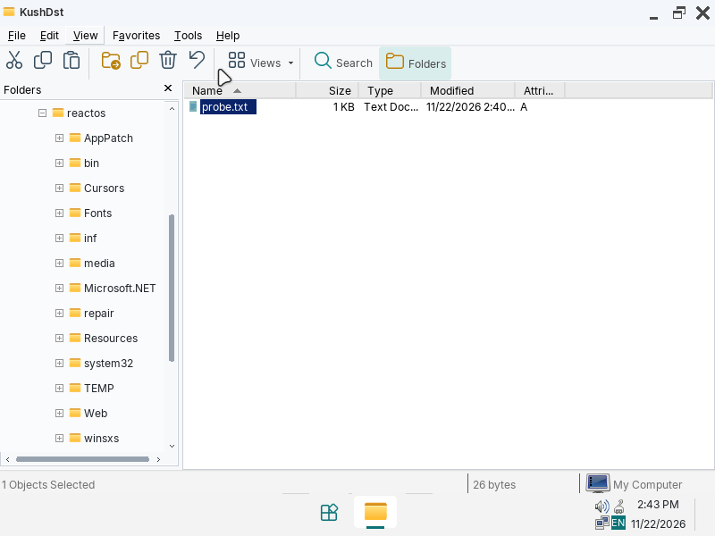

### تحديث 22 نوفمبر: صف عنوان Explorer أوضح

اتشالت كلمة Address الزائدة من صف العنوان في الترتيب الحديث، واتسع ارتفاع الصف إلى 36 بكسل مع حقل أعلى يسهل تحديده. الحقل الحقيقي نفسه باق: كتابة المسار و Enter وزر Go وقائمة العناوين الأصلية، بدون breadcrumbs وهمية أو مربع بحث لا يعمل.

أول تجربة كشفت أن ComboBoxEx الأصلي يحاذي الأيقونة لأعلى والنص لأسفل عند زيادة الارتفاع. اتصلح تمركزهما فقط للحقل الذي يعلّمه CAddressBand بعلامة `KushCenteredAddress` ؛ عناصر ComboBoxEx الأخرى تحتفظ بمسارها القديم. لا تغيير في تفسير المسارات أو التنقل أو الملفات. مفتاح `ClassicExplorer=1` يعيد العنوان والارتفاع القديمين في نافذة جديدة، و 0 يعيد الترتيب الحديث.

في QEMU على 96DPI اتجرب Alt+D وكتابة `X:\reactos` ثم Enter ، واتفتحت مجلدات النظام فعلا. قائمة العنوان فتحت بالماوس، وزر Go فتح المسار المكتوب، ثم اتجرب الرجوع وإعادة التفعيل في نوافذ جديدة. Explorer و cmd و Notepad و Control Panel شغالة معا والسجل بلا `KUSH-EXC`. الـ ISO النهائي محفوظ خصوصيا، ونُزل وطابق SHA256 قبل الإقلاع.

لا أيقونات أو خطوط جديدة من الموقع في الدفعة دي. القائمة القديمة وفصل أوامر التنقل وشريط أوامر المرجع و breadcrumbs والبحث المستقل ما زالت باقية. التحقق هنا ليس اختبار توافق شامل ولا يشمل كل التطبيقات أو DPI الأعلى.

### تحديث 22 نوفمبر: أول خطوة في ترتيب Explorer حسب المرجع الجديد

المرجع الذي اختاره المستخدم هو [Explorer في موقع Win11 React](https://win11.blueedge.me/). بدأت بخطوة صغيرة في Explorer الأصلي نفسه: صفوف الشجرة الجانبية بارتفاع28بكسل، بلا خطوط التوصيل المنقطة، وخلفية شبه بيضاء. ارتفاع أزرار الشريط بقى38بكسل، مع الإبقاء على عرضها وترتيبها وأوامرها الأصلية. المقاسات تتدرج حسبDPI عند إنشاء النافذة، ولا فحص ريجستري أو إنشاء موارد في مسار الرسم.

لا نقل لكود واجهة المتصفح، ولا صور أيقونات أو خطوط جديدة من الموقع في هذه الدفعة. الأيقونات الملونة الدقيقة ومصدرها والخط الظاهر على جهاز المستخدم موضوع منفصل لم يُحسم هنا. القائمة القديمة وصف العنوان ما زالا موجودين للحفاظ على كل الأوامر؛ لم يُنفذ بعد شريط الأوامر الكامل أو breadcrumbs أو مربع بحث مستقل مثل المرجع. الصورة الحالية خطوة ترتيب، وليست ادعاء بمطابقة الموقع.

`HKCU\Software\Kush\Shell\ClassicExplorer=1` يرجع الصفوف والشريط القديمين عند فتح نافذة Explorer جديدة، و0يعيد الترتيب الحديث. `ClassicWindows=1` أو التباين العالي عند إنشاء نافذة جديدة يعطلان الترتيب الحديث أيضا. تبديل التباين العالي حيا في نافذة موجودة، وDPIالأعلى، لم يختبرا في هذه الدفعة.

اختبارQEMUعلى96DPI: شجرة My Documents فتحت المجلد الحقيقي وتغير العنوان، وزر Back رجع My Computer، وقائمة View الحقيقية فتحت. تم اختبار ClassicExplorer=1ثم0في نوافذ جديدة، والتكبير، ثم فتح Explorer وcmd وNotepad وControl Panel معا. السجل بلا`KUSH-EXC`. أشرطة التمرير الأصلية للشجرة تبقى متاحة عندما لا تسع النافذة العناصر. الـISOمحفوظ خصوصيا ونُزل وطابق البصمة قبل الإقلاع. أداة`tools/qemu/explorerprobe.c`للتجربة فقط ولا تضاف تلقائيا لنسخة النظام.

### تحديث 22 نوفمبر: أسهم زيادة ونقصان القيم

اتبدلت8صور لأزرار spinner وأسهمها برسومات أصلية مسطحة، مع الإبقاء على أبعاد المصدر واتجاهاته الأربعة وترتيب الحالات. الخلفية بيضاء، المرور تيل فاتح، الضغط تيل غامق، والتعطيل باهت. لا تغيير في كود التحكم أو القيم أو مناطق الضغط.

أول ISO لم يُظهر التغيير رغم نجاح البناء. السبب كان في CMake: إضافة اعتمادات ملفات INI كانت تستبدل قائمة اعتمادات الصور، فالتعديل على BMP وحده لا يعيد تجميع الثيم. اتصلحت الإضافة لتحتفظ بالقائمتين، واتعدل المولد عشان يحتفظ بالإصلاح عند تكراره. البناء التالي أعاد تجميع مورد الثيم فعلا، وظهر الشكل الجديد في QEMU. فُحصت اعتمادات Ninja، والمولد مطابق بايتيا عبر403ملفات عند تكراره.

التجربة الفعلية في Mouse/Wheel: الزر العلوي زاد3إلى4، والسفلي رجعها3، واختيار شاشة واحدة عطّل حقل العدد والسهمين. أُغلقت الإعدادات بإلغاء من غير حفظ التجربة. اتجرب الرجوع الكامل بـ`ClassicWindows` وإعادة KushFluent، وظهرت Explorer وcmd وNotepad وControl Panel معا، والسجل بلا`KUSH-EXC`. كل ISO جديد محفوظ خصوصيا، ونُزل وطابق SHA256 قبل إقلاعه.

التحقق الحي لهذه الدفعة للاتجاه الرأسي في Mouse على96DPI، مع العادي والمرور والتعطيل والتفاعل. لا ندّعي اختبار كل اتجاهات spinner أو أحجام DPI أو حالة الضغط المطول في كل تطبيق. القوائم المنسدلة وبعض الأزرار والحدود وأيقونة وسيط الإقلاع وأيقونات أخرى ما زالت باقية.

### تحديث 22 نوفمبر: شرائط الضبط الداخلية

اتبدلت رسومات مقابض slider القديمة برسومات أصلية مسطحة:14أطلسا للمقابض الأفقية والرأسية وبأحجام المصدر نفسها، مع5حالات لكل أطلس. لا تغيير في مناطق الضغط أو مدى القيم أو أوامر إعدادات الماوس. القناة بقت رمادية مسطحة بدل الحافة الغائرة.

صورة الإقلاع الأول كشفت أن القناة تظهر كطرفين فقط. السبب أن هامشي المصدر3+3كانا يستهلكان عرض صورة طولها6بكسل بالكامل، فالمساحة الوسطى صفر. اتعدلت هوامش رسم القناة إلى2+2من غير تغيير حدود العنصر نفسه، واتعمل بناء وإقلاع جديدان لإثبات الخط المتصل.

صور QEMU النهائية تثبت المقبض العادي والمعطل، وحالتي مرور الماوس والضغط، ثم الرجوع الكامل بـ`ClassicWindows` وإعادة KushFluent. اتقفلت نافذة الإعدادات بإلغاء من غير حفظ القيم التجريبية. فُتحت Explorer وcmd وNotepad وControl Panel، والسجل بلا`KUSH-EXC`. المولد قابل للإعادة بايتيا. كل ISO جديد اتنسخ احتياطيا خصوصيا ونُزل وطابق SHA256 قبل الإقلاع.

الاختبار الحي هنا للمقبض الأفقي في Mouse على96DPI، وليس إثباتا لكل اتجاه وحجم وتطبيق. القوائم المنسدلة وspinner وبعض الأزرار وحدود المجموعات وأيقونات أخرى ما زالت تحتاج شغلا.

### تحديث 22 نوفمبر: أسماء التبويبات كاملة وأدوات اختيار مسطحة

المشكلة كانت واضحة في صور Mouse وSystem: النص يُرسم بخط الثيم Inter9، لكن عرض التبويب ومركز النص يُحسبان بخط الحوار الأصغر. لذلك كانت أسماء مثل Pointer Options وHardware وComputer Name تُقص رغم وجود مساحة كافية داخل النافذة.

- اتصلح قياس النص وتمركزه بخط الثيم نفسه، محفوظ مرة لكل عنصر تبويبات. لا قراءة ريجستري أو إنشاء خط مع كل رسم. `WM_GETFONT` وخط التطبيق الأصلي لا يتغيران.
- التغيير محصور في تبويبات KushFluent الأفقية العادية. تبويبات owner-draw والرأسية وتبويبات الأزرار تحتفظ بمساراتها. لا تغيير لترتيب الصفحات أو أوامر الإعدادات أو النواة.
- أضيفت رسومات أصلية مولدة للتبويبات، ومربعات الاختيار وأزرار الاختيار بألوان تيل وحالات منفصلة. أبعاد أطالس الصور وترتيب حالات Win32 محفوظان. اتصلحت إحالات radio ذات16و25بكسل، لكن اختبار QEMU هنا96DPI فقط.
- `HKCU\Software\Kush\Shell\ClassicTabs=1` يرجع قياس التبويبات القديم عند فتح حوار جديد، و0 يعيد الإصلاح. هذا المفتاح لا يرجع رسومات الثيم القديمة. الرجوع الكامل للثيم يبقى عبر `ClassicWindows` ومساعد المظهر/جلسة جديدة كما في القسم السابق.

اختبار QEMU: ظهرت أسماء Mouse وSystem كاملة، وتم التنقل بين Pointer Options وWheel وبين صفحات System. ظهرت مربعات اختيار محددة وفارغة، وأزرار اختيار محددة وفارغة. جُرب `ClassicTabs=1` في حوار جديد فعاد القص، ثم0فعادت الأسماء كاملة. جُرب أيضا الرجوع الكامل للثيم ثم إعادة KushFluent. فُتحت Explorer وcmd وNotepad وControl Panel، وسجل الدورة النهائية بلا `KUSH-EXC`. هذا فحص تشغيل وصور، وليس اختبار توافق شامل.

المولد `tools/theme/gen_kushfluent.py` أعطى ناتجا مطابقا بايتيا عند تكراره. أداة الاختبار `tools/qemu/tabprobe.c` تغير مفتاح القياس فقط ولا تُشحن تلقائيا ضمن النظام. آخر ISO تجريبي نُسخ احتياطيا خصوصيا ونُزل وطابق SHA256 قبل الإقلاع.

ما زالت شرائط الضبط وبعض القوائم المنسدلة والأزرار وحدود المجموعات وأجزاء أخرى قديمة. حالات hover/pressed/disabled المختلطة، والتباين العالي، وDPI الأعلى والعربية لهذه الحوارات لم تُختبر كلها حيا. العمل مستمر، والمرحلتان2و3 ليستا مكتملتين.

### تحديث 22 نوفمبر: Printers وNetwork Connections الفعليان

الصور السابقة كشفت أن تغيير موارد متشابهة الاسم لا يكفي: Printers مسجل على مورد shell32 رقم138، وNetwork Connections يستخدم netshell.dll نفسه. اتصلح ربط المسارين الفعليين مع الإبقاء على الصور والأرقام الأصلية، ومراعاة `ClassicIcons` عند فتح نافذة جديدة. صورة المجلد/لوحة الشبكة فقط اتغيرت؛ صور حالة الشبكة النشطة والخاملة والمفصولة والاستقبال والإرسال لم تُدمج أو تُستبدل في الدفعة دي.

صور QEMU أدناه تثبت الشكل الحديث، والرجوع إلى الصور الأصلية بالقيمة1، ثم إعادة التفعيل بالقيمة0. فُتحت Explorer وNotepad وcmd وControl Panel، وسجل هذه الدورة بلا `KUSH-EXC`. النسخة الجديدة محفوظة خصوصيا ونُزلت وطابقت SHA256 قبل الإقلاع. الجرد وصل23موردا في `shell-map.json`، لا23ظهورا تم اختباره.

أضيف مورد CD من Fluent أيضا، لكن أيقونة ReactOS(X) بقيت قديمة في الصورة. تتبّع المصدر كشف أن صورة autorun الخاصة بوسيط الإقلاع تتقدم على مورد القرص العام. هذا الجزء لم يُصلح بعد، ولا يبرر تحويل صور الأقراص العشوائية أو تغيير سلوك تشغيلها. ما زالت هناك أيقونات وأجزاء داخلية قديمة وأسماء تبويبات مقطوعة، والعمل مستمر.

### تحديث 22 نوفمبر: بقايا Explorer وفضاءات الأسماء

أضيفت20موردا من Fluent الرسمي إلى مسارات عرض مختارة:12موردا في shell32 و8في امتداد NT Object Namespace وSystem Registry. الأصل وأرقامه باقية، والنسخ الجديدة عند الرقم الأصلي +40000. المجموعة تشمل موارد Floppy وFolder Options وPrinters وTaskbar وموارد أخرى، لكن العدد جرد مصدر وليس ضمانا لظهور كل مورد في صورة الاختبار.

صور QEMU تثبت تغير Floppy وControl Panel وNT Object Namespace وSystem Registry داخل My Computer، وتغير Folder Options وTaskbar and Start Menu داخل Control Panel. اختُبر `ClassicIcons=1` في نافذة Explorer جديدة فعادت الصور الأصلية، ثم0فعادت Fluent. فُتحت البرامج الأربعة، ولم يظهر `KUSH-EXC` في هذه الدورة. النسخة الجديدة نُسخت احتياطيا خصوصيا ونُزلت وطابقت بصمتها قبل الإقلاع.

المولد `tools/icons/build_shell_fluent.py` يستخدم نفس الحزمة الرسمية والرخصة المثبتتين أدناه، ويحفظ SVG وخريطة الموارد في `media/icons/fluent-system/shell-map.json`. صورة Folder Options تجمع رمزي folder وsettings الرسميين. مسار الاستخراج المسموح توسع فقط إلى ntobjshex.dll الموجود في System32؛ لا يحول أيقونات ملفات المستخدم أو البرامج العشوائية.

هذه ليست نهاية الأيقونات القديمة. صورة قرص ReactOS(X) ما زالت قديمة فعليا رغم وجود مورد RAM disk جديد، وPrinters وNetwork Connections وبعض البرامج ومناطق أخرى ما زالت تحتاج تحديد مسارها وتحديثه. لا يُعد تغيير مورد دليلا أن كل مساراته تستخدمه.

### تحديث 22 نوفمبر: الأيقونات الثابتة داخل Keyboard وMouse وSystem

المشكلة: بعض صور `ICON` في قوالب الحوارات يحملها مدير الحوارات مباشرة، فتظل قديمة رغم تحديث موارد الوحدة ومسارات `LoadIcon`. اتصلحت دفعة محددة من الداخل بدل الاكتفاء بقائمة Control Panel.

- أضيف ربط لـ9 عناصر ثابتة في إعدادات Keyboard وMouse، و4 أنواع صور في6مواضع من قوالب System الإنجليزية. العدد وصف للمصدر، وليس إثباتا أن كل الحوارات اتجربت.
- صور System التي كانت بلا رقم عنصر مميز أخذت4أرقام عرض مخصصة. أرقام الحوارات وموارد الأيقونات وأزرار الإعدادات لم تتغير، ولا تغيرت وظائف الإعدادات أو ترتيب التبويبات أو مواقعها.
- التحديث يحصل مرة عند تهيئة الحوار، فقط لعناصر Static من نوع أيقونة، ويحافظ على حجم الصورة الأصلية. `ClassicIcons=1` يترك صور القالب الأصلية عند فتح نافذة جديدة، و0 يعيد Fluent. الأصول والرخصة هي نفس مجموعة MIT الموثقة أدناه.
- المولد القابل للإعادة `tools/icons/refresh_static_fluent.py` يوثق الربط، مع مساعد العرض في `sdk/include/reactos/kushicons.h`. اختُبر تكرار المولد بدون فرق في الناتج.

اختبارات QEMU الفعلية: Keyboard بصورتين حديثة وأصلية، System/Hardware بصورتين حديثة وأصلية، ثم إعادة Fluent وفتح Mouse/Pointer Options وWheel. فُتحت Explorer وNotepad وcmd وControl Panel أيضا، ولم يظهر `KUSH-EXC` في سجل هذه الدورة. النسخة التجريبية الجديدة محفوظة خصوصيا ونُزلت وطابقت SHA256 قبل الإقلاع. لم تُغير إعدادات الماوس والكيبورد أثناء التصوير.

العمل غير مكتمل: الأيقونات القديمة في الأماكن الأخرى المذكورة أدناه باقية، وكذلك بقية قوالب الحوارات غير المشمولة. بعض أسماء التبويبات ما زالت مقطوعة، وأجزاء مثل شرائط الضبط ومربعات الاختيار وأزرار الاختيار تحتاج تحديثا واختبارا منفصلين. اختبار اللغة العربية والتباين العالي لهذه الحوارات لم يكتمل.

### تحديث 22 نوفمبر: أيقونات Control Panel وداخل النوافذ

الدفعة دي تعالج طلب استبدال الأيقونات القديمة داخل الواجهة، مع إزالة الأشرطة الرمادية البارزة التي بقيت تحت شريط العنوان الحديث.

- أضيفت 96 موردا من Fluent UI System Icons الرسمية إلى 19 وحدة من Control Panel. تستخدمها قائمة Control Panel ومسارات تحميل الأيقونات المحدثة، مع بقاء أرقام الموارد الأصلية ووظائف الأوامر كما هي. العدد جرد موارد، وليس إثباتا لتحديث كل ظهور داخل الحوارات. الجرد والربط موجودان في `media/icons/fluent-system/cpl-map.json`.
- شريط Explorer يستخدم 47 خانة Fluent بنفس ترتيب الأوامر، بأحجام 16 و24 بكسل، مع زري Go جديدين. ربط كل خانة موجود في `toolbar-map.json`. أزرار الرجوع والتقدم والقص والنسخ والحذف لم يتغير عملها.
- خلفيات القوائم وأشرطة الأدوات أصبحت فاتحة ومسطحة بدل التدرج الرمادي. اتخففت الفواصل، واترسمت أجزاء شريط التمرير وأزرار القائمة المنسدلة من جديد بالسكربت.
- حالات البطارية ما اتجمعت في أيقونة واحدة: مستويات الشحن والتفريغ مختلفة، وحالة الشحن لها علامة كهرباء، والمجهولة لها علامة استفهام، وعدم وجود بطارية له علامة منع. النقاط والموارد الشفافة المقصودة ظلت كما هي.

المصدر هو الحزمة الرسمية `@fluentui/svg-icons` بالإصدار 1.1.347، برخصة MIT. ملفات SVG المستعملة والرخصة ومصدر الحزمة وبصمتها محفوظة في `media/icons/fluent-system/`. الأيقونات الملونة محفوظة بألوانها الأصلية، وبعض الرموز بلون تيل أو أزرق يناسب Kush. علامات حالة البطارية المضافة رسم إجرائي أصلي. ما اتستعملت أيقونات Windows مغلقة أو شعاراته.

`ClassicIcons=1` داخل `HKCU\Software\Kush\Shell` يرجع موارد هذه الدفعة الأصلية عند فتح نافذة جديدة؛ `ClassicIcons=0` يعيد Fluent. الموارد الأصلية باقية عند أرقامها، وموارد Fluent الجديدة عند الرقم الأصلي +40000، بعد الأرقام الأصلية حتى لا تتغير فهارسها. تحميل الأيقونات الداخلية للوحدات يراعي المفتاح، ومسار عرض أيقونات النظام في shell32 يراعيه أيضا للموارد المربوطة من Control Panel مثل Fonts وAdministrative Tools. لا يعاد توجيه ملفات البرامج العشوائية. أداة الاختبار `tools/qemu/iconprobe.c` تغير المفتاح فقط. الرجوع عن ألوان وأجزاء الثيم مستقل، باستخدام `ClassicWindows` المذكور أعلاه.

لإعادة توليد الموارد بعد تنزيل الحزمة المحددة وفكها، استخدم `tools/icons/build_cpl_fluent.py` و`tools/icons/build_toolbar_fluent.py` مع مسار مجلد الحزمة. المطلوب Python وPillow وCairoSVG. مولد الثيم هو `tools/theme/gen_kushfluent.py`. اعتماديات البناء تشمل ملفات الأيقونات والصور الجديدة وجدول أيقونات shell32 صراحة، حتى لا ينجح بناء قديم دون إعادة تجميع المورد المتغير.

**ما زال العمل مستمرا:** هذه ليست كل أيقونات النظام. ما زالت أيقونات قديمة في وحدات وأماكن أخرى، منها محركات الأقراص وFolder Options وNetwork Connections وNT Object Namespace وSystem Registry وPrinters وTaskbar and Start Menu، وبعض البرامج والحوارات. لا تعتبر الخطة مكتملة لمجرد تغيير العدد المذكور. صور ICON الثابتة في بعض قوالب الحوارات تبقى على الموارد الأصلية حاليا، ولم يعمم التحديث على كل ظهور داخلي. الغامق والتباين العالي يحتاجان اختبارا أوسع، وبعض أزرار MessageBox والحوارات غير المفعّل فيها الثيم ما زالت قديمة.

اختبارات QEMU: عرض الأيقونات الجديدة داخل Control Panel، فتح Explorer بالشريط المسطح، النزول لآخر عناصر Control Panel بشريط التمرير، ثم الرجوع بـClassicIcons وإعادة Fluent. شمل الرجوع Fonts وAdministrative Tools أيضا. فُتحت Notepad وcmd وExplorer وControl Panel، وسجل هذا الاختبار خالٍ من KUSH-EXC. النسخة التجريبية محفوظة خصوصيا ونُزلت وطابقت بصمتها قبل الإقلاع. هذه اختبارات محددة، وليست إثباتا لكل الحوارات والأجهزة. صور Explorer وControl Panel والرجوع وإعادة التفعيل من البناء الرابع، وصورة النزول لآخر القائمة واختبار البرامج الأربعة من البناء الثاني السابق بنفس الثيم والأصول.

### تحديث 22 نوفمبر 2026: النوافذ نفسها والأيقونات الأكبر

المشكلة كانت إن تغيير Start وشريط المهام وحدهما خلّى النوافذ بشكل قديم. اتضاف ثيم `KushFluent` مستقل فوق ثيم Modern الموجود في المصدر، مع الاحتفاظ برخصة GPLv3 ونسبة الأجزاء الموروثة لأصحابها. مولّد `tools/theme/gen_kushfluent.py` بيرسم أجزاء الإطار والأزرار الفاتحة الأصلية. ما اتنسخت صور أو خطوط مغلقة من Windows.

- شريط عنوان فاتح مسطح بارتفاع 28px، وحافة خفيفة وزوايا علوية مستديرة. أزرار النوافذ أوضح وأكبر، وزر الإغلاق أحمر عند المرور.
- الحوارات بخلفية فاتحة وأزرار مسطحة مستديرة مع لون تيل للتركيز. اتصلحت شفافية زوايا الأزرار، عشان ما تظهر نقاط وردية.
- أيقونات سطح المكتب بقت 48px مع تباعد 90px، وأيقونات البرامج في شريط المهام 32px داخل خلايا 56×40.
- خط القوائم والعناوين والرسائل وأسماء الأيقونات Inter بحجم 9pt عبر إعدادات الواجهة المعتادة. Noto Sans Arabic مسجل كبديل للعربي. اختبار الخطوط اختار Inter وInter SemiBold وNoto Sans Arabic فعلياً، وعرض عينة عربية متصلة من اليمين لليسار. ده ما إثبات لتغطية كل البرامج أو كل حالات fallback.

سبب تعثر تفعيل الثيم أولاً كان فتح ملف الثيم قبل أول تهيئة رسومية لعملية Explorer. الحل إنشاء نافذة مخفية عادية وتهيئة الرسم المعتادة قبل استدعاء واجهة الثيم، في مساري التفعيل والتعطيل. ما اتغيرت النواة ولا طريقة رسم النوافذ في محرك النظام. أحجام العنوان وألوان النظام بتتطبق بإعدادات الواجهة نفسها المستخدمة في Display Properties. الخطوط والألوان الأصلية محفوظة قبل تغييرها، وتغيير الخط ما بيرجع مقاس العنوان بالخطأ.

مفاتيح الرجوع داخل `HKCU\Software\Kush\Shell`:
- `ClassicWindows=1`: يرجع مظهر النوافذ وألوانها ومقاس العنوان القديم عند بدء Explorer. القيمة 0 تسمح بالتفعيل من جديد.
- `ClassicFonts=1`: يرجع الخطوط المحفوظة، من غير إلغاء مقاس عنوان الثيم الحالي. القيمة 0 ترجع Inter عند المرور التالي لإعداد الخط.
- `ClassicTaskbar=1`: مسار شريط المهام السابق. حجم أيقونات سطح المكتب إعداد Windows المعتاد `Control Panel\Desktop\WindowMetrics\Shell Icon Size`، والقيمة 32 ترجع الحجم السابق بعد إعادة الجلسة.

إعدادات الثيم والخط بتتطبق مرة واحدة لاحترام تغييرات Display Properties اللاحقة. اختبار الرجوع اليدوي في QEMU ممكن بمولّد `tools/qemu/build_windowprobe.py`، ثم تشغيل `window.exe classic` و`window.exe modern`، أو `fonts-classic` و`fonts-modern` داخل النظام. المولّد بيختبر نفس كود التهيئة المستخدم في Explorer.

**حدود المرحلة:** ده تحديث جزئي، مش اكتمال لكل Fluent. بعض toolbars وأيقونات Control Panel وcheckboxes وأزرار البرامج القديمة لسه كلاسيكية، وزر MessageBox التشخيصي يحتفظ بحد افتراضي مربع، والنسخة الغامقة موروثة ولم يُعاد تصميمها أو اختبارها. شاشة الاختيار الأولى قبل Explorer لسه كلاسيكية. ما في compositor أو blur حي، وما اتعمل اختبار على جهاز حقيقي في المرحلة دي.

اتصلح أيضا نص الساعة الأبيض الموروث من Modern ليكون داكنا على الشريط الفاتح. بناء v6 اشتغل في QEMU بعد حفظ النسخة الخاصة وتنزيلها ومطابقة SHA256. صور Run والبرامج أدناه من v6، وصور مفاتيح الرجوع وعينة الخطوط من اختبار v5 السابق بنفس كود التهيئة.

التحقق الفعلي على QEMU: إطارات حديثة 28×28، رجوع كلاسيكي 18×18 مع Inter، رجوع Tahoma مع بقاء إطار 28×28، ثم إعادة Inter. فُتحت Notepad وcmd وControl Panel وExplorer. سجل v5 خالٍ من KUSH-EXC. إعداد Noto للعربي مثبت كخط مباشر، وليس إثباتا لكل fallback.

بنية Kush 1.1 Fluent قيد التنفيذ حسب `docs/design/kush-fluent-plan.md` (فيه جدول الحالة محدّث لكل مرحلة).
المرفوع لحد الآن: قائمة Start جديدة في النص + شريط مهام فاتح 48px (`kushstart.cpp`/`traywnd.cpp`/`taskswnd.cpp`)،
خطوط Inter و Noto Sans Arabic (OFL) مع بدائل مسجلة في `font.inf`، ومجموعة أيقونات Fluent UI System Icons (MIT)
متولدة بـ `tools/icons/build_fluent_icons.py`. كل ميزة وراها مفتاح ريجستري (`HKCU\Software\Kush\Shell`) يرجّع الشكل الكلاسيكي.
**الأصول كلها قانونية**: Fluent UI System Icons (MIT)، Inter (OFL)، Noto Sans Arabic (OFL) — إشعارات الرخص في `media/fonts/` و `media/icons/`.
حالة التحقق (22 نوفمبر 2026): اتأكدت بصور QEMU من الخلفية، وأيقونات سطح المكتب وأيقونة Explorer في Start، ورسم عدسة البحث، وزر Start المسطح والحافة العلوية المسطحة للشريط. اتجرّبت دورة Start ← زر الطاقة ← إلغاء ← Start بنجاح. اتوحّدت خلفية منطقة الإشعارات والساعة مع الشريط في `trayntfy.cpp` و`trayclock.cpp` و`syspager.cpp`، واتشالت الحافة الغائرة. بقى زر إظهار سطح المكتب شريطاً مسطحاً بفاصل خفيف، مع نفس مساحة الضغط وتلميح الأداة، وبقاء الشكل القديم في وضع التباين العالي أو `ClassicTaskbar`. اتجرّب إخفاء النوافذ ثم استعادتها بالنقر عليه. اتفتحت Notepad وCommand Prompt وControl Panel وExplorer من Start في نفس الإقلاع. باقي شكل أيقونات الإشعارات الكلاسيكية واختبارات المراحل الأوسع. دي نسخة تطوير WIP، ما إصدار مستقر مكتمل.

القرار التقني: الرسم الخفيف بـGDI لمساحة البحث، ورسم زر Start والتحكم في `WM_NCPAINT` لإزالة الإطار القديم. الألوان الجديدة محكومة بمفتاح `ClassicTaskbar` الحالي. المصدر العام هو المستودع ده؛ نسخ ISO التجريبية الاحتياطية ليست إصدارات عامة. البناء السحابي لم ينتج ISO ناجحاً حتى آخر تحديث.

## أزرار البرامج المفتوحة في شريط المهام

اتحولت الأزرار الأفقية الطويلة إلى خلايا أيقونات بعرض 48px وارتفاع 40px، مع أيقونات تطبيقات 24px،
ومسافة 4px بين الخلايا. مجموعة Start والبرامج تتوسط الشريط كوحدة واحدة. الأيقونة تأتي من البرنامج نفسه؛
الاسم محفوظ في بيانات شريط الأدوات للتلميح وإمكانية الوصول، لكنه لا يُرسم كعنوان طويل.

الرسم خفيف بـGDI: خلفية موحدة، استدارة بسيطة عند المرور/النشاط، وخط تيل أسفل البرنامج النشط، وعلامة رمادية
للبرنامج المفتوح غير النشط. حالة تنبيه البرنامج تبقى ظاهرة بلون فاتح. لا تغيير لمعرفات الأزرار أو أوامر الضغط
أو النقر اليمين أو تبديل النوافذ. الإعداد `ClassicTaskbar=1` يبقي المسار السابق؛ كذلك يحتفظ الوضع العمودي
والتباين العالي بالرسم السابق. مسار تجميع البرامج القديم لم يُغيّر.

الملفات: `taskswnd.cpp` للرسم والحجم، `traywnd.cpp` لحساب عرض المجموعة المتوسطة، و`kushstart.cpp/.h` لبوابة
التفعيل. التجربة الأولى كشفت شرائط رمادية بين الأيقونات من مسح خلفية toolbar الكلاسيكي، فاتوحّد مسح الخلفية
مع الشريط بدلاً من تغطية كل زر وحده.

اختبار 22 نوفمبر، 13:02 CAT: فتح Notepad وcmd وControl Panel وExplorer، ثم التبديل إلى Notepad والتصغير
والاستعادة من نفس الأيقونة نجح بالصور. دورة Start ← الطاقة ← إلغاء ← إعادة فتح Start نجحت أيضاً، والسجل خالٍ من `KUSH-EXC`. لم يتغير شكل إطارات النوافذ أو عناصر
البرامج الداخلية في هذه الخطوة. لم تُختبر هنا دورة التباين العالي أو الوضع العمودي أو قراءة قارئ الشاشة؛ مساراتها
السابقة محفوظة في الكود. بيانات العنوان محفوظة، لكن ظهور tooltip نفسه لم يُثبت في هذا الاختبار.

- [الأربع برامج وشريط المهام](docs/design/2026-11-22-compact-tasks-apps.png)
- [تصغير Notepad وعودة التركيز إلى Explorer](docs/design/2026-11-22-compact-tasks-minimized.png)
- [تفصيل مكبر للشريط من لقطة QEMU](docs/design/2026-11-22-compact-tasks-detail.png)
- ملف ISO الخاص: `kushos-compact-tasks-v2-20261122`، الأصل محفوظ في المستودع الخاص، واتعاد تنزيله ومطابقة
  SHA-256 قبل الإقلاع: `aa9a2e790d5618a810eed7fcd25410ddbfd8aade256e3d8d43b7efef9354af50`.

## أسهم الماوس الحديثة

أُضيفت ملفات المستودع المطلوب نفسه [Windows-10-11-Modern-Cursor](https://github.com/sunqfuu/Windows-10-11-Modern-Cursor)،
إصدار `v.1.0.2`، مراجعة `3aed65fbc3fb9e8cc7e62c3d4d231194e4a878dc`، مع نسبة النشر إلى `sunqfuu`.
اختيرت مجموعة **light / regular size / default animation color** لتناسب الواجهة الفاتحة. الـ17 ملفاً الأصليين
(15 CUR + 2 ANI) بدون تعديل في `media/cursors-modern/`؛ README الأصلي محفوظ كما هو وفيه تصريح MIT،
وتفاصيل المصدر في `SOURCE.txt` وبصمات الملفات في `docs/design/modern-cursor-sha256.txt`.
لم يُشغّل ملف التثبيت أو أي سكربت من المستودع الخارجي.

الدمج موارد واجهة داخل `user32` للمؤشرات القياسية فقط، وليس استبدالاً لمؤشرات البرامج الخاصة أو تغييراً في النواة.
السبب: مسار استبدال المؤشر في `SetSystemCursor` غير مكتمل في ReactOS. لو فشل تحميل مورد حديث يرجع المورد الكلاسيكي.
للرجوع للمؤشرات القديمة عند تحميلها: `HKCU\Software\Kush\Shell\ClassicCursors` بقيمة DWORD تساوي `1` ثم إعادة الجلسة؛ القيمة `0` تعيد الشكل الحديث.
الإعداد يُقرأ مرة لكل عملية، لذلك لا يكفي تبديله لعملية مفتوحة بالفعل.

**قيد معروف:** مؤشرا Busy وWorking يعرضان نسخة ثابتة من إطار أصلي ممثل من منتصف ANI؛ الملفان كاملان محفوظان.
ReactOS يستطيع رسم إطارات ANI، لكن مسار مؤشر الشاشة لا يحركها ويستخدم بيانات صورة غير مناسبة، ما أخفى المؤشر في التجربة الأولى.
لذلك استُخدم الإطار الثابت لتظل علامة الانتظار ظاهرة، دون تعديل سلوك النواة. تحريك المؤشر الفعلي لم يُنفذ بعد.
مؤشرات handwriting وpin وperson محفوظة من الحزمة، لكن لا يقابلها دور OEM قياسي في المسار الحالي.

التحقق في QEMU (22 نوفمبر 2026): ظهر المؤشر الجديد على سطح المكتب، وعُرضت الأدوار الـ14 من داخل النظام
ببرنامج الاختبار `tools/qemu/cursorprobe.c` عبر `LoadCursorW`. مؤشر Busy ثابت وواضح على الشاشة عند المرور فوق خانته.
جرّبت `ClassicCursors=1` في عملية جديدة فظهرت الموارد الأصلية، ثم `0` في عملية جديدة فرجعت الموارد الحديثة.
ده اختبار رجوع على مستوى عمليات جديدة، وليس دليلاً على تبديل كل مؤشر مخزن في جلسة مفتوحة فورياً.
فتحت Notepad وcmd وControl Panel وExplorer في الإقلاع النهائي، وما ظهر `KUSH-EXC` في سجل الجلسة.

## Modifications (vs ReactOS master 344ebfe5)

- **Sudanese rebrand** — ProductName "Kush 1.1", setup wizard / explorer /
  desktop & sound schemes renamed ReactOS → Kush, 4 Kush BMP wallpapers
  (Kush-Meroe default, Kush-Nile, Kush-Nubian, Kush-Temple, 1280x800), boot
  logo (teal #0D7377 + gold, "Kush 1.1", three pyramids), Lautus accents in
  Kush teal #0D7377. Internal `SOFTWARE\ReactOS` keys and version 0.4.16
  left untouched on purpose.
- **TrapFrame syscall fix** (`ntoskrnl/ke/amd64/traphandler.c`) —
  `KiSystemCallHandler` computed the trap frame 56 bytes too low (MinGW
  `_AddressOfReturnAddress()` vs 7 extra callee-saved registers pushed before
  RBP), corrupting syscall pointer arguments so `ZwAllocateVirtualMemory`
  returned SUCCESS but left Heap NULL. Fix: `TrapFrame = Thread->TrapFrame;`.
- **GOP video fallback** (`win32ss/drivers/miniport/vbe/gop.c`, new file) —
  reads the UEFI GOP framebuffer from the registry
  (`HARDWARE\DESCRIPTION\System\MultifunctionAdapter\0\DisplayController\0`,
  "Configuration Data") and `VBEInitialize` tries it FIRST, so the system
  boots a desktop on UEFI-only hardware (fixes STOP 0xB4). Key detail: a real
  `CM_PARTIAL_RESOURCE_DESCRIPTOR` is 20 bytes, not 32.
- **AHCI / storahci** (`drivers/storage/port/storahci/`) — storahci was built
  but not in the image and not registered; AHCI (PCI CC_0106) was mapped to
  legacy pciide. Enabled in CMakeLists + `hivesys.inf` + `txtsetup.sif`.
  Fixed `AhciStartPort` to always issue COMRESET (it only ran when the port
  was half-running) and extended the DET poll from 30 ms to 500 ms.
  Fixes STOP 0x7B (INACCESSIBLE_BOOT_DEVICE) on SATA SSDs.
- **HAL clock** (`hal/halx86/apic/halinit.c`) — added `HalpInitializeClock();`
  at the end of `HalpInitPhase0` (the kernel hung in the idle loop with no
  timer interrupt).
- **Boot fixes** — `boot/freeldr/freeldr/ntldr/arch/amd64/winldr.c`
  (`MempMapSinglePage` accepts the mapped page for the same frame); build
  fixes in `sdk/include/asm/asm.inc` and `sdk/include/asm/trapamd64.inc`.
- **SPSS compatibility** (`media/sdb/sysmain.xml`) — the built-in
  application-compatibility database (`AppPatch\sysmain.sdb`) now applies the
  Windows 7 SP1 version lie + `GlobalMemoryStatus2GB` to every IBM SPSS
  Statistics executable (`spsswin.exe`, `spss.exe`, `stats.exe`,
  `spssengine.exe`, `statisticsb.exe`, `spssprod.exe`), matched by file name so
  it covers all SPSS releases. ReactOS reports NT 5.2 and SPSS 20+ refuses to
  start below Windows 7. For the SPSS **installer**, right-click it →
  Properties → Compatibility → "Windows 7" before running it.
  Limits (not verified on real SPSS yet): Kush 1.1 is amd64 and ReactOS has
  no WoW64, so only the **64-bit** SPSS builds can run; whether a given SPSS
  version then works depends on ReactOS API coverage.
- **Default boot entry = "Live (Debug)"** (`boot/bootdata/bootcd.ini`) —
  verified in QEMU (amd64, TCG): the plain "Live Environment" entry still hits
  STOP 0x7E in `bootvid.dll` (no `/DEBUG`, so the KUSH-DBG `DbgPrint` traces
  don't slow the race down), while "Live (Debug)" (`/DEBUG /DEBUGPORT=COM1`)
  boots to the Kush 1.1 desktop. Revert to `DefaultOS=LiveImg` once the
  bootvid race is fixed.

## تجربة Firefox 160.0.1 (64-bit) على Kush 1.1 ❌ (محتاج ويندوز 10)

المصدر: `https://ftp.mozilla.org/pub/firefox/releases/160.0.1/win64/en-US/Firefox Setup 160.0.1.exe` (مجاني، 95.8 MB).

| # | الفحص | النتيجة | الحل |
|---|-------|---------|------|
| 1 | نوع ملف التثبيت | `Firefox Setup 160.0.1.exe` هو **PE32 (32-bit، i386)، مضغوط بـ UPX** (غلاف NSIS)، يعني Kush الـ 64-bit (ما فيه WoW64) غالبًا حيرفضه زي SPSS | نفك الملف بدل ما نشغّله |
| 2 | فك الملف بـ `7z x` | ✅ 76 ملف (362 MB)، ومنهم **`core/firefox.exe` بنسخة 64-bit (PE32+ x86-64)**، و `setup.exe` | ننسخ مجلد `core` لـ Kush ونشغّل `firefox.exe` مباشرة |
| 3 | تشغيل `Firefox Setup 160.0.1.exe` على Kush | ❌ **"Machine Type Mismatch"** (`docs/firefox/01-installer-machine-type-mismatch.png`)، زي ما توقعنا | الفك بـ 7z (الخطوة 2) |
| 4 | `xcopy /E /I D:\core C:\Firefox` | ✅ 75 ملف اتنسخت | |
| 5 | تشغيل `C:\Firefox\firefox.exe` | ❌ **"api-ms-win-core-version-l1-1-1.dll was not found"** (`docs/firefox/02-api-ms-win-core-version-missing.png`) | Firefox 160 محتاج ويندوز 10 أو أحدث، وبيستعمل مكتبات "API set" (`api-ms-win-*`) ناقصة في Kush. ⏳ الحل: نضيف الـ API sets الناقصة (forwarders لـ `version.dll` و `kernel32`/`kernelbase`) |
| 6 | ليه الـ API set ناقص؟ | Kush فيه جدول API sets (`sdk/lib/apisets/apisets.table.c`، 1248 مدخل) وفيه `api-ms-win-core-version-l1-1-1`، لكنه معلّم `APISET_WIN10`. الـ loader (`ntdll/rtl/libsupp.c`، `LdrpApisetVersion`) **بيفعّل الـ API sets بس لما البرنامج مصنّف ويندوز 10** (`RosGetProcessCompatVersion`)، وفايرفوكس بيشتغل بإصدار Kush العادي (NT 5.2) | نشغّله بطبقة التوافق `WIN10RTM` |
| 7 | `set __COMPAT_LAYER=WIN10RTM` وتشغيل فايرفوكس | ⚠️ تقدّم: الـ API set اتفعّل واتحوّل، لكن لـ `kernel32.dll`، فطلع **"Entry Point Not Found: GetFileVersionInfoSizeW in api-ms-win-core-version-l1-1-1.dll"** (`docs/firefox/03-win10-layer-entry-point-not-found.png`) | في ويندوز 10 الدوال دي في `kernelbase.dll`، وفي Kush مكانها `version.dll`. ⏳ الحل: نحوّل `api-ms-win-core-version-*` لـ `version.dll` في جدول الـ API sets |
| 8 | فحص كامل لكل الدوال اللي فايرفوكس بيستوردها ومقارنتها بـ Kush (`tools/firefox_api_audit.py`، النتيجة في `docs/firefox/api-audit-firefox160.txt`) | ❌ **الفجوة كبيرة:** 126 دالة ناقصة في `kernel32.dll` (SRW locks، `AddDllDirectory`، thread pool…)، و 32 في `ntdll.dll` (ALPC بتاع الـ sandbox)، و 12 في `advapi32.dll` (ETW، `RegDeleteTreeW`…)، و 8 في `user32.dll` (DPI)، و ~40 API set ما ليها مدخل Win10 في الجدول، و ~13 API set بتتحوّل لمكتبة ما فيها الدالة، و 9 مكتبات ما موجودة أصلًا (`dxgi`، `dcomp`، `mf`، `mfplat`، `coremessaging`، `bcp47langs`، `profapi`، `ktmw32`، `rometadata`) | شوف الاستنتاج تحت |

### خطة تشغيل Firefox 160 نفسه (قيد التنفيذ)

الفحص الذكي (`tools/firefox_api_audit.py`) لأول سلسلة تحميل (`firefox.exe` + `mozglue.dll` + `msvcp140` +
`vcruntime140`) لقى **97 دالة ناقصة**، من 3 أنواع:

1. **API sets ما معلّمة لويندوز 10** في `apisets.table.c` (synch، file، memory، processthreads، registry،
   security، sysinfo، version، winrt-string…)، فما بتتفعّل حتى بطبقة `WIN10RTM`.
2. **API sets بتتحوّل للمكتبة الغلط:** registry و security لازم يمشوا لـ `advapi32.dll`، و version لـ
   `version.dll`، و winrt و winrt-string لـ `combase.dll`.
3. **دوال `kernel32`/`ntdll` الحديثة:** اكتشاف مهم: **معظمها موجود في الكود ومخفي.** `kernel32.spec`
   و `ntdll.spec` معلّمين `AcquireSRWLockExclusive` و `CompareStringEx` و `CreateThreadpoolWork`
   و `GetTickCount64` و `RtlAcquireSRWLockExclusive`… بـ `-version=0x600+`، و Kush اتبنى بـ
   `DLL_EXPORT_VERSION=0x502` (ويندوز 2003). ReactOS عنده "وضع NT6" بيصدّر الدوال دي مباشرة.
   الدوال اللي ما موجودة في أي مكان لسه: `CreateFile2`، `CopyFile2`، `CreateEventExW`،
   `CreateSemaphoreExW`، `WaitOnAddress`/`WakeByAddress*`، `SetDefaultDllDirectories`،
   `*ProcThreadAttributeList`، `Get/SetProcessMitigationPolicy`، `SetThreadInformation`،
   `QueryUnbiasedInterruptTime(Precise)`، `RtlQueryPerformanceCounter`، `Wer*RuntimeExceptionModule`…

**الخطوات:**
- **أ.** ✅ بناء Kush بـ `DLL_EXPORT_VERSION=0x600` (Vista): `cmake ... -DDLL_EXPORT_VERSION=0x600` ثم
  `ninja bootcd`، **نجح بالكامل** (ISO 340 MB) مع تعديلات ب و ج و د. مشاكل البناء اللي ظهرت واتحلّت:
  تعارض `CopyFile2` مع التعريف الرسمي (بقى بيستعمل `COPYFILE2_EXTENDED_PARAMETERS`)، و 4 دوال طلعت
  موجودة أصلًا في `kernel32` (`CreateWaitableTimerExA/W`، `FlushProcessWriteBuffers`،
  `GetCurrentPackageId`) فاتشالت من `kush_win8.c`.
- **ب.** ✅ تصليح `sdk/lib/apisets/apisets.table.c`: علامة `APISET_WIN10` اتضافت لـ **332** API set كانت
  Win7/8/8.1 بس (ويندوز 10 بيدعمها)، و **9** اتحوّلت للمكتبة الصحيحة (registry و security و sddl ←
  `advapi32`، و version ← `version.dll`، و winrt و winrt-string و winrt-error ← `combase.dll`، و psapi ←
  `psapi.dll`)، واتضاف `api-ms-win-core-libraryloader-l1-2-1` و `api-ms-win-core-realtime-l1-1-1`.
  الجدول لسه مرتّب (1111 مدخل، فحص الترتيب بيمر).
- **ج.** ⏳ كتابة الدوال الما موجودة (الكود اترفع، البناء والتجربة جاريين):
  - `dll/win32/kernel32/kush/kush_win8.c` (جديد): **31 دالة** ويندوز 7/8/10 مبنية على دوال Kush الموجودة:
    `CreateFile2`، `CopyFile2`، `CreateEventExW/A`، `CreateWaitableTimerExW/A`، `SetWaitableTimerEx`،
    `WaitOnAddress`، `WakeByAddressSingle/All`، `TryAcquireSRWLockShared`، `SetDefaultDllDirectories`،
    `AddDllDirectory`، `RemoveDllDirectory`، `Initialize/Update/DeleteProcThreadAttributeList`،
    `Get/SetProcessMitigationPolicy`، `Get/SetThreadInformation`، `SetFileInformationByHandle`،
    `GetLogicalProcessorInformationEx`، `FlushProcessWriteBuffers`، `GetCurrentPackageFullName/Id`،
    `QueryUnbiasedInterruptTime(Precise)`، `QueryInterruptTimePrecise`، `Wer(Un)RegisterRuntimeExceptionModule`.
    الحاجات الما موجودة في Kush أصلًا (packages، mitigation policies، WER) بترجع نفس نتيجة ويندوز لما
    الخاصية مقفولة.
  - `kernel32.spec`: الدوال الجديدة بتتصدّر، و **68 دالة** فايرفوكس محتاجها والكود بتاعها موجود اتشال منها
    شرط الإصدار (SRW locks، thread pool، `InitOnce*`، `CompareStringEx`، `GetTickCount64`،
    `GetSystemTimePreciseAsFileTime`، `K32EnumProcessModules`…).
  - `ntdll.spec` + `rtl/libsupp.c`: `RtlTryAcquireSRWLockExclusive` اتصدّرت، واتكتبت
    `RtlQueryPerformanceCounter` و `RtlQueryPerformanceFrequency`.
  - البناء بـ `DLL_EXPORT_VERSION=0x600` (Vista) عشان دوال `-version=0x600+` تتصدّر.
- **د.** ✅ تصنيف فايرفوكس كويندوز 10 تلقائيًا:
  - `sdk/tools/xml2sdb`: دعم `<LAYER_REF NAME="..."/>` جوّا `<EXE>` (بيكتب `TAG_LAYER` + `TAG_NAME`،
    و `apphelp` بيحلّه بالاسم في `SdbpAddExeLayers`).
  - `media/sdb/sysmain.xml`: `firefox.exe` و `plugin-container.exe` و `crashreporter.exe` ← طبقة
    `WIN10RTM` (بتبلّغ عن NT 10.0 وبتفعّل API sets بتاعة ويندوز 10 في الـ loader).
- **هـ.** ✅ نفس الشي لـ `xul.dll` (المحرك). الفحص على البناء الجديد لقى 32 دالة ناقصة، واتكتبت كلها:
  - `apisets.table.c`: بعض الأسماء في الجدول بحروف مختلطة (`api-MS-Win-Security-Base-L1-1-0`)، فاتصلّحت
    المقارنة: security-base ← `advapi32`، و psapi ← `kernel32` (فيها `K32*`)، و path ← `kernelbase_ros`
    (فيها `PathCch*`)، و shcore-scaling ← `shcore.dll`.
  - `kush_win8.c` (دورة 2): `GetOverlappedResultEx`، `PowerCreate/Set/ClearRequest`، `ResolveLocaleName`،
    `GetCurrentApplicationUserModelId`، `GetSystemCpuSetInformation`، و forwarders في `kernel32.spec`:
    `OpenProcessToken`/`OpenThreadToken`/`SetThreadToken` ← `advapi32`.
  - `dll/win32/advapi32/kush/kush_etw.c` (جديد): ETW (`EventRegister`، `EventWrite`، `EventWriteTransfer`،
    `EventWriteEx`، `EventSetInformation`، `EventUnregister`، `EventEnabled`، `EventProviderEnabled`،
    `EventActivityIdControl`)، و `RegCreateKeyTransactedW`/`RegOpenKeyTransactedW` (من غير transaction).
  - `sdk/lib/rtl/amd64/dynfntbl.c`: `RtlAddGrowableFunctionTable` و `RtlGrowFunctionTable` و
    `RtlDeleteGrowableFunctionTable` (محتاجها JIT بتاع JavaScript لتسجيل unwind data)، ومتصدّرة من `ntdll`.
  - `dll/win32/cfgmgr32/kush_cm.c`: `CM_Register_Notification`/`CM_Unregister_Notification`.
  - `dll/win32/ktmw32/` **(مكتبة جديدة)**: `CreateTransaction`، `CommitTransaction`، `RollbackTransaction`.
  - ✅ **البناء نجح، والفحص (`tools/firefox_load_chain_audit.py`) ما لقى أي دالة ناقصة** في سلسلة
    تحميل `firefox.exe` ولا `xul.dll`.
- **و.** ⏳ التجربة الفعلية في Kush: نقلت مكتبات البناء الجديد (653 ملف `.dll`/`.exe` في `system32`) و
  `AppPatch/sysmain.sdb` لنظام التجربة، وشغّلت `C:\Firefox\firefox.exe` **من غير أي `set`**:
  - ✅ **فايرفوكس اتحمّل بكل مكتباته**: ما في "DLL not found" ولا "Entry Point Not Found"، وطبقة ويندوز 10
    اتطبّقت تلقائيًا من قاعدة التوافق (`ShimInfo(Exe(firefox.exe))`)، والبرنامج بدأ يشتغل (نادى
    `SetProcessDpiAwareness(2)`، ودي لسه stub في Kush).
  - ❌ بعدها **access violation** (`0xC0000005`) في العنوان `0x0E22EF77` والبرنامج قفل.
  - **التشخيص:** breakpoint بـ gdb على `ntdll!KiUserExceptionDispatcher`، وقريت قائمة المكتبات من الـ PEB
    (عن طريق `GS` = TEB بتاع فايرفوكس): الخطأ في **`xul.dll` (المحرك)، RVA `0x19EF77`**، تعليمة
    `incl 0xa8(%rsi)` و `rsi` فاضي. نزّلت رموز Mozilla الرسمية لنفس النسخة (`symbols.mozilla.org`،
    `xul.pdb/FD70672AC9C2F0394C4C44205044422E1/xul.sym`): الدالة هي
    **`mozilla::profiler::ThreadRegistration::RegisterThread`** (`ProfilerThreadRegistration.cpp`، سطر 128)،
    وبتستعمل متغيرات **`thread_local` (TLS)**.
  - **السبب الجذري في Kush:** `xul.dll` بيتحمّل **وقت التشغيل** بـ `LoadLibrary`. الـ loader في Kush
    (`dll/ntdll/ldr/ldrinit.c`) بيجهّز الـ TLS **مرة واحدة بس وقت بداية البرنامج** (`LdrpInitializeTls`)،
    فأي مكتبة فيها TLS بتتحمّل بعد كده ما بتاخد index ولا ذاكرة، والمؤشر بيطلع NULL. ويندوز من Vista بيدعم
    ده (**dynamic TLS**).
  - **التصليح (`dll/ntdll/ldr/ldrinit.c`):**
    - `LdrpHandleDynamicTls` (جديد): لما مكتبة فيها `IMAGE_TLS_DIRECTORY` تتحمّل بعد بداية البرنامج، بتاخد
      index جديد في `LdrpTlsList`، و **كل thread شغّال** في البرنامج (من `NtQuerySystemInformation`
      ← `NtOpenThread` ← TEB) بيتكبّر جدول الـ TLS بتاعه وبتتعمل ليه نسخة من بيانات المكتبة. الـ threads
      الجديدة بتاخدها تلقائيًا في `LdrpAllocateTls`.
    - الـ TLS callbacks بتتنادى كمان للمكتبات اللي بتتحمّل وقت التشغيل.
    - **باق تاني اتصلّح:** `LdrpAllocateTls` كان بيحجز حجم البيانات الأولية بس من غير `SizeOfZeroFill`،
      يعني متغيرات `thread_local` اللي قيمتها الأولية صفر ما كانت بتاخد ذاكرة. هسي بيحجز الحجم الكامل
      ومصفّر.
    - ✅ التجربة: **ما في access violation تاني**، فايرفوكس عدّى `RegisterThread` وكمّل لقدام، ووصل لدوال
      لسه **stubs** في Kush (`CreateWaitableTimerExW`، `CancelIoEx`)، وبعدها قفل براهو (`tasklist` ما فيه).
  - **دورة الـ stubs:** فحص كل الدوال المعلّمة stub في Kush وفايرفوكس بيستعملها: 9 في `kernel32`،
    و 11 في `ntdll` (ALPC للـ sandbox، `NtCancelIoFileEx`، `NtRemoveIoCompletionEx`)، و `RegRenameKey`،
    و `GetDpiForMonitor`/`SetProcessDpiAwareness` في `shcore` (الـ stub بيرجع نجاح من غير ما يملأ الـ DPI).
    - `kush_win8.c` (دورة 3): نسخ حقيقية لـ `CreateWaitableTimerExW/A` (القديمة طلعت stub)، `CreateMutexExW`،
      `CancelIoEx` (بـ `NtCancelIoFile`)، `CancelSynchronousIo`، `CallbackMayRunLong`،
      `GetQueuedCompletionStatusEx`، `GetDynamicTimeZoneInformation`، `GetTimeZoneInformationForYear`،
      `RaiseFailFastException`، `SetThreadErrorMode`.
    - `dll/win32/shcore/kush_dpi.c` (جديد): `GetDpiForMonitor` (96 DPI)، `SetProcessDpiAwareness`،
      `GetProcessDpiAwareness`، `GetScaleFactorForMonitor` (100%).
    - ❌ التجربة الأولى: السجل لسه بيقول `WARNING: calling stub CreateWaitableTimerExW()`.
      **السبب:** `kernel32.spec` كان فيه السطر القديم `@ stub -version=0x600+ CreateWaitableTimerExW` **و**
      السطر الجديد مع بعض، فالاسم اتصدّر مرتين (ordinal 174 و 1267) واللودر بيلقى الـ stub الأول.
      نفس المشكلة كانت في `CreateWaitableTimerExA` و `SetFileInformationByHandle` و `FlushProcessWriteBuffers`.
    - ✅ **الحل:** سكربت بيلقى كل اسم مكرر في الـ spec ويشيل سطر الـ `@ stub` (4 أسطر)، و
      `FlushProcessWriteBuffers` طلعت ما متعرّفة أصلًا (كانت شغالة بالـ stub بس)، فاتضافت في `kush_win8.c`.
    - ✅ التجربة التانية: الـ stub اختفى، وفايرفوكس مشى لقدام: شغّل `crashhelper.exe`، ووصل لـ COM
      (`NetworkListManager`) و WinRT (`Windows.UI.ViewManagement.UISettings`)، يعني محرك XPCOM اشتغل.
      لكنه لسه بيقفل، و`start /wait` بيرجّع **كود الخروج 128**.
  - **تحقيق كود 128:**
    | # | الفحص | النتيجة |
    |---|---|---|
    | 1 | gdb على `KiUserExceptionDispatcher` | ولا exception في فايرفوكس، فالشكل كأنه بيقفل براهو |
    | 2 | gdb على `NtTerminateProcess` و `RtlExitUserProcess` | فايرفوكس ما نادى أي واحدة منهم. اللي نادى **`csrss.exe`**: `NtTerminateProcess(handle, 0x80)` |
    | 3 | قراءة `subsystems/csr/csrsrv/api.c` | `0x80` = `STATUS_ABANDONED`. csrss بيقتل العملية لما تجيه رسالة `LPC_EXCEPTION`، يعني **exception ما اتعالج وصل للفرصة التانية** |
    | 4 | طباعة تشخيصية في الكيرنل (`ntoskrnl/ke/amd64/except.c`: `KUSH-EXC`) لكل exception في user mode يوصل للفرصة التانية | `firefox.exe ... second-chance code c06d007f at kernel32!RaiseException` |
    | 5 | `0xC06D007F` = فشل **delay-load** (دالة بتتحمّل وقت أول استدعاء). الكيرنل بقى يطبع الاسم من `DelayLoadInfo` | **`iphlpapi.dll!NotifyIpInterfaceChange` not found** (خدمة مراقبة الشبكة في فايرفوكس) |
    | 6 | أداة جديدة `tools/firefox_delayload_audit.py`: بتقرأ جداول الـ delay-import في كل ملفات فايرفوكس وتقارنها بـ Kush | 26 دالة ناقصة في 8 مكتبات |
  - ✅ **الحل (كل الـ 26):**
    - `iphlpapi/kush_iphlp.c`: `NotifyIpInterfaceChange`، `NotifyUnicastIpAddressChange`، `NotifyRouteChange2`،
      `CancelMibChangeNotify2`، `GetIpInterfaceTable`، `FreeMibTable` (التسجيل بينجح، والإشعار الأولي بيتبعت من thread).
    - `user32`: 9 دوال لمس كان كودها موجود في `user32_vista` لكن مقفولة بـ `-version` اتفتحت، و
      `kush/kush_touch.c` فيه `GetAutoRotationState` و `GetPointerFrameTouchInfo` و `InjectSyntheticPointerInput`.
    - `uxtheme/kush_panning.c`: `Begin/Update/EndPanningFeedback`.
    - `shell32`: فتح `SHGetKnownFolderItem` و `Get/SetCurrentProcessExplicitAppUserModelID`، و `SHGetPropertyStoreForWindow` جديدة.
    - `userenv/kush_appcontainer.c`: `DeriveAppContainerSidFromAppContainerName` (بيرجّع `E_NOTIMPL`، والـ sandbox بيكمّل من غير AppContainer).
    - `advapi32`: `AddMandatoryAce` حقيقية (بتبني `SYSTEM_MANDATORY_LABEL_ACE`).
    - `shlwapi`: `IsOS` بقت بتتصدّر بالاسم، مش بالرقم بس.
    - النتيجة: الأداة ما بتلقى أي دالة ناقصة في `xul.dll` و `firefox.exe`. الباقي في مكتبات Windows App SDK
      (`Microsoft.UI.*`) بس، وفايرفوكس ما بيحتاجها في التشغيل العادي.
    - ✅ التجربة: فايرفوكس عدّى مرحلة الشبكة (`ws2_32`، `WSCGetProviderInfo`) ووصل لـ session restore.
  - **دورة 4: stubs العادية (`@ stub`):** دي بترمي exception `0x80000100` ما بيتلغى، فقتلت فايرفوكس في
    `GetApplicationRestartSettings`. فحص كل الـ stubs اللي فايرفوكس بيستوردها طلّع 6 في `kernel32`، واتكتبت كلها:
    `GetApplicationRestartSettings`، `UnregisterApplicationRestart`، `FreeLibraryWhenCallbackReturns`،
    `GetNamedPipeServerProcessId`، `QueryProcessCycleTime`، `QueryThreadCycleTime`. ✅ التجربة: عدّاها.
  - **دورة 5: Rust panic:** الكيرنل طلّع `0x80000003` (breakpoint) في `xul.dll +0x6615f91`. أداة جديدة
    (`tools/breakpad_sym.py` مع رموز Mozilla) وضّحت إنها `RustMozCrash`. وبما إن سبب الـ crash بيكون في `r8`
    وقت الـ `int3`، الكيرنل بقى يطبعه:
    **`system time before Unix epoch: SystemTimeError(11644473600s)`**.
    - السبب: `GetSystemTimePreciseAsFileTime` في `kernel32/client/time.c` كانت `STUB;` بس، يعني بترجع من غير
      ما تكتب الوقت، فـ Rust (`SystemTime::now()`) لقى الوقت 0 (سنة 1601).
    - فحص كل دوال kernel32 اللي جسمها `STUB` وفايرفوكس بيستوردها: `GetSystemTimePreciseAsFileTime`،
      `ReOpenFile`، `RegisterApplicationRestart`.
    - ✅ الحل: `GetSystemTimePreciseAsFileTime` بقت بترجع وقت النظام. `ReOpenFile` بقت حقيقية
      (`NtCreateFile` نسبةً للـ handle الأصلي، ولو فشل بيعمل `DuplicateHandle`). `RegisterApplicationRestart` بقت بترجع `S_OK`.
    - ✅ **التجربة: Firefox 160 فتح على Kush!** نافذة "Welcome to Firefox" ظهرت بالتبويبات وشريط الأدوات
      (`docs/firefox/10-firefox160-welcome-window.png`).
  - **دورة 6: رسالة "ReactOS - no 3D acceleration":** فايرفوكس بيجرّب Direct3D (`wined3d`)، وما في OpenGL ICD
    في QEMU، فبتظهر رسالة تحذير. الرسالة بتظهر مرة في كل process، ففايرفوكس (بالـ GPU process بتاعه) كان بيطلّعها كل مرة.
    - ✅ `dll/directx/wine/wined3d/adapter_gl.c`: الرسالة بقت بتظهر **مرة واحدة لكل مستخدم**
      (`HKCU\Software\Kush\No3DWarningShown`).
    - الرسالة اختفت، لكن فايرفوكس بقى بطيء جدًا وما بيستجيب للضغط.
  - **دورة 7: loop في الرسوميات (على مستوى النظام):**
    | # | الفحص | النتيجة والحل |
    |---|---|---|
    | 1 | السجل | `Failed to initialise output \\.\DISPLAY1` بيتكرر ~32 مرة في الثانية |
    | 2 | `gdi32_vista/d3dkmt.c` | ✅ handles الـ D3DKMT المحاكية كانت في جدول 16 خانة بيتملي (handles ما بتتقفل)، وبعدها كل فتح بيفشل. بقت **stateless** (رقم الشاشة جوه الـ handle)، فما بتخلص أبدًا |
    | 3 | بعدها | `Required extension ARB_fragment_shader is not supported` بيتكرر (Mesa software ما فيه OpenGL كافي) |
    | 4 | stack بـ gdb و رموز Mozilla | `D3DVsyncSource::VBlankLoop → DeviceManagerDx::GetOutputFromMonitor → EnsureFactoryLocked`: إنشاء DXGI factory بيفشل، ففايرفوكس بيعيده مع **كل vblank** |
    | 5 | `wined3d/directx.c` | ✅ لو OpenGL ما صالح، wined3d بيرجع لـ adapter **no-3D** بدل ما يفشل، فالـ DXGI factory بينجح ويتحفظ. ده بيفيد أي برنامج DXGI/Direct3D على جهاز من غير تسريع 3D |
  - **دورة 8: كل التعديلات بقت على مستوى النظام (طلب المستخدم):** شلنا كل الحاجات الخاصة بفايرفوكس:
    - ❌ اتشال سطر `firefox.exe`/`plugin-container.exe`/`crashreporter.exe` من `sysmain.xml` (طبقة WIN10RTM).
    - ❌ اتشالت ملفات `policies.json` و `defaults/pref/kush.js`.
    - ✅ **السبب الحقيقي:** النظام بيختار **أقل** إصدار في `supportedOS` من الـ manifest، وفايرفوكس بيكتب من Vista لحد
      Win10، فاتصنّف Vista، والـ API sets كانت مقفولة لـ Vista. الحل في `ntdll/rtl/libsupp.c`: **API sets بتتفعل لكل
      البرامج**. ده آمن، لأن أسماء `api-ms-*` بتتطبق بس على البرامج اللي بتطلبها.
    - ❌ التجربة الأولى: `api-ms-win-core-version-l1-1-1.dll was not found`
      (`docs/firefox/12-system-wide-apiset-win7-subset.png`). **السبب:** الـ manifest بتاع Firefox 160 بيبدأ من
      **Win7** مش Vista، فالنظام فعّل جدول Win7 بس، والعقد `version-l1-1-1` خاص بـ Win8+.
    - ✅ **الحل:** `LdrpApisetVersion` بقت بترجع **جدول Win10 دايمًا لكل البرامج**، وده بيشمل كل عقود Win7/8/8.1.
    - ✅ **التجربة التانية: Firefox 160 فتح بتعديلات النظام بس**، من غير shim أو ملفات إعدادات خاصة بيه، وloop
      الرسوميات اختفى (`docs/firefox/13-firefox160-system-wide-only.png`).
  - **دورة 9: مكتبة C (ucrtbase) فيها دوال رياضية بترجع 0:** الضغط على "Continue" ما بيستجيب، والسجل فيه
    `calling stub lround(100.000000)` و `cbrtf(...)` و `fegetround()`.
    - فحص: **65 دالة** C99 (رياضيات و`<fenv.h>`) كانت `-stub` في `ucrtbase.spec`، يعني بترجع 0
      (`lround(100.0) = 0`، `cbrtf(x) = 0`، `rint`، `fmax`، `copysign`، `log1p`، `erf`، `tgamma`…). ده بيأثر على
      **أي برنامج حديث** مبني بـ Visual Studio 2015+.
    - ✅ الحل: `dll/win32/ucrtbase/kush_math.c`: تنفيذ حقيقي للـ 65 دالة (rounding بيحترم وضع التقريب الحالي،
      وerf بـ series وكسر متصل، وgamma بـ Lanczos، وfenv على MXCSR). اتبنت بـ `-fno-builtin` عشان GCC ما يحوّلها
      لاستدعاء نفسها.
    - ✅ اختبار الدقة ضد glibc libm (`tools/ucrt_math_test.c`): أسوأ خطأ نسبي **6e-14**، و`lround(100)=100`.
    - ✅ التجربة في فايرفوكس: كل تحذيرات الدوال الرياضية (`lround`، `cbrtf`، `fe*`) اختفت من السجل، وما فاضل غير
      `WSCGetProviderInfo` (معلومات Winsock، مش ضرورية). فايرفوكس فتح عادي (`docs/firefox/14-firefox160-after-ucrt-math.png`).
    - زر "Continue" ما بيستجيب، واتحقق فيه في الدورة 10.
  - **دورة 10: فتح Google والبحث عن "السودان" (2026-11-22):**
    | # | المشكلة | الفحص | السبب الجذري | الحل |
    |---|---|---|---|---|
    | 1 | الـ VM ما بيوصل للإنترنت | `curl` من بيئة البناء: الوصول المباشر مقفول، وبيشتغل بس عن طريق proxy `127.0.0.1:35723` | البيئة السحابية بتسمح بالخروج عن طريق proxy بس | **proxy النظام** في Kush (إعدادات الإنترنت في الـ registry: `ProxyServer=10.0.2.2:35723`، `ProxyEnable=1`)، وفايرفوكس بياخده تلقائيًا. الـ proxy بيمرر google.com بشهادة Google الأصلية، فما محتاجين شهادة إضافية. ده إعداد تجربة جوه الـ VM بس |
    | 2 | 8 جيجا رام: شاشة زرقاء `0x7B INACCESSIBLE_BOOT_DEVICE` | `serial.log` | Kush ما بيقدر يقرأ القرص لما الرام تعدي 4GB (DMA مع الذاكرة العالية) | الحد الآمن 3GB. ⏳ **bug مفتوح في النظام** (session التصميم وثّقت نفس المشكلة) |
    | 3 | 3.5GB و 4 أنوية: شاشة زرقاء `0xC000021A` | ملفات النظام في القرص طلعت سليمة | الغالب إن Kush ما ثابت مع 4 أنوية | الرجوع لـ 3GB وأنويتين |
    | 4 | الأنوية الزيادة ما بتسرّع | `top -H` على QEMU: نواة واحدة 100% والتانية 0% | الكيرنل اللي بيقلع هو نسخة **المعالج الواحد** (`ntoskrnl.exe`) | ⏳ تشغيل `ntkrnlmp.exe` بثبات = سرعة أكبر لكل البرامج |
    | 5 | فايرفوكس: process واحدة بس، وصفحات الويب ما بتفتح | `tasklist` | الـ **sandbox** بتاع فايرفوكس ما بيقدر يشغّل الـ content processes على Kush | للتجربة: `MOZ_DISABLE_*_SANDBOX=1`، واشتغلت **9 content processes** وفتح تبويب Google. ⏳ الحل الحقيقي في النظام: restricted tokens، job objects، وalternate desktop |
    | 6 | الواجهة كلها معلّقة (فايرفوكس، شريط المهام، وحتى زر تصغير cmd) | **عينات RIP** من QEMU (`info registers`، 4767 عينة): 91% في الكيرنل `NtYieldExecution` و`KeSetEvent`، وعينات user mode في **`WinUtils::WaitForMessage`** (برموز Mozilla) | **bug في win32k:** علامات الرسائل (`fsWakeBits`) بتتحسب بعدّادات، ولما العدّاد يخرج عن المزامنة الـ bit بيفضل مرفوع من غير رسالة. `MsgWaitForMultipleObjectsEx(MWMO_INPUTAVAILABLE)` بترجع على طول، و`PeekMessage` ما بيلقى حاجة، والبرنامج بيعمل `SwitchToThread` ويعيد → **livelock** | `win32ss/user/ntuser/message.c`: `IntResyncQueueWakeBits`: لما `PeekMessage` من غير فلتر ما يلقى أي رسالة، بيمسح كل bit ما وراه رسالة حقيقية (posted، sent، hardware، paint، timer). ده **على مستوى النظام**، وبيفيد أي برنامج بيستعمل النمط ده |
    - ✅ **التجربة بعد إصلاح win32k:** عينات المعالج اتغيرت تمامًا: `NtYieldExecution` اختفى، والمعالج بقى **فاضي ~88%**
      (`HalProcessorIdle`). **النظام رجع يستجيب**: قائمة Start بتفتح بالماوس، وقبل الإصلاح حتى زر التصغير ما كان بيشتغل
      (`docs/firefox/15-after-win32k-fix-start-menu-works.png`).
    - ❌ **فايرفوكس لسه ما بيستجيب:** الـ main thread **محبوس في انتظار** (المعالج فاضي، والنافذة ما بتتعاد رسمها بعد ما
      قائمة Start تتقفل: `docs/firefox/16-firefox-main-thread-blocked.png`). الغالب إنه مستني رد متزامن (sync IPC) من
      content process.
    - ⏳ **الخطوات الجاية (بالترتيب):**
      1. stack الـ main thread والـ content processes وهي في الانتظار (gdb + رموز Mozilla) عشان نعرف بيستنوا شنو.
      2. دعم sandbox فايرفوكس في النظام (restricted tokens، job objects، alternate desktop/winstation)، عشان يشتغل
         من غير `MOZ_DISABLE_*_SANDBOX`.
      3. تشغيل كيرنل تعدد المعالجات (`ntkrnlmp.exe`) بثبات، وإصلاح bug الرام فوق 4GB (0x7B)، عشان النظام يبقى أسرع.
  - **دورة 11: فايرفوكس وصل لـ Google بكلمة "السودان" (2026-11-22):**
    | # | المشكلة | السبب | الحل |
    |---|---|---|---|
    | 1 | نافذة Welcome/شروط الاستخدام قافلة الشاشة | أول تشغيل لفايرفوكس 160 | إعدادات تجربة في `user.js` جوه profile جديد (`browser.preonboarding.enabled=false`، `termsofuse.*`، `browser.aboutwelcome.enabled=false`) + content process واحدة. **إعداد تجربة جوه الـ VM بس، مش جزء من Kush** |
    | 2 | ملف إعدادات في `C:\Firefox\defaults\pref\` ما اتطبق | فايرفوكس بيقرأ إعدادات الـ browser من `user.js` أو `browser/defaults/preferences` | استعملنا `user.js` |
    | 3 | `policies.json` (فيه `SkipTermsOfUse` و `Proxy`) خلّى فايرفوكس يقع: access violation في `xul.dll` جوه `_Find_impl` (بحث نصي) في الـ main thread، والقراءة عند حافة صفحة ذاكرة | ⏳ ما اتحدد بالضبط. الغالب في قراءة/تحليل ملف السياسات على Kush | شلنا `policies.json`. ⏳ **محتاج تحقيق في النظام** (قراءة ملفات بحجم معين أو mapping لحد الصفحة) |
    | 4 | ✅ **فايرفوكس فتح `google.com/search?q=السودان`**: العنوان بالعربي ظاهر صح، والاتصال عدّى الـ proxy | | `docs/firefox/17-firefox-google-sudan-tls-error.png` |
    | 6 | ❌ الضغط والكيبورد ما بيوصلوا لمحتوى الصفحة (زر "Advanced" ما بيستجيب، و Tab + Enter كمان)، رغم إن الصفحة بتترسم والنافذة نشطة | الـ input من الواجهة (parent) للـ content process ما بيوصل، أو الـ content process ما بيعالجه | ⏳ تحقيق: IPC بين الـ processes (named pipes/ALPC في Kush) |
    | 7 | إعداد `browser.xul.error_pages.expert_bad_cert` ما عرض تفاصيل الخطأ | التفاصيل محتاجة ضغطة على "Advanced"، وده ما بيشتغل (رقم 6) | ⏳ |
    | 8 | أداة تشخيص جديدة `tools/kstackdump` (stack كل threads أي process بـ `GetThreadContext` + `ReadProcessMemory`) ما لقت processes فايرفوكس | أسماء الـ processes الراجعة من `Process32First` مقطوعة: `crashhelper.exe` ← `per.exe`، و`[System Process]` ← `Process]` (متزحزحة 8 بايت). **bug في النظام:** `sdk/include/psdk/tlhelp32.h` كان معرّف `th32DefaultHeapID` كـ `DWORD`، وفي Windows هو `ULONG_PTR` (8 بايت على 64-bit). نفس الغلطة في `HEAPLIST32` و`HEAPENTRY32`. يعني **أي برنامج 64-bit مبني لـ Windows** كان بيقرأ معلومات الـ processes والـ heaps غلط من Kush | ✅ تصحيح الـ structs لتطابق Windows، وإعادة بناء kernel32 وtaskmgr وtaskkill وdrwtsn32 وumandlg وwbemprox |
    | 9 | ليه الـ input ما بيوصل؟ `kstackdump` على فايرفوكس (59 thread) | **الـ main thread محبوس** في `nsFrameLoader::TryRemoteBrowserInternal` ← `ContentParent::GetNewOrUsedBrowserProcess` ← `WaitForSingleObject`: فايرفوكس شغّل content process جديدة **بشكل متزامن** وقاعد منتظرها تتصل بيه، وهي ما بتتصل، فالواجهة كلها واقفة. كمان `GetThreadContext` ما بيرجع لبعض الـ threads في Kush | ⏳ الخطوة الجاية: stack الـ content process الجديدة (وين وقفت في بدايتها). الأداة بقت بتتخطى أي thread ما ترد خلال 3 ثواني |
    | 10 | `kstackdump` بـ `SuspendThread` **جمّد النظام كله** (الساعة وقفت) | إيقاف thread ماسكة قفل في win32k أو الـ console بيوقف كل البرامج اللي محتاجة القفل ده | الأداة بقت ما بتوقف أي thread (`GetThreadContext` بيشتغل على الـ threads المنتظرة) |
    | 11 | حتى من غير `SuspendThread`، النظام كله **جمد** (الساعة وقفت) والأداة بتقرأ stack الـ thread التالتة في فايرفوكس بـ `ReadProcessMemory` (`docs/firefox/18-kstackdump-system-freeze.png`) | **deadlock في الكيرنل** في النسخ بين الـ processes (`NtReadVirtualMemory` ← `MmCopyVirtualMemory`)، غالبًا مع الـ address-space lock زي مشاكل Mm اللي اتصلحت قبل كده لـ SPSS. **وده الغالب سبب مشكلة فايرفوكس الأساسية:** فايرفوكس بيكتب في ذاكرة الـ content process الجديدة (`WriteProcessMemory`) قبل ما يشغّلها، فلو النسخ علّق، الـ process الجديدة ما بتبدأ والـ main thread بيفضل منتظرها | ⏳ **الخطوة الجاية:** تحقيق في `ntoskrnl/mm/ARM3/virtual.c` (`MiDoMappedCopy`/`MiDoPoolCopy`، و `KeStackAttachProcess` مع الأقفال) بـ gdb على الكيرنل وقت التجميد، وبعدها إصلاح. ده إصلاح في النظام بيفيد أي برنامج بيستعمل `ReadProcessMemory`/`WriteProcessMemory` (debuggers، launchers، مديري المهام) |
    | 5 | ❌ صفحة "Security Risk" (HSTS) | الـ proxy بيقدم **شهادة Google الأصلية** (WE2 ← GTS Root R4 ← GlobalSign، اتأكدنا بـ `openssl s_client`)، يعني **التحقق من الشهادة بيفشل جوه Kush** (NSS/التشفير أو الوقت) | ⏳ الخطوة الجاية: رمز الخطأ من "Advanced"، وبعدها إصلاح في النظام |

  #### ملخص مشاكل فايرفوكس اليوم وحلولها (كلها على مستوى النظام)

  | # | المشكلة | السبب الجذري | الحل (الملف) |
  |---|---|---|---|
  | 1 | `calling stub CreateWaitableTimerExW` رغم إنها اتكتبت | سطر `@ stub` قديم وسطر جديد لنفس الاسم في الـ spec | شيل 4 stubs مكررة، وإضافة `FlushProcessWriteBuffers` (`kernel32.spec`، `kush_win8.c`) |
  | 2 | فايرفوكس بيقفل بكود 128 | csrss بيقتله بـ `STATUS_ABANDONED` بسبب exception `0xC06D007F` (فشل delay-load لـ `iphlpapi!NotifyIpInterfaceChange`) | 26 دالة ناقصة في 8 مكتبات (`iphlpapi/kush_iphlp.c`، `user32/kush/kush_touch.c`، `uxtheme/kush_panning.c`، `shell32/kush_shell.c`، `userenv/kush_appcontainer.c`، `advapi32`، `shlwapi`) |
  | 3 | exception `0x80000100` | `@ stub` العادية بترمي exception ما بيتلغى | 6 دوال في `kernel32` (`GetApplicationRestartSettings`، cycle time…) |
  | 4 | Rust panic: `system time before Unix epoch` | `GetSystemTimePreciseAsFileTime` كانت `STUB;` بس | كتابتها، ومعاها `ReOpenFile` و `RegisterApplicationRestart` (`kernel32/client`) |
  | 5 | رسالة "no 3D acceleration" بتتكرر | بتظهر مرة في كل process | مرة واحدة لكل مستخدم (`wined3d/adapter_gl.c`) |
  | 6 | `Failed to initialise output` آلاف المرات | جدول handles الـ D3DKMT (16 خانة) بيتملي | handles stateless (`gdi32_vista/d3dkmt.c`) |
  | 7 | فايرفوكس ما بيستجيب | DXGI factory بيفشل (OpenGL ناقص)، والـ vsync بيعيده مع كل vblank | wined3d بيرجع لـ adapter no-3D (`wined3d/directx.c`) |
  | 11 | أسماء الـ processes غلط لبرامج Windows الـ 64-bit | `tlhelp32.h` بأحجام 32-bit | تعريفات Win64 (`sdk/include/psdk/tlhelp32.h`) |
  | 10 | الواجهة معلّقة (livelock) | wake bits معلّقة في win32k | `IntResyncQueueWakeBits` (`ntuser/message.c`) |
  | 9 | `lround(100)=0`، `cbrtf=0` وغيرها | 65 دالة رياضية في ucrtbase كانت `-stub` | تنفيذ حقيقي (`ucrtbase/kush_math.c`)، ودقة 6e-14 |
  | 8 | فايرفوكس محتاج shim خاص بيه | النظام بيصنّف البرنامج بأقل إصدار في الـ manifest، وجدول الـ API sets بيتبع التصنيف | جدول API sets كامل لكل البرامج (`ntdll/rtl/libsupp.c`)، وشيل سطور فايرفوكس من `sysmain.xml` |

  **أدوات التشخيص اللي اتضافت للنظام وبتنفع أي برنامج:**
  - `KUSH-EXC` في `ntoskrnl/ke/amd64/except.c`: بيطبع أي exception يوصل للفرصة التانية، والموديول والـ RVA،
    واسم الـ DLL والدالة لو فشل delay-load، وسبب `MOZ_CRASH` من `r8`.
  - `tools/firefox_delayload_audit.py`: فحص جداول الـ delay-import لأي برنامج.
  - `tools/breakpad_sym.py`: تحويل عنوان لاسم دالة بملفات رموز breakpad.
  - طريقة الشغل مفصلة في `docs/firefox/autonomous-method-2026-11-21.json`.

**الاستنتاج:** Firefox 160 **ما بيشتغل على Kush 1.1 هسي**. هو مبني لويندوز 10 وما فوق (Mozilla وقّفت دعم
ويندوز 7 و 8 بعد Firefox 115)، و Kush بيقلّد Windows Server 2003 مع جزء من دوال Vista و 7. المشكلة ما
في مكتبة واحدة، الفجوة **مئات الدوال**.

**طرق الحل:**
1. **الأسرع (موصى بيه): Firefox ESR 115 بنسخة 64-bit.** آخر نسخة بتدعم ويندوز 7، فبتحتاج دوال أقل بكتير،
   ومعظمها موجود في `kernel32_vista` و API sets بتاعة Win7 في Kush. الرابط:
   `https://ftp.mozilla.org/pub/firefox/releases/115.18.0esr/win64/en-US/` (نفس طريقة الفك بـ 7z).
2. **متوسط:** نصلّح الأشياء السهلة اللي ظهرت في الفحص، وده بيفيد كل البرامج الحديثة مش فايرفوكس بس:
   - `apisets.table.c`: `api-ms-win-core-version-*` → `version.dll`، و `api-ms-win-core-psapi` → `psapi.dll`،
     و `api-ms-win-core-path` → `kernelbase`/`shlwapi`، وإضافة علامة `APISET_WIN10` للـ API sets الأساسية
     (synch، processthreads، libraryloader، file، memory…) اللي معلّمة Win7/8 بس.
   - تصنيف `firefox.exe` كويندوز 10 تلقائيًا (مدخل في `media/sdb/sysmain.xml`، أو دعم `LAYER_REF` جوّا
     `EXE` في `xml2sdb` و `apphelp`)، بدل `set __COMPAT_LAYER=WIN10RTM`.
   - تصدير دوال Vista/7 من `kernel32.dll` (forwarders لـ `kernel32_vista.dll`).
3. **كبير (أسابيع):** تطبيق بقية دوال ويندوز 10 (ALPC في `ntdll`، و DPI في `user32`، و `dxgi`/`dcomp`،
   و Media Foundation) عشان النسخ الحديثة زي 160 تشتغل.

## ملخص الحالة (للمتابعة)

| الموضوع | الحالة | المكان في الكود |
|---------|--------|-----------------|
| SPSS 25 على Kush | ✅ بيثبت ويفتح ملفات `.sav` ويعمل تحليل (QEMU) | `ntoskrnl/mm/region.c`، `section.c`، `ARM3/virtual.c`، `vadnode.c`، `boot/bootdata/hivesys.inf` (`IBM_JAVA_OPTIONS=-Xint`) |
| رجفة الماوس | ✅ اتصلّحت في الكود، ⏳ محتاجة تأكيد على جهاز الـ Acer | `drivers/input/i8042prt/mouse.c`، `registry.c` |
| تعريف NVMe | ✅ القرص بيتعرّف، والتثبيت عليه والإقلاع منه شغّالين (QEMU)، ⏳ التجربة على جهاز حقيقي | `drivers/storage/port/nvme/`، `drivers/storage/port/storport/storport.c`، `fdo.c`، `txtsetup.sif`، `hivesys.inf` |
| الكيبورد والماوس PS/2 و USB، وكرت الشاشة (VBE/GOP)، و SATA/IDE/USB | ✅ موجودين في النظام من قبل | (ReactOS) |
| تاتشباد I2C | ❌ ما في تعريف (`hidi2c`) | — |

**الخطوات الجاية بالترتيب:**
1. ✅ ~~نكمّل تثبيت Kush على قرص NVMe في QEMU ونقلع منه~~ (اتعمل).
2. نجرب على جهاز الـ Acer: رجفة الماوس، والـ SSD (SATA أو NVMe).
3. نرجّع الـ JIT بتاع Java (نشيل `-Xint`) بعد ما نعرف سبب الحلقة في `j9jit28.dll`.
4. نصلّح فتح ملف `.sav` من سطر الأوامر (crash في `MSVCR100.dll`).
5. تعريف تاتشباد I2C (لو التاتشباد في الـ Acer من النوع ده).

**بيئة البناء والتجربة:** ReactOS `344ebfe5` + ملفات المستودع ده فوقه، `cmake -G Ninja -DARCH=amd64`
بـ mingw-w64 (نسخة posix)، و `ninja bootcd`. التجربة في QEMU (TCG) بخيار الإقلاع Debug، وأدوات
التشخيص في `tools/kdbg/`.

**بيئة تجربة Fluent (من 2026-11-22):** المحاكي برام **4096MB** (`tools/qemu/run_vm.sh`،
كانت 3072MB واترفعت بأمر المستخدم — الرام القليلة كانت بتخنق النظام تحت TCG)،
والقرص `~/workspace/kush-vm/k.raw` بحجم **8GB** (ملف sparse، الحجم المنطقي
8,589,934,592 بايت؛ الهوست فيه 128GB فاضية وقت الإنشاء). التثبيت من
`bootcd.iso` باختيار Setup، والإقلاع بـ `tools/qemu/run_vm.sh <workdir> k.raw`.
**سياسة الصور:** screenshot بعد كل خطوة مهمة (بناء، تثبيت، إقلاع، سطح مكتب،
فتح Start، كل مرحلة) باسم واضح ومؤرخ في `docs/design/`، ولا تُجمع الصور
لنهاية العمل.
**صورة الأساس قبل Fluent:** `docs/design/2026-11-22-baseline-desktop-before-fluent.png`
— سطح مكتب Kush 1.1 من آخر بناء موثّق (2026-11-18، `344ebfe`): شريط مهام رمادي
كلاسيكي وزر Start يسارًا، وأيقونات سطح المكتب يسارًا، وخلفية زرقاء سادة
(خلفية Meroe لا تظهر — مشكلة معروفة). هذه هي نقطة «قبل» التي ستُقارن بها
كل مراحل Fluent؛ وصورة جديدة من بناء اليوم ستؤكدها عند أول إقلاع.

## التعريفات (Drivers) في Kush 1.1

الهدف: تعريفات قياسية جوّا النظام للماوس والكيبورد وكرت الشاشة والهاردسكات (HDD، SSD، NVMe)،
وحل مشكلة رجفة الماوس. كل مرحلة بتترفع في `main` مع توثيقها هنا.

### الوضع قبل الشغل (فحص المصدر والـ ISO)

| النوع | التعريف | موجود في النظام؟ |
|-------|---------|------------------|
| كيبورد PS/2 + ماوس/تاتشباد PS/2 | `i8042prt` + `kbdclass` + `mouclass` | ✅ |
| كيبورد وماوس USB | `usbxhci`/`usbehci`/`usbohci`/`usbuhci` + `hidusb` + `kbdhid` + `mouhid` | ✅ |
| ماوس serial | `sermouse` | ✅ |
| كرت الشاشة (قياسي) | `vgapnp.sys` (VBE + UEFI GOP، مع تصليح Kush) + `vga.sys` + `framebuf.dll` | ✅ |
| HDD/SSD بنظام SATA (AHCI) | `storahci` (Kush فعّله) | ✅ |
| HDD/SSD بنظام IDE | `pciide` + `uniata` + `atapi` | ✅ |
| فلاشات وهاردسكات USB | `usbstor` | ✅ |
| **SSD بنظام NVMe** | **ما في** ← اتضاف `nvme.sys` (المرحلة 2) | ❌ ← ✅ |
| تاتشباد I2C (لابتوبات حديثة) | ما في (`hidi2c`) | ❌ |

### المرحلة 1: رجفة الماوس (الماوس بيهتز في مكانه وبيقفز) ✅

**الأعراض (من المستخدم):** الماوس بيعمل اهتزاز، وفي مكانه، وبيقفز من محل لمحل.

**السبب (في `drivers/input/i8042prt`):** ماوس/تاتشباد PS/2 بيرسل كل حركة كـ packet من 3 أو 4 bytes.
لو byte واحد ضاع، الـ driver بيقرا الـ bytes الجاية في غير مكانها (byte الـ X كأنه أزرار، والـ Y كأنه X)،
فبتطلع حركات كبيرة غلط (قفز) وضغطات وهمية:
1. **زمن إعادة المزامنة كان 2 ثانية** (`DefaultMouseSynchIn100ns = 20000000`)، يعني الـ stream بيفضل
   غلط طول ما الماوس بيتحرك، وما بيتصلّح إلا لما يقيف ثانيتين.
2. **فحص أول byte ضعيف:** بيفحص bit 3 بس، فأي byte فيه البت ده بيتقبل كبداية packet.

**التصليح:**
- `registry.c`: زمن إعادة المزامنة بقى **50 ms** (bytes الـ packet الواحد بتجي في أقل من كده).
- `mouse.c`: لو أول byte فيه bits الـ overflow (6 و 7) مرفوعة، ده غالبًا byte في غير مكانه، فبنتجاهله
  وبنزامن مع الجاي (زي `psmouse` في Linux).

**الفحص:**
| الفحص | النتيجة |
|-------|---------|
| بناء `i8042prt.sys` | ✅ بدون أخطاء |
| تثبيته على Kush في QEMU والإقلاع | ✅ |
| تحريك الماوس للركن ثم +200 يمين و +100 تحت | ✅ المؤشر وصل (200، 100) بالضبط، ما في قفز (`docs/drivers/01-mouse-after-fix-exact-position.png`) |
| الرجفة نفسها | ⏳ ما بتظهر في QEMU (الماوس المحاكي ما بيضيّع bytes)، **التأكيد النهائي على جهاز الـ Acer** |

### المرحلة 2: تعريف NVMe (للـ SSD من نوع NVMe M.2): شغّال، والنظام بيقلع من NVMe ✅

**المصدر:** تعريف **OpenFabrics Alliance NVMe for Windows** (OFA nvmewin، رخصة BSD من Intel و IDT و LSI)
من `github.com/gigaherz/nvmewin`. ده StorPort miniport (نفس نوع `storahci`)، وحطيناه في
`drivers/storage/port/nvme/` (~21,000 سطر).

**التعديلات عشان يتبني بأدوات Kush/ReactOS:**
| المشكلة | التصليح |
|---------|---------|
| WPP tracing (`*.tmh`، `DoTraceMessage`) ما موجود | `nvme_tracing.h` بقى stubs، وملفات `.tmh` فاضية |
| `nvmeMofData.h` بيتولّد من MOF بأداة `wmimofck` | كتبته يدوي من `nvmeMofData.mof` (GUIDs وهياكل WMI) |
| تعارض `srb.h` مع `storport.h` | `precomp.h` بيعرّف `_NTSRB_` قبل `scsiwmi.h` |
| أنواع SAL (`HW_STARTIO`، `HW_TIMER_EX`…) ما موجودة | معرّفة في `precomp.h` |
| التعريف بيستهدف StorPort بتاع Windows 8 | `precomp.h` بيعرّف `NTDDI_VERSION = Win8` |
| `__try/__finally` بتاع MSVC | اتحوّلت لـ PSEH (`_SEH2_TRY/_SEH2_FINALLY/_SEH2_END`) |
| أنواع الإرجاع (`SNTI_STATUS`) و `DriverEntry` ما متطابقة مع GCC | اتصلّحت |
| `nvme.rc` بيضمّن ملف MOF مترجم (`.bmf`) | `nvme.rc` جديد بنمط ReactOS (الأصلي محفوظ في `nvme_ofa_original.rc.txt`) |
| `StorPortQuerySystemTime` و `memcpy_s` و `ScsiPortWmi*` ما بتتربط | `kush_compat.c` (WMI بيرجع "غير مدعوم"، والتخزين ما محتاجه) |

**التسجيل في النظام:**
- `txtsetup.sif`: نسخ `nvme.sys`، و `PCI\CC_010802 = nvme` (فئة NVMe: class 01، subclass 08، prog-if 02)، و `nvme = nvme.sys` في `[SCSI.Load]`.
- `hivesys.inf`: `CriticalDeviceDatabase\PCI#CC_010802` → `nvme`، و service `nvme` (Start=0، Group "SCSI Miniport").

**التجربة: برنامج تثبيت Kush في QEMU مع قرص NVMe بس (`-device nvme`، 8 GB)، وكل مشكلة وحلها:**
| # | النتيجة / سجل الـ serial | السبب | التصليح |
|---|--------------------------|-------|---------|
| 1 | ❌ "Setup could not find a harddisk" (`docs/drivers/02-nvme-setup-no-disk-before.png`)، والسجل وقف عند `NVMeEnumNumaCores: Failed to retrieve number of group` | StorPort بتاع Kush ما بيطبّق `StorPortExtendedFunction` لمجموعات المعالجات و NUMA وغيرها | `storport.c`: أضفت `GetCurrentProcessorNumber` و `GetActiveGroupCount` و `GetGroupAffinity` و `GetActiveNodeCount` و `GetNodeAffinity` و `GetHighestNodeNumber` و `AllocateContiguousMemorySpecifyCacheNode` و `FreeContiguousMemorySpecifyCache` و `FreeTimer` و `Acquire/ReleaseMSISpinLock` |
| 2 | ❌ STOP 0x7E في `storport.sys!PortFdoPnp+0x331` | `IoConnectInterruptEx` في الـ kernel بيرجع نجاح لـ MSI **من غير ما يعمل حاجة** ("UNIMPLEMENTED")، و StorPort بيقرا جدول MSI وهو NULL. **(الباق ده كان ممكن يضرب `storahci` كمان)** | `fdo.c`: لو الجدول NULL ده "ما في MSI"، وبنرجع لـ line interrupt عادي |
| 3 | ❌ `NVMeDriverFatalError` error 0x2 في state 37 (Set Features) | الـ controller رفض **Interrupt Coalescing** (اختياري في مواصفات NVMe)، والتعريف بيعتبره خطأ قاتل | `nvmeInit.c`: بقى تحذير والتشغيل بيكمّل |
| 4 | ❌ error 0x4 (`QUEUE_ALLOC_FAILURE`)، و `CDW11 = 0xFFFFFFFF` | بدون MSI (`Msg granted=0`)، عدد الـ queues = `min(cores, 0) - 1` = **65535**، فالـ controller رفض | `nvmeInit.c`: أقل عدد 1 (interrupt واحد) |
| 5 | ✅ الـ controller اشتغل: admin queues، RDY، Identify للـ controller والـ namespace، و I/O queue، و `NVMeStartComplete`، و `StorPortReady`. بعدها ❌ النظام وقف في DPC جوّا `StorPortExtendedFunction` ← `KeSetTimerEx` | `ExtFunctionRequestTimer` بيدّي `KeSetTimer` وقت **موجب**، وده تاريخ **مطلق** (1601)، فالـ timer بيضرب فورًا كل مرة، والتعريف بيعيد تشغيله كل ثانية من جوّا الـ callback: حلقة DPC بلا نهاية | `storport.c`: الوقت بقى سالب (نسبي) |
| 6 | ❌ STOP 0x7E في `storport.sys!PortPdoIssueRequest` عند أول قراءة من القرص | `DmaAdapter` = NULL: StorPort بيعمله بس جوّا `StorPortGetUncachedExtension`، وتعريف NVMe ما بيناديها | `fdo.c`: إنشاء الـ DMA adapter بعد `HwFindAdapter` (PASSIVE_LEVEL) من `PortConfig` |
| 7 | ✅ **REPORT LUNS و INQUIRY و READ CAPACITY اشتغلوا** (`LastLBA=0xffffff`، 512 byte = 8 GB)، و**برنامج التثبيت شاف القرص**: "8189 MB Harddisk 0 [RAW]"، "Unpartitioned space 8188 MB" (`docs/drivers/03-nvme-setup-disk-found.png`) | | |

| 8 | ✅ **الكتابة على NVMe شغّالة:** برنامج التثبيت عمل partition (MBR، FAT32، 8188 MB) وهيّأه، وبدأ ينسخ ملفات النظام (27% بعد 5 دقايق في QEMU) (`docs/drivers/04-nvme-setup-copying-files.png`) | | |

| 9 | ✅ **النسخ خلص، والنظام أعاد التشغيل و قلع من قرص NVMe:** وصل للمرحلة التانية من التثبيت ("Welcome to the ReactOS Setup Wizard")، والشاشة مكتوب فيها `C:\ReactOS` (`docs/drivers/05-nvme-booted-installed-system.png`). السجل فيه `NVMeRunning: StorPortReady` **مرتين** (برنامج التثبيت + النظام المثبّت)، والنظام بيقرا ملفاته من `C:\ReactOS` وبيرسل أوامر FLUSH للقرص | | |

**الحالة:** ✅ **تعريف NVMe شغّال بالكامل في QEMU:** بيتعرّف على القرص، وبيكتب ويقرا، وKush بيتثبّت على قرص NVMe و**بيقلع منه**. ⏳ الخطوة الجاية: التجربة على جهاز حقيقي فيه SSD من نوع NVMe.

## Known notes

- **Keep the KUSH-DBG serial traces** in `ntoskrnl/mm/ARM3/heap.c`,
  `virtual.c` and `vadnode.c`. A clean build without them still crashes in
  `bootvid.dll` `VidBitBlt` (STOP 0x7E) — a timing-sensitive race the traces
  hide. The traces are serial-only and harmless.
- **No NVMe driver exists in ReactOS** — NVMe SSDs cannot be supported.
  SATA (AHCI) is what was fixed.
- **QEMU cannot fully verify SATA disk detection** (SSTS.DET stays 0 after
  COMRESET) — the decisive test is on real hardware (Acer). q35 breaks USB
  boot entirely (0x7B) and is not a usable test platform.
- The Meroe wallpaper does not appear on the master amd64 desktop (plain
  blue background) — cosmetic, pending.

## Status

- Last verified image: `kush11-amd64-uefi-ahci.img` (1.5 GB) — GOP works,
  storahci loads and finds the Intel AHCI controller (VEN 8086 DEV 2922,
  6 ports), system boots from USB in QEMU/OVMF. Real-hardware Acer test is
  decisive.
- If the Acer still gives 0x7B on USB boot: try a USB 2.0 port (xHCI issue)
  and report the Acer model and SSD type (SATA vs NVMe).

## تقرير تجربة SPSS 25 (64-bit) على Kush 1.1

**النتيجة: SPSS 25 بيشتغل على Kush 1.1 ✅** بالرخصة: شاشة البداية، وSPSS Statistics Viewer، و**Data Editor** بكل القوائم (Analyze، Graphs…)، و"IBM SPSS Statistics Processor is ready" (`24-spss25-data-editor-works.png`). المطلوب: تصليحات الـ kernel (الخطوات 9 و 10) + `IBM_JAVA_OPTIONS=-Xint` (الخطوة 13).

بيئة التجربة: Kush 1.1 مبني من `main` (ReactOS `344ebfe5` + تعديلات Kush)،
amd64 Release، مثبّت على قرص 20 GB (FAT32) في QEMU (بدون KVM، 3 GB RAM).
الملف المجرّب: `SPSS_Statistics_25_win64.exe` (IBM SPSS Statistics 25.0.0.0،
InstallShield، 735 MB)، اتوصّل للنظام كـ CD (`D:`) واتشغّل من `cmd.exe`.
الصور في `docs/spss25-test/`.

### المشاكل وطرق حلها

| # | المشكلة | السبب | الحل | الحالة |
|---|---------|-------|------|--------|
| 1 | الـ Live CD بخيار "Live Environment" بيعطي شاشة زرقاء STOP 0x7E في `bootvid.dll` | بدون `/DEBUG` تتبعات KUSH-DBG ما بتشتغل، فالـ race في bootvid بيظهر | الخيار الافتراضي في `boot/bootdata/bootcd.ini` بقى `LiveImg_Debug` | اتصلّح ✅ (اتأكدنا في QEMU) |
| 2 | النظام بعد التثبيت على الهارد بيقيف في شاشة سودا (الـ kernel عالق في bootvid، 640x480) | نفس سبب #1: `freeldr.ini` اللي بيكتبه الـ Setup بيختار `ReactOS` (بدون debug) | `base/setup/lib/bootsup.c`: الـ Setup بقى يخلّي `ReactOS_Debug` الافتراضي دايمًا | اتصلّح في الكود ✅ (التجربة اتعملت بتعديل `freeldr.ini` يدويًا وفتح سطح المكتب) |
| 3 | النظام بيبلّغ عن "NT 5.2" (Windows Server 2003) | ReactOS بيقلّد Windows 2003 | `media/sdb/sysmain.xml`: برامج SPSS بتاخد version lie لويندوز 7 SP1 | مضاف، لكن ما وصلنا لمرحلة نجربه فيها |
| 5 | `licenseinit.exe`: "MSVCR90.dll was not found" | مكتبة VC++ 2008 x64 ما متثبّتة، لأن `vcredist_x64.exe` غلاف 32-bit وفشل (Machine Type Mismatch) | `vc_red.msi` اتثبّت لكن ما سجّل في WinSxS، فاستخدمنا private assemblies (`tools/make_vc90_private.py`) | اتحلّت ✅ (CRT + MFC + ATL + OpenMP) |
| 6 | الـ MSI بيتخطّى custom actions بنسخة 32-bit (`ISSELFREG.DLL`، `ISSetup.dll`، `IsChainPackages.dll`) | `msi.dll` في ReactOS amd64 ما بيقدر يشغّل DLLs بنسخة 32-bit (ما في WoW64) | تسجيل مكونات COM يدويًا بـ `regsvr32` (64-bit)، أو WoW64 على المدى الطويل | مفتوح ❌ |
| 7 | **Fatal System Error 0x1E** أثناء تثبيت `vc_red.msi` من الـ CD | خطأ في الـ kernel (exception `0x80000016`) بعد `ole32` ما قدر يقفل الملف على الـ CD (error 158) | تشخيص: بيحصل بس لما الـ CD يتغيّر والنظام شغّال (`0x80000016` = `STATUS_VERIFY_REQUIRED` ما اتعالج في amd64). حل مؤقت: وصّل القرص قبل الإقلاع. الحل الدائم: تصليح معالجة verify في cdfs/kernel | اتشخّص ✅ / التصليح مفتوح |
| 10 | SPSS بيقفل لما ملف `.sav` يتمرّر في سطر الأوامر | access violation في `MSVCR100.dll+0x36ADF` | مؤقتًا: File ← Open من جوّا SPSS | مفتوح ❌ |
| 9 | SPSS بياخد 98% CPU وما بيفتح (سطح المكتب شكله متجمّد) | حلقة لا نهائية في thread بتاع Java JIT (`j9jit28.dll`) | `IBM_JAVA_OPTIONS=-Xint` في `hivesys.inf` | **اتحلّت ✅** |
| 8 | سطح المكتب بيتجمّد بعد ما `stats.exe` يبدأ (نافذة SPSS ما بتترسم) | **deadlock في الـ kernel (Mm):** Java J9 بيعمل `VirtualProtect` على الـ shared classes cache (ملف memory-mapped)، و `MmProtectSectionView` بياخد page fault وهو ماسك الـ address space lock، وبقية الـ threads (منها thread الواجهة) بتقيف على نفس الـ lock | `IBM_JAVA_OPTIONS=-Xshareclasses:none` كمتغيّر نظام في `boot/bootdata/hivesys.inf` | **اتحلّت ✅** (الحل الجذري في الـ kernel في الخطة) |
| 4 | **"Machine Type Mismatch"**: `The image file ...SPSS_Statistics_25_win64.exe is valid, but is for a machine type other than the current machine` | برنامج التثبيت (InstallShield bootstrapper) هو **32-bit (PE32 / i386)** رغم إن SPSS نفسه 64-bit، و ReactOS amd64 **ما فيه WoW64** فما بيشغّل أي برنامج 32-bit | اتجاوزناه: استخرجنا حزمة الـ MSI الـ 64-bit وثبّتناها بـ `msiexec` (المحاولة 2 تحت) | اتجاوزناه ✅ |

### المحاولة 2: تثبيت حزمة الـ MSI الـ 64-bit مباشرة: SPSS 25 اتثبّت واشتغل ✅

1. استخرجت حزمة الـ MSI من برنامج التثبيت بأداة `tools/isx_extract.py`
   (نسخة Python من ISx لصيغة InstallShield "ISSetupStream"):
   `python3 tools/isx_extract.py "<overlay من 7z>" out/` ← طلع
   `IBM SPSS Statistics 25.msi` (740 MB، **x64**) + ملفات `.mst` للغات.
2. شرط النظام في الـ MSI (`LaunchCondition`) هو XP أو أحدث بس
   (`VersionNT>=501`)، فـ "NT 5.2" **ما بيمنع** التثبيت. ما احتجنا قاعدة توافق لـ `msiexec`.
3. على Kush: `msiexec /i D:\spss25.msi /L*v C:\spss.log`
   - ✅ واجهة InstallShield Wizard فتحت (`02-msi-wizard-welcome.png`).
   - ✅ صفحة الترخيص، اختيار Python (اخترنا No)، مجلد التثبيت
     `C:\Program Files\IBM\SPSS\Statistics\25\`، و "Ready to Install" (`03-...png`).
   - ✅ التثبيت اشتغل (`04-msi-installing.png`).
   - ⚠️ أثناء التثبيت: `licenseinit.exe` (أداة الترخيص) فشلت:
     **"MSVCR90.dll was not found"** (`05-licenseinit-msvcr90-missing.png`).
     السبب: مكتبة Visual C++ 2008 x64 ما متثبّتة.
   - ⚠️ الـ MSI حاول يثبّت `vcredist_x64.exe` (VC++ 2008 x64)، وده كمان **غلاف 32-bit**،
     فطلع "Machine Type Mismatch" (`06-vcredist-x64-32bit-mismatch.png`).
   - ✅ **"InstallShield Wizard Completed": SPSS 25 اتثبّت** في
     `C:\Program Files\IBM\SPSS\Statistics\25\` (`07-msi-install-completed.png`).
   - ⚠️ سجل الـ serial بيوضّح إن الـ MSI **اتخطّى custom actions بنسخة 32-bit**:
     `ISSELFREG.DLL` (تسجيل مكونات COM)، `ISSetup.dll`، `IsChainPackages.dll`:
     `msi/custom.c: "ISSELFREG.DLL" is a 32 bit custom action. Returning as ERROR_SUCCESS`.
     يعني التثبيت **ناقص**: بعض مكونات SPSS ما اتسجّلت.
4. استخرجت `vc_red.msi` + `vc_red.cab` (VC++ 2008 SP1 x64، 9.0.30729.17) من
   `vcredist_x64.exe` بـ 7z، وحاولت أثبّتها على Kush بـ `msiexec` من الـ CD.
   - ❌ **النظام وقع: `Fatal System Error 0x0000001E`** (KMODE_EXCEPTION_NOT_HANDLED)،
     exception `0x80000016` @ `0xFFFFF880759E2B9F`، بعد
     `ole32/filelockbytes.c: no mapping for error 158` (قراءة الـ MSI من الـ CD).
   - من `C:` الـ MSI اشتغل من غير ما يقع، لكن **ما ثبّت VC90 في WinSxS**
     (`C:\ReactOS\WinSxS` ما فيه `*vc90*`)، فـ `stats.exe` لسه بيقول
     "MSVCR90.dll was not found" (`08-stats-exe-msvcr90.png`).
5. **تشخيص الكراش 0x1E:** حصل مرتين في **نفس العنوان** `0xFFFFF880759E2B9F`،
   والمرتين بعد ما **غيّرت الـ CD والنظام شغّال**. `0x80000016` = `STATUS_VERIFY_REQUIRED`
   (الإشارة اللي بيرفعها درايفر الـ CD لما القرص يتغيّر)، والـ kernel في amd64 ما
   بيعالجها. يعني **باق في Kush/ReactOS لتغيير الـ CD**، ما ليه علاقة بـ SPSS.
   الحل المؤقت: وصّل القرص قبل الإقلاع.
6. **حل MSVCR90 (private assembly):** `tools/make_vc90_private.py` بيبني مجلدات
   `Microsoft.VC90.CRT/MFC/ATL/OpenMP/MFCLOC` من `vc_red.cab` بـ manifest نسخته
   `9.0.21022.8` (النسخة اللي SPSS طالبها)، وبتتنسخ جوّا مجلد SPSS (`09-...png`).
   - ✅ بعد CRT: الخطأ اتغيّر لـ `Could not find dependent assembly Microsoft.VC90.MFC`،
     يعني CRT اتحلّت.
   - ✅ بعد إضافة MFC/ATL/OpenMP/MFCLOC: **ما في أي خطأ مكتبات**، و `stats.exe`
     اشتغل: نافذة **"SPSS Statistics"** ظهرت في شريط المهام
     (`10-stats-exe-started-window-in-taskbar.png`).
   - ✅ السجل بيأكّد إن قاعدة التوافق بتاعتنا اتطبّقت على SPSS:
     `ShimInfo(Exe(stats.exe))` → `ShimInfo(Complete)` (تعديل `media/sdb/sysmain.xml`).
7. ❌ **النتيجة الحالية: سطح المكتب كله بيتجمّد بعد ما SPSS يبدأ.** نافذة SPSS ما
   بتترسم، والساعة واقفة، ولوحة المفاتيح ما بتستجيب
   (`11-desktop-frozen-after-stats-start.png`). الـ kernel شغّال (`HLT=1`، والسجل
   بيتحدّث)، يعني المشكلة في الواجهة (win32k/user32) أو في SPSS واقف ينتظر حاجة
   (غالبًا Java أو مكونات COM اللي ما اتسجّلت في مشكلة #6).

8. **تشخيص التجمّد (مشكلة #8):**
   - ✅ Java لوحدها شغّالة: `java -version` (IBM J9 1.8.0 amd64) (`12-java-version-works.png`)،
     وواجهة Java (`policytool`) فتحت عادي (`13-java-gui-policytool-works.png`)، وشاشة بداية شفافة
     (`-splash:` بـ PNG فيها alpha) ما عملت مشكلة.
   - وقت التجمّد الماوس بيتحرك والمعالج idle (`HLT`)، يعني **deadlock** مش بطء.
   - ربطت gdb بالـ VM (`qemu -s`) وقريت هياكل الـ kernel من الذاكرة (`ntkrnlmp.exe`،
     offsets محسوبة من الـ headers): thread الواجهة (820) و 4 threads لـ Java كلهم واقفين في
     `KiAcquireGuardedMutex ← MmNotPresentFault ← MmAccessFault`، وthread 856 (من `j9shr28.dll`،
     الـ shared classes cache) واقف في
     `ZwProtectVirtualMemory → MmProtectSectionView/MmAlterViewAttributes` ووقع في page fault
     وهو ماسك الـ address space lock، فـ `MmNotPresentFault` حاول ياخد نفس الـ lock تاني:
     **self-deadlock في Mm بتاع ReactOS amd64.**
   - **الحل:** نوقف الـ shared classes cache في J9: `-Xshareclasses:none`.
     - ✅ مع `set IBM_JAVA_OPTIONS=-Xshareclasses:none`: شاشة بداية SPSS 25 ظهرت
       (`14-spss25-splash-fixed.png`)، وبعدها **SPSS Statistics Viewer** فتح وسطح المكتب
       شغّال عادي (`15-spss25-viewer-opened-no-license.png`).
     - الحل الدائم في Kush: `boot/bootdata/hivesys.inf` بيضيف
       `IBM_JAVA_OPTIONS=-Xshareclasses:none` كمتغيّر نظام، فبيطبّق على كل برامج IBM Java
       (SPSS 20 وطالع) من غير أي إعداد.

9. **الحل الجذري في الـ kernel (`ntoskrnl/mm/region.c`):** بعد ما ثبّتنا الرخصة، التجمّد رجع
   حتى مع `-Xshareclasses:none`. قريت الـ trap frame من الـ kernel stack بتاع الـ thread الواقف
   (`ZwProtectVirtualMemory`): الخطأ في **`MmAlterViewAttributes+0x45`** على العنوان **`0x68`**،
   يعني NULL pointer: `MmLocateMemoryAreaByAddress` رجّع NULL.
   - **السبب:** في `MmAlterRegion`،
     `CurrentBaseAddress = StartAddress + NewRegion->Length` بيفترض إن `NewRegion` بيبدأ من
     `StartAddress`، وده صحيح بس لما الـ region يتقسم. لما ما يتقسم (الـ region أصلًا عنده نفس
     الحماية) `NewRegion` بيبدأ من `InitialBaseAddress`، فالعنوان **بيتخطّى نهاية الـ view**
     وبيتنادى `MmAlterViewAttributes` على عنوان ما عنده memory area. ولأن `0x68` عنوان
     user، الـ kernel عامله كـ page fault عادي وحاول ياخد الـ address space lock اللي هو
     ماسكه، فحصل **deadlock بدل شاشة زرقاء**.
   - **التصليح:** `region.c` بيحسب العنوان من `InitialBaseAddress` لما ما في تقسيم، و
     `section.c` (`MmAlterViewAttributes`) بيرجع بأمان لو الـ memory area NULL.
   - ✅ بعد التصليح: الـ debugger بيأكّد إن **ما في أي thread واقف في `KiAcquireGuardedMutex`**،
     وكل threads الواجهة في SPSS بتنتظر رسائل عادي.
   - ⏳ لسه في تجمّد تاني منفصل في الشاشة: thread الواجهة في Explorer حالته **Ready** والمعالج
     idle (`HLT`)، يعني غالبًا **باق في الجدولة على أكتر من معالج (SMP)**. قيد التجربة بمعالج واحد.

10. **سبب تاني: ساعة النظام بتموت (`KeTickCount` واقف).** في التجمّد بعد تصليح Mm، قريت
    `KeTickCount` مرتين بفرق 15 ثانية: **ثابت (21516)**، يعني interrupt الساعة (RTC) وقف تمامًا،
    والـ threads بتفضل في حالة Ready والمعالج idle. ده حصل كمان بمعالج واحد (`-smp 1`)،
    يعني مش باق SMP. متغيّرات الـ HAL (`HalpSetClockRate`، `HalpNextClockRate`،
    `HalpCurrentClockRate=10`) بتوضّح إن **ما في تغيير لسرعة الساعة** (ما في `timeBeginPeriod`).
    - **السبب المرجّح:** تتبعات KUSH-DBG في `NtAllocateVirtualMemory` و `MiInsertVadEx` بتطبع
      سطر على الـ serial debugger **لكل عملية حجز ذاكرة**، و Java بتحجز ذاكرة باستمرار من
      threads كتيرة، فالـ interrupts بتكون مقفولة معظم الوقت.
    - **التصليح:** التتبعات بقت تطبع بس وقت `InbvCheckDisplayOwnership()` (يعني وقت ما
      bootvid ماسك الشاشة في الإقلاع، وده الوقت الوحيد اللي محتاجينها فيه حسب الـ README).
    - ✅ النظام لسه بيقلع عادي (ما رجع باق bootvid)، و ✅ **الساعة ما بتموت**: `KeTickCount` بيزيد
      (37605 → 38250 في 10 ثواني) والـ SPSS شغّال.
11. ⏳ **المشكلة الباقية:** الشاشة ما بتتحدّث (ساعة شريط المهام واقفة والكتابة ما بتظهر) رغم إن
    الساعة شغّالة وكل threads الواجهة (explorer و csrss و stats.exe) في `GetMessage` عادي ومافي
    thread واقف في lock. يعني المشكلة غالبًا في رسم الشاشة أو توصيل الـ input في win32k
    (مثلًا window شفافة لـ SPSS "StatsTransparent" فوق الشاشة، أو الـ desktop ما بيترسم).
    الخطوة الجاية: نقرا قائمة النوافذ وحالة الـ foreground/capture في win32k من الذاكرة.

12. **فحوصات التجمّد الباقي (الشاشة ما بتتحدّث):**
    | الفحص | النتيجة | المعنى |
    |-------|---------|--------|
    | `KeTickCount` قبل وبعد 10 ثواني | زاد (37605 → 38250) | ساعة النظام شغّالة ✅ |
    | حالة الـ threads (gdb) | كل threads الواجهة في `GetMessage`، ما في thread في lock | ما في deadlock ✅ |
    | Ctrl+Alt+Del | شاشة Security ظهرت (`17-ctrl-alt-del-works-during-freeze.png`) | لوحة المفاتيح والرسم و Winlogon شغّالين ✅ |
    | Task Manager | سطح المكتب رجع اترسم، والساعة اتحدّثت، و SPSS "Running" مش "Not responding" (`18-...png`) | الواجهة مش واقفة ✅ |
    | تبويب Processes | **`stats.exe` بياخد 98% CPU** (CPU time 9:13، ذاكرة 29 MB) (`19-stats-exe-cpu98.png`) | SPSS **مشغول**، مش متجمّد |
    | عينات RIP من QEMU (12 عينة) | معظمها في نطاق `0x273e000`–`0x2757000` (CPL=3)، وده جوّا `j9jit28.dll` حسب قائمة الـ modules | Java بتعمل **JIT compile** |
    - **الاستنتاج:** "التجمّد" الحالي هو إن SPSS بياخد كل المعالج وهو بيبدأ (Java JIT)، فسطح
      المكتب ما بيترسم. ده بطيء جدًا هنا لأن QEMU بيحاكي المعالج بالـ software (TCG، بدون KVM)،
      وعلى جهاز حقيقي المفروض يكون أسرع بكتير. لسه محتاج نتأكد إن الواجهة بتفتح في النهاية.

13. **الحل النهائي للتجمّد: إيقاف الـ JIT بتاع Java (`-Xint`).**
    | الفحص | النتيجة |
    |-------|---------|
    | عينات RIP + حالة الـ threads (gdb) | thread 880 حالته **Running** ووقته في user mode **73,693 tick (~19 دقيقة)**، والـ RIP جوّا `j9jit28.dll` (0x20e0000–0x2b50000)، وبقية الـ threads منتظرة عادي. والذاكرة ثابتة 29 MB، يعني **حلقة لا نهائية في الـ JIT** مش تقدّم |
    | إنهاء `stats.exe` من Task Manager | CPU نزل لـ 2% وسطح المكتب رجع طبيعي (`20-...png`) |
    | `set IBM_JAVA_OPTIONS=-Xint` وتشغيل SPSS تاني | شاشة البداية بعد ~3 دقايق (`21-xint-splash.png`)، وبعدها **Viewer فتح بكل القوائم و"Processor is ready"** و CPU 1-2% (`22-...png`) |
    | الرخصة (`lservrc`) | ✅ "Your temporary usage period for IBM SPSS Statistics will expire in 3327 days" (`23-license-active-3327-days.png`) |
    | Data Editor | ✅ Untitled1 [DataSet0] فتح بـ Data View و Variable View (`24-spss25-data-editor-works.png`) |
    - **التطبيق الدائم:** `boot/bootdata/hivesys.inf` بقى بيضيف `IBM_JAVA_OPTIONS=-Xint` كمتغيّر نظام
      (بدل `-Xshareclasses:none` اللي ما كفى). `-Xint` بيخلّي Java أبطأ، لكنه شغّال.
    - رسالة "An unknown file type is specified on the command line: ...stats.exe" سببها إني شغّلته بـ
      `start stats.exe` من `cmd` (المسار فيه مسافات)، وما بتأثّر على حاجة.

14. **فتح ملف `.sav` حقيقي (استبيان بالعربي، 20 متغيّر، 19.5 KB):**
    | الفحص | النتيجة |
    |-------|---------|
    | `stats.exe D:\rawia.sav` (الملف في سطر الأوامر) | ❌ SPSS قفل: `KdSendPacket: Got exception 0xc0000005 @ 0x79766ADF` (جوّا `MSVCR100.dll`، اللي بيبدأ من `0x79730000`) (`25-...png`) |
    | `stats.exe` من غير ملف | ✅ شاشة "Welcome to IBM SPSS Statistics" فتحت بعد ~5 دقايق، وفيها "You have 3,327 days left" (`26-welcome-dialog.png`) |
    | "Open another file..." ← Open dialog ← `D:\rawia.sav` | ✅ (`27-open-dialog.png`) **الملف فتح**: `rawia.sav [DataSet1]`، **Visible: 20 of 20 Variables**، النصوص العربية ظاهرة صاح في Data View، وأسماء المتغيرات وعناوين الأسئلة بالعربي ظاهرة في Variable View، و"IBM SPSS Statistics Processor is ready" |
    - صور محتوى الملف ما اترفعت للمستودع لأنها بيانات استبيان خاصة والمستودع عام.
    - **مشكلة جديدة:** فتح ملف من سطر الأوامر (أو بالضغط على ملف `.sav`) بيقفل SPSS. الحل المؤقت:
      افتح SPSS وبعدها File ← Open. الخطوة الجاية: نعرف الدالة اللي في `MSVCR100.dll+0x36ADF`.

15. **تحليل حقيقي (معيار النجاح): Frequencies على الملف.**
    - File ← New ← Syntax، وكتبت `FREQUENCIES VARIABLES=Var_2 Var_3 Var_4 Var_5 Var_6.` وشغّلتها (Ctrl+A ثم Ctrl+R).
    - ✅ **التحليل اشتغل** بعد ~90 ثانية: الـ Output Viewer عرض جدول **Statistics**
      (N Valid = 30 و Missing = 0 للخمسة متغيّرات) و **Frequency Table** لكل متغيّر (العمر،
      المؤهل العلمي، التخصص، المسمى الوظيفي، سنوات الخبرة) فيها Frequency و Percent و
      Valid Percent و Cumulative Percent، والعناوين والقيم العربية ظاهرة صاح.
    - **يعني SPSS 25 بيشتغل على Kush 1.1 من البداية للنهاية: تثبيت، ورخصة، وفتح ملف، وتحليل.**

**ملاحظة عن ملف الرخصة:** ملف التفعيل (`lservrc`) اتثبّت في الـ VM بس للتجربة، و**ما اترفع للمستودع**،
لأن المستودع عام وأي زول يقدر ينسخ الرخصة.

### أدوات التشخيص (في `tools/kdbg/`)
- `walk_threads.py`: سكربت gdb (مع `qemu -s`) بيقرا الـ processes والـ threads من ذاكرة الـ kernel
  ويطبع حالة كل thread، والـ kernel stack والـ user stack بأسماء الدوال، والـ trap frames.
- `offsets.c`: بيحسب offsets الهياكل (`EPROCESS`، `ETHREAD`، `KTRAP_FRAME`...) من headers بتاعة Kush.
- `ticks.py`: بيقرا `KeTickCount` عشان نعرف إن ساعة النظام شغّالة.

### ملخص الوصلنا ليه

| المرحلة | النتيجة |
|---------|---------|
| تشغيل برنامج التثبيت الأصلي (32-bit) | ❌ Machine Type Mismatch، اتجاوزناها |
| تثبيت حزمة الـ MSI (x64) | ✅ اتثبّت (مع تخطّي custom actions بنسخة 32-bit) |
| مكتبات VC++ 2008 x64 | ✅ اتحلّت بـ private assemblies |
| `stats.exe` يبدأ | ✅ بدأ، والنافذة اتعملت |
| واجهة SPSS تظهر وتشتغل | ✅ مع `-Xint`: Viewer + Data Editor + الرخصة شغّالين |
| حلقة لا نهائية في Java JIT | ✅ اتجاوزناها بـ `-Xint` (الحل الجذري في الخطة) |
| فتح ملف `.sav` حقيقي | ✅ من File ← Open (20 متغيّر، عربي سليم). ❌ من سطر الأوامر بيقفل |
| تحليل Frequencies | ✅ اشتغل (Statistics + 5 Frequency Tables) |
| deadlock في Mm (`region.c`) | ✅ اتصلّح، والـ debugger أكّد |
| ساعة النظام بتموت | ✅ اتصلّحت (تقليل تتبعات KUSH-DBG) |

## الخطة المستقبلية لتشغيل SPSS 25 على Kush

المراحل القديمة **اتنفّذت**: استخراج الـ MSI وتثبيته، وحل مكتبات VC++ 2008، وحل تجمّد الشاشة. SPSS 25 بيفتح.
الخطوات الجاية مرتّبة حسب الأولوية:

### المرحلة 1: إرجاع الـ JIT (عشان SPSS يبقى أسرع)
- `-Xint` بيشغّل Java بالـ interpreter بس، وده أبطأ. الخطوة الجاية نحدّد ليه الـ JIT بيلف:
  نطلّع `j9jit28.dll` ونعمل disassemble للعنوان `j9jit28.dll+0x67764f` اللي الـ thread واقف فيه،
  ونشوف بينتظر في شنو (غالبًا API في ReactOS بترجع قيمة غلط، زي معلومات المعالج أو الذاكرة).
- نجرب خيارات أخف من `-Xint`: `-Xjit:disableAsyncCompilation` أو `-Xnoaot` أو `-Xjit:count=0`.
- `-Xshareclasses:none` ما بقى محتاج، لأن `region.c` اتصلّح.
- بعد كده: نفتح ملف `.sav` ونعمل Frequencies (معيار النجاح الكامل).

### المرحلة 2: مكونات COM اللي ما اتسجّلت (مشكلة #6)
- نطلع قائمة الملفات اللي كان `ISSELFREG.DLL` المفروض يسجّلها (جدول `ISSelfReg` في
  الـ MSI بـ `msiinfo export ... ISSelfReg`)، ونسجّلها يدويًا بـ `regsvr32` (64-bit).

### المرحلة 3: تصليحات في Kush نفسه (تفيد كل البرامج)
1. **msi.dll:** يثبّت Win32 side-by-side assemblies (`MsiAssembly`) في `WinSxS`،
   عشان ما نحتاج private assemblies.
2. **تغيير الـ CD (مشكلة #7):** معالجة `STATUS_VERIFY_REQUIRED` في amd64 بدل الـ bugcheck 0x1E.
3. **bootvid (مشكلة #1/#2):** تصليح الـ race الحقيقي عشان نرجّع خيار الإقلاع العادي.

### المرحلة 4: حلول بديلة لو الطريق ده اتقفل
- **Kush 32-bit (i386) + SPSS 25 32-bit:** ReactOS 32-bit أنضج، وبيشغّل برامج التثبيت
  الـ 32-bit والـ custom actions مباشرة. محتاج نقل تعديلات Kush (UEFI/GOP/AHCI) لنسخة i386،
  وجهاز يقبل Legacy/CSM أو UEFI 32-bit.
- **WoW64 في ReactOS amd64:** بيحل برامج التثبيت والـ custom actions الـ 32-bit، لكنه مشروع
  كبير جدًا وما بيضمن إن واجهة SPSS تشتغل.
- **Remote Desktop:** Kush فيه `mstsc`، فممكن تستخدم SPSS من جهاز ويندوز تاني مباشرة.

### أدوات الاستعملناها (في المستودع)
- `tools/isx_extract.py`: بيطلّع الملفات من برنامج تثبيت InstallShield "ISSetupStream"
  (زي `SPSS_Statistics_25_win64.exe`)، ومنها `IBM SPSS Statistics 25.msi`.
- `tools/make_vc90_private.py`: بيبني مجلدات VC++ 2008 x64 (private assemblies) من `vc_red.cab`.

### معيار النجاح
SPSS 25 يتثبّت، و `stats.exe` يفتح، ويقرأ ملف `.sav`، ويطلع جدول Frequencies.

## خطة تصميم Kush Fluent (شكل حديث زي Windows 11)

الخطة الكاملة في [`docs/design/kush-fluent-plan.md`](docs/design/kush-fluent-plan.md). تصميم أصلي على نفس مبادئ
Fluent Design، بمصادر مفتوحة (أيقونات Fluent UI System Icons برخصة MIT، وخطوط Selawik و Noto Sans Arabic برخصة OFL)،
و**كل التعديلات على مستوى النظام**.

| المرحلة | المحتوى | محتاجة compositor؟ |
|---|---|---|
| 0 | Design tokens: ألوان فاتح/غامق، accent، زوايا، مسافات (في الـ registry) | لا |
| 1 | الخطوط: Selawik + Noto Sans Arabic، anti-aliasing | لا |
| 2 | ثيم `KushFluent.msstyles`: أدوات بزوايا 4px، scrollbars رفيعة، شريط عنوان مسطح | لا |
| 3 | زوايا دائرية 8px لكل النوافذ والقوائم من win32k، و `DWMWA_WINDOW_CORNER_PREFERENCE` | لا |
| 4 | **Mica**: صورة الخلفية بعد blur وtint، بتترسم تحت النافذة حسب مكانها | لا |
| 5أ | **Acrylic ثابت** لشريط المهام وStart والـ flyouts (blur للخلفية + noise + tint) | لا |
| 5ب | **compositor** حقيقي: Acrylic حي، و `DwmEnableBlurBehindWindow` | **نعم** |
| 6 | أيقونات Fluent بكل المقاسات، مع الحفاظ على أرقام الأيقونات | لا |
| 7 | الواجهة: شريط مهام في النص، Start جديد، flyouts | لا |
| 8 | الوضع الغامق على مستوى النظام (uxtheme ordinals 132–135) | لا |
| 9 | الحركة: بسيطة من غير compositor، وكاملة بعد 5ب | جزئيًا |

### استيراد مزامنة طابور الرسائل، 22 نوفمبر 2026

نُقل تعديل win32k من المصدر بعد مراجعة نطاقه، مع اختبار رسائل ومؤقت ورسم وعدم تراجع قبل وبعد، وإعادة فحص Toolhelp وفتح البرامج الأربعة. الاختبار لم يعد إنتاج تعليق Firefox الأصلي ولم يثبت إصلاحه. أول استيقاظ فوري ظهر في النسختين ثم انتهت أربع انتظارات بالمهلة، والتفاصيل والحدود والصور في [تقرير الطابور](docs/fixes/2026-11-22-queue.md). لا ادعاء بإصلاح SPSS أو إقلاع الجهاز الحقيقي.

### دفعة System Configuration المحدودة، 22 نوفمبر

اتسعت النافذة إلى670×451مع سطح أبيض وصفوف24بكسل وشجرة26بكسل، مع إبقاء التبويبات والأوامر والخطوط وحالات التعطيل الأصلية. اختُبرت معاينة الصفحات الست وSelective/Normal ومنع تغييرcheckbox للخدمات وStartup وتشغيلConsole منTools وCancel والرجوعClassicSystemConfiguration1ثم0 وفتح البرامج الأربعة. لا دعم جديد لحفظ الإقلاع أو إدارة الخدمات؛ حراسRTL/التباين/DPI راجعت في المصدر فقط. [التقرير والصور والحدود](docs/design/kush-msconfig-2026-11-22.md).

### دفعة التاريخ والوقت المحدودة، 22 نوفمبر

سطح أبيض ونص داكن وعقارب وتحديد تقويم بلون تيل، مع بقاء هندسة404×344 والصفحات والأوامر وحساب الوقت والتزامن الأصلية. اختُبرت الصفحات الثلاث وتحرك الساعة وتحديد يوم ثمCancel والرجوعClassicDateTime1ثم0 وفتح البرامج الأربعة. لم يطبق تغيير وقت أو منطقة أوتزامن، والحقل الفارغ للمنطقة موجود في الأساس. فروعRTL والتباين وDPI راجعت في المصدر فقط. [التقرير والصور والحدود](docs/design/kush-timedate-2026-11-22.md).

### دفعة خصائص العرض المحدودة، 22 نوفمبر

سطح أبيض ونص داكن وحدود مجموعات خفيفة، مع بقاء هندسة394×452 والصفحات والموارد ومحركات الإعدادات الأصلية. اختبرت الصفحات الأربع واختيار خلفية ثمCancel والرجوعClassicDisplay1ثم0 والبرامج الأربعة. شرائط رمادية خلف بعض النصوص باقية؛ لم يطبق تغيير خلفية أوثيم أودقة، وحراسRTL والتباين وDPI مصدر فقط. [التقرير والصور والحدود](docs/design/kush-display-2026-11-22.md).

### دفعة خصائص النظام المحدودة، 22 نوفمبر

سطح أبيض ونص داكن وحدود مجموعات خفيفة في General وHardware وAdvanced فقط، مع بقاء 410×461 والموارد والأوامر الأصلية. Computer Name الخارجية والشعار الأصلي وشرائط النص الفاتحة وقص زر Environment Variables باقية. اختُبرت الصفحات الأربع وuptime وحوار الترخيص والرجوع ClassicSystemProperties1ثم0 وفتح البرامج الأربعة. لا Apply أوتغيير إعدادات، وحراس RTL والتباين وDPI مصدر فقط. [التقرير والصور والحدود](docs/design/kush-system-2026-11-22.md). انتهى جرد النوافذ العشر في نطاق الدفعات المحدودة، لا خطة Fluent العامة؛ عطل WordPad المنفصل باق.
