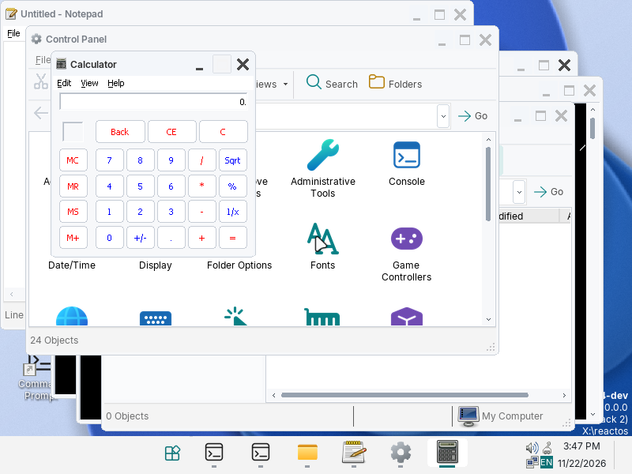
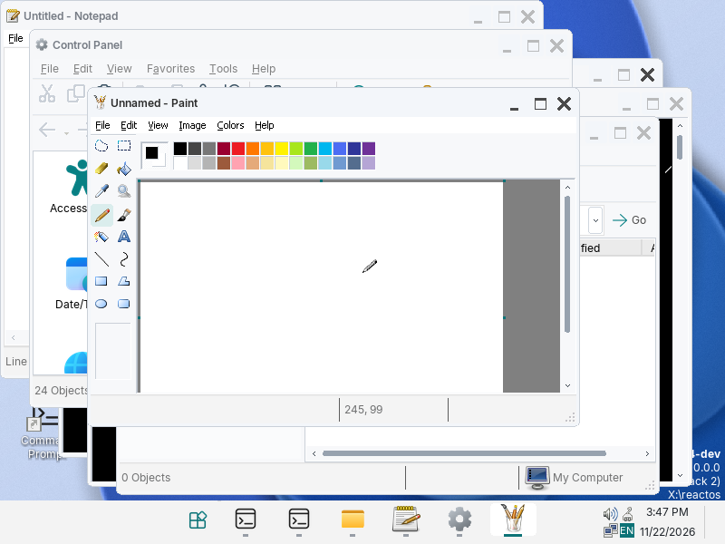
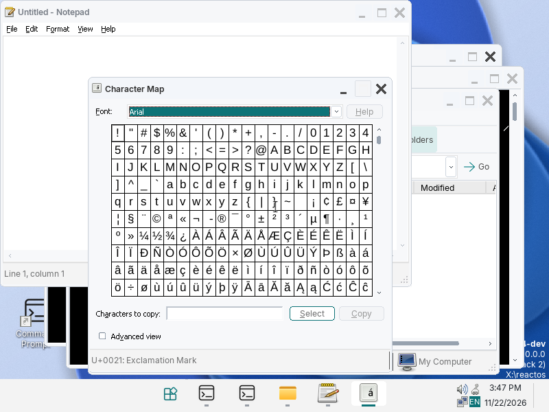
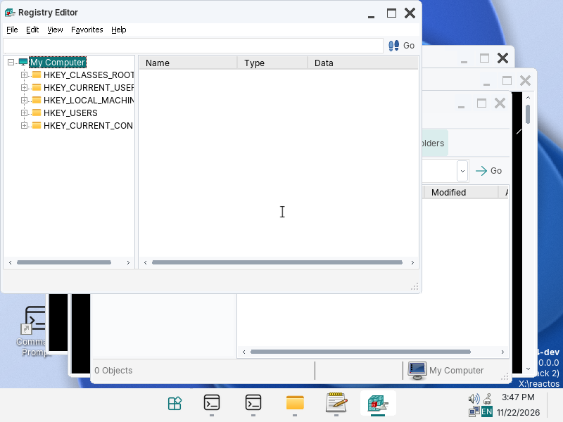
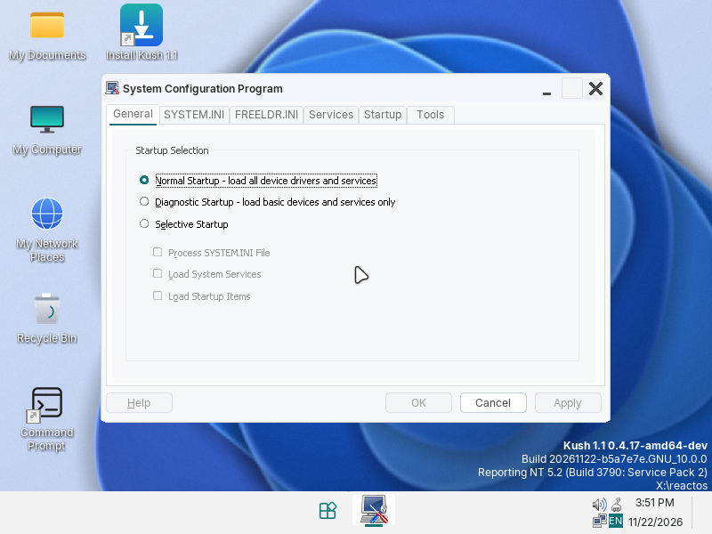
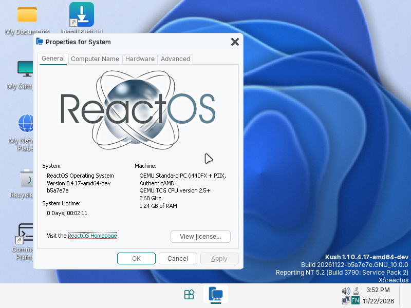
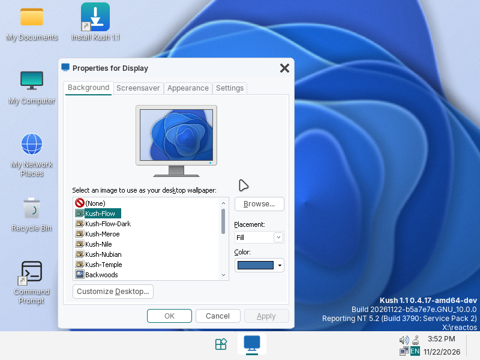
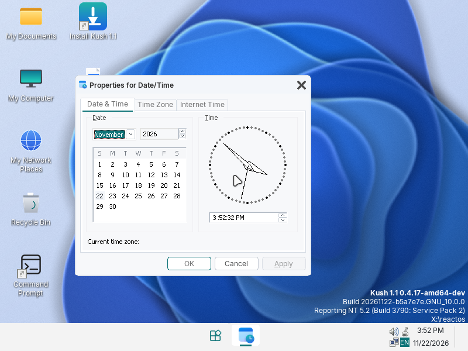
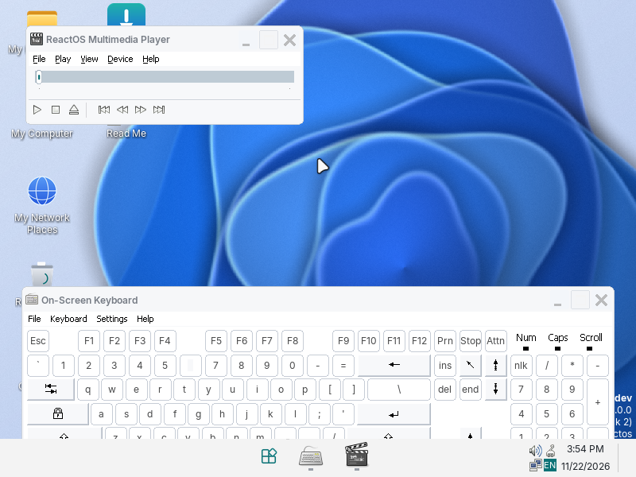

# مراجعة البرامج والحوارات القديمة، 22 نوفمبر 2026

هذه مراجعة بصرية فعلية داخل QEMU، وليست تحديثا لهذه البرامج ولا اختبار توافق كامل. القياس 800×600 و96DPI. الهدف تحديد مواضع الواجهة القديمة بعد تحديث Task Manager وحوار فتح الملفات وصفحتي LiveCD، مع إبقاء وظائف البرامج كما هي.

## مصدر الصور وحدودها

- صور Calculator وPaint وCharacter Map وRegistry Editor من بناء LiveCD الثاني، SHA256: `b306282a4aa8497b9d57c6f18c7cf8cb1cc287e22e04ece5f1d9e1df981c91cb`.
- صور System Configuration وSystem Properties وDisplay وDate/Time ولوحة المفاتيح ومشغل الوسائط من بناء حوار الملفات الثالث السابق لتعديل LiveCD، SHA256: `d00ad784a4c5609f043ba34ef8a9064a0dfaaa4291da96c4dd97b4c210132fba`. أُعيد تنزيله وطابقت بصمته قبل الإقلاع لمقارنة عطل WordPad. لذلك لا تُعرض هذه الصور كاختبار إضافي للبناء الأحدث.
- فتح نافذة لا يثبت صحة كل وظائفها. لم تُغيّر إعدادات النظام، ولم يُفتح ملف صوت أو فيديو، ولم تُجرّب كل أدوات الرسم أو أوامر السجل. لم تُستخدم لوحة المفاتيح للكتابة.

## الجرد البصري

| النافذة | الملاحظة المرئية | حدود الفحص |
|---|---|---|
| Calculator | مساحة صغيرة وأزرار كثيفة وألوان نص حمراء وزرقاء لا تتسق مع بقية الواجهة | فتح الوضع القياسي فقط؛ لم تُختبر العمليات هنا |
| Paint | شبكة أدوات صغيرة ولوحة ألوان قديمة ومساحة عمل رمادية | فتح النافذة فقط، بلا تعديل صور |
| Character Map | شبكة رموز كثيفة ونصوص وأدوات صغيرة | لا تحقق من كل الخطوط أو نسخ الرموز |
| Registry Editor | شجرة ضيقة وأيقونات صغيرة وأسماء مفاتيح مقصوصة | مشاهدة فقط، بلا تعديل السجل |
| System Configuration | تبويبات وخيارات صغيرة ومسافات ضيقة | إغلاق دون تغيير خيارات بدء التشغيل |
| System Properties | ترتيب معلومات قديم وشعار ReactOS كبير | لا تغيير إعدادات؛ أي تحديث لاحق للهوية يجب أن يحفظ نسب المشروع الأصلي وحقوقه |
| Display Properties | معاينة شاشة وقائمة وخيارات خلفية بالترتيب القديم | إغلاق دون تغيير الدقة أو الخلفية |
| Date and Time | ساعة وعناصر تقويم صغيرة | إغلاق دون ضبط الوقت |
| On-Screen Keyboard | أزرار صغيرة؛ الصف السفلي ظاهر جزئيا خلف شريط المهام عند هذه الدقة | رسالة الترحيب أُغلقت دون تغيير خيار عدم إظهارها؛ لم تُختبر الكتابة |
| Multimedia Player | نافذة ضيقة وأزرار أدوات صغيرة وقديمة | النافذة فتحت؛ تشغيل الوسائط غير مختبر |

### Calculator

### Paint

### Character Map

### Registry Editor

### System Configuration

### System Properties

### Display Properties

### Date and Time

### On-Screen Keyboard وMultimedia Player

الصورة التالية تجمع النافذتين الفعليتين. الجزء السفلي من لوحة المفاتيح مخفي خلف شريط المهام؛ هذه ملاحظة على الحالة الحالية وليست صورة مكتملة لكل مفاتيحها.

## WordPad: عطل لا يُنسب إلى LiveCD

لم تظهر نافذة WordPad على البناء الأحدث، وسُجّل استثناء second-chance من النوع `c0000005` في `wordpad.exe` داخل `msvcrt.dll+0x5a438`. سبقته أخطاء اتصال طباعة، لكن التسلسل الزمني لا يثبت السبب.

للمقارنة أُقلع بناء حوار الملفات الثالث السابق لتعديل LiveCD، بعد مطابقة بصمته. ظهرت صفحة اللغة القديمة فعليا، ثم جُرّب WordPad كأول برنامج بعد الوصول لسطح المكتب. تكرر الاستثناء نفسه بالموديول والإزاحة نفسيهما.

**النتيجة المحددة:** العطل يسبق دفعة LiveCD فقط. هذه المقارنة لا تثبت أنه يسبق كل تعديلات الواجهة السابقة، ولا تحدد السبب الجذري. لم يُغيّر محرك WordPad أو الطباعة أو أي وظيفة أساسية لمعالجته. يظل العطل مفتوحا خارج نطاق التجميل الحالي.

القول السابق إن اختبار التطبيقات الأربعة لم يسجل KUSH-EXC يخص Explorer وcmd وNotepad وControl Panel في نهاية اختبار LiveCD المحدود، وليس كل البرامج أو جلسة المراجعة اللاحقة.

## ترتيب العمل التالي

ابدأ بواجهة Calculator القياسية لأنها نافذة صغيرة مستقلة وواضحة المقارنة: مساحات أوسع، شاشة أرقام أوضح، أزرار محايدة، وتيل لزر النتيجة. تبقى معرفات الأزرار ومسارات الحساب والكيبورد والقوائم الأصلية دون تغيير. يلزم مفتاح رجوع مستقل وصور حقيقية واختبار للواجهة الجديدة قبل اعتبارها منجزة. الأوضاع العلمية والتحويل لا تُوصف كمحدثة أو مختبرة قبل فحصها.

بقية الجدول قائمة مواضع تحتاج عملا، وليست إعلانا عن اكتمال مراجعة كل برامج النظام.

## تحديث لاحق لنفس اليوم

نُفّذت واختُبرت بعد نشر الجرد واجهة الحاسبة القياسية فقط. التفاصيل والصور ومفتاح الرجوع في [تقرير الحاسبة](kush-calculator-2026-11-22.md). بقية نتائج الجرد لا تعني اكتمال تحديث البرامج.

اتصلح لاحقا ارتفاع وموضع لوحة المفاتيح على الشاشة، مع الحفاظ على شكل الأزرار والإدخال الأصليين. صارت صورة OSK أعلاه توثق حالة ما قبل التصحيح، لا الحالة الأحدث. اختبار التخطيطين والكتابة والرجوع وحدوده في [تقرير OSK](kush-osk-2026-11-22.md).

اتحدثت لاحقا واجهة خريطة الرموز فقط، بخلفية بيضاء ومسافات أوسع وشبكة أخف، مع بقاء المحرك الأصلي. صورة الجرد القديمة توثق الحالة السابقة. اختُبر اختيارA ونسخه إلىNotepad وAdvanced وInter وCharset437 ثمUnicode والرجوع1 ثم0 وفحص تشغيل البرامج الأربعة. [تقرير خريطة الرموز والصور وحدود الاختبار](kush-charmap-2026-11-22.md). هذا لا يحسم بقية صفوف الجرد أو عطلWordPad.

اتحدثت لاحقا مساحات وألوان Paint وحدود نافذته العادية والمكبرة. صورة الجرد القديمة توثق حالة ما قبل الدفعة. اختُبرت نقاطPencil وUndo/Redo ومعاينتا اللون وعرض الإعدادات وView والرجوعClassicPaint1 ثم0 وفحص تشغيل البرامج الأربعة. سحبLine لم يجتز الاختبار، وتكرر علىISO خريطة الرموز السابق؛ السبب غير محدد ولا يوجد إصلاح لمحرك الرسم. [تقرير Paint والصور وحدود الاختبار](kush-paint-2026-11-22.md). بقية صفوف الجرد وعطلWordPad لم تُحسم.

اتحدثت لاحقا مساحات Registry Editor وشجرته وأعمدته وصف العنوان وحدود التكبير فقط. اختُبر الانتقال وحوارDWORD وإلغاؤه والفرز والفاصل وشريط الحالة والرجوع1 ثم0 وفتح البرامج الأربعة. استثناء الإغلاق من الدرجة الأولى أُعيد إنتاجه في المحرر الأصلي علىISO Paint السابق، ولم يُصلح ضمن دفعة العرض. [التقرير والصور والحدود](kush-regedit-2026-11-22.md). لا تعني نتيجة العرض اختبار كل أوامر تعديل السجل.

اتحدثت لاحقا النافذة العادية لمشغل الوسائط إلى560×160 وخلفية بيضاء ومسار تقدم أخف ومناطق أزرار أوسع، مع إبقاء صورها الأصلية ومحركMCI. ظهرMSVideo1 كاملا في التخطيط المدمج الأصلي328×324، واجتازت حالاتالأوامر والرجوع1 ثم0 وقياسا480/680 برمجيا وفتح البرامج الأربعة فحصا محدودا. رسالةMMSYS5 وبقاء رسم الفيديو خلف العناصر بعد الرجوع أثناء التشغيل تكررا فيISO السابق، دون إصلاح هنا أو إثبات للصوت. صورة الجرد أعلاه توثق الحالة السابقة فقط. [تقرير المشغل والصور والحدود](kush-media-2026-11-22.md).

اتحدث لاحقا عرض System Configuration فقط، مع صفوف أوسع وأعمدة أوضح واحتفاظ بالأوامر وحالات التعطيل الأصلية. صورة الجرد أعلاه توثق الحالة السابقة. اختُبرت الصفحات الست وSelective/Normal وcheckbox غير القابل للتعديل وTools/Console وCancel والرجوع1ثم0 والبرامج الأربعة. لا إضافة لتطبيق إعدادات الإقلاع أو إدارة الخدمات. [تقرير System Configuration والصور والحدود](kush-msconfig-2026-11-22.md).

اتحدثت لاحقا ألوان التاريخ والوقت فقط، مع بقاء404×344 والصفحات وحسابات الوقت والتزامن الأصلية. صور الجرد أعلاه توثق الحالة السابقة. اختبرت الصفحات الثلاث وتحرك الساعة وتحديد يوم ثمCancel والرجوعClassicDateTime1ثم0 والبرامج الأربعة. لم يطبق تغيير وقت أوتزامن، والحقل الفارغ موجود فيالأساس. [التقرير والصور والحدود](kush-timedate-2026-11-22.md).

اتحدث لاحقا سطح خصائص العرض وحدود مجموعاته فقط، مع بقاء394×452 والصفحات والموارد والأوامر الأصلية. اختبرت الصفحات الأربع واختيار خلفية ثمCancel والرجوعClassicDisplay1ثم0 والبرامج الأربعة. شرائط رمادية باقية، ولا تطبيق لتغيير الخلفية أوالثيم أوالدقة. صورة الجرد توثق الحالة السابقة. [التقرير والصور والحدود](kush-display-2026-11-22.md). يبقىSystem Properties من الجرد دون دفعة عرض جديدة، وعطلWordPad مفتوح منفصلا.

## حالة الجرد بعد آخر دفعة

سطح أبيض ونص داكن وحدود مجموعات خفيفة في General وHardware وAdvanced فقط، مع بقاء 410×461 والموارد والأوامر الأصلية. Computer Name الخارجية والشعار الأصلي وشرائط النص الفاتحة وقص زر Environment Variables باقية. اختُبرت الصفحات الأربع وuptime وحوار الترخيص والرجوع ClassicSystemProperties1ثم0 وفتح البرامج الأربعة. لا Apply أوتغيير إعدادات، وحراس RTL والتباين وDPI مصدر فقط. [تقرير خصائص النظام](kush-system-2026-11-22.md). صور الجرد الأولى توثق ما قبل هذه الدفعات. لا نافذة أخرى غير معالجة في هذا الجرد المحدود، لكن حدود الاختبارات موثقة في تقاريرها، وعطل WordPad باق. هذا لايعني اكتمال كل برامج النظام أوخطة Fluent العامة.
