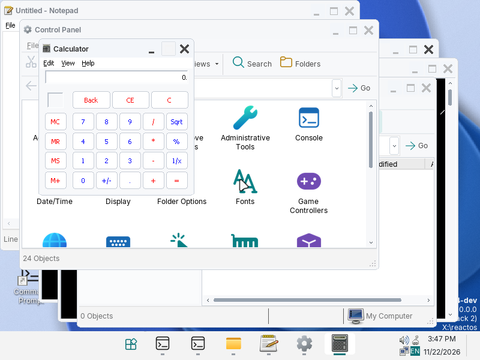
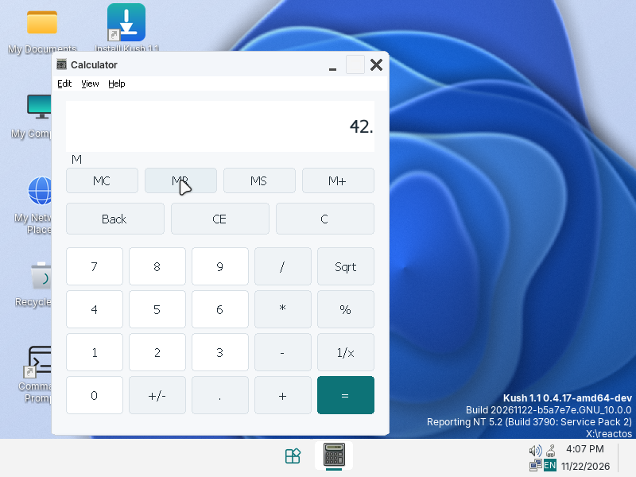
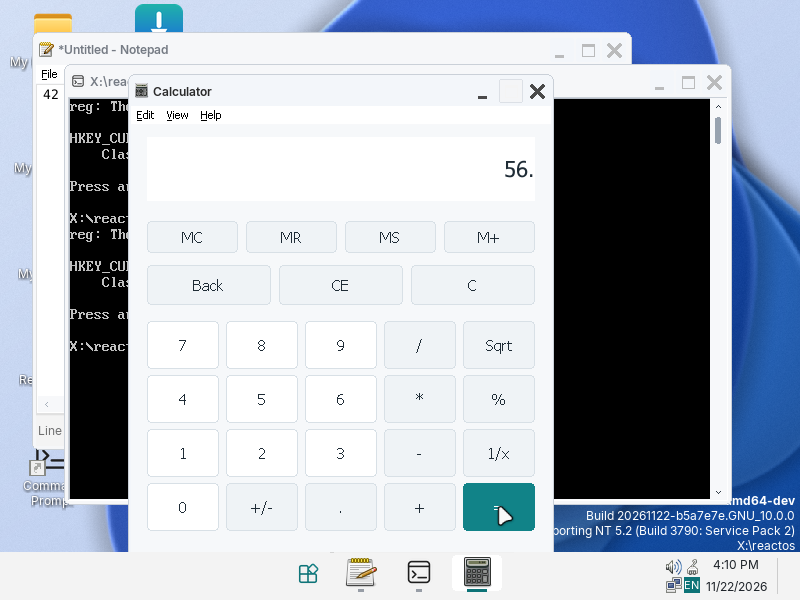
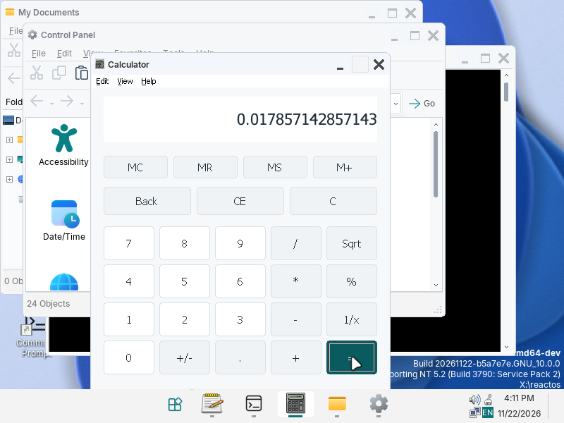
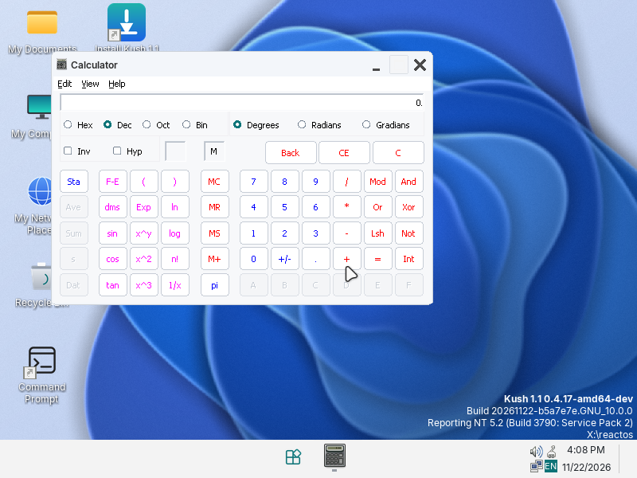
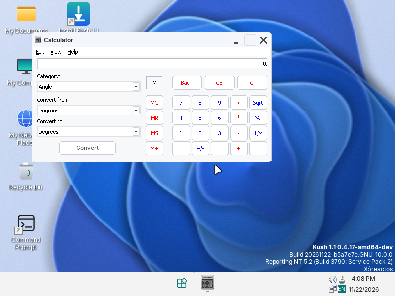
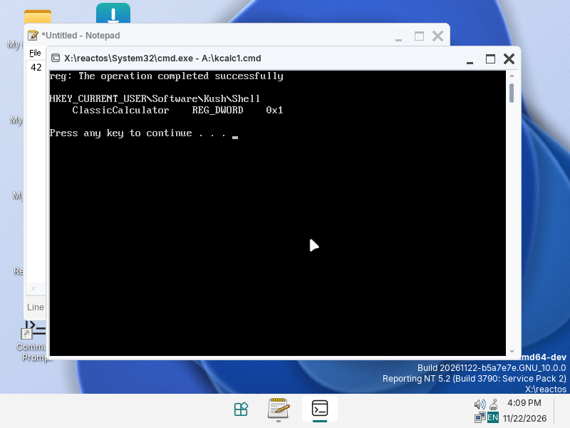
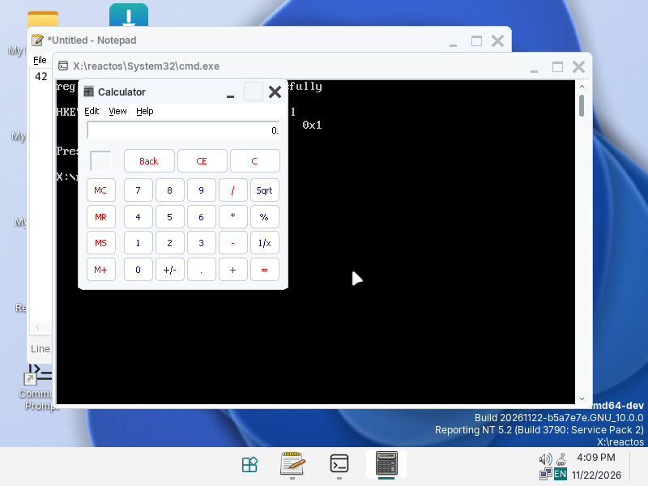
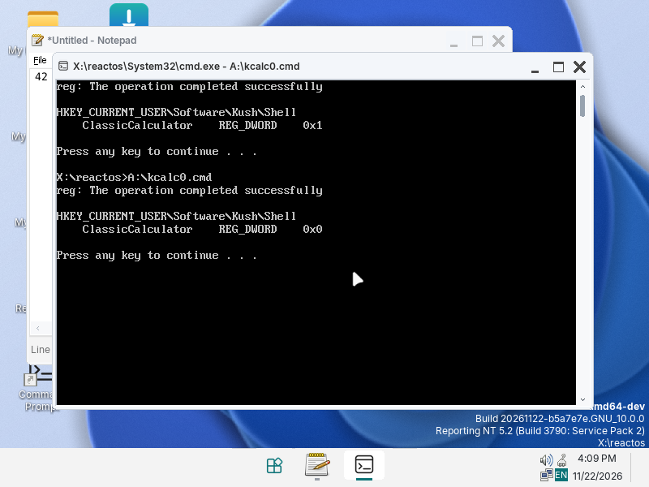
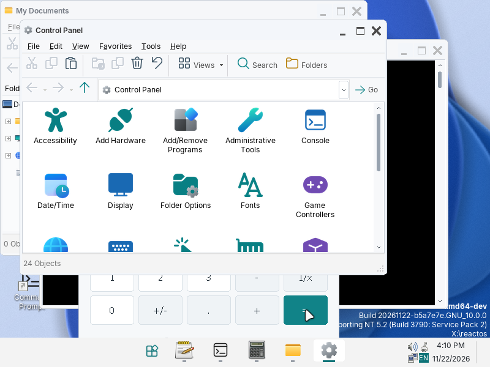

# واجهة الحاسبة القياسية، 22 نوفمبر 2026

## المشكلة والسبب

قالب Calculator القياسي كان صغيرا، بأزرار ونصوص كثيفة وألوان حمراء وزرقاء قديمة. ثيم النظام وحده لا يعيد ترتيب هذه العناصر لأن البرنامج يرسم أزراره بنفسه ويأخذ مواضعها من قالب الحوار القديم.

## التعديل البصري

- مساحة داخلية 420×430 بكسل عند 96DPI، مع إبقاء النافذة داخل مساحة العمل فوق شريط المهام.
- شاشة أرقام أكبر، وصف مستقل للذاكرة، وصف Back وCE وC، وشبكة حساب بأزرار 72×48 بكسل. النصوص ومعرفات العناصر الأصلية باقية.
- خلفية فاتحة، أرقام داكنة، أزرار محايدة وزر نتيجة تيل، مع رسم hover وpressed وfocus وdisabled. الصورة المضغوطة تحقق حالة الضغط؛ حالة disabled ليست ضمن اختبار الوضع القياسي.
- عائلة الخط الأصلية موروثة، بحجم 15 بكسل للأزرار و22 للأرقام. عرض الرقم الطويل يختار خطا أصغر من الخطوط الجاهزة، دون تغيير الرقم أو دقته أو تنسيقه. موارد GDI تُحرر عند إغلاق الحوار أو تغيير الوضع.
- لا تغيير في محرك الحساب أو رسائل الأوامر أو الاختصارات أو Clipboard أو موارد الترجمة. التغيير داخل عرض الحاسبة الأصلية، وليس برنامجا بديلا.

الوضعان Scientific وConversion يظلان على القالب والرسم الأصليين. فتحهما والرجوع منهما اختُبر، وليس كل عملياتهما.

## الرجوع

`HKCU\Software\Kush\Shell\ClassicCalculator` من نوع DWORD:

- `1`: عرض الحاسبة الأصلي.
- `0` أو غياب القيمة: العرض الجديد للوضع القياسي فقط.

يُعاد التقييم عند إنشاء الحوار، فافتح عملية جديدة أو أعد اختيار الوضع. اختُبر 1 ثم 0 في عمليتين جديدتين مع قراءة القيمة بأمر reg query. ClassicWindows=1 والتباين العالي وRTL وأي DPI غير 96 ومساحة العمل غير الكافية تترك القالب الأصلي، لكن هذه الحالات لم تُختبر فعليا في هذه الدفعة.

## الاختبار الفعلي

ISO البناء الأول حُفظ في نسخة احتياطية خاصة قبل الإقلاع، ثم نُزّل مجددا وطابقت بصمته:

`5bb19314eb38627768ce4429a6cd8be71d43b44a6e105d92a547d570a63ae3dc`

QEMU، دقة 800×600 و96DPI، English/US:

- كتابة `12 + 30` ثم Enter أظهرت 42.
- MS ثم مسح الرقم ثم MR أعاد 42 وظهرت علامة M.
- زر Sqrt بالماوس حوّل 9 إلى 3.
- `9 / 0` أظهر Error الأصلي، ثم Escape أعاد الإدخال.
- الانتقال إلى Scientific ثم Conversion ثم Standard نجح، ورجع العرض الجديد. لم تتغير واجهتا الوضعين الآخرين.
- Ctrl+C من الحاسبة ولصق الرقم في Notepad أظهر 42، ثم Ctrl+V في الحاسبة أعاد 42.
- إدخال 32 رقما أظهر النص كاملا مع فواصل التجميع وخط أصغر، بلا قص ظاهر. هذا اختبار عرض، لا ادعاء دقة حسابية من 32 رقما.
- `8 * 7` ثم الضغط على زر = بالماوس أظهر 56. فُحص أيضا شكل زر النتيجة أثناء الضغط عليه.
- مفتاح الرجوع 1 أعاد القالب القديم، ثم 0 أعاد الواجهة الحديثة في عملية جديدة.
- Explorer وcmd وNotepad وControl Panel فتحت على البناء الجديد. سجل نهاية هذا الفحص المحدود 91305 بايت، وعدد KUSH-EXC صفر. لا يشمل ذلك WordPad أو كل البرامج، ولا يحسم عطل WordPad المسجل في المراجعة السابقة.

## الصور الفعلية

القوائم وشريط العنوان وأيقونة البرنامج لم تُعدّل في هذه الدفعة. بقية البرامج في جرد المراجعة لم تُحدّث بعد. لا ادعاء باكتمال التوافق أو الوصول أو الاختبارات على لغات ودقات أخرى.
