# خريطة الرموز: ترتيب وألوان الواجهة

22 نوفمبر 2026. هذه دفعة عرض محدودة لبرنامج Character Map، وليست تحديثا لمحرك الخطوط أو الرموز ولا إكمالا لكل برامج النظام.

## المشكلة والقرار

القالب الأصلي ضيق وشبكته سوداء كثيفة. اتوسعت المسافات وخفّت خطوط الشبكة، مع خلفية بيضاء وتحديد تيل فاتح. عناصر النظام الأصلية باقية، وليس هناك نافذة بديلة أو شبكة رموز جديدة. الإطار وأزرار العنوان يستعملان العمل السابق للنظام.

مساحة الحوار الرئيسي 530×388 بكسل، والشبكة 498×232، ولوحة Advanced الإضافية 530×86 عند 96DPI. تتوزع الخلايا الأصلية ذات 20 عمودا و10 صفوف على المساحة الجديدة. تغيرت مستطيلات الرسم فقط؛ تعداد الرموز، اختيار الخط، مجموعات المحارف، مسارات الماوس والكيبورد والنسخ والحفظ الأصلية لم تتغير. لم تُضف خطوط أو أيقونات أو خلفية في هذه الدفعة.

التخطيط الجديد يتحقق من مساحة العمل وقياس نصوص التسميات والأزرار وبنية القالب قبل تحريك العناصر. إذا لم تكف المساحة، أو لم تلائم النصوص، يحتفظ بالقالب الأصلي. RTL والتباين العالي وDPI غير96 وClassicWindows تترك المسار الأصلي. هذه الحواجز موجودة في الكود، لكنها لم تُختبر فعليا هنا.

## قبل وبعد من QEMU

قبل التعديل، على ISO دفعة OSK السابقة:

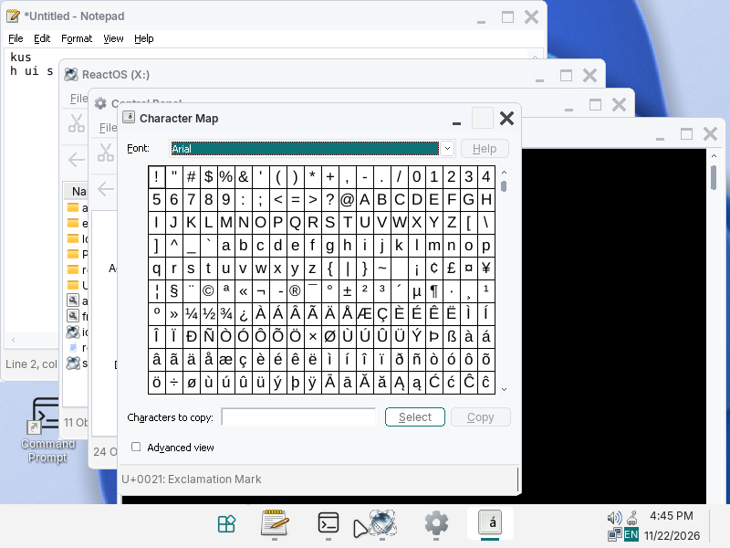

بعد التعديل، على ISO خريطة الرموز الأولى:

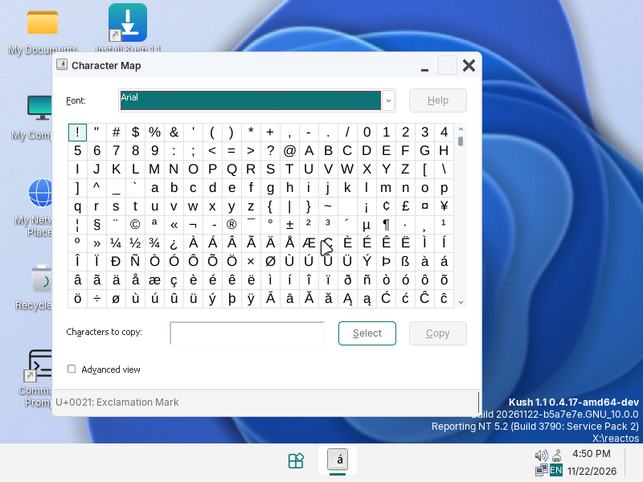

## ما اختُبر فعليا

بيئة الاختبار: إقلاع LiveCD نظيف، English (United States) وUS، 800×600 و96DPI. كل الصور التالية من البناء نفسه بعد حفظ نسخة ISO احتياطية والتحقق منها، وليست نماذج تصميم.

1. اختيار A بالماوس من الشبكة ثم Select أظهر A في حقل النسخ وU+0041 في شريط الحالة. نافذة تكبير الحرف هي الأصلية.
2. Copy ثم Ctrl+V في Notepad لصق A فعليا.
3. Advanced view أظهر اللوحة كاملة فوق شريط المهام. اختيار Inter من قائمة الخطوط الأصلية غيّر عرض الرموز. هذا اختبار لخط واحد، وليس إضافة خط جديد أو فحصا لكل الخطوط.
4. قائمة Charset فتحت؛ اختيار OEM United States (437) غيّر الشبكة، ثم أعادت Unicode الشبكة. لا ادعاء بفحص كل الصفحات أو كل الرموز.
5. بعد إغلاق البرنامج، أعادت قيمة ClassicCharacterMap=1 الشكل الأصلي في عملية جديدة، ثم أعادت0 الشكل الحديث. صُورت نتائج reg query في الحالتين. اختيار Inter وحالة Advanced بقيتا عبر آلية Settings الأصلية، دون تغييرها.
6. Explorer وcmd وNotepad وControl Panel فتحت على البناء نفسه؛ نفذ cmd أمر echo، وبقي A في Notepad. هذا فحص تشغيل محدود وليس اختبار كل وظائف البرامج الأربعة.

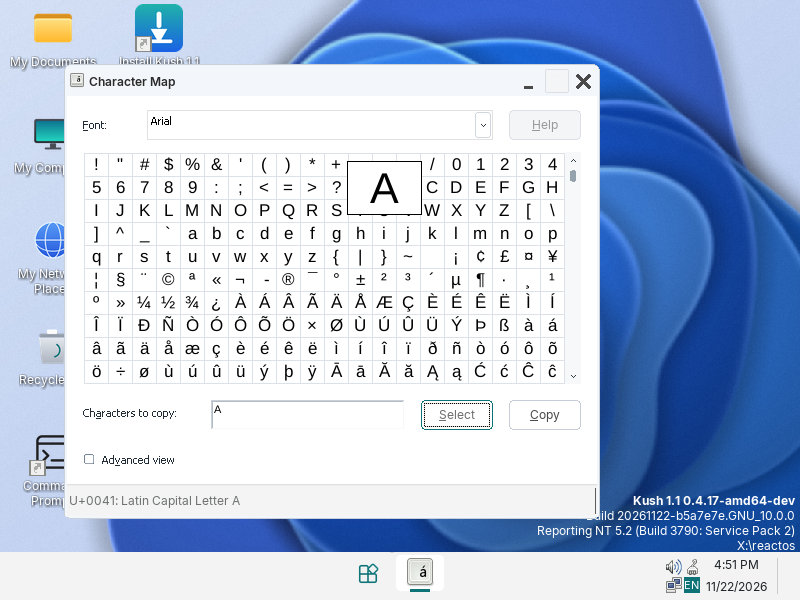

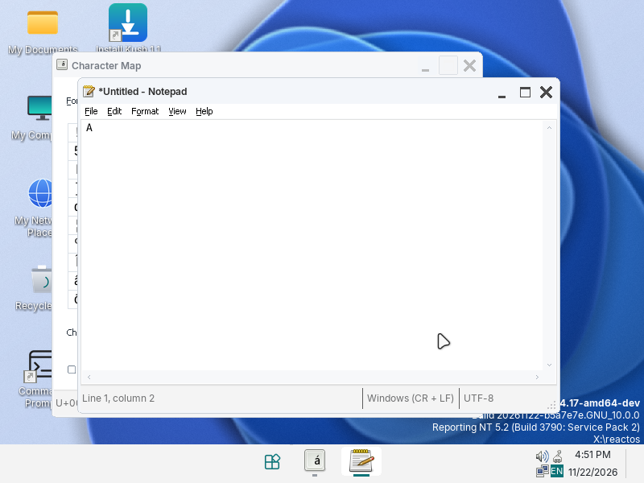

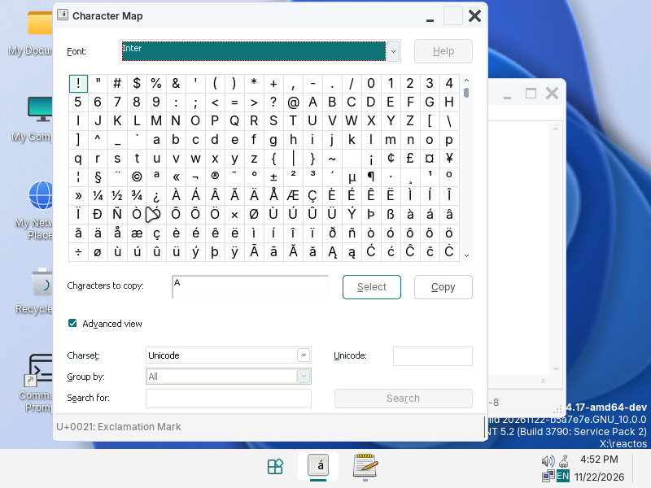

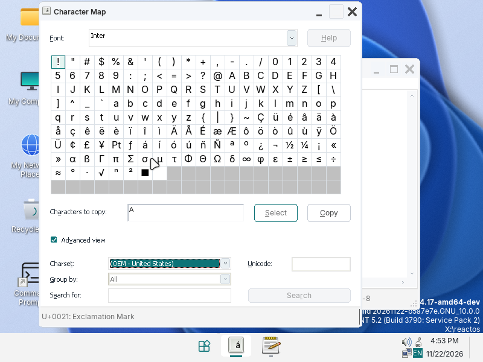

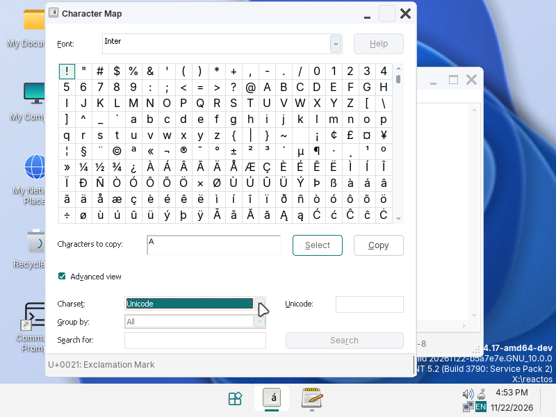

## مفتاح الرجوع

`HKCU\Software\Kush\Shell\ClassicCharacterMap` من نوع DWORD. القيمة1 تعطل عرض هذه الدفعة، والقيمة0 أو حذف القيمة يعيدان تفعيله عند فتح عملية جديدة إذا نجحت حواجز التخطيط. لم يُحذف المفتاح في الاختبار؛ جُربت1 ثم0 فقط.

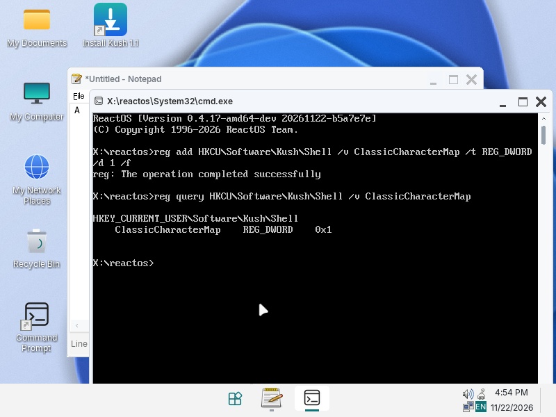

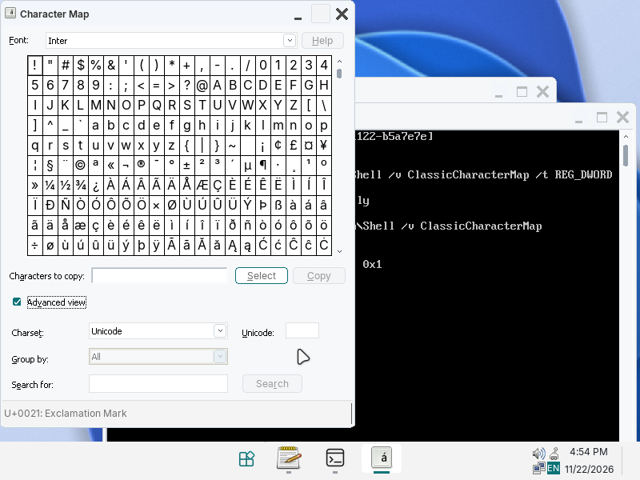

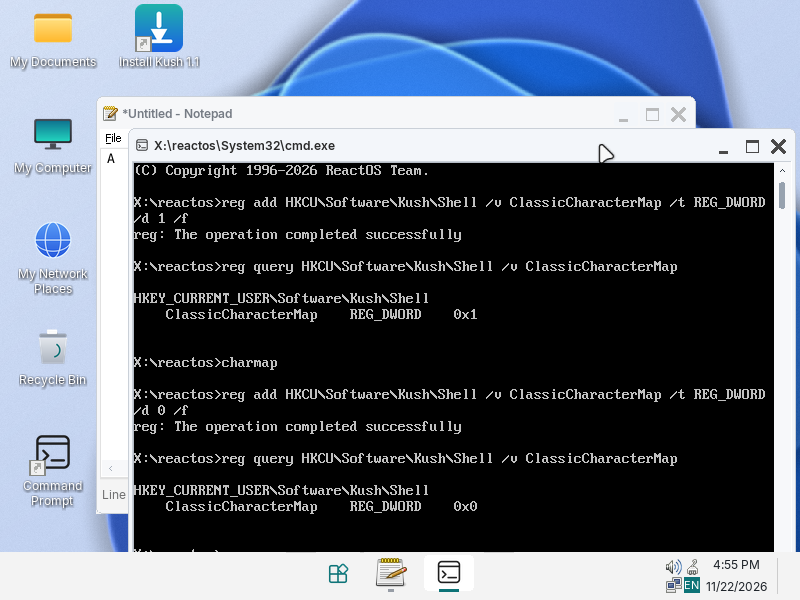

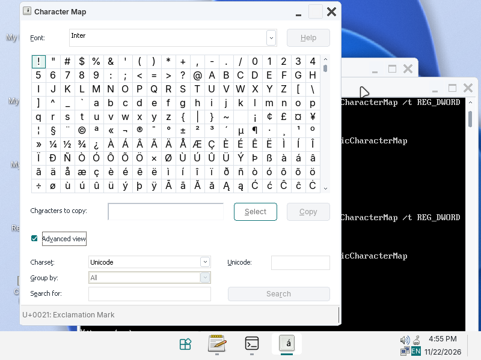

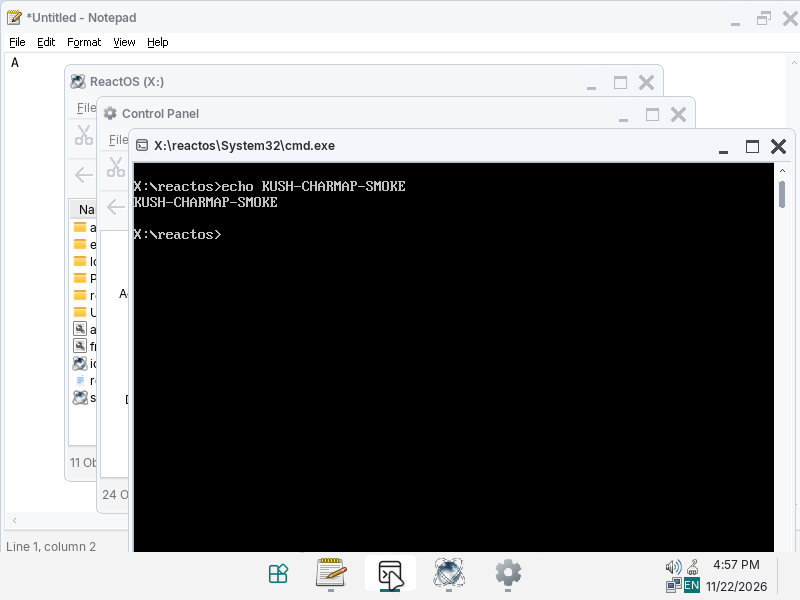

## البناء وحدود النتيجة

نجح `ninja -j2 charmap bootcd` بعد تصحيح اسم ماكرو عد العناصر إلى SIZEOF الموجود في المشروع؛ سجل البناء النهائي بلا تحذيرات مترجم. حجم ISO هو406847488بايت. حُفظ في نسخة احتياطية خاصة جديدة، وأعيد تنزيله وطابق SHA256 قبل تشغيله:

`70978fcdc3315d7c6b0bdab69a3060448bb6021697aff937b404adc779ca712a`

نسخة سجل نهاية الفحص90806بايت، بلا KUSH-EXC أو Fatal System Error. توجد رسائل تشخيص أخرى للنظام؛ لا تعني النتيجة أن السجل خال من كل الأخطاء أو أن النظام كله سليم.

Help وGroup by وSearch تظل معطلة كما كانت أصلا. لم تُضف وظائف بحث أو تجميع، ولم تُفحص الطباعة أو WordPad أو كل إدخالات Unicode أو كل تفاعلات الكيبورد والتمرير. لم تُختبر العربية أو RTL أو التباين العالي أو DPI آخر أو تعدد الشاشات. هذه الدفعة لا تحسم سبب توقف جلسة OSK السابقة ولا عطل WordPad المفتوح. بقية البرامج ما زالت قيد العمل.
