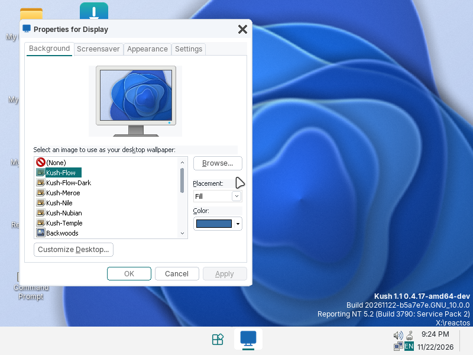

# خصائص العرض: سطح أخف مع الإعدادات الأصلية

22 نوفمبر 2026. دفعة عرض محدودة على800×600 و96DPI وEnglish/US. هندسة النافذة394×452 والصفحات الأربع والموارد والأوامر الأصلية لم تتغير.

## القرار والتنفيذ

خلفية بيضاء للنافذة والصفحات، ونص داكن مع الحفاظ على لون النص المعطل، وحدود مجموعات خفيفة. التنفيذ في `dll/cpl/desk/desk.c` فقط. أغلفة الصفحات تستدعي إجراءاتها الأصلية أولا، ثم تضيف subclass لرسم السطح. SettingsPageCallbackProc ومسارات إضافة الصفحات الأصلية باقية. لا تعديل في محرك الخلفيات أو الثيمات أو شاشة التوقف أو تعريف العرض.

**حدود بصرية باقية:** شرائط بعض العناصر الثابتة ومعاينة الشاشة ما زالت بلون الثيم الفاتح، وبعض النصوص المعطلة منخفضة التباين مثل الأصل. ليست إعادة تصميم كاملة. جُرّبت معالجة إضافية لـWM_PRINTCLIENT في بناء خامس، ولم تحسن هذه الشرائط في الصورة الفعلية، فتراجعت عنها. الصور والاختبارات النهائية تخص البناء الرابع.

أُلغي ثيم Static العادي وButton من نوعGroupBox داخل هذه الصفحات فقط؛ لم تتغير عناصرowner-draw أوbitmap أوicon، ولا ثيم الأزرار العادية أوحقول الإدخال أوالمعاينات. لا اعتمادات جديدة ولا رسم دوري جديد.

## المقارنة الفعلية

كل الصور لقطاتQEMU أصلية غير معدلة.

| الصفحة | الأصل | الجديد |
|---|---|---|
| الخلفية | [قبل](2026-11-22-display-before-main.png) | [بعد](2026-11-22-display-main.png) |
| شاشة التوقف | [قبل](2026-11-22-display-before-screensaver.png) | [بعد](2026-11-22-display-screensaver.png) |
| المظهر | [قبل](2026-11-22-display-before-appearance.png) | [بعد](2026-11-22-display-appearance.png) |
| إعدادات الشاشة | [قبل](2026-11-22-display-before-settings.png) | [بعد](2026-11-22-display-settings.png) |



ظل مسارVisual Style أطول من حقل عرضه، كما في الأصل. لم يتغيرBochs Graphics Adapter أو800×600 أوTrue Color32bit.

## ما اختبر فعليا

- فتحت الصفحات الأربع وفُحصت النصوص والأزرار والمعاينات وحالات التعطيل.
- اختيرKush-Flow-Dark فتغيرت معاينة الشاشة وتفعّلApply، دون تغيير خلفية سطح المكتب. [التحديد](2026-11-22-display-selection.png).
- Cancel ثم إعادة الفتح أعاداKush-Flow معApply معطل. [بعد الإلغاء](2026-11-22-display-cancel-restored.png).
- ClassicDisplay=1 أعاد السطح الرمادي الأصلي، ثم0 أعاد الأبيض بعد إعادة الفتح: [القيمة1](2026-11-22-display-registry1.png)، [الأصل](2026-11-22-display-classic1.png)، [القيمة0](2026-11-22-display-registry0.png)، [الجديد](2026-11-22-display-modern0.png).
- فتحتExplorer وcmd وNotepad وControl Panel على نفسISO: [البرامج الأربعة](2026-11-22-display-apps.png)، وكتبت عينة في[Notepad](2026-11-22-display-notepad.png).
- سجل الجلسة الأخيرة96423بايت، بلاKUSH-EXC أوUnhandled exception أوKeBugCheck أوBugCheck أوAssertion failed في هذا الفحص. تحذيرات أخرى باقية؛ لا ادعاء بخلو النظام كله من الأعطال.

لم تضغطApply أوOK أوPreview أوPower أوAdvanced، ولم تختبر تغييرات فعلية للدقة أوالثيم أوشاشة التوقف أوإعدادات الطاقة.

## الرجوع والحراس

```bat
reg add HKCU\Software\Kush\Shell /v ClassicDisplay /t REG_DWORD /d 1 /f
```

أغلق النافذة وافتحها من جديد. القيمة0 تعيد العرض الجديد. ClassicWindows غير الصفري يعيد المسار الأصلي أيضا. الحراس توقف هذه الدفعة عندArabic/Hebrew UI أوprocessRTL أوالتباين العالي أوDPI غير96. هذه الفروع راجعت في المصدر فقط، ولم تختبر بصريا.

## البناء وحدوده

بُنيdesk.cpl وbootcd. ISO البناء الرابع407896064بايت، SHA256:

`78f6a9f751cbdb7423dd5ffd31967a6d220aba66b7cdfc610e4f7c805fddeecf`

حُفظت نسخة خاصة جديدة وأعيد تنزيلها وتطابقت البصمة قبل الإقلاع. نسخةbootstride1 المخصصة لطلب التسليم لم تتغير؛ هذا اختبار مستقل وليس تسليمDrive. لا اختبار جهاز حقيقي أوتثبيت، ولا إصلاحFirefox أوSPSS أوتعريفات ضمن هذه الدفعة.
