# واجهة مشغل الوسائط، 22 نوفمبر 2026

دفعة عرض محدودة لبرنامج Multimedia Player الأصلي `mplay32`، وليست محرك وسائط جديدا أو إثبات توافق عام. الصور أدناه من QEMU فعلي بدقة800×600 و96DPI وEnglish/US. لم تُستخدم صور تصور أو بيانات خاصة.

## المشكلة والقرار

النافذة العادية القديمة350×125 صغيرة ومزدحمة. اتسعت إلى560×160، بحد أدنى480 بكسل، وخلفية بيضاء ومسار تقدم رفيع ولون تيل لعرض الموضع. اتسعت مناطق أزرار الأدوات إلى36×36، لكن الصور الأصلية16 بكسل باقية. لم تُستبدل هذه الصور بأيقونات جديدة، ولا تمثل الدفعة اكتمال هوية المشغل.

محرك MCI واختيار الأجهزة وأوامر التشغيل والإيقاف والقوائم والملفات لم تتغير. مسار التقدم ما زال عنصر النظام الأصلي، بما فيه المقبض والإدخال. الرقم المعروض يظل بوحدة الجهاز الأصلية؛ في عينة AVI هو موضع إطار، وليس وعدا بعرض ثوان أو زمن منسق.

العرض المدمج للفيديو يستعمل التخطيط الأصلي وأزراره23×22. استعادة المقاييس و`TB_AUTOSIZE` تسبق انتقال العرض، حتى لا يضيف ارتفاع الأزرار الحديثة14 بكسلا إلى نافذة الفيديو.

## قبل وبعد والرجوع

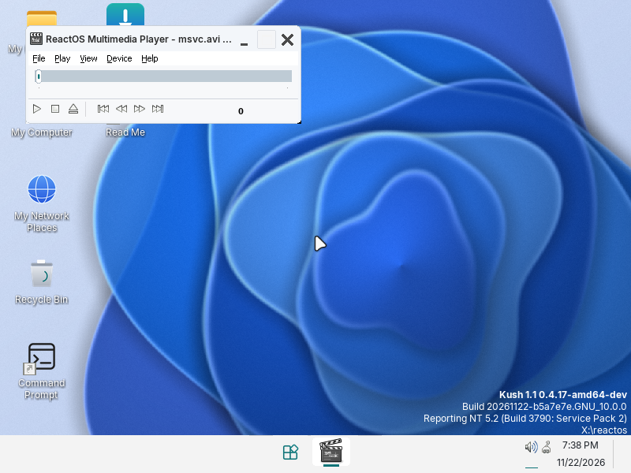

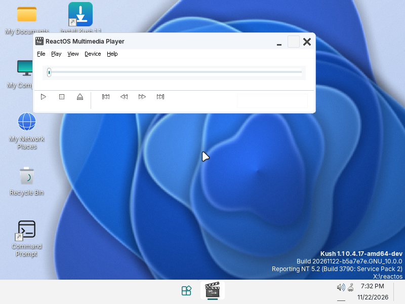

للرجوع المستقل، أغلق المشغل ثم نفذ:

```bat
reg add HKCU\Software\Kush\Shell /v ClassicMediaPlayer /t REG_DWORD /d 1 /f
```

افتحه من جديد. القيمة0 تعيد الواجهة الحديثة في عملية جديدة. اختُبر الاتجاهان مع قراءة القيمة. `ClassicWindows=1` يترك العرض الأصلي أيضا. التباين العالي وDPI غير96 ومساحة العمل الصغيرة ولغة الواجهة العربية أو العبرية وتخطيط العمليةRTL تترك المسار الأصلي. هذه الحواجز راجعت في المصدر، ولم تُختبر إعداداتها فعليا في هذه الدفعة. أضيف فحص اللغة والتخطيط لأن مؤشر `SM_MIDEASTENABLED` في المصدر الحالي ثابت على0، فلا يكفي وحده لحمايةRTL.

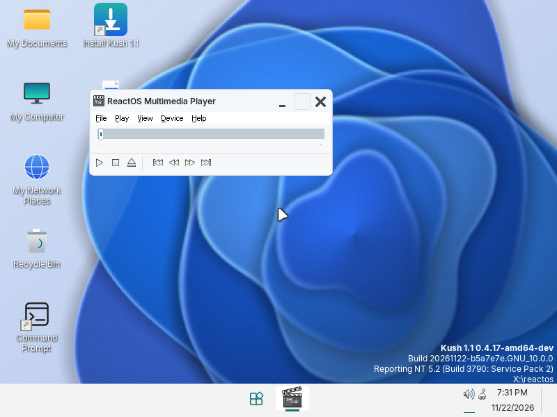

## نتائج الفحص المحدود

- البناء الرابع نجح، ولم تظهر مطابقة `warning:` أو `error:` في سجل أمر البناء.
- اختُبر قياس480×160 و680×160 بمساعد يرسل `WM_SIZING` ثم يضع النافذة. هذا اختبار برمجي لقيود المقاس، لا ادعاء بأن سحب الحواف بالماوس نجح.
- عينة أصلية320×240 بترميزMSVideo1 ظهرت كنافذة فيديو مستقلة ثم داخل المشغل. قياس النافذة المدمجة328×324، مطابق للأصلي، والإطار الملون كامل.
- مساعد `mediaprobe.c` أرسل أوامرStop وPlay وPause. ظهر في العنوان Stopped ثمPlaying ثمPaused، وطبعPASS. هذا تحقق من حالات الأوامر الظاهرة فقط، وليس اختبارا آليا لسلامة الإطارات أو الصوت. رسالة الخطأ الواردة أدناه ظهرت خلال تسلسل الفحص وأُغلقت قبل ظهور النتيجة.
- فتحت Explorer وcmd وNotepad وControl Panel. سجل نهاية هذا الفحص118308بايت، بلا `FirstChance` أو `KUSH-EXC` أو `Fatal System Error`. لا يشمل ذلك كل برامج النظام ولا يثبت صلاحية كل وظائف البرامج الأربعة.

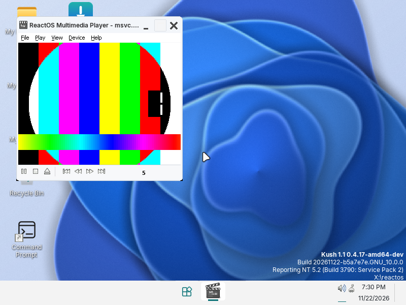

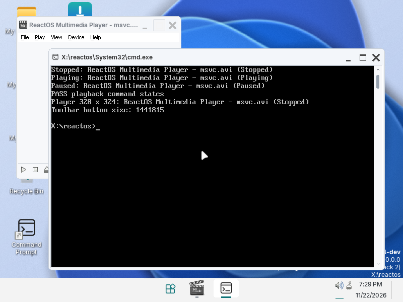

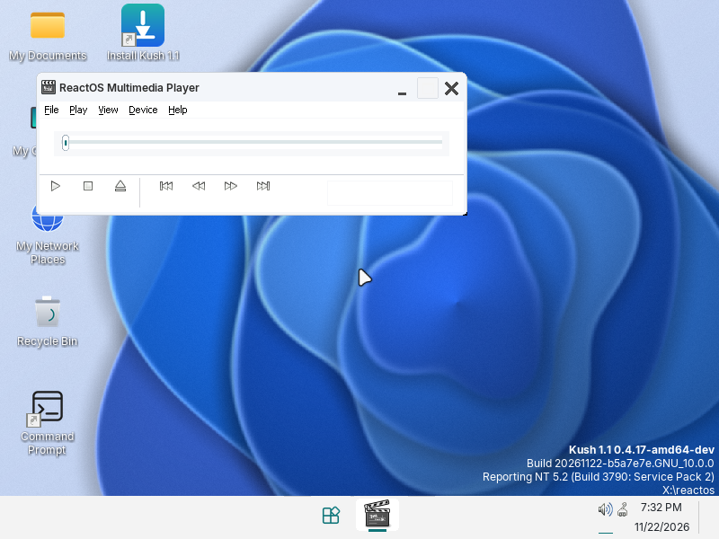

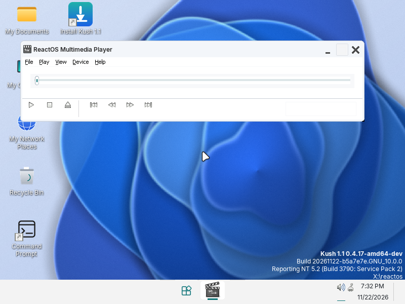

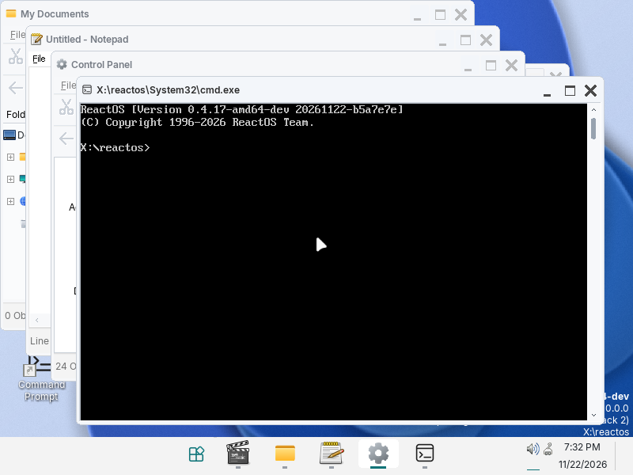

## أخطاء باقية، لا تُحسب نجاحا

### رسالةMMSYS5

ظهرت رسالةMMSYS5 بلا وصف أثناء تسلسل أوامر التشغيل. أُعيدت التجربة على ISO طابور الرسائل السابق للدفعة، وظهرت الرسالة نفسها مع العينة والمساعد. هذا يثبت سبق السلوك لهذه الدفعة فقط؛ لا يحدد سببه ولا يصلحه.

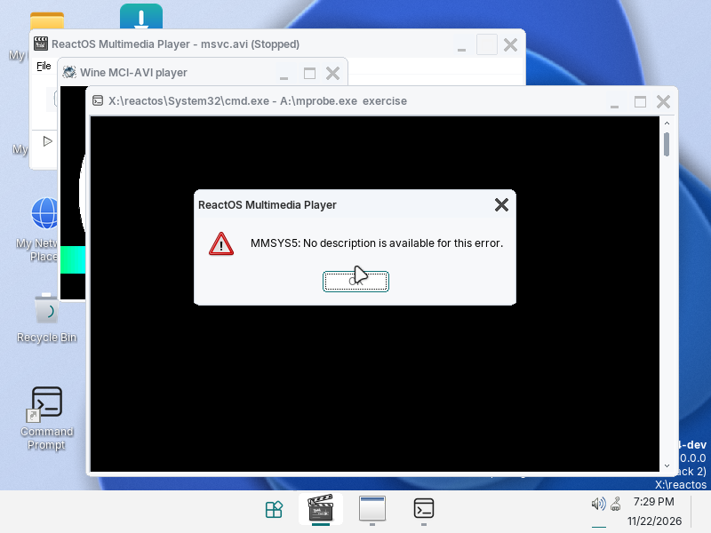

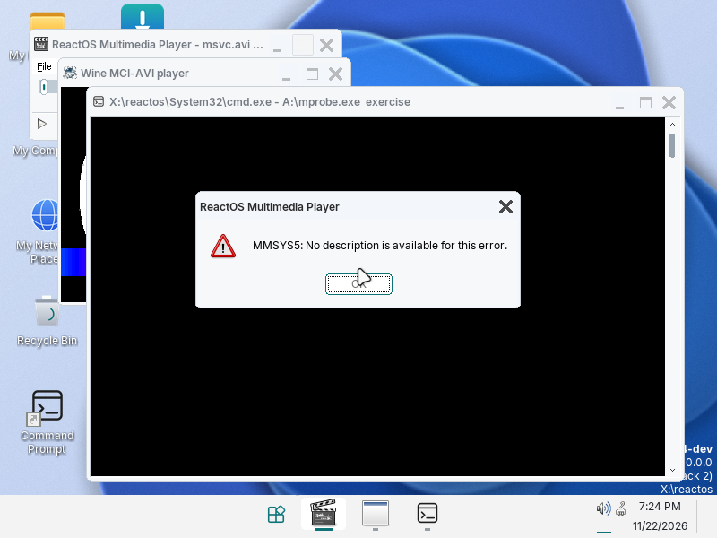

### رسم الفيديو بعد الخروج من العرض المدمج

عند الرجوع للنافذة العادية أثناء التشغيل، يستمر جزء من الفيديو خلف مسار التقدم. أُعيد الاختبار علىISO السابق وظهر الشريط الملون نفسه خلف عناصر النافذة الأصلية350×125. لم يُخف هذا العيب أو يُصلح ضمن تعديل الواجهة. المصدر غير المعدل `mciavi32/wnd.c` يفحص صحة النافذة قبل قبول مقبضها، بينما مقبض العودة الافتراضي0؛ هذه قرينة مصدر تحتاج تشخيصا مستقلا، لا إثبات سبب جذري نهائي.

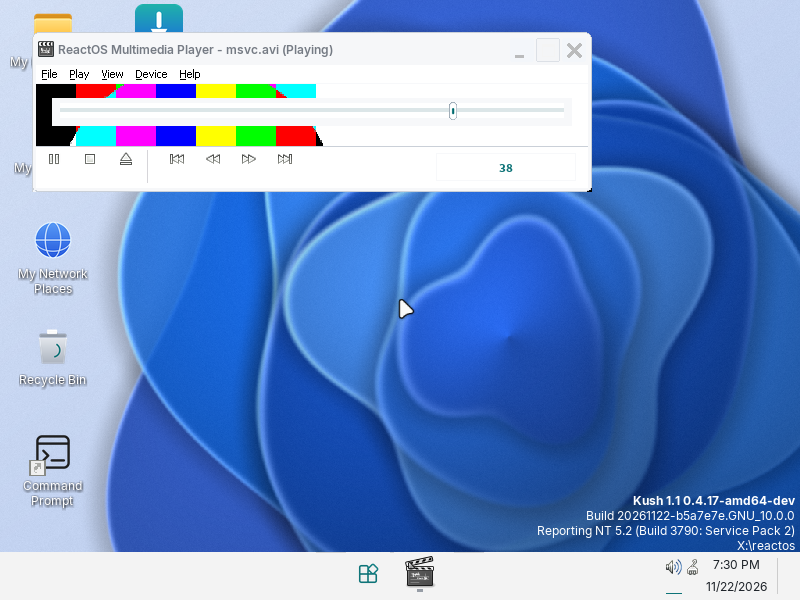


### الصوت والصيغ الأخرى

عينةWAV ظهرت بحالةStopped في فحص سابق على القديم والجديد. مخرج الصوت المستخدم صامت، فلا يوجد إثبات سماع صوت. عيناتAVI الخام السابقة لم تنجح ولم تُصلح. النجاح البصري هنا محصور في عينةMSVideo1 المحددة، وليس كلAVI أو كل صيغ الوسائط. لم يُختبرSeek أو كل أوامر القوائم أو اختيار الأجهزة أو كل أحجام الفيديو أو السحب بالماوس.

## إعادة الفحص ومصدر الصور

`tools/qemu/make_media_samples.py` يولدWAV أصليا20ثانية PCM8000Hz أحادي16بت، وAVI أصليا12ثانية320×240 بمعدل4إطارات/ثانية عبرffmpeg testsrc وmsvideo1. بصمةAVI المختبر: `d7531311bf841294772311f6431b7178f207eae64023804b23dc8bfc3d5f00f5`. لا توجد ملفات وسائط مملوكة للغير أو بيانات خاصة في الدفعة.

يمكن ترجمة المساعد خارج المستودع، ثم نسخه والعينات إلى قرص الاختبار:

```sh
x86_64-w64-mingw32-gcc -Os -s tools/qemu/mediaprobe.c -lcomctl32 -o /tmp/mprobe.exe
python3 tools/qemu/make_media_samples.py /tmp/media-samples
```

داخل النظام افتح `mplay32 A:\msvc.avi`. `mprobe exercise` يختبر حالات الأوامر ثم يبدل العرض، وقد ينتظر إغلاق خطأMCI. `mprobe command 1007` يبدل العرض، و`mprobe command 1500` يشغل أو يوقف مؤقتا بحسب الحالة، و`mprobe small` و`mprobe large` يختبران قيود المقاس. المساعد لا يعترض أخطاءMCI ولا يخفيها.

بصمة ISO البناء الرابع: `519fb5c271cdc90f6b05132b623131dfd0612ec2c78b90647a1c436c215fe7b9`، حجمه407896064بايت. حُفظ في نسخة خاصة جديدة ثم أُعيد تنزيله وطابقت بصمته قبل الإقلاع. هذه نسخة احتياطية، وليست تسليمISO علىDrive.

صور المقارنة الأصلية ورسالة الخطأ والرجوع أثناء التشغيل من ISO طابور الرسائل السابق، بصمة `f206d88c1e1deb395ad7c9e48627f617f80158e63f097ff75f83fe6ffe8a19ce`. بقية صور التقرير من البناء الرابع. اقتصرت التعديلات التنفيذية على ملف واجهة المشغل، مع المساعد ومولد العينات والتوثيق؛ لا تعديل لمحركMCI أو الصوت أو النواة هنا.
