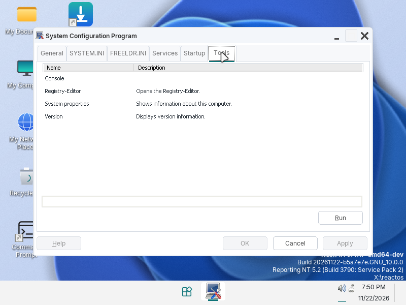
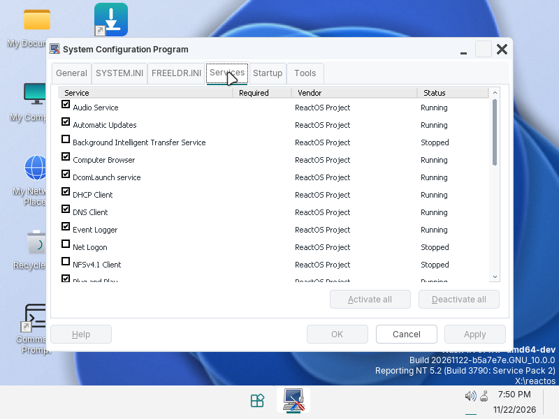

# System Configuration: عرض أوسع مع إبقاء الوظائف الأصلية

22 نوفمبر 2026. هذه دفعة واجهة محدودة، وليست إضافة لدعم حفظ إعدادات الإقلاع أو إدارة الخدمات.

## المشكلة والقرار

النافذة الأصلية ضيقة وصفوفها متقاربة. بعض أسماء الخدمات وأمر Startup تحتاج تمريرا أفقيا، وزر Check All Boot Paths لا يعرض عنوانه كاملا. القرار توسيع مناطق العناصر الأصلية مرة واحدة عند الفتح، مع إبقاء الخطوط ومعرّفات العناصر وترتيب التنقل ومسارات الأوامر. لا نوافذ بديلة ولا تغيير لمحرك الخدمات أو الإقلاع.

القياس الفعلي على QEMU عند 800×600 و96DPI وEnglish/US: النافذة الجديدة **670×451** مقابل **573×393** للكلاسيكية. مساحة العميل المطلوبة 664×416. الصفوف24بكسل والشجرة26بكسل، مع خلفيات بيضاء ونص داكن وأعمدة تستعمل عرض القائمة. لكل قائمة ImageList مستقل عند الحاجة، والعناصر الأصلية غير مشتركة في ملكيته. التغيير لا يكبر الخط نفسه.

## قبل وبعد حقيقيان

الصور لقطات QEMU غير معدلة، وليست نماذج تصميم. اختلاف الوقت وموضع المؤشر ناتج عن جلستي القياس.

| الصفحة | قبل | بعد |
|---|---|---|
| General | [الأصل](2026-11-22-msconfig-before-general.png) | [الجديد](2026-11-22-msconfig-general.png) |
| SYSTEM.INI | [الأصل](2026-11-22-msconfig-before-system.png) | [الجديد](2026-11-22-msconfig-system.png) |
| FREELDR.INI | [الأصل](2026-11-22-msconfig-before-boot.png) | [الجديد](2026-11-22-msconfig-boot.png) |
| Services | [الأصل](2026-11-22-msconfig-before-services.png) | [الجديد](2026-11-22-msconfig-services.png) |
| Startup | [الأصل](2026-11-22-msconfig-before-startup.png) | [الجديد](2026-11-22-msconfig-startup.png) |
| Tools | [الأصل](2026-11-22-msconfig-before-tools.png) | [الجديد](2026-11-22-msconfig-tools.png) |





اسم Background Intelligent Transfer Service أصبح ظاهرا كاملا في القياس المختبر. الصف الجزئي أسفل قائمة Services مقصوص داخل مساحة القائمة القابلة للتمرير؛ ليس خارج النافذة. المساحة الأكبر تعني صفوفا أقل كثافة، لا زيادة عدد الصفوف المرئية بالضرورة.

## ما اختُبر

- تنقل بالنقر بين الصفحات الست وفحص صورها. لم يُعتمد Ctrl+Tab كاختبار ناجح للتنقل.
- بقيت6تبويبات و25خدمة وعنصر Startup واحد و4أدوات في بيئة الاختبار، قبل الرجوع وبعده. هذه أعداد تلك البيئة وليست قيما مفروضة في الكود.
- Selective يفعّل خاناته وNormal يعطلها. لم يُحفظ تغيير إعدادات.
- بقيت OK وApply وHelp وأزرار تفعيل الخدمات وStartup معطلة. محاولة النقر البرمجية على أول checkbox في كل من Services وStartup أبقت الحالة1→1. [مخرجات الاختبار](2026-11-22-msconfig-states.png).
- مسار Run الأصلي في Tools شغّل Console فعليا، وعدّاد نوافذ Console صار1→2. [النافذة](2026-11-22-msconfig-console.png) و[المخرجات](2026-11-22-msconfig-tools-check.png). قياس166×34 في هذه المخرجات يخص نافذة msconfig المصغرة أثناء التجربة، لا قياس التخطيط العادي.
- الرجوع ClassicSystemConfiguration=1 أعاد573×393، ثم0 أعاد670×451 مع فتح عملية جديدة في كل مرة. [قياس1](2026-11-22-msconfig-registry1.png)، [قياس0](2026-11-22-msconfig-registry0.png)، [الشكل الكلاسيكي](2026-11-22-msconfig-classic.png).
- Cancel أغلق النافذة، ثم أعطت أداة الفحص نتيجة عدم العثور على msconfig المتوقعة. لا نعد هذه النتيجة فشلا للتطبيق. Escape لم يُثبت بصورة مستقلة.
- فُتحت Explorer وcmd وNotepad وControl Panel. [البرامج](2026-11-22-msconfig-apps.png). كُتب نص في [Notepad](2026-11-22-msconfig-notepad.png) ثم أُغلق دون حفظ.
- سجل QEMU بلغ183144بايت عند نهاية الفحص. البحث عن KUSH-EXC وUnhandled exception وKeBugCheck وBugCheck وAssertion failed أعاد صفرا. توجد رسائل تشخيص أخرى؛ هذا ليس ادعاء خلو النظام من كل الأخطاء.

أداة الفحص في `tools/qemu/msconfigprobe.c`، وتجميعها:

```sh
x86_64-w64-mingw32-gcc -Wall -Wextra -Os -static -s tools/qemu/msconfigprobe.c -o cfg2.exe -lcomctl32 -luser32 -lgdi32
```

تشغّل مع نافذة البرنامج المفتوحة بالعنوان الإنجليزي: `cfg2.exe` للفحص الأساسي، و`selective` ثم`normal`، و`veto` و`startup-veto`، و`run-console`. أداة محدودة تفحص مجموعة أزرار وحالات وعدد العناصر، وليست اختبارا لكل عنصر أو أمرا لحفظ إعدادات.

## الرجوع والحدود

```bat
reg add HKCU\Software\Kush\Shell /v ClassicSystemConfiguration /t REG_DWORD /d 1 /f
```

أغلق البرنامج وافتحه من جديد. القيمة0 تعيد العرض الجديد. المفتاح العام ClassicWindows غير الصفري يوقفه أيضا. حراس اللغة العربية والعبرية وprocess RTL والتباين العالي وDPI غير96 ومساحة عمل أصغر من720×500 تعيد التخطيط الأصلي عند بدء العملية. هذه الفروع راجعتها في المصدر فقط، ولم تختبر عمليا ضمن الدفعة. لا تحديث حي لهذه الخيارات أثناء بقاء النافذة مفتوحة، ولا ادعاء بتحسين RTL في هذا التطبيق.

OK وApply وHelp بقيت معطلة لأن النسخة الأصلية لا تدعم تطبيق الإعدادات هنا. لم تُضف كتابة للإقلاع أو بدء/إيقاف خدمة أو حفظ Startup. لم يُختبر Firefox أوSPSS أو الإقلاع على العتاد الحقيقي في هذه الدفعة، ولم تُقَس سرعة الرسم أو كل اللغات.

## البناء المختبر

`ninja bootcd` اكتمل. ISO المختبر407896064بايت، SHA256:

```text
1f0de0dab370547a631e9c92f022b63a3118ebfce78cea82e112d1cd45829ede
```

حُفظت نسخة خاصة جديدة وأعيد تنزيلها ومطابقة الحجم والبصمة قبل أول إقلاع. هذا توثيق لاختبار الدفعة، وليس تسليما لملف ISO عبر Drive ولا إثبات إصلاح عطل الجهاز الحقيقي.
