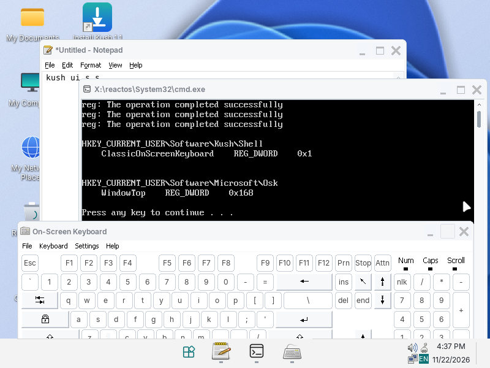
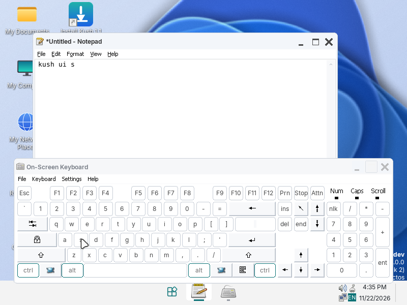
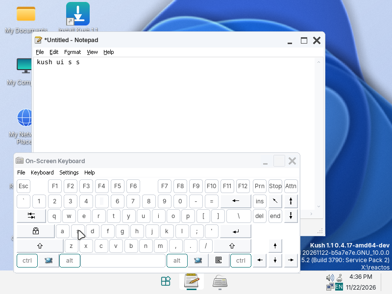
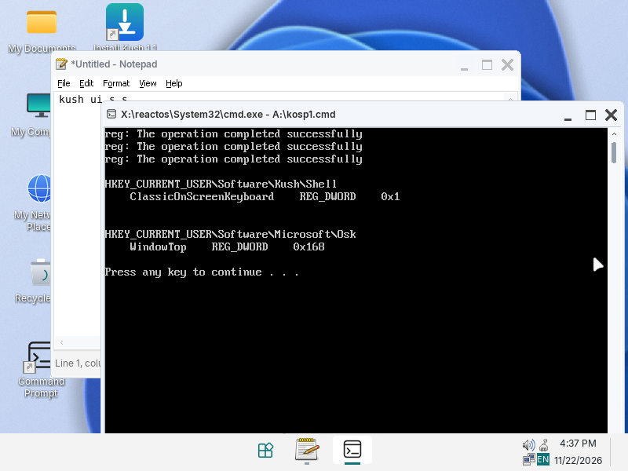
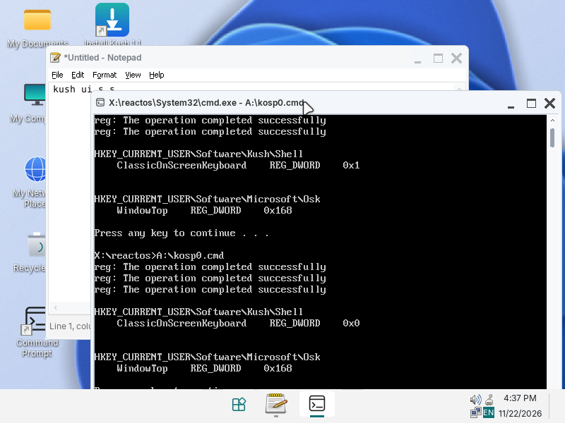
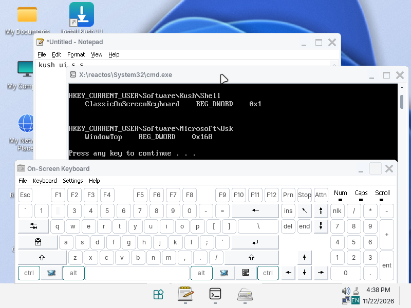
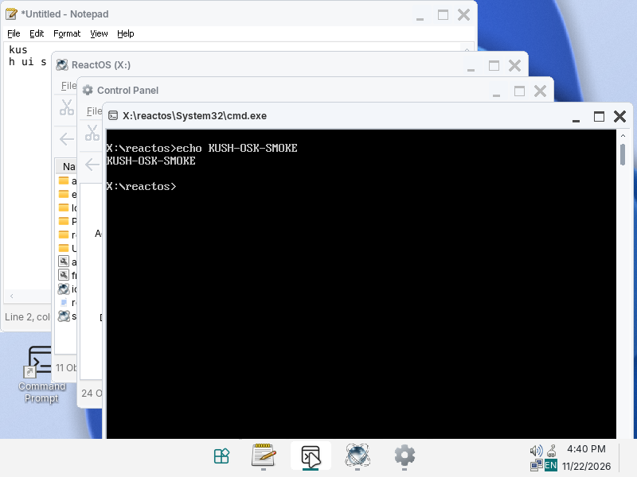

# موضع لوحة المفاتيح على الشاشة، 22 نوفمبر 2026

## المشكلة والسبب

في مراجعة البرامج، الصف السفلي من On-Screen Keyboard كان يدخل خلف شريط المهام عند 800×600. الموضع الأصلي يعتمد على حد الشاشة، لا مساحة العمل المتاحة، وصيغة الارتفاع لا تضم كامل الإطار والقائمة. هذا إصلاح حجم وموضع، وليس إعادة تصميم للأزرار.

## التعديل

- استعمال مساحة عمل الشاشة الأقرب للنافذة، وتصحيح الارتفاع بمقاس الإطار الفعلي، ثم إبقاء النافذة كاملة داخلها عند الفتح وتغيير التخطيط.
- إبقاء العرض الأصلي: Enhanced بعرض746 بكسل وStandard بعرض586 بكسل. بيانات لوحة الأرقام الموجودة في Standard تظل مخفية كما يقصد التخطيط الأصلي.
- الفحص البصري للبناء الأول كشف شريحة صغيرة من لوحة الأرقام في Standard؛ صُححت بالحفاظ على العرض الأصلي، ثم أُعيد البناء والنسخ الاحتياطي والإقلاع.
- لم تتغير معرفات المفاتيح أو scan codes أو SendInput أو المؤقت أو التركيز أو الخطوط أو القوائم. حفظ موضع النافذة يستعمل آلية الإعدادات الأصلية، مع حفظ الموضع المصحح.

## الرجوع

`HKCU\Software\Kush\Shell\ClassicOnScreenKeyboard` من نوع DWORD:

- `1`: الحجم والموضع الأصليان بلا التصحيح.
- `0` أو غياب القيمة: تصحيح الارتفاع والموضع.

يُقرأ عند فتح عملية جديدة. ClassicWindows=1 والتباين العالي وRTL وDPI غير96 تترك المسار الأصلي. إذا كانت النافذة أكبر من مساحة العمل لا يفرض التصحيح حجما لا يتسع لها. هذه المسارات الاحترازية غير مختبرة هنا.

## الاختبار الفعلي على البناء الثاني

QEMU، 800×600 و96DPI، English/US، بعد حفظ ISO احتياطيا وإعادة تنزيله والتحقق من SHA256 قبل الإقلاع:

`7afd8aedbe2559ebfc60a158c794a7ec60450a521c4da38e658b673660bfc166`

- Enhanced ظهر كاملا فوق شريط المهام، من y311 إلى حد مساحة العمل y552. Standard ظهر بالعرض الأصلي بلا شريحة من لوحة الأرقام.
- بعد تنشيط مساحة تحرير Notepad، الضغط بالماوس على حروف ومسافة في التخطيطين وصل إلى النص. صور النتيجة التقطت بعد استقرار الرسم. القيم والإدخال الأصليان لم يُستبدلا بمساعد كتابة.
- التبديل بين Enhanced وStandard ثم العودة نجح. قائمة Settings أظهرت Always on Top مفعلا وUse Click Sound غير مفعل؛ لم يُغيّر هذان الإعدادان، وليس هذا اختبارا لتبديلهما أو للصوت.
- لاختبار الرجوع بصورة مضبوطة، ضُبط WindowTop الأصلي على360 في المرتين. قرئت قيمة ClassicOnScreenKeyboard=1 وWindowTop=0x168 بأمر reg query، ثم ظهر الجزء السفلي محجوبا بالمسار الأصلي. أغلقت العملية، وضُبطت القيمة0 مع الموضع360 نفسه، وقرئت القيم ثم فُتحت عملية جديدة؛ ظهر الصف السفلي كاملا بالموضع المصحح311.
- Explorer وcmd وNotepad وControl Panel فتحت على البناء الثاني. نفّذ cmd أمر echo التجريبي. سجل نهاية هذا الفحص المحدود96881بايت، بلا KUSH-EXC وبلا Fatal System Error. ليس اختبار توافق كامل ولا يشمل WordPad.

## واقعة سابقة وحدود النتيجة

خلال تجهيز اختبار إضافي على البناء الأول، في جلسة شملت استبدال وسيط اختبار مرن، حدث توقف نظام0x1e/c0000005. حُفظ السجل، والسبب غير محدد؛ لا ننسب التوقف إلى الوسيط أو لوحة المفاتيح بلا دليل. لم يتكرر في الإقلاع النظيف للبناء الأول أو جلسة الفحص المحدودة للبناء الثاني من دون استبدال الوسيط. هذا لا يثبت زوال السبب في كل الحالات، ولم تُعدّل النواة أو محركات الإدخال لمحاولة إخفائه.

المثبت فعليا هو حجم وموضع النافذة، التخطيطان، كتابة حروف ومسافة، قراءة إعدادين، والرجوع وإعادة التفعيل في الإعداد المختبر. لم تُختبر العربية وRTL أو دقات وDPI أخرى أو الشاشات المتعددة أو كل المفاتيح والاختصارات أو احتياجات الوصول. شكل الأزرار والأيقونة والقوائم ما زال أصليا، وبقية البرامج قيد العمل.

## الصور الفعلية

