# Paint: مساحات أدوات أوضح وسطح فاتح

22 نوفمبر 2026. هذه دفعة واجهة محدودة لبرنامج Paint الأصلي. لا تستبدل محرك الرسم ولا تعني أن كل أدواته اجتازت اختبارا وظيفيا.

## المشكلة والقرار

كانت الأدوات متقاربة في عمود ضيق، ولوحة الألوان غائرة ومساحة خارج الصورة رمادية داكنة. بقيت الأيقونات الأصلية ذات16×16 بكسل، مع تكبير مساحة أزرارها من25 إلى32 بكسل وإضافة8 بكسل حول المجموعة. صار عرض لوحة الأدوات80 بدلا من50 بكسل. احتفظت منطقة إعدادات الأداة بارتفاعها الأصلي140 بكسل، واتسعت إلى64 بكسل تحت الأزرار.

خلايا الألوان صارت18 بدلا من16 بكسل، بخلفية بيضاء وحدود مسطحة. عدد الألوان الأصلي28 لم يتغير. المنطقة خارج حدود الصورة صارت فاتحة؛ بكسلات الصورة نفسها ومسارات أدوات الرسم والملفات والحافظة والطباعة لم تتغير في الكود. لا خطوط أو أيقونات أو صور جديدة في هذه الدفعة.

الحد الأدنى للنافذة الحديثة640×528 بكسل، أو أكبر إذا تطلب الإطار والقائمة ذلك. يتم التحقق من مساحة العمل قبل التفعيل. أظهر الفحص أن موضع النافذة النهائي بعد ShowWindow قد يحجب أسفلها خلف شريط المهام، ثم كشف اختبار التكبير المشكلة نفسها عند التكبير. لذلك أضيف ضبط الموضع العادي بعد الإظهار وحدود التكبير من مساحة العمل الفعلية. الصور النهائية أدناه من البناء الثالث بعد التصحيحين.

## قبل وبعد من QEMU

الشكل الأصلي على ISO خريطة الرموز السابقة:

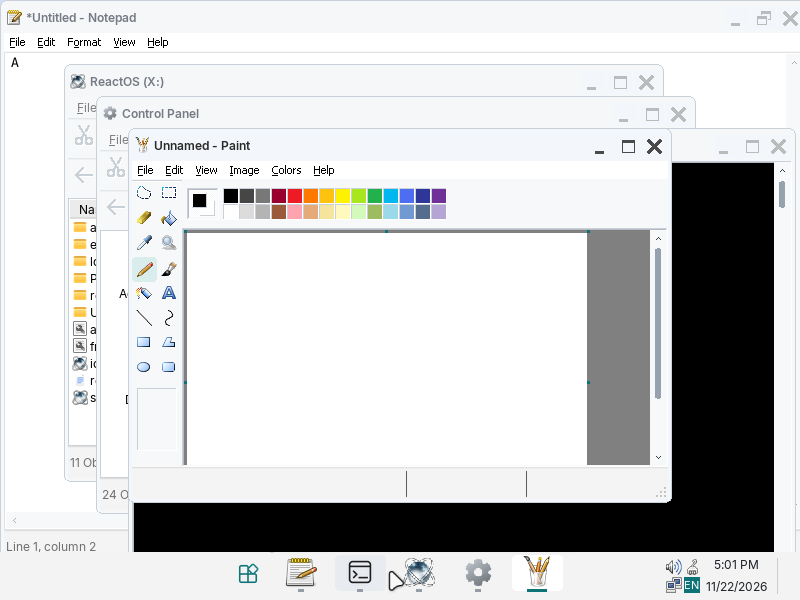

الشكل الحديث على البناء الثالث:

## ما اختُبر فعليا على البناء الثالث

بيئة الاختبار: LiveCD نظيف، English (United States) وUS، 800×600 و96DPI. حُفظ ISO احتياطيا وأعيد تنزيله ومطابقة بصمته قبل الإقلاع. هذه صور تشغيل حقيقية، وليست نماذج تصميم.

- ظهرت النافذة العادية وشريط حالتها فوق شريط المهام. نجح التكبير ثم الاستعادة؛ بقي شريط الحالة ظاهرا في الحالتين.
- إخفاء Color palette من View ثم إعادتها أعاد توزيع المساحة. نجح أيضا إخفاء Tool box ثم إعادته من القائمة الأصلية. الاختبار بالقائمة، وليس إثباتا لاختصارات Ctrl+L أو Ctrl+T.
- أداة Pencil رسمت نقاطا متباعدة عند إرسال حركة الماوس عبر المحاكي. Ctrl+Z أزالها، وCtrl+Y أعادها. لا توصف هذه النتيجة بأنها خط متصل.
- اختيار الأحمر بالزر الأيسر غيّر معاينة اللون الأمامي. اختيار الخانة الأخيرة في الصف السفلي بالزر الأيمن غيّر معاينة لون الخلفية إلى البنفسجي الفاتح.
- فتح Brush أظهر إعداداتها الأصلية كاملة. اختيار Rounded rectangle من آخر صف أظهر منطقتي النمط وسمك الخط كاملتين. هذا فحص لعرض الإعدادات واختيار الأداة، وليس لاجتياز رسم الأشكال.
- إغلاق ورقة الاختبار المعدلة أظهر سؤال الحفظ الأصلي Yes/No/Cancel. اختير No للتخلص من الرسم التجريبي فقط. لم يُختبر حفظ ملف أو طباعته.
- قيمة ClassicPaint=1 ثم فتح عملية جديدة أعادا الشكل الأصلي؛ القيمة0 أعادت الشكل الحديث. صُورت نتائج reg query في الحالتين.
- فتحت Explorer وcmd وNotepad وControl Panel على البناء نفسه. استُعمل cmd فعليا لضبط مفتاح الرجوع وقراءته. هذا فحص تشغيل محدود لا يغطي وظائف البرامج الأربعة كلها.

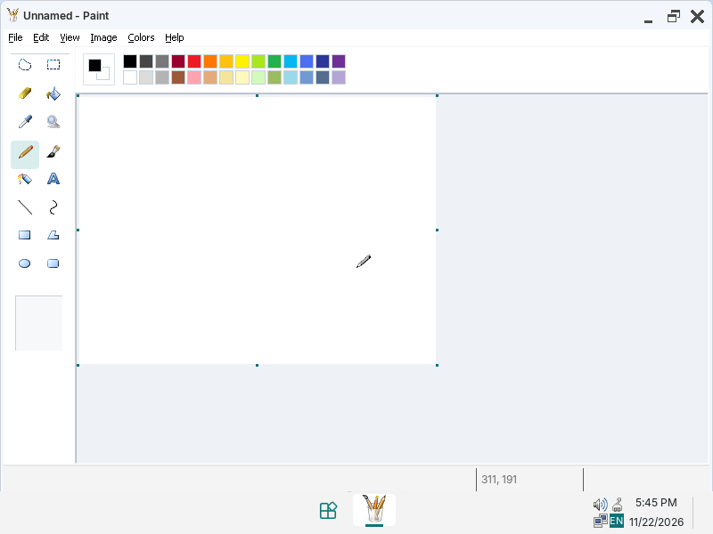

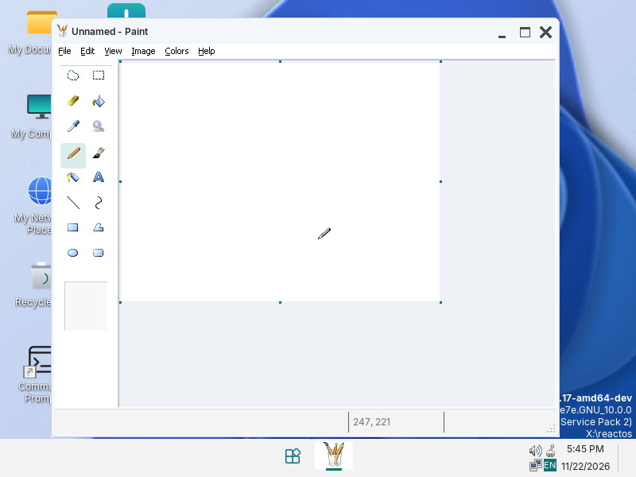

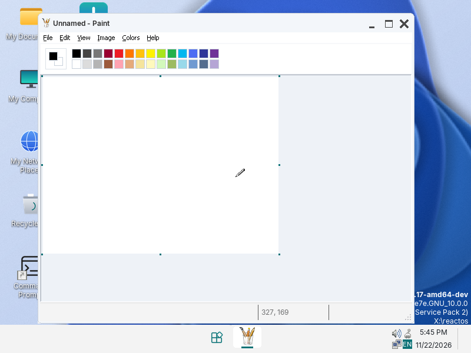

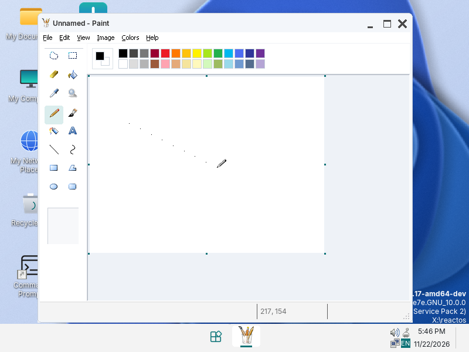

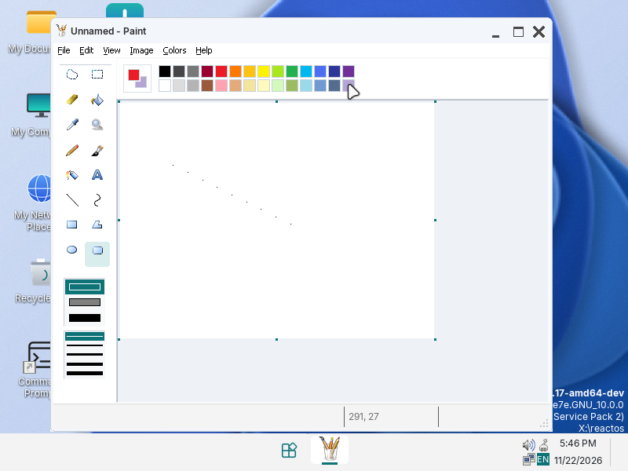

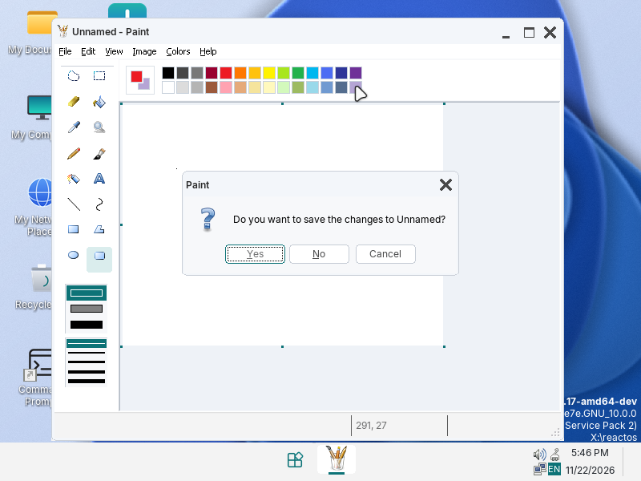

## نتيجة غير ناجحة: سحب أداة Line

على البناء الأول لهذه الدفعة، لم ينتج سحب Line الخط المتوقع، سواء بالشكل الحديث أو بعد الرجوع للشكل الأصلي. للمقارنة أُقلع ISO خريطة الرموز السابق لتعديلات Paint، وجُرّبت الأداة الأصلية بحركة المحاكي نفسها، فتكرر عدم ظهور الخط.

النتيجة المحددة: السلوك المرصود يسبق دفعة Paint هذه. السبب غير محدد، وقد يتعلق بإدخال المحاكي أو بمسار الرسم الموجود. لا تثبت المقارنة السبب، ولا تعني أن الأداة تعمل على جهاز حقيقي. لم يُغيّر محرك الرسم لمعالجة ذلك، ولم يُسجل الاختبار كنجاح. البناء الثالث أعاد فحص النقاط وUndo/Redo، لا اجتياز Line.

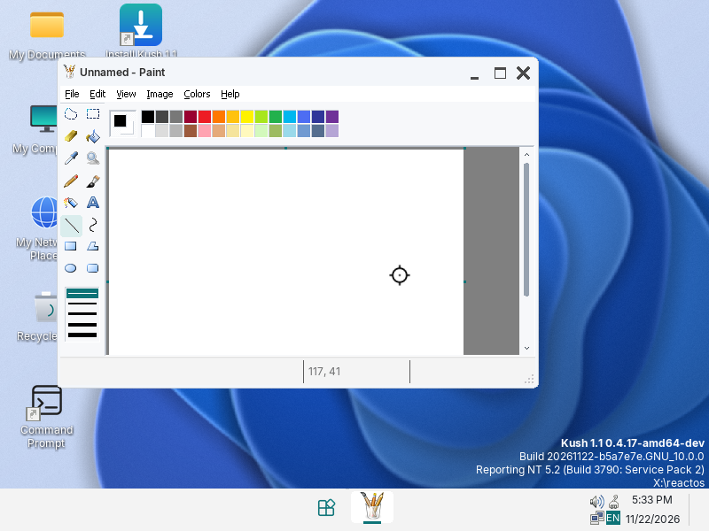

## مفتاح الرجوع والحواجز

`HKCU\Software\Kush\Shell\ClassicPaint` من نوع DWORD. القيمة1 تعطل عرض هذه الدفعة، و0 أو حذف القيمة يعيدان تفعيله عند فتح عملية جديدة إذا نجحت الحواجز. اختُبرت1 ثم0 فقط، لا حذف القيمة.

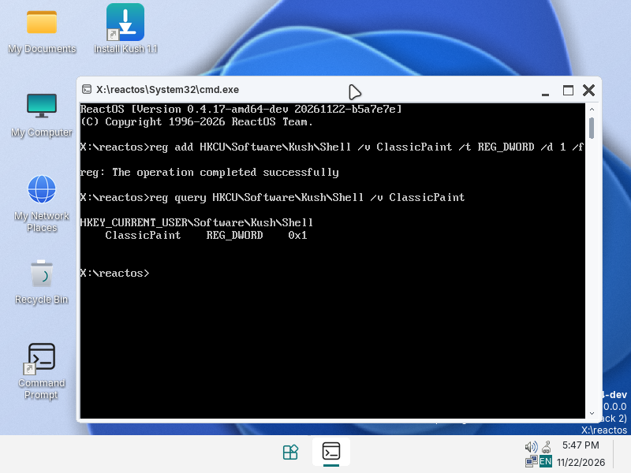

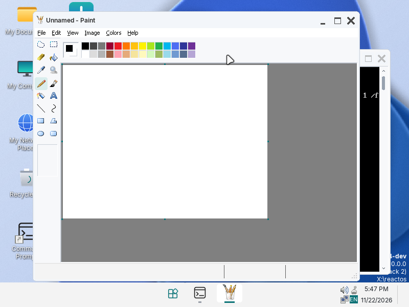

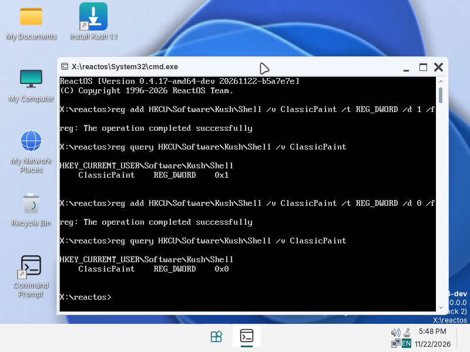

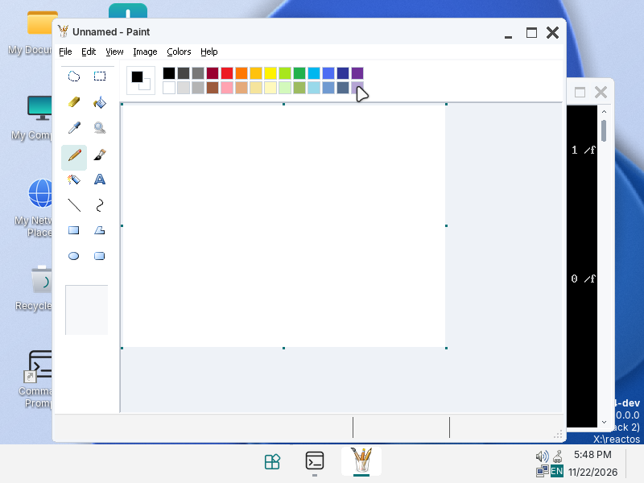

ClassicWindows والتباين العالي وRTL وDPI غير96 ومساحة عمل لا تكفي تترك المسار الأصلي. هذه الحواجز موجودة في الكود ولم تُختبر هنا. لا ادعاء بتغطية العربية أو تعدد الشاشات أو كل أوضاع العرض أو التغيير الحي للثيم وDPI.

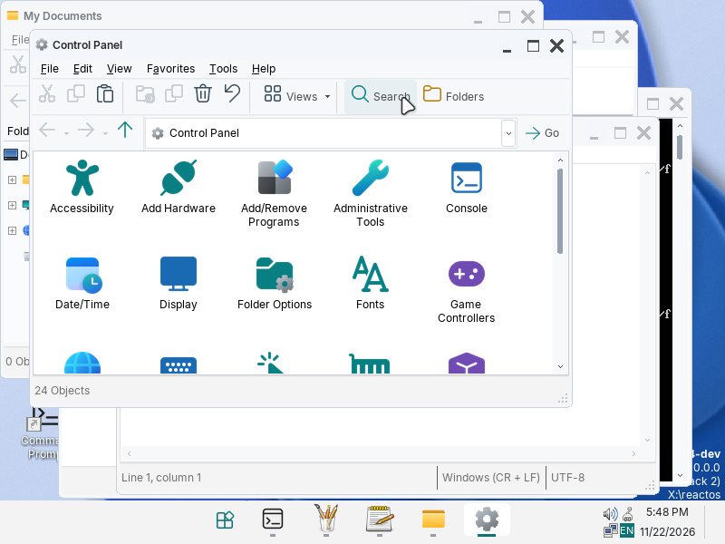

## البناء وحدود النتيجة

نجح `ninja -j2 mspaint bootcd` في البناء الثالث. لم تظهر تحذيرات مترجم؛ توجد رسائل mkisofs المعروفة عن ISO-9660 وأسماء الملفات الطويلة، وتنبيهات ملفات اختيارية غير موجودة. تطابقت ملفات Paint الإحدى عشرة بايتيا بين نسخة النشر ومصدر البناء، واجتاز فرقها فحص المسافات.

حجم ISO407896064بايت. SHA256 بعد إعادة تنزيل النسخة الاحتياطية الخاصة:

`6f5928665000bd207e27e00c1d1abd7058ea0037f813257deb6414637a720edc`

نسخة سجل نهاية الاختبار92363بايت، بلا KUSH-EXC أو Fatal System Error. توجد رسائل fixme/err أخرى؛ هذه ليست شهادة بأن النظام خال من الأخطاء.

لم تُختبر كل أدوات الرسم، أو النص، أو التحديد والقص، أو كل درجات التكبير، أو فك اللوحات وتحريكها، أو فتح الملفات وحفظها والطباعة والحافظة في هذه الدفعة. مساراتها لم تتغير في الكود، لكن ذلك ليس بديلا عن اختبارها. عطل WordPad السابق وواقعة توقف جلسة OSK السابقة ما زالا غير محسومين. بقية مراجعة البرامج وتصميم النظام العام لم يكتملوا.
