# Registry Editor: شجرة أوضح ومساحات أوسع

22 نوفمبر 2026. دفعة عرض محدودة للمحرر الأصلي، وليست تغييرا لأوامر تعديل السجل أو صلاحياته أو الاستيراد والتصدير.

## القرار

صارت النافذة الافتراضية740×480 بكسل ومتمركزة داخل مساحة العمل، قبل استعادة إعدادات المستخدم الأصلية. عرض الشجرة الافتراضي264 بدلا من190 بكسل، وصفوفها28 بكسل مع مسافة بادئة20 بكسل ومن دون الخطوط المنقطة. حدود الشجرة والقائمة مسطحة وخلفيتهما بيضاء؛ الأيقونات والخطوط الأصلية باقية.

مساحة العنوان36 بكسل وحقل النص24 بكسل، مع إبقاء التصفح والإكمال التلقائي وأمر Go الأصلي. أعمدة القيم الافتراضية190 و100 و180 بكسل، بعدما ظهر قص أسماء قيم Kush في البناء الأول. الإعدادات المحفوظة للنافذة والفاصل والأعمدة تظل من مسار المحرر الأصلي. الحد الأدنى للنافذة الحديثة640×400، وحدود التكبير تتبع مساحة عمل الشاشة حتى لا يختفي شريط الحالة خلف شريط المهام.

## صور فعلية من QEMU

قبل هذه الدفعة، على ISO Paint السابق:

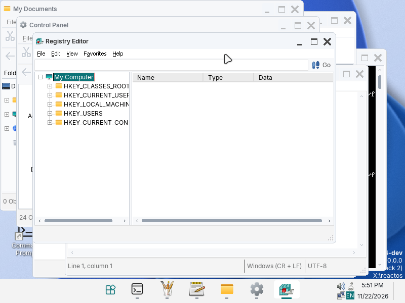

البناء الثاني بعد توسيع الأعمدة:

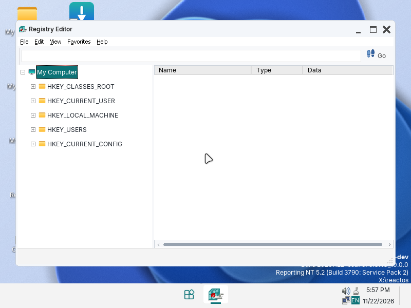

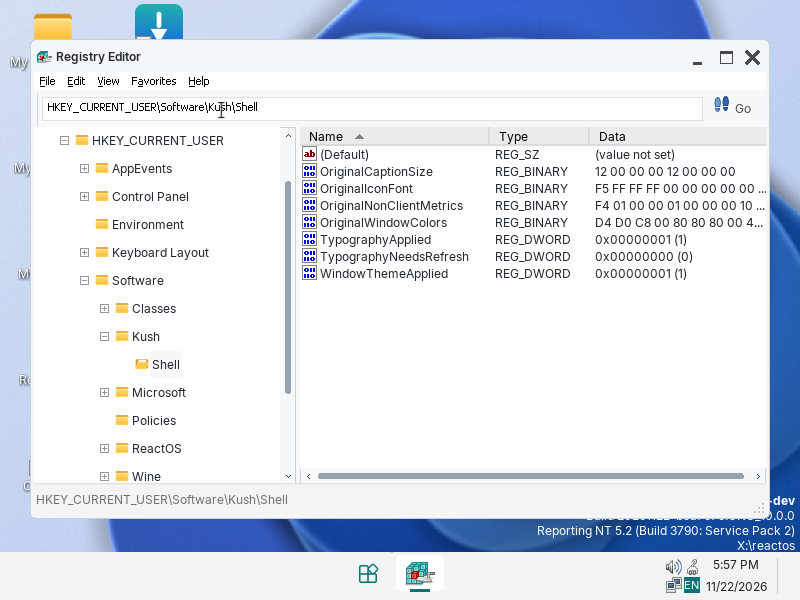

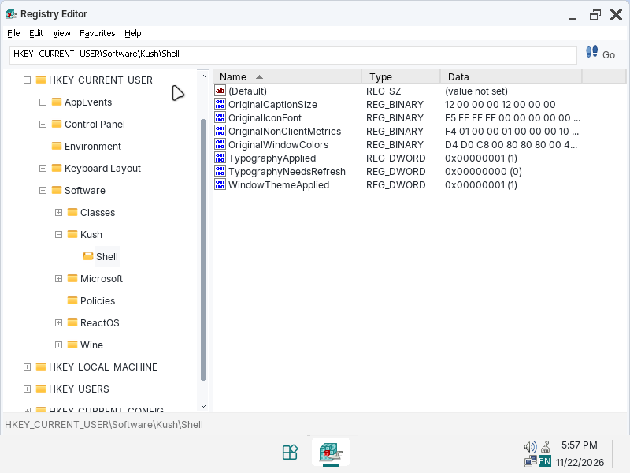

## الاختبار الفعلي

البيئة: LiveCD نظيف، English (United States) ولوحةUS، 800×600 و96DPI. حُفظ ISO احتياطيا بشكل خاص وأعيد تنزيله ومطابقة بصمته قبل الإقلاع.

- الانتقال إلى `HKEY_CURRENT_USER\Software\Kush\Shell` بكتابة العنوان ثم Enter أظهر المفتاح والقيم المطلوبة.
- فُتحت نافذة تعديل DWORD الأصلية لقيمة TypographyApplied ثم أُلغيت بـEsc؛ لم تُغيّر تلك القيمة.
- تغيير ترتيب عمود Name أظهر الفرز العكسي، وظهر تحديد الصف كاملا.
- تحريك الفاصل بنحو60 بكسل أعاد توزيع الشجرة والقائمة؛ وعاد موضع المفتاح والفاصل المحفوظ عند فتح عملية جديدة. لا يعني ذلك اختبار كل إعداد محفوظ.
- إخفاء شريط الحالة ثم إعادته من View نجح. التحقق من الإخفاء كان بالقائمة، لا بافتراض نجاح حرف اختصار ملتبس.
- نجح التكبير والاستعادة مع بقاء أسفل النافذة ظاهرا فوق شريط المهام.
- قُرئت ClassicRegistryEditor=1 فعليا، ثم أُغلقت العملية وظهر الشكل الأصلي. قُرئت0 ثم ظهر الشكل الحديث في عملية جديدة. احتُفظ بالفاصل المحفوظ المشترك بين الشكلين، فلا يدعي الرجوع مطابقة الهندسة الافتراضية القديمة حرفيا.
- على إقلاع جديد للبناء نفسه فُتحت cmd وExplorer وNotepad وControl Panel، ثم المحرر. الصور أدناه من ذلك الإقلاع. هذا اختبار تشغيل أساسي، وليس تغطية لكل وظائف البرامج.

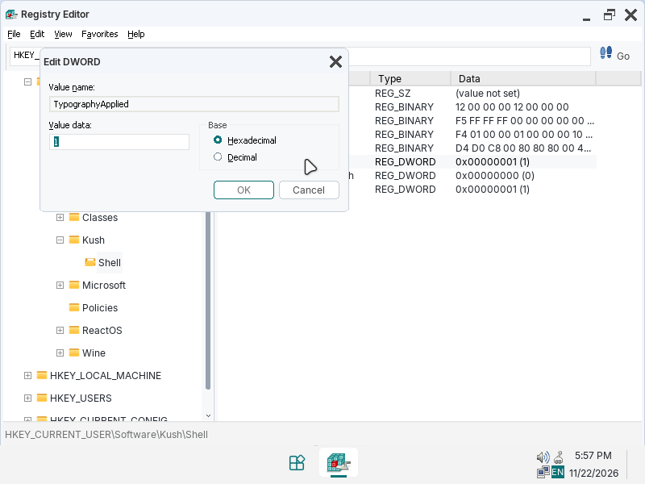

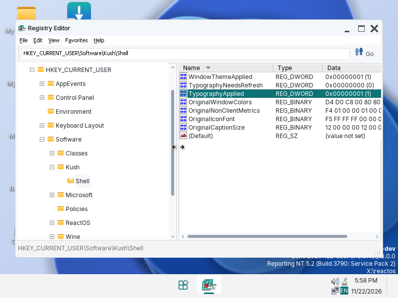

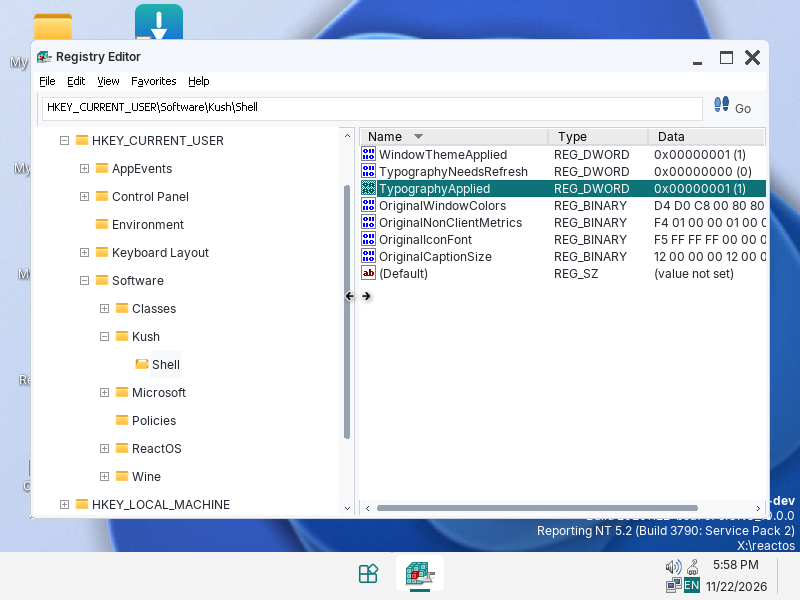

## الرجوع المستقل والحواجز

`HKCU\Software\Kush\Shell\ClassicRegistryEditor` من نوع DWORD. القيمة1 تعيد العرض الأصلي؛ القيمة0 أو غيابها يسمحان بالعرض الجديد عند فتح عملية جديدة إذا نجحت الحواجز. اختُبرت1 ثم0، لا حذف القيمة.

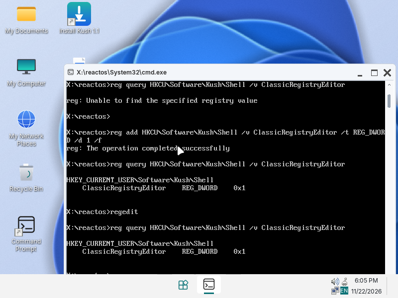

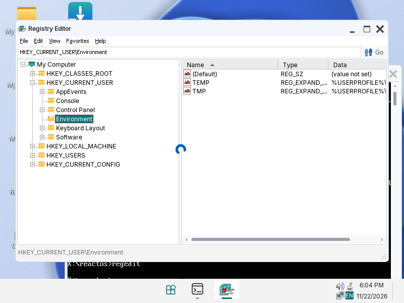

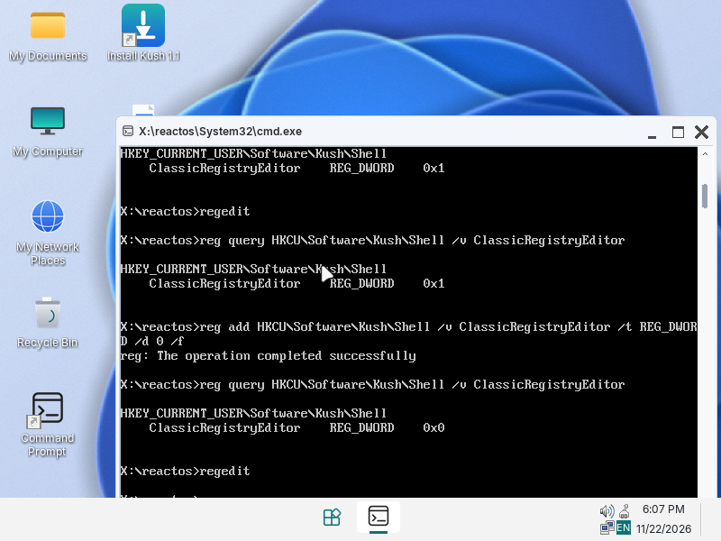

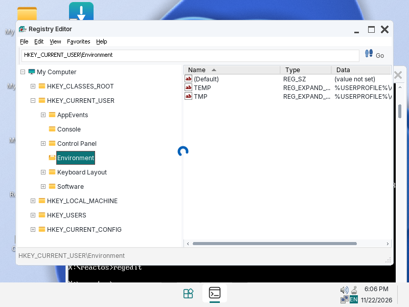

ClassicWindows وRTL والتباين العالي وDPI غير96 ومساحة عمل أصغر من740×480 تترك المسار الأصلي في الكود. هذه الحواجز لم تُختبر هنا. لا ادعاء بتغطية العربية أو تعدد الشاشات أو تغير الثيم وDPI أثناء التشغيل.

## استثناء الإغلاق: مقارنة لا إصلاح

ظهر أثناء تسلسل الإغلاق وإعادة الفتح استثناء وصول من الدرجة الأولى `0xC0000005` في `resize_frame_rect`، عند استخدام بنية نافذة الطفل بعد أن أصبحتNULL. تبعته رسالة أن DefWindowProc التقط الاستثناء. تكرر مع تعطيل المظهر الجديد في البناء نفسه.

للمقارنة أُقلع ISO Paint الثالث السابق لهذه الدفعة، وفُتح المحرر الأصلي ثم أُغلق. كان عدد الاستثناءات قبل الإغلاق صفرا، وظهر بعده الاستثناء نفسه من الدرجة الأولى. العنوان في النسخة السابقة `0x140009B56` وفي البناء الثاني `0x140009EF6`؛ فُحصت تعليمة كل ملف تنفيذي، وهي الموضع نفسه من `resize_frame_rect` الذي يستخدم مؤشر نافذة الطفل. لم يظهرKUSH-EXC من الدرجة الثانية في هذين الفحصين.

هذا يثبت أن السلوك المرصود موجود في ISO السابق، ولا يثبت سلامة كل تسلسلات الإغلاق أو أن سبب كل بطء معروف. لم يُضف إصلاح لدورة حياة النافذة أو منطق التسجيل ضمن دفعة العرض هذه. واجهت جلسة الاختبار الأولى تأخر أوامر؛ لم تُحسب لقطة Explorer غير المحمّلة حينها نجاحا، وأُعيد اختبار تشغيل البرامج الأربعة على إقلاع نظيف.

## البناء وحدود النتيجة

نجح `ninja -j2 regedit bootcd` للبناء الثاني. لم تظهر تحذيرات مترجم في سجل البناء، مع وجود تحذيرات ISO-9660 المعروفة وأسماء الملفات الطويلة. تغيرت ستة ملفات مصدر في regedit فقط، دون موارد أو خطوط أو أيقونات جديدة.

حجم ISO407896064بايت. بصمته بعد إعادة تنزيل النسخة الاحتياطية الخاصة:

`a5bcc6cfe95ade5947d017717cba2feb4f9bcb52a0b226994fe2e515ccad651b`

سجل الإقلاع النظيف عند التقاط البرامج الأربعة والمحرر85043بايت، بصفرFirstChance وصفرKUSH-EXC وصفرFatal System Error قبل إغلاق المحرر. لا يُلغي ذلك استثناء الإغلاق الموثق أعلاه. تبقى رسائلfixme/err أخرى.

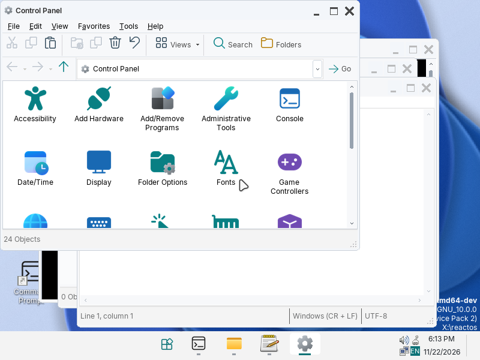

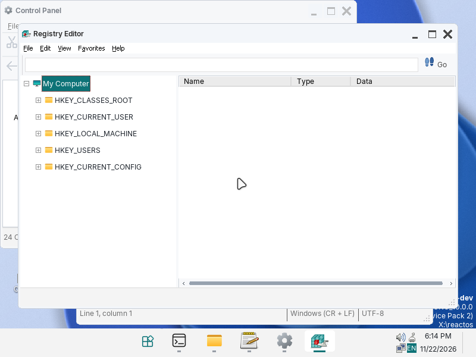

لم تُختبر إضافة مفاتيح أو حذفها، أو تعديل بيانات فعلية، أو استيراد وتصدير ملفاتreg، أو البحث أو الصلاحيات أو الاتصال بسجل جهاز آخر. لم تتغير مسارات هذه الأوامر في الكود، لكن ذلك ليس بديلا عن اختبارها. هذه الصور والنتائج لا تدعي إصلاح عطل إقلاع على جهاز حقيقي، ولا اكتمال إعادة تصميم النظام.
