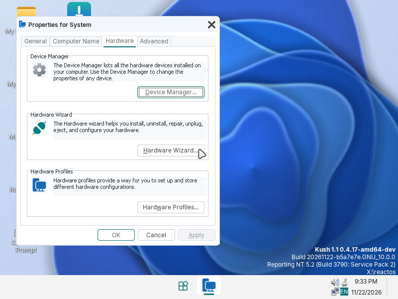

# خصائص النظام: دفعة عرض محدودة

22 نوفمبر 2026. الاختبار في QEMU على 800×600 و96DPI وEnglish/US. كل الصور أصلية غير معدلة.

## القرار والنطاق

سطح أبيض ونص داكن وحدود مجموعات خفيفة في General وHardware وAdvanced. التنفيذ في sysdm.c مع إضافة اعتماد uxtheme إلى CMakeLists.txt. إجراءات الصفحات الأصلية تعمل أولا، ثم يضاف رسم السطح. هندسة النافذة 410×461 والموارد والبيانات والأوامر باقية. لا تغيير في general.c أوhardware.c أوadvanced.c.

صفحة Computer Name تأتي من netid.dll وبقيت على شكلها الأصلي، مثل الصفحات الإضافية الخارجية والحوارات الفرعية. أُلغي ثيم Static العادي وButton من نوع GroupBox داخل الصفحات الثلاث فقط، دون عناصر owner-draw أوbitmap أوicon أوالأزرار العادية. شعار ReactOS وصور الموارد الأصلية باقية. لا أصول رسومية أوخطوط جديدة.

**حدود باقية:** مستطيلات النصوص ما زالت بلون الثيم الفاتح، فلا يوصف هذا كتجديد كامل. قص زر Environment Variables في Advanced وبعض معلومات الجهاز موجود في الأصل ولم يصلح هنا. صفحة Computer Name ظلت بالقيم الفارغة الأصلية في LiveCD، دون ادعاء إصلاح الشبكة أوالهوية.

## المقارنة الفعلية

| الصفحة | الأصل | الجديد |
|---|---|---|
| General | [قبل](2026-11-22-system-before-general.png) | [بعد](2026-11-22-system-general.png) |
| Computer Name الخارجية | [قبل](2026-11-22-system-before-name.png) | [بعد، الأصل باق](2026-11-22-system-name.png) |
| Hardware | [قبل](2026-11-22-system-before-hardware.png) | [بعد](2026-11-22-system-hardware.png) |
| Advanced | [قبل](2026-11-22-system-before-advanced.png) | [بعد](2026-11-22-system-advanced.png) |



## ما اختبر فعليا

- الصفحات الأربع ومعاينة النصوص والأزرار والأيقونات وحدود المجموعات.
- زاد System Uptime من 00:01:01 إلى 00:01:05 دون تغيير مصدره أوالمؤقت: [الأولى](2026-11-22-system-general.png)، [الثانية](2026-11-22-system-uptime.png).
- View license فتح الحوار الأصلي. أول لقطة كانت مبكرة وفارغة، ثم أعيد الاختبار مع انتظار وظهر نص GPL وزر OK كاملا: [الترخيص في المسار الجديد](2026-11-22-system-modern-license-final.png). ظهر النص أيضا في [المسار الكلاسيكي](2026-11-22-system-classic-license.png). أُغلق الحوار بـEscape دون تغيير إعدادات.
- ClassicSystemProperties=1 أعاد السطح القديم ثم0 أعاد الأبيض بعد إعادة الفتح: [القيمة1](2026-11-22-system-registry1.png)، [الأصل](2026-11-22-system-classic1.png)، [القيمة0](2026-11-22-system-registry0.png)، [الجديد](2026-11-22-system-modern0.png).
- فُتحت Explorer وcmd وNotepad وControl Panel، مع عينة كتابة في [Notepad](2026-11-22-system-notepad.png). [لقطة البرامج الأربعة](2026-11-22-system-apps-final.png). تشغيل control بلاامتداد أعاد نافذة System السابقة في هذه الجلسة؛ تشغيل control.exe فتح لوحة التحكم الرئيسية المثبتة بالصورة، دون تعديل مساراتها.
- سجل نهاية الجلسة 104335 بايت: صفر KUSH-EXC وUnhandled exception وKeBugCheck وBugCheck وAssertion failed. توجد تحذيرات أخرى، ولايعني هذا خلو جميع النظام من الأخطاء.

لم يضغط Apply أوOK للنافذة الرئيسية، ولم تفتح أوامر تغيير الأجهزة أوالبيئة أوالأداء أوالإقلاع أوالشبكة. هذه دفعة عرض، وليست اختبارا لكل وظائف System Properties.

## الرجوع والحراس

```bat
reg add HKCU\Software\Kush\Shell /v ClassicSystemProperties /t REG_DWORD /d 1 /f
```

أغلق النافذة وافتحها جديدا. القيمة0 تعيد العرض الجديد. ClassicWindows غيرالصفري يوقف الدفعة أيضا. حراس Arabic/Hebrew UI وprocessRTL والتباين العالي وDPI غير96 تعيد المسار الأصلي. هذه الفروع راجعت في المصدر فقط ولم تختبر بصريا.

## البناء

بُني sysdm.cpl وbootcd بلاخطأ أوتحذير ترجمة في هذا البناء. ISO الاختبار 407896064 بايت، SHA256:

`e02d32c9cdf349fd766795ad83c4c743f529fa288f6a7458765a2c24e7ced95f`

حُفظت نسخة خاصة جديدة وأعيد تنزيلها وتطابقت البصمة قبل الإقلاع. ليست تسليم Drive. نسخة bootstride1 المخصصة لطلب التسليم القائم باقية دون استبدال. لااختبار جهاز حقيقي أوتثبيت أوإصلاح Firefox/SPSS ضمن هذه الدفعة.

## حالة الجرد

هذه آخر نافذة قابلة للدفعة المحدودة ضمن جرد العشر نوافذ السابق. WordPad مازال عطله المنفصل مفتوحا، وبقية نتائج الجرد لكل منها حدودها الموثقة. انتهاء هذه الدفعة لايعني اكتمال خطة Fluent العامة أوالثيم أوالأيقونات أوRTL أوcompositor.
