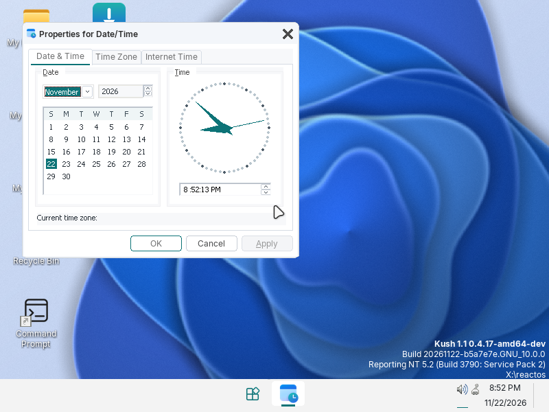

# التاريخ والوقت: ألوان أوضح مع بقاء التحكم الأصلي

22 نوفمبر 2026. دفعة عرض محدودة على800×600 و96DPI. لم تتغير هندسة النافذة404×344، ولا موارد الصفحات أو حساب الوقت أو المنطقة الزمنية أو عميل التزامن.

## القرار

السطح الأبيض والنص الداكن يجعلان هذه النافذة أقرب لباقي واجهةKush. عقارب الساعة تيل، ونقاطها رمادية هادئة، وتحديد يوم التقويم تيل بنص أبيض. بقيت الخطوط والأزرار الأصلية. بعض مستطيلات العناصر الثابتة ما زالت بلون الثيم الفاتح؛ ليست إعادة تصميم كاملة.

التنفيذ محصور في timedate.c وtimedate.h وclock.c وmonthcal.c. غلاف الصفحات يستدعي إجراءات الحوار الأصلية أولا، ثم يضيف رسم السطح. لا تعديل في dateandtime.c أو timezone.c أو internettime.c أو موارد اللغة. ألوانDC المؤقتة تعاد بعد الرسم ولا تنشأ فرشاة جديدة مع كل ثانية.

## المقارنة الفعلية

الصور لقطاتQEMU أصلية غير معدلة، وليست رسوما تخطيطية.

| الصفحة | الأصل | الجديد |
|---|---|---|
| التاريخ والوقت | [قبل](2026-11-22-timedate-before-main.png) | [بعد](2026-11-22-timedate-main.png) |
| المنطقة الزمنية | [قبل](2026-11-22-timedate-before-zone.png) | [بعد](2026-11-22-timedate-zone.png) |
| وقت الإنترنت | [قبل](2026-11-22-timedate-before-internet.png) | [بعد](2026-11-22-timedate-internet.png) |



حقلCurrent time zone الفارغ موجود في لقطة الأصل أيضا. بقي اختيارGMT-12 وخادمpool.ntp.org وحالة التزامن كما كانا في بيئةLiveCD، ولم يغيرهما هذا العمل. لا ادعاء بإصلاح ذلك الحقل.

## ما اختبر فعليا

- الصفحات الثلاث بالإنجليزيةEnglish/US، وفحص اكتمال النصوص والأزرار والخريطة. لم تضغطApply أوOK أوUpdate Now، ولا تجربة تغيير ساعة النظام أو المنطقة أو مزامنة الشبكة.
- تحركت الساعة من20:49:03 إلى20:49:06 وتغير موضع عقرب الثواني: [الأولى](2026-11-22-timedate-tick-before.png)، [الثانية](2026-11-22-timedate-tick-after.png).
- اختير اليوم17 بدلا من22 وتفعّلApply، ثمCancel أغلق النافذة. إعادة الفتح أعادت22 معApply معطل: [التحديد](2026-11-22-timedate-selected17.png)، [بعد الإلغاء](2026-11-22-timedate-cancel-restored.png). هذان الاختباران في جلسةLiveCD بلغةLatvian اختيرت بالخطأ، لذلك لا يستعملان كمقارنة هندسة معEnglish. أعيد الإقلاع باختيارEnglish/US المثبت في صور الصفحات النهائية، لا تغيير لإعدادات المستخدم الحقيقي.
- ClassicDateTime=1 أعاد العقارب والألوان الأصلية بعد فتح عملية جديدة؛ ثم0 أعاد العرض الجديد. [القيمة1](2026-11-22-timedate-registry1.png)، [الكلاسيكي](2026-11-22-timedate-classic.png)، [القيمة0](2026-11-22-timedate-registry0.png)، [العرض المستعاد](2026-11-22-timedate-modern0.png).
- فُتحتExplorer وcmd وNotepad وControl Panel على نفسISO: [البرامج](2026-11-22-timedate-apps.png). وكتب نص في[Notepad](2026-11-22-timedate-notepad.png).
- فحص سجل الجلسة الأخيرة عند83600بايت أعاد صفرا لكلKUSH-EXC وUnhandled exception وKeBugCheck وBugCheck وAssertion failed. توجد تحذيرات أخرى عادية في السجل، ولا يعني هذا خلو النظام كله من الأخطاء.

## الرجوع والحراس

```bat
reg add HKCU\Software\Kush\Shell /v ClassicDateTime /t REG_DWORD /d 1 /f
```

أغلق النافذة وافتحها من جديد. القيمة0 تعيد الشكل الجديد. ClassicWindows غير الصفري يوقف هذه الدفعة أيضا. الحراس يعيدون المسار الأصلي عندArabic/Hebrew UI أوprocessRTL، أوالتباين العالي، أوDPI غير96. هذه الفروع راجعت في المصدر فقط، وليست اختباراتRTL أوhigh-DPI منجزة.

## البناء وحدوده

بُني timedate.cpl ثمlivecd. ISO الاختبار الثالث407896064بايت وبصمته:

`cf158d8e2a3d4a9ff800034462c93bd5cbf272f72f27c8a0fee0600beb858ef4`

حُفظت نسخة خاصة جديدة وأُعيد تنزيلها وتطابقت البصمة قبل أول إقلاع. هذا حفظ اختباري، لا تسليمISO علىDrive. ISO إصلاح الإقلاعbootstride1 محفوظة مستقلة كهدف التسليم القائم؛ لم تستبدلها هذه الدفعة.

لم يختبر حفظ الوقت أو التزامن الشبكي أوRTL أوالتباين العالي أوشاشاتDPI أخرى. لا إصلاحFirefox أوSPSS أوتعريفات أوتثبيت مادي داخل هذه الدفعة.
