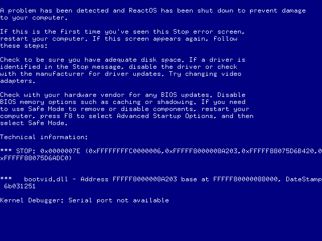
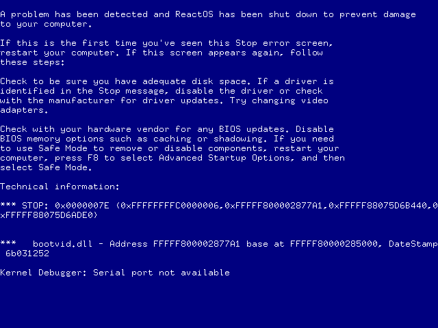
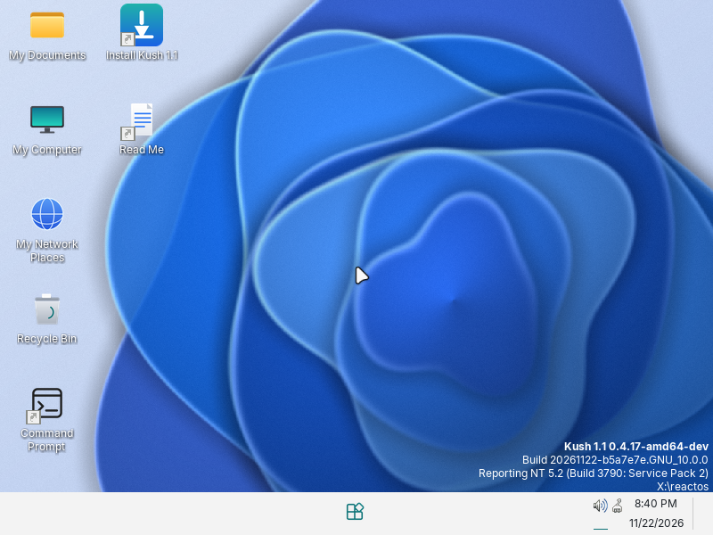
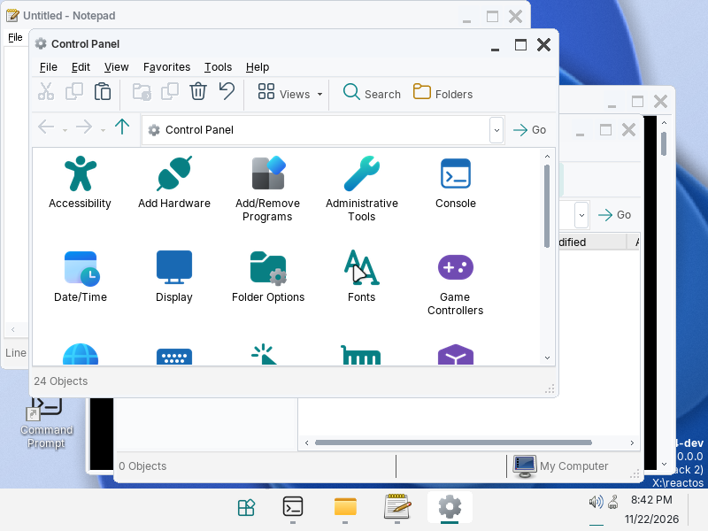
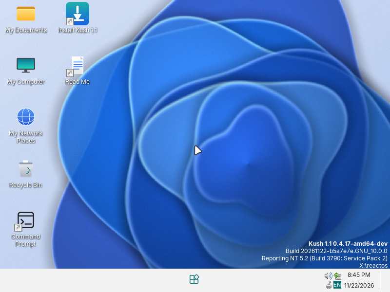

# تصحيح اتجاه صفوف صورة الإقلاع على64بت

22 نوفمبر2026. فحص محدد استجابة لتوقف الإقلاع، وليس تغييرا في التصميم أو ادعاء بتوافق كل العتاد.

## ما وجدناه في last-kushos

جُلب main الحالي من [المصدر الذي حدده المستخدم](https://github.com/eltaieb-eltalib/last-kushos) عند `9740c33171823c9d6507a509679d47df5df6e716`. المقارنة المباشرة لبصمات الملفات المتتبعة وجدت تطابق bootvid وFreeLoader وntoskrnl/mm وamd64 وinbv وkd وHAL والتخزين وVBE/GOP مع نسختنا قبل هذا التصحيح.

[تعديل المصدر السابق](https://github.com/eltaieb-eltalib/last-kushos/commit/f8c5fb25f8a2144196e1458e08b9eae217bfe7bc) يجعل Live Debug الاختيار الافتراضي. هذا التفاف موثق حول توقف bootvid، وليس إصلاحا لسبب الخطأ. أبقينا الاختيار الافتراضي ولم ننسخ إعدادات أو نضف تأخيرا زمنيا.

## السبب المحدد والتعديل

`VidBitBlt` يحسب `Stride` كـLONG، ويجعله سالبا لصور bottom-up. لكن دالة `BitBlt` الداخلية كانت تستقبله كـULONG. علىamd64، إضافة ذلك العدد غير الموقّع إلى المؤشر تجعل الانتقال للصف السابق قفزة موجبة تقارب4GB بدلا من رجوع عدة بايتات. يفشل الوصول إلى بيانات الصورة في الصف التالي.

التصحيح الوحيد في سلوك النظام: نوع وسيط `Stride` في الدالة الداخلية أصبح `LONG`. لا يتغير التصدير أو عقدAPI الخارجي، ولا أبعاد الصور أو ألوانها أو تعريف التخزين. الاتجاه الموجب يبقى كما هو.

ختم الملف في صورة التوقف `6b031252` والإزاحة `0x27A1` يطابقان `lfbbvid.dll` في بناء خريطة الرموز السابق. FreeLoader يحمل هذا الملف عندUEFI ويسجله باسم `bootvid.dll`. التعليمة المطابقة في `BitBlt` تقرأ بايتا من بيانات الصورة. هذا أدق من استنتاج أن اسم الوحدة يعني عطلا في تعريف كرت الشاشة.

## الاختبار المباشر

أضيف `tools/qemu/test_bootvid_stride.py`، يستخرج الدالة الفعلية من المصدر ويبنيها على مضيف64بت مع إخراج بكسلات مراقب ومنطقة ذاكرة محجوزة لحماية اختبار التحكم. لا يمس قرصا أو نظاما مثبتا.

```sh
python3 tools/qemu/test_bootvid_stride.py
```

| الحالة | النتيجة |
|---|---|
| التصحيح، صفوف موجبة | نجاح:1،2،3،4 |
| التصحيح، صفوف سالبة | نجاح:3،4،1،2 |
| التوقيع القديم، صفوف موجبة | نجاح:1،2،3،4 |
| التوقيع القديم، صفوف سالبة | انهيار متوقعSIGSEGV في عملية اختبار منفصلة |

[نتائج التشغيل](2026-11-22-bootvid-stride-test.json). الاختبار يتطلب مضيفPOSIX64بت ومترجمC، ولا يختبر كل تنسيقاتBitmap أو النظام32بت.

## مقارنة الإقلاع الفعلية

بقيت صورة CharacterMap1 القديمة دون تعديل. قبل التصحيح، اختيار Live Environment العادي تحتSeaBIOS أعادSTOP7E/C0000006 في قراءة بياناتBitBlt. تحتUEFI/OVMF أعاد نفس الاستثناء وختم `6b031252` والإزاحة `0x27A1` الظاهرين في بلاغ العطل. التجربةUEFI كانت بدون منفذ تسلسلي افتراضي.





بعد التصحيح، وصلت صورةISO الجديدة إلى سطح المكتب من Live العادي تحتSeaBIOS، ومن Live العادي وLive Debug تحتUEFI. فيUEFI دون منفذ تسلسلي، فتحتExplorer وcmd وNotepad وControl Panel. لا تعديل لإعداداتBIOS أو قرص المستخدم ولا تثبيت في هذه الدفعة.





## فحص USB افتراضي مع عزل التغيير

استُخدمت نسخة من صورة GPT/FAT32 التشخيصية السابقة، بنفس محتويات CharacterMap1، واستُبدل bootvid.dll وlfbbvid.dll فقط بالملفين المصححين. أقلعت كجهازUSB عبر xHCI تحتUEFI/OVMF، دون منفذ تسلسلي، ومع اختيار Live العادي الظاهر في لقطة القائمة. وصلت إلى سطح المكتب. هذا يفصل اختبار التصحيح عن تغييرات التطبيقات الأحدث فيISO الحالية، لكنه ليس اختبارRufus ولا فلاشة حقيقية.



محاولة أولى اختارتSetup Debug بالخطأ وأظهرت7B. لم تُحسب كاختبارLive، ولم يُغيّر قرص أو يُستكمل تثبيت. أُعيد الاختبار بعد فحص لقطة القائمة والتأكد من اختيارLive العادي. لا ادعاء بإصلاحSetup.

## البناء والحدود

نجح بناءbootvid وlfbbvid وbootcd. ظهرت تحذيراتISO-9660 والملفات الاختيارية المفقودة المعتادة. حُفظتISO الجديدة بنسخة خاصة قبل تشغيلها وأعيد تنزيلها ومطابقةSHA256:

`74aaadab7dc4842f933152d668feb72b278f1a835b7b1e6e3b8fba386e0bb766`

الحجم407896064بايت. تعديلDate/Time التجريبي استُبعد من مصدر البناء لهذه الصورة، وبقي محفوظا منفصلا ولم يُنشر.

نجاح المحاكاة لا يثبت حل جهازAcer أوLenovo فعليا. لم تُجرّب الصورة المصححة عليهما بعد، ولم يُختبرSetup أو تثبيت قرص أو كل أحجام الذاكرة. لم نغير الاختيار الافتراضي منLive Debug، ولم نصلح جميع أعطالالإقلاع. يمكن الرجوع عن هذا الالتزام وحده دون التراجع عن تصميمFluent.

مرجع أنواعWindows المقروء: [LONG عدد32بت بإشارة وULONG عدد32بت دون إشارة](https://learn.microsoft.com/en-us/windows/win32/winprog/windows-data-types).
