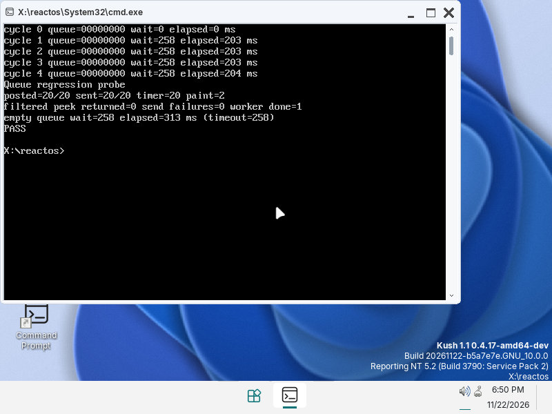
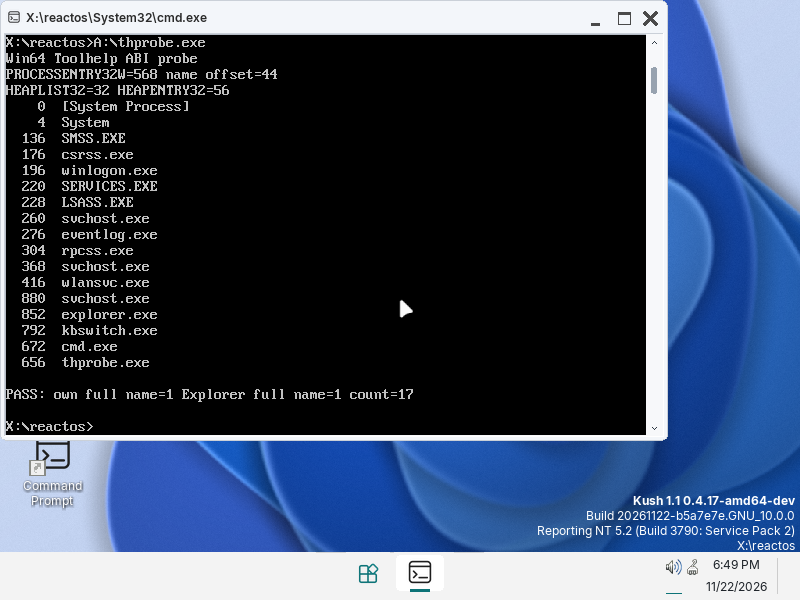
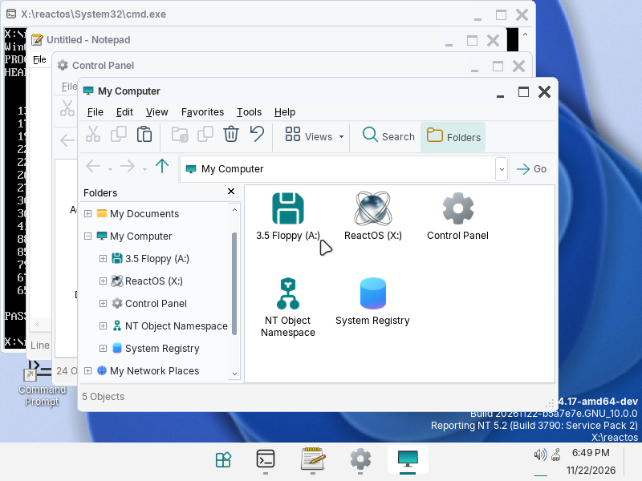

# مزامنة إشارات طابور الرسائل في win32k

22 نوفمبر 2026. استيراد محدود مستقل عن تعديل Toolhelp ودفعات Fluent.

## المصدر والمراجعة

نقل `win32ss/user/ntuser/message.c` كما هو من main في [last-kushos](https://github.com/eltaieb-eltalib/last-kushos) عند `9740c33171823c9d6507a509679d47df5df6e716`. أصل التعديل `cd86c351edca6bb2b2d0db9a8f83c5e8efc8ee1f`.

يضيف `IntResyncQueueWakeBits` لمسح إشارات وعدادات لا تسندها رسالة فعلية، بعد فشل PeekMessage غير المفلتر في إيجاد رسالة. راجعت موضع الاستدعاء: يأتي بعد معالجة الرسائل المرسلة والمنشورة وأحداث العتاد والرسم والمؤقت. لا يستدعى عند فلترة نافذة أو مجال رسائل أو عند قناع لا يشمل QS_ALLINPUT. يحتفظ بفحص قائمة رسائل العتاد وحركة الفأرة المعلقة قبل مسح إشاراتها.

المصدر يصف تعليق Firefox بسبب إشارات عالقة. هذا وصف المصدر، وليس نتيجة أثبتها اختبار Firefox في هذه الدفعة.

## الاختبار الفعلي وحدوده

مصدر الاختبار `tools/qemu/queueprobe.c` ينشئ نافذة ثم يتحقق من20رسالة منشورة و20رسالة مرسلة بين خيطين و20حدث مؤقت على الأقل ورسم واحد على الأقل. يتأكد أن PeekMessage بمجال مختلف لا يعيد رسالة، ثم يغلق النافذة ويفرغ الطابور ويكرر الانتظار خمس مرات.

نجح الاختبار المعدل نفسه قبل الإصلاح وبعده:20/20رسائل منشورة و20/20مرسلة و20مؤقتا ومرتا رسم، دون فشل SendMessageTimeout. أول انتظار عاد فوراً بقيمة0 رغم أن GetQueueStatus أظهر0، ثم الانتظارات الأربعة التالية انتهت بمهلة258 خلال203إلى204مللي ثانية. لم يحدد هذا الفحص سبب الاستيقاظ الأول.

الاختبار الأول الأقصر كان يتوقع انتهاء أول انتظار بالمهلة وفشل على النسختين. لم نعتبر ذلك فشلا جديدا في التصحيح، ولم نخف النتيجة. توسيع القياس أظهر أن الاستيقاظ الفوري ليس حلقة مستمرة في هذا السيناريو. أسطر cycle هي قياسات كل انتظار، أما elapsed في الملخص أسفلها فيشمل زمن طباعة الأسطر، فلا يستخدم لقياس الانتظار منفردا.




هذه نتيجة عدم تراجع في النطاق المفحوص، لا إثبات لإعادة إنتاج العطل الأصلي أو إصلاحه. لم نحقن عدادات معطوبة في النواة، ولم نختبر حمل RAWINPUT أو hotkeys أو WM_QUIT أو كل حالات اشتراك الطابور بين الخيوط.

أعيد اختبار Toolhelp المستقل على الصورة الجديدة، ونجح تعداد17عملية بالأسماء الكاملة بما فيها explorer.exe والاختبار نفسه.



فتحت cmd وNotepad وControl Panel وExplorer على إقلاع نظيف، واستخدمت لوحة المفاتيح للتشغيل. الصورة فحص فتح أساسي، وليست اختبار كل وظائف البرامج أو الفأرة.



## البناء والرجوع

نجح `ninja -j4 win32k bootcd`. بقيت تحذيرات ISO-9660 والملفات الاختيارية المفقودة. سجل الفحص النهائي84246بايت، بصفرFirstChance وصفرKUSH-EXC وصفرFatal، مع بقاء رسائل النظام الأخرى.

حفظت صورة ISO خاصة قبل الإقلاع، وأعيد تنزيلها للتحقق. الحجم407896064بايت وSHA256:

`f206d88c1e1deb395ad7c9e48627f617f80158e63f097ff75f83fe6ffe8a19ce`

يمكن الرجوع عن هذا الالتزام وحده لاستعادة message.c السابق، دون المساس بتصحيح Toolhelp أو التصميم. لم يختبر Firefox أوSPSS هنا، ولم تختبر هذه الصورة على الجهاز الحقيقي، ولم يحل هذا العمل تشخيص شاشة التوقف الفعلية.

لبناء الاختبار المستقل:

```sh
x86_64-w64-mingw32-gcc -O2 -Wall -Wextra tools/qemu/queueprobe.c -o qprobe.exe -luser32 -lgdi32
```
