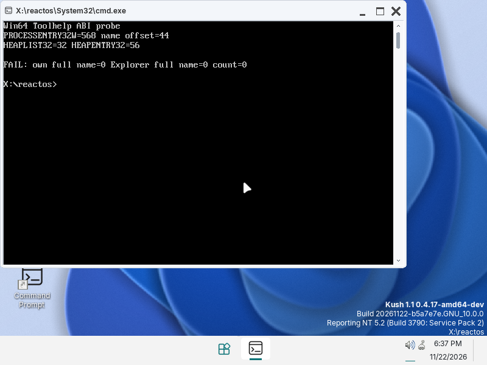
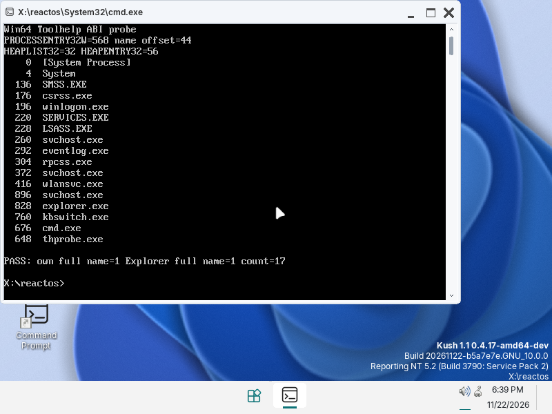
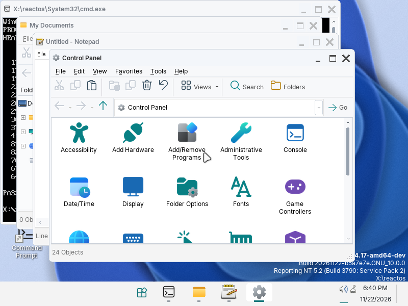
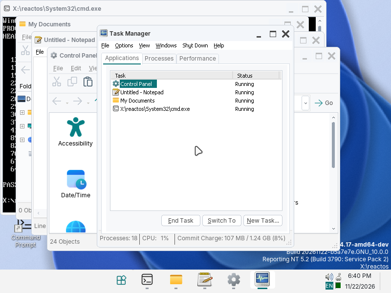

# تصحيح Toolhelp على Win64

22 نوفمبر 2026. استيراد محدد من المصدر الأصلي، وليس إعادة دمج للمستودع أو استبدالا لتصميم Fluent.

## المصدر والمشكلة

فُحص main في [last-kushos](https://github.com/eltaieb-eltalib/last-kushos) عند `9740c33171823c9d6507a509679d47df5df6e716`. التصحيح الأصلي `446205a0f3a30c2106b83b0028252fe366881901` يعدل `sdk/include/psdk/tlhelp32.h` فقط. نُقل محتوى الرأس المصحح كما هو، دون دمج التاريخ القديم أو التعليمات والتجارب الموجودة في README المصدر.

كانت حقول مؤشرات وأحجام في HEAPLIST32 وHEAPENTRY32 وPROCESSENTRY32 معرفة كـDWORD بدلا من SIZE_T وULONG_PTR. على64بت تختلف الأحجام والمحاذاة، فتخالف البنى التي تتوقعها برامج Windows64. هذا تصحيح توافق ABI، وليس تغييرا مرئيا أو إضافة دعم كامل لكل تطبيق.

راجعت أنواع الحقول مقابل وثائق Microsoft المقروءة:

- [HEAPLIST32](https://learn.microsoft.com/en-us/windows/win32/api/tlhelp32/ns-tlhelp32-heaplist32)
- [PROCESSENTRY32W](https://learn.microsoft.com/en-us/windows/win32/api/tlhelp32/ns-tlhelp32-processentry32w)
- [PROCESSENTRY32](https://learn.microsoft.com/en-us/windows/win32/api/tlhelp32/ns-tlhelp32-processentry32)
- [Heap32First وعقد الحجم](https://learn.microsoft.com/en-us/windows/win32/api/tlhelp32/nf-tlhelp32-heap32first)

## الاختبارات

أضيف مصدر اختبار مستقل `tools/qemu/toolhelpprobe.c` يبنى برأس MinGW القياسي الصحيح، لا برأس Kush القديم. يتحقق من sizeof وموضع اسم العملية، ثم يستدعي CreateToolhelp32Snapshot وProcess32FirstW وProcess32NextW ويبحث عن اسمه الكامل وexplorer.exe.

على ISO Registry Editor السابق، ظهر فشل تعداد العمليات وعدد0. هذه نتيجة الاختبار المحدد؛ لم يسجل رمز الخطأ الفرعي لذلك الفشل، فلا تنسب إليه تفاصيل أكثر.



على ISO التصحيح الجديد، عدّد الاختبار17عملية بأسمائها الكاملة، وأثبت وجود thprobe.exe وexplorer.exe وعرضPASS.



اختبار `tools/qemu/toolhelplayout.c` يبني تأكيدات مباشرة على رأس Kush المصحح. اجتاز فحص الترجمة على64بت وعلى32بت دون ربط برنامج32بت أو تشغيله:

| البنية | Win64 | Win32، فحص ترجمة فقط |
|---|---:|---:|
| sizeof PROCESSENTRY32W | 568 | 556 |
| موضع szExeFile | 44 | 36 |
| sizeof HEAPLIST32 | 32 | 16 |
| sizeof HEAPENTRY32 | 56 | 36 |

الأحجام والمواضع على32بت بقيت كما كانت. لم يُبن أو يُشغّل نظام Kush32بت في هذه الدفعة.

فتحت cmd وExplorer وNotepad وControl Panel ثم Task Manager على إقلاع نظيف. ظهرت التطبيقات الأربعةRunning في Task Manager، وهو فحص تشغيل وقائمة تطبيقات فقط، لا اختبار لكل وظائف إدارة العمليات أو إنهائها.





## البناء وحدود النتيجة

نجح بناء kernel32 وtaskmgr وtaskkill وdrwtsn32 وumandlg وwbemprox وbootcd مع إعادة بناء الاعتماديات المتأثرة. ظهرت تحذيرات مترجم في dbghelp.h عن محاذاةMINIDUMP، وفي console.c عن اقتطاعstrncpy، إضافة إلى تحذيرات ISO-9660 والملفات الاختيارية المفقودة. لم تُعدل تلك المواضع، ولم يُدّع فحصا خاليا من التحذيرات.

حُفظ ISO الخاص الجديد قبل تشغيله، وأعيد تنزيله ومطابقة SHA256:

`e8d15a18d4fb76c2f1e8abec9ccf639335977a27516ef3aeca06da709d12c44c`

حجمه407896064بايت. سجل الفحص عند لقطة التطبيقات84617بايت، بصفرFirstChance وصفرKUSH-EXC وصفرFatal System Error. تبقى رسائلfixme/err أخرى.

لم تُختبر Heap32ListFirst أو Heap32First وقت التشغيل، أو كل مستهلكي Toolhelp، أو Firefox وSPSS على هذه الصورة. تغيير الأنواع مطابق للمصدر والمرجع واختبارABI، لكنه لا يثبت دعم كل برنامج أو علاج كل تعليق. لم يُغير تصحيح طابور الرسائل في هذه الدفعة، ولم يُعلن حل شاشة توقف الإقلاع على جهاز حقيقي. يمكن الرجوع عن هذا الالتزام مستقلا عن دفعة Registry Editor أو بقية التصميم.


لبناء الاختبار المستقل برأس MinGW القياسي:

```sh
x86_64-w64-mingw32-gcc -municode -O2 -Wall -Wextra -static-libgcc tools/qemu/toolhelpprobe.c -o thprobe.exe
x86_64-w64-mingw32-gcc -fsyntax-only tools/qemu/toolhelplayout.c
x86_64-w64-mingw32-gcc -m32 -fsyntax-only tools/qemu/toolhelplayout.c
```
