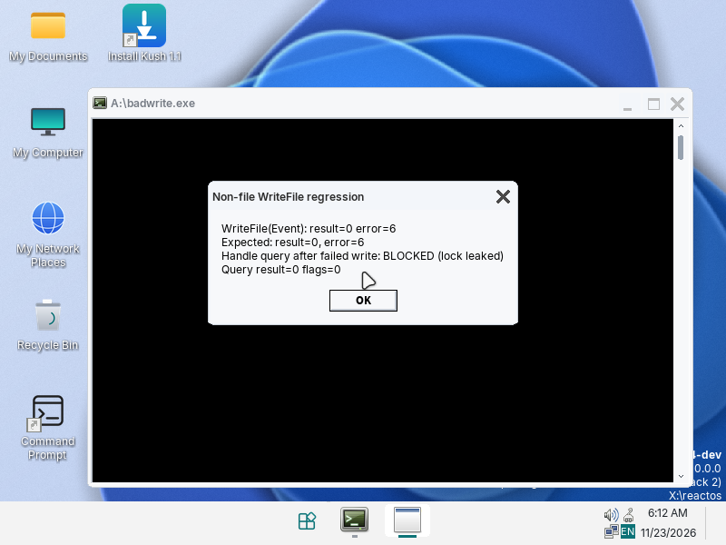
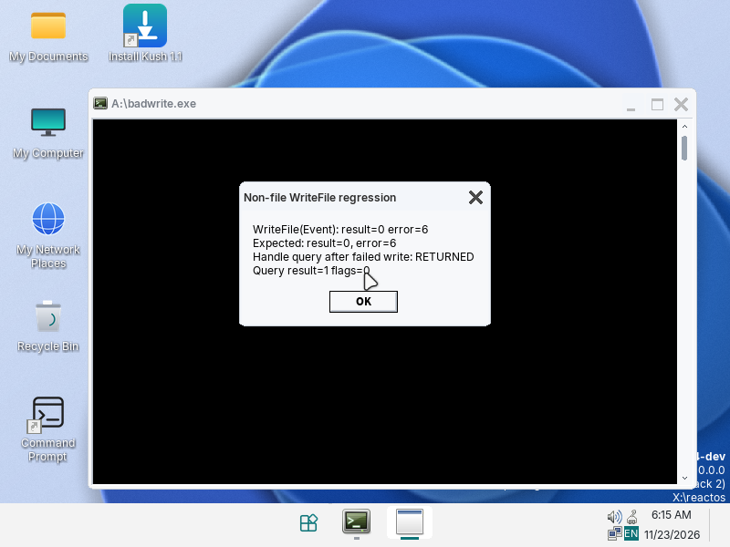
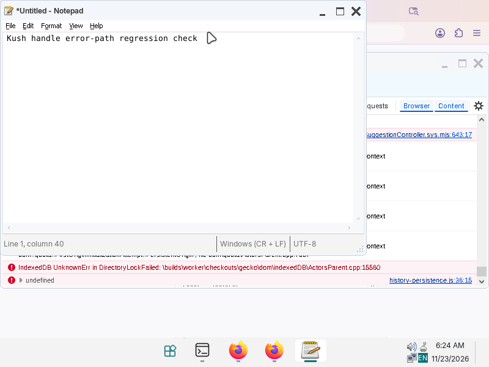
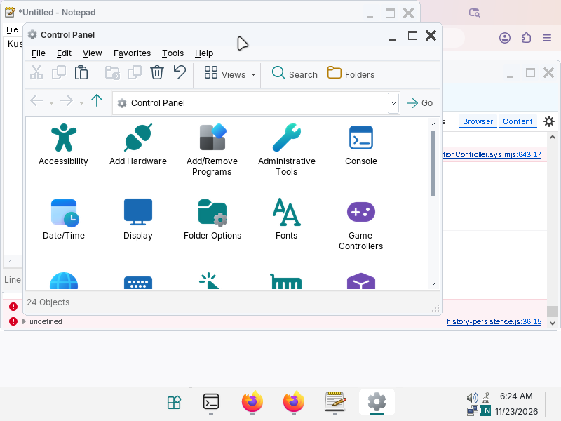

# تحرير قفل المقبض بعد خطأ WriteFile، 23 نوفمبر 2026

## السبب

مسار ObReferenceFileObjectForWrite يأخذ قفل مدخل جدول المقابض ثم يتحقق أن الكائن ملف. إذا كان Event أو Directory، يرجع STATUS_OBJECT_TYPE_MISMATCH من دون تحرير القفل. لذلك يفشل WriteFile كما ينبغي، لكن أي استعلام أو كتابة أو إغلاق لاحق لنفس المقبض قد ينتظر بلا نهاية.

خلال تشخيص Firefox160 الرسمي، أظهر الفحص المباشر خيط الإطلاق داخل GetFileType ثم NtQueryVolumeInformationFile، منتظرا قفل جدول المقبض قبل الوصول إلى استعلام نوع الجهاز. كان المقبض رقم 8 من نوع Event مقفولا. جلسة سابقة احتوت Directory مقفولا. هذه أدلة تحديد السبب، وليست وحدها اختبارا للإصلاح.

## التغيير والاختبار المستقل

أُضيف ExUnlockHandleTableEntry إلى فرع فشل التحقق من النوع فقط في ntoskrnl/ob/obref.c. لم تتغير صلاحيات الوصول أو قيمة الخطأ أو ملفات Firefox أو إعدادات sandbox.

برنامج tools/compat-tests/badwrite.c ينشئ Event ثم يحاول WriteFile عليه، وبعده يستعلم عن المقبض من خيط آخر بحد انتظار 750ms.

| القياس | قبل | بعد |
|---|---|---|
| WriteFile(Event) | فشل، error 6 | نفس الفشل، error 6 |
| GetHandleInformation بعده | لم يرجع خلال 750ms | رجع بنجاح، flags 0 |

بنيت النواة وbootcd، وحُفظت صورة الاختبار في نسخة احتياطية خاصة ثم أُعيد تنزيلها والتحقق من SHA256 قبل الإقلاع. فُتحت Explorer وcmd وNotepad وControl Panel، واستقبل Notepad نصا فعليا. هذا فحص قصير، لا إثبات استقرار طويل أو اختبار عتاد حقيقي.

## حدود النتيجة

في إعادة اختبار Firefox اختفى قفل المقبض المتسرب، واستجاب زر الترحيب ووصلت الواجهة إلى تبويب عادي. لكن كتابة رابط بحث Google والضغط على Enter لم تعرض نتائج، وبقي التبويب فارغا. إذن الخلل المحدد أُصلح، ولا يزال هدف التصفح والبحث غير مكتمل. لا ادعاء بتوافق Firefox أو SPSS الكامل. لم تتغير صورة التسليم المجمدة أو حالة رفع Drive.
