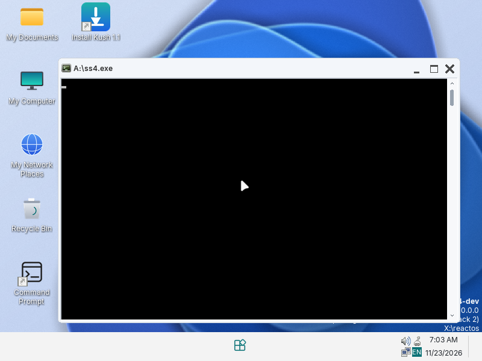
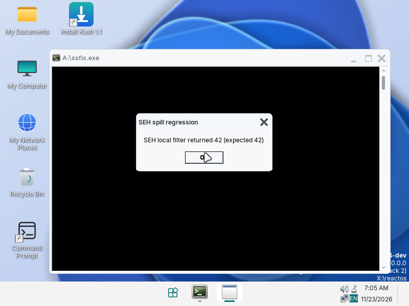
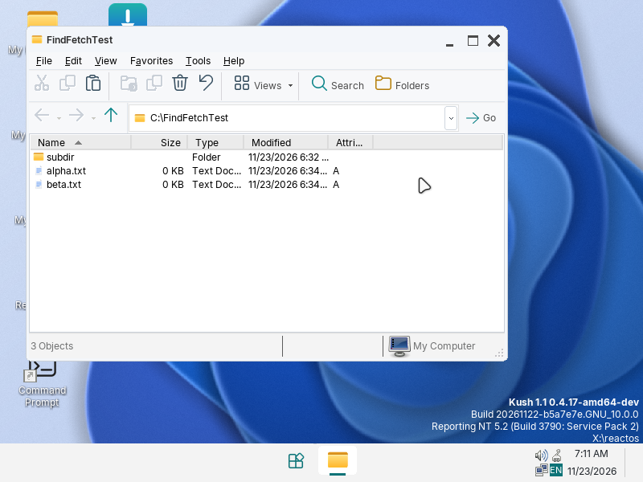

# متغير مرشح الاستثناء في fastfat، 23 نوفمبر 2026

## المشكلة المثبتة

انهيار اختبار Firefox بعد LARGE_FETCH بدأ عند مرشح FatFsdQueryInformation. سجل الاستثناء الأول يحدد الكتابة في fastfat+0x1b0d0، والتعليمة هي تخزين RDI إلى RBP-0x50 قبل دخول trampoline الذي يضبط إطار الدالة. كان RBP وقتها عنوان مستخدم، لا إطار دالة fastfat. ثم فشل RtlVirtualUnwind وانتهت النواة بـ1E. الاستثناء الأصلي الذي كان المرشح يحاول معالجته C0000102. سبب ذلك الاستثناء الأصلي لم يُحسم.

اختبار مستقل صغير، خارج Firefox، ولّد نفس نمط التخزين المبكر. تشغيله على الصورة السابقة أعطى أول AV عند 0x140001661، نفس تعليمة التخزين المبكر، ثم تكررت الاستثناءات وانتهى النظام بـ1E. الصورة الأولى تبين نافذة الاختبار قبل توقف النظام، وليست شاشة نجاح أو شاشة زرقاء.

## التصحيح المحدود

جعل IrpContext متغير مؤشر volatile داخل FatFsdQueryInformation وFatFsdSetInformation. هذا يبقي القيمة المشتركة بين try والمرشح في الذاكرة. فحص تعليمات البناء أكد زوال التخزين قبل trampoline في المرشحين. لا تعديل عام لـPSEH ولا ادعاء علاج كل أخطائه، ولا تعديل لملفات Firefox أو إعدادات sandbox.

## الاختبارات والحدود

- نفس الاختبار المصغر، مع تعريف FIXED_LOCAL فقط، وصل إلى المعالج وأرجع42 كما هو متوقع. هذا يثبت نمط الخطأ وطريقة تجنبه في الاختبار، وليس حقن استثناء داخل fastfat الفعلي.
- بُني fastfat وISO. نسخة ISO خاصة حُفظت وأعيد تنزيلها وطابقت بصمتها قبل التشغيل: `a11c162210f7315a80e9a142fe9771d56ab349ac27dab0fd18fc8e2dc190cb78`.
- على البناء الجديد: كتب Notepad النص، وفتح Control Panel وExplorer الذي عدّد ملفات المجلد، ونفذ cmd أمر echo. فحص السجل بعد الجولة لم يجد استثناءات أو Fatal System Error. هذا فحص محدود، لا يغطي كل عمليات الملفات.
- وصل إدخال رابط Google فعليا إلى شريط Firefox ثم Enter دون الانهيار السابق في هذه الجولة. الصفحة بقيت New Tab فارغة، وبحث `ok` **لم ينجح**. عدم تكرار الانهيار في جولة لا يثبت إزالة سببه بكل الظروف.
- لم يُختبر فرع الاستثناء في Query/Set بحقن مضبوط داخل المشغل، ولا كل أنواع معلومات الملفات، ولا جهاز حقيقي. الخطوة التالية فصل الاستثناء الأصلي C0000102 عن عطل المرشح ومتابعة إطلاق المحتوى.

## إعادة بناء الاختبار المصغر

`tools/compat-tests/pseh-local-spill.c` يحتاج ترويسات PSEH وGCC plugin المبني في المشروع. ترجمة O2 مع `_M_AMD64` وبدون `FIXED_LOCAL` تعيد نمط التخزين قبل trampoline في GCC المستخدم. تعريف `FIXED_LOCAL` يغيّر تخزين المؤشر فقط. النسخة غير المصححة قد توقف النظام كله، فلا تُشغّل على جهاز العمل.

## صور حقيقية

## مصادر راجعتها لتجنب تكرار العمل

- https://github.com/disean/reactos/commit/ff6bd792215d99c614f5619900878d304e2439ed : حفظ سجلات trampoline موجود بالفعل في الشجرة، فلا يُحسب إصلاحا جديدا.
- https://github.com/reactos/reactos/pull/8787 : تعديل آخر يتعلق بعمر رمز الاستثناء والوصول بعد noreturn، وليس إثباتا لإصلاح الخلل الحالي.
- https://reactos.org/wiki/index.php/PSEH : يشرح مخاطر مشاركة المتغيرات بين try والمرشح وvolatile. بعض الشرح لتنفيذ أقدم؛ الاختبار وفحص التعليمات هما دليل هذه الحالة.
