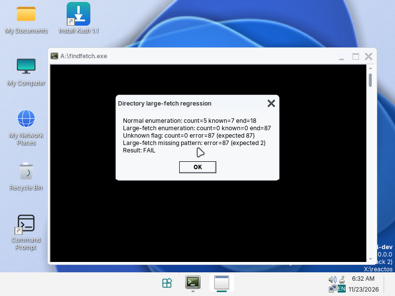
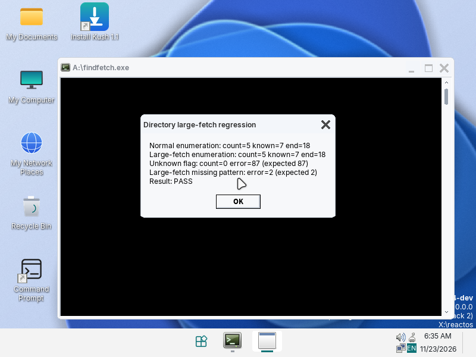
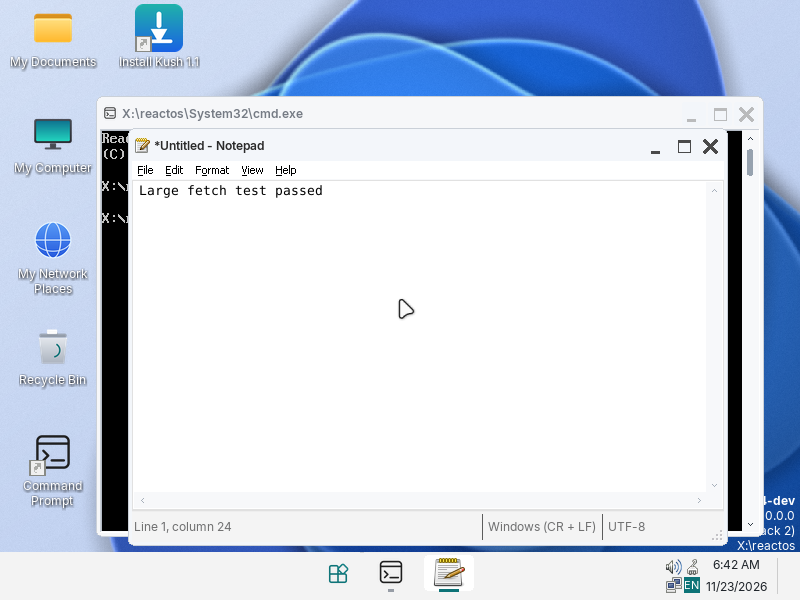
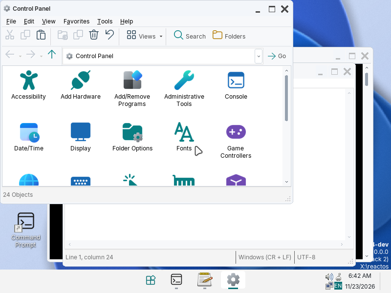
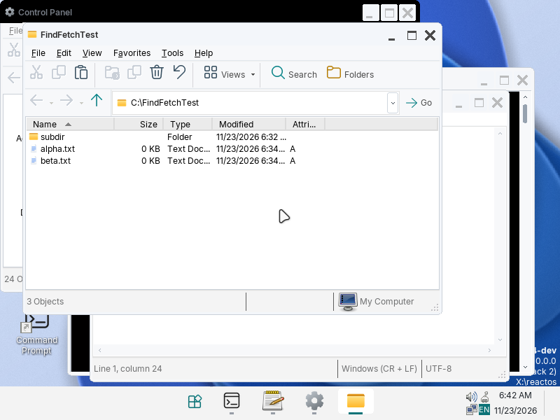

# توافق تعداد المجلدات LARGE_FETCH، 23 نوفمبر 2026

## المشكلة والسبب

Firefox الرسمي يستعمل `FindFirstFileExW` مع `FindExInfoBasic` و`FIND_FIRST_EX_LARGE_FETCH` عند فتح تعداد مجلد. تنفيذ Kush كان يرفض العلم 2 في نسختي A وW بخطأ `ERROR_INVALID_PARAMETER` رقم 87. ظهر خطأ تعداد المجلدات 87 في Browser Console أثناء التشخيص، لكن هذا الربط لا يثبت أن العلم هو سبب كل مشاكل التخزين أو التصفح.

عقد الدالة: https://learn.microsoft.com/en-us/windows/win32/api/fileapi/nf-fileapi-findfirstfileexw

العلم تلميح لحجم مخزن الاستعلام، وليس نوع بحث مختلفا. المسار الحالي يستخدم أصلا مخزنا 16KiB ويجمع النتائج في `FindNextFileW`. التغيير يقبل هذا التلميح في التحقق من الوسائط ويحتفظ بالمسار الموجود. لا ادعاء بتحسين سرعة مقاس، ولا دعم جديد للعلم ON_DISK_ENTRIES_ONLY أو تغيير لصلاحيات الوصول. الملفات المعدلة داخل النظام في `dll/win32/kernel32/client/file/find.c`، وليس Firefox.

## اختبار مستقل قبل وبعد

`tools/compat-tests/findfetch.c` ينشئ ملفين ومجلدا، ثم يقارن تعداد نفس النمط بالعلم 0 وبالعلم 2. يتحقق كذلك من رفض علم مجهول ومن نتيجة نمط لا يطابق شيئا.

| القياس | قبل | بعد |
|---|---|---|
| تعداد عادي W | 5 نتائج، الملفات الثلاثة المعروفة موجودة، النهاية 18 | نفسه |
| تعداد LARGE_FETCH W | فشل 87، دون نتائج | نفس نتائج التعداد العادي، النهاية 18 |
| علم مجهول 0x80000000 | رفض 87 | رفض 87 |
| نمط مفقود مع LARGE_FETCH | خطأ 87 | FILE_NOT_FOUND رقم 2 |

بني kernel32 وbootcd. حُفظ ISO في نسخة احتياطية خاصة وأُعيد تنزيله والتحقق من SHA256 قبل الإقلاع: `8cb73f41d401265f89db8f160c1d22ffc20f177a155c2fcc1e2289a400070e86`.

## الحدود والمتابعة

الاختبار المستقل أعلاه لـW فقط؛ نسخة A تمرر إلىW بعد تحويل الاسم، وتعديل التحقق نفسه موجود فيها، لكن لم تُقاس بعد باختبار مستقل في هذه الجولة. حجم المخزن لم يتغير، ولم يُقَس الأداء أو تعداد الشبكة والملفات الطويلة.

أعيد تشغيل Firefox الرسمي ووصلت الواجهة العادية وظهر حوار اختيار المتصفح الافتراضي. محاولات الانتقال في هذه الجولة لم تنتج نتائج Google، وبعضها وصل إلى نافذة أو حوار غير مقصود بسبب تأخر الواجهة. لذلك لا تُحسب هذه المحاولات نجاح تصفح أو دليلا مستقلا على زوال أخطاء التخزين. في الجولة السابقة حدث انهيار متكرر أثناء فك الاستثناء ثم انهيار نواة، وهو غير مصلح بهذه الدفعة. لا تعديل لملفات المتصفح الرسمية ولا تعطيل sandbox، ولا ادعاء بتوافق Firefox الكامل أو العتاد الحقيقي. صورة التسليم المجمدة ورفع Drive لم يتغيرا.

## فحص البرامج الأساسية

في إقلاع نظيف منفصل عن جلسة Firefox فُتحت cmd وNotepad وControl Panel وExplorer. كتب Notepad النص الفعلي، وعدّد Explorer ملفي الاختبار والمجلد. هذا فحص قصير فقط، وليس إثبات استقرار طويل.

