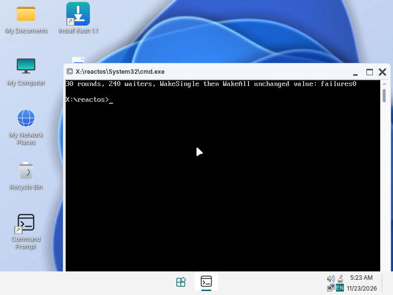
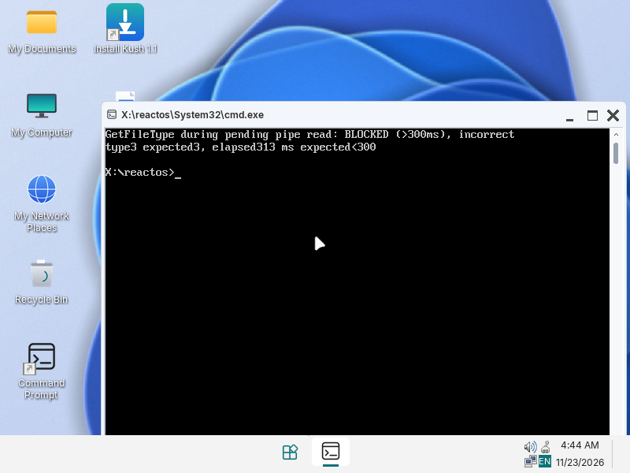
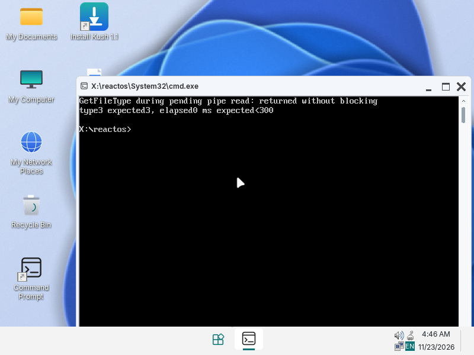
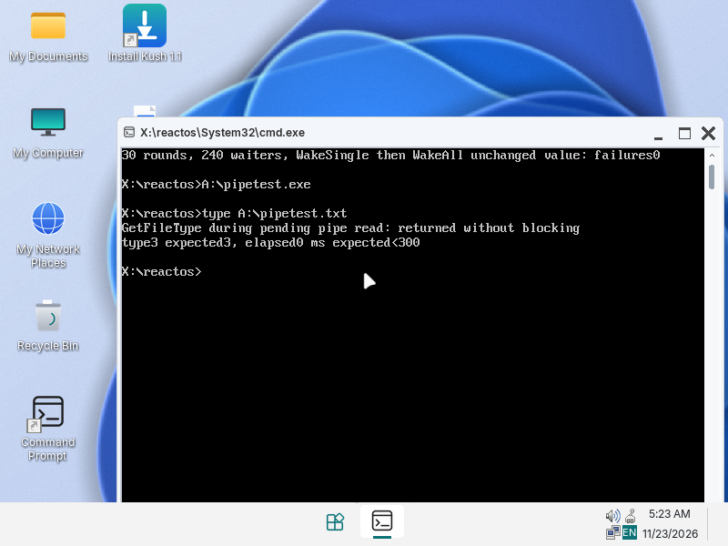
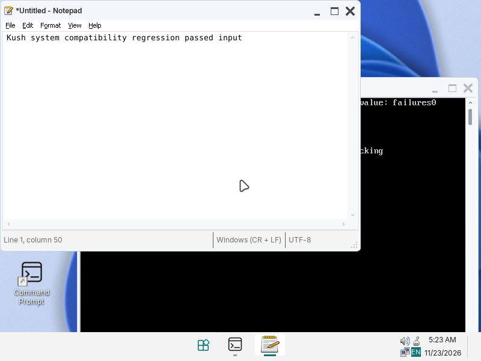
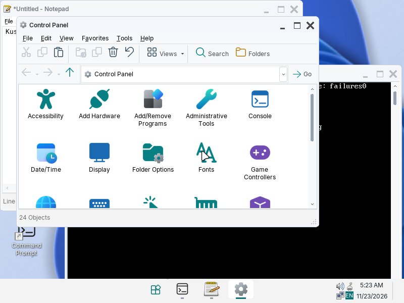

# انتظار العناوين واستعلام نوع الجهاز، 23 نوفمبر2026

هذه دفعة نظام محدودة خرجت من تشخيص Firefox160 الرسمي64بت. لا تعني إصلاح المتصفح: صفحة الترحيب ظهرت لكن لم تستجب، ولم ينجح بحثGoogle عنok. ملفاتFirefox الرسمية لم تتغير، ولم يُعطلsandbox. تصحيح مجلداتAppData ما زال تجربة في إعدادات جلسةLiveCD على قرص الاختبار، وليس ضمن هذه الدفعة.

## WaitOnAddress

التنفيذ السابق كان يكرر مقارنة الذاكرة معSleep، وكانت دالتاWakeByAddressSingle وWakeByAddressAll فارغتين. لم يكن الإيقاظ يصل إذا القيمة بقيت كماهي، والحجم غير المقبول كان يرجع خطأمهلة. التنفيذ الجديد يسجل كل انتظار معحدث مستقل داخلقائمة للعملية، تحتقفل قصير، ويسجل الإيقاظ قبل إزالةالانتظار وإغلاق الحدث. التسجيل ومقارنةالقيمة والإيقاظ تستخدم نفسالقفل لمنع ضياعالإشارة في الفجوة بينها. يرفض الأحجام غير1/2/4/8 بخطأ87.

| الاختبار | قبل | بعد |
|---|---|---|
| حجم3 | فشل بخطأ1460 | فشل بخطأ87 |
| قيمة مختلفة | نجاح0ms | نجاح0ms |
| مهلة100ms | فشل1460 بعد109ms | نفسالنتيجة109ms |
| إيقاظ دون تغييرالقيمة | فشل بعد703ms | نجاح بعد110ms |
| إيقاظواحد ثم الجميع | لم يقس فيالأساس |30جولة،240خيط،صفر فشل |

هذا ليس تنفيذا لاختبار توافقWindows كاملا. تكلفةحدث لكلانتظار والقائمة الخطية قابلة للتحسين. لم يُختبر إنهاءخيطانتظار قسريا. دوالRtlWaitOnAddress فيntdll لمتتغير بهذهالدفعة.

## GetFileType أثناء قراءةpipe

NtQueryVolumeInformationFile كان يأخذ قفل الملف المتزامن قبل المسارالسريع FileFsDeviceInformation، مع أن نوعالجهاز لا يحتاج انتظارReadFile. اختبار مستقل تركقراءةpipe معلقة ثم استعلم نوعه منخيط آخر. قبلالتصحيح لميرجع الاستعلام حتىأرسلت بايتا لفكالقراءة، وبعده رجعFILE_TYPE_PIPE=3 فورا والقراءة مازالت معلقة.

| الاختبار | قبل | بعد |
|---|---|---|
| استعلام أثناءReadFile | محجوب لأكثر300ms، رجع313ms عندفكالقراءة | رجع0ms دونفكالقراءة |

نُقل المسارالسريع قبلقفل الملف، وبقيت بقيةاستعلاماتنظامالملفات علىالقفل الأصلي. لاتغييرلتصاريحالوصول أوبرامجالقراءة.

## إعادةالبناء والفحص

بنيkernel32 والنواة وbootcd. حُذفت رسائلتتبعالإطلاق والاستعلام المؤقتة قبلالبناءالنظيف. اختباراتC المستقلة فيtools/compat-tests، تُترجم بواسطةx86_64-w64-mingw32-gcc وتكتبنتائجها إلىA داخلبيئةالاختبار. ليست جزءا من حزمةالتشغيل. يجب تشغيلها علىقرصاختبار قابلللكتابة.

فتحتExplorer وcmd وNotepad واستقبلNotepad نصا، وفتحتControlPanel. لااختباركلالبرامج أوالعتادالحقيقي. جلسةالتشخيص السابقة التيشغلت محاولتيFirefox انتهت بانهيارأثناءمعالجةاستثناء؛ لمأنسبه لإصلاحأحدهذينالخللين، ولمأعتبرالفحصالقصير إثباتاستقرارطويل.

## مايبقى

Firefox يعلق وهوينتظرعمليةالمحتوى. أظهرالتتبع أنGetFileType علىمقابضconsole يرجعفشلا، وليس نفسpipe الاختبار. لذلك لايجوزتقديمإصلاحpipe كسببنهائي مثبتللتعليق. بقيتشخيصإطلاقالمحتوى ومعالجةالاستثناء، وتصحيحعاملمجلداتLiveCD القابلةللكتابة. لاOpenGL أوVC++ تثبيتعشوائي، ولااستبدالللمتصفح. هذهالدُفعة لا تستبدلISO التسليمbootstride ولا تغيرحالةDrive.
