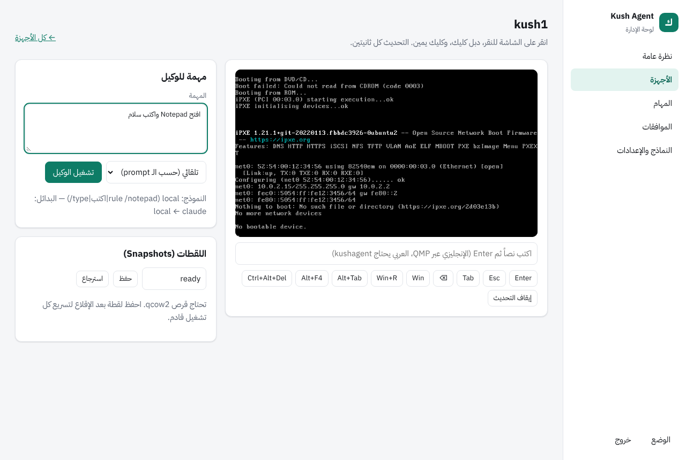
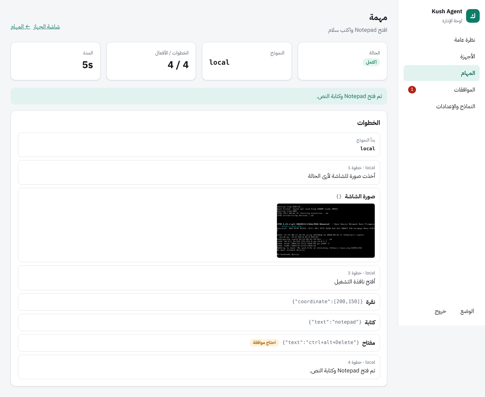

# 12 — لوحة الإدارة

```bash
export KUSH_ADMIN_PASSWORD='كلمة-مرور-قوية'
kush-agent admin --config config/models.yaml --port 8080
# على VPS: يتم ذلك تلقائياً عبر deploy/install.sh كخدمة systemd
```





## الصفحات
| الصفحة | ماذا تفعل |
|---|---|
| **نظرة عامة** | نوع التسريع (KVM/TCG) مع تحذير إن كان برمجياً، عدد الأجهزة والمهام، الموافقات المعلّقة، النماذج وهل مفاتيحها موجودة |
| **الأجهزة** | إنشاء جهاز (من ISO أو من صورة ذهبية qcow2)، تشغيل/إيقاف/حذف |
| **شاشة الجهاز** | الشاشة الحية (تحديث كل ثانيتين)؛ **النقر على الصورة = نقرة في الجهاز** (ودبل كليك وكليك يمين)، كتابة نص، أزرار مفاتيح (Enter، Win+R، Alt+Tab، Ctrl+Alt+Del…)، حفظ/استرجاع لقطات، وصندوق **مهمة للوكيل** يُظهر أي نموذج سيُختار أثناء الكتابة |
| **المهام** | كل التشغيلات وحالتها؛ صفحة المهمة تعرض كل خطوة ونص النموذج وكل فعل وصور الشاشة، وزر إيقاف |
| **الموافقات** | الأفعال الحساسة التي تنتظر قرارك (موافقة/رفض)، وعدّاد في القائمة؛ تُرفض تلقائياً بعد 10 دقائق |
| **النماذج والإعدادات** | جدول النماذج، تجربة الموجّه على أي prompt، وتحرير `models.yaml` مع تحقق قبل الحفظ |

الواجهة عربية (RTL)، وضع ليلي/نهاري، وتعمل على الجوال.

## الأمان
- تسجيل الدخول بكلمة المرور ← كوكي موقّعة HMAC، `HttpOnly`، `SameSite=Strict`، صالحة 12 ساعة (`Secure` مع `--secure-cookie`).
- كل طلب يغيّر شيئاً يحتاج ترويسة `X-Kush: 1` (حماية CSRF)، وتأخير متزايد بعد كل كلمة مرور خاطئة.
- ترويسات: CSP صارمة، `X-Frame-Options: DENY`، `nosniff`، `no-store`.
- ملفات ISO/qcow2 تُختار فقط من مجلد `images` (لا مسارات عشوائية)، وأسماء الأجهزة واللقطات محصورة بنمط آمن.
- المفاتيح لا تُعرض ولا تُحرَّر من اللوحة؛ تُقرأ من متغيرات البيئة.
- مهمة واحدة لكل جهاز في نفس الوقت. أفعال اللوحة والوكيل على نفس الجهاز تمر بقفل واحد في QMP.

## الـ API (للواجهة)
`POST /api/login` · `GET /api/overview` · `GET|POST /api/vms` · `POST /api/vms/{n}/start|stop|delete|snapshot|actions` ·
`GET /api/vms/{n}/screenshot` · `GET /api/images` · `GET /api/models` · `GET /api/route?prompt=` · `GET|PUT /api/config` ·
`GET|POST /api/runs` · `GET /api/runs/{id}` · `GET /api/runs/{id}/shot-NNNN.png` · `POST /api/runs/{id}/stop` ·
`GET /api/approvals` · `POST /api/approvals/{id}`

## ما سيأتي
بث فيديو حي (noVNC/WebRTC) بدل الصور المتتالية، تعدد المستخدمين والصلاحيات، رفع ISO من المتصفح، استهلاك التوكن والتكلفة لكل مهمة.
